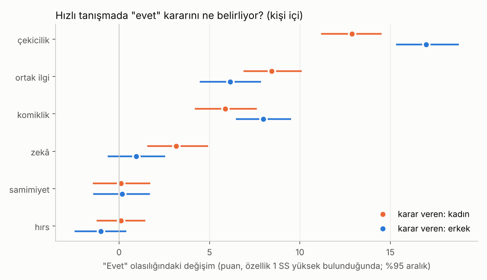

# Çekicilik ve Sohbet · Sürüm 1: Literatür ve Hızlı Tanışma Analizi

> **Sürüm:** 1 · **Tarih:** 2026-10-19 · **Durum:** güncel
>
> **Acelen varsa:** en alttaki [En basit özet](#en-basit-özet) bölümüne atla.
>
> Bu doküman **tıbbi tavsiye değildir.** İlişki tavsiyesi ya da "taktik" listesi de değildir; araştırmaların ortalama olarak ne bulduğunu anlatır.

**Kanıt seviyeleri:**

| Etiket | Anlamı |
|---|---|
| **A** | Meta-analiz ya da birden çok büyük, bağımsız çalışma |
| **B** | Tek büyük, iyi tasarlanmış çalışma |
| **C** | Küçük çalışma, vaka serisi, ikincil kaynak |
| **V** | Bu çalışmanın kendi gerçek veri analizi |
| **D** | Model ya da varsayım |

---

## Soru ve kapsam

1. Kadınlar ilk tanışmada bir erkekten hoşlanırken **en çok nelere** tepki veriyor? Görünüşün payı ne, sohbetin payı ne?
2. Sohbette **hangi davranışların** beğeniyi artırdığına dair kanıt var?
3. İnsanların **söylediği** tercih ile **gerçek kararı** örtüşüyor mu?
4. "Ortak ilgi alanı" önceden var olan bir benzerlik mi, yoksa sohbette **oluşan bir algı** mı?
5. Bir sesi yanlış çıkarmak (ör. "r"yi "l" gibi söylemek) dinleyicinin algısını nasıl etkiliyor, düzelir mi?

**Benzetme:** İlk tanışma bir dükkânın vitrini ile içerisi gibi. Vitrin (görünüş) insanı kapıdan içeri sokar. İçeride ne olduğu (sohbet) ise ne kadar kalacağını ve tekrar gelip gelmeyeceğini belirler. Bu sürüm ikisinin payını ayrı ayrı ölçüyor.

**Kapsam dışı:** Manipülasyon teknikleri; 18 yaş altı katılımcılarla deney; belirli bir kişiye yönelik tavsiye. Eşcinsel çiftler bu verilerde ayrı incelenmedi.

## Yöntem

**1. Literatür.** Sohbet davranışları, ilk izlenim, söylenen ve gerçek tercih, konuşma sesi hataları. Bulgular yayın özetlerinden, yazarların ya da üniversitelerin duyurularından kontrol edildi. Yalnız başka bir yazarın aktarımıyla doğrulanabilenler `[ikincil]` diye işaretlendi. **Yapay zekâ ile üretilmiş örnek kanıt olarak kabul edilmedi ve rapora konmadı;** örnek cümleler yalnız çalışmaların kendi aktardıklarıdır (ör. McFarland ve ark. 2013'teki "Bu harika", "Bu zor olmalı").

**2. Gerçek veri (V).** Analiz planı ve karar kuralları kod yazılmadan önce commit edildi; kod da çalıştırılmadan önce ayrıca commit edildi.

| Veri | Rol |
|---|---|
| **D1: Hızlı tanışma deneyi** (Fisman ve Iyengar, Columbia Üniversitesi; DataHub kopyası) | Her 4 dakikalık buluşmadan sonra katılımcı karşısındakini 6 özellikte puanlıyor (1-10) ve "evet/hayır" diyor. Yaş-farkı araştırmasıyla aynı dosya ve aynı SHA-256 |
| **D2: 45 ülke açık verisi** (Walter ve ark. 2020) | İdeal partnerde 5 özelliğin önemi (1-7). `sex = 0` kadın |

**Kişi içi model (D1):** Her değişkenden karar verenin kendi ortalaması çıkarılır. Böylece seçici biri ile seçici olmayan biri karıştırılmaz; soru "aynı kişi, hangi partnere daha çok evet dedi?" olur. Yordayıcılar o cinsiyetteki kişi içi standart sapmaya bölünür. Doğrusal olasılık modeli. Katsayı × 100, o özellik 1 standart sapma yüksek bulunduğunda "evet" olasılığının kaç puan arttığını gösterir. %95 aralık için kişiler üzerinden 2000 bootstrap (tohum 20261019).

| Kod | Analiz |
|---|---|
| A1 | Kadınların kararı: 6 yordayıcı (çekicilik, samimiyet, zekâ, komiklik, hırs, ortak ilgi) |
| A2 | Erkeklerin kararı: aynı model; her özellik için fark (erkek − kadın) |
| A3 | **Söylenen ve gerçek tercih (kadınlar):** A1'e 3 etkileşim: karşısındakinin çekicilik, komiklik ve zekâ puanı × karar verenin etkinlikten önce o özelliğe verdiği önem. Önem puanı dalga içinde standartlaştırıldı, çünkü bazı dalgalarda ölçek farklı |
| A4 | **Kâğıt üzerindeki benzerlik ve algılanan ortak ilgi (kadınlar):** İki ayrı tek yordayıcılı model, aynı satırlarda: hobi listelerinin nesnel korelasyonu ve algılanan ortak ilgi |
| A5, A6 | **D2:** Her ülkede kadınların (A5) ve erkeklerin (A6) 5 özelliğe verdiği ortalama önem; hangi özellik kaç ülkede birinci; Türkiye |

**Karar kuralları (K1-K6) ve teknik testler (T1-T5)** ön kayıtta yazıldığı gibi uygulandı; ayrıntıları [ön kayıt commit'inde](https://github.com/cruciblelab/arastirma/commit/54ed807) bulunuyor. Sonuçları [Bulgular › Testler ve kararlar](#7-testler-ve-kararlar) bölümünde.

**Şeffaflık notu:** Plan yazılmadan önce, bir sohbet sırasında A1'in kaba bir sürümü ve A5 görüldü. Bu yüzden **K1, K6 ve T5 kör değildir**. **A2, A3, A4, A6 ve K2-K5 görülmeden** önceden kaydedildi.

**Komut:** `cd analiz && python calistir.py` (~2 saniye). Veriler kaynağından indirilir, SHA-256 doğrulanır; repoya kopyalanmaz.

### Plandan sapmalar

| Sapma | Gerekçe |
|---|---|
| **T2 kaldı; sonradan T2b eklendi** | T2'nin ölçütü (kadın 269, erkek 274 kişi) yaş-farkı sürüm 1'den alınmıştı. Ama orada kişiler yalnız yaşı ve kararı dolu satırlarda sayılmış. Bütün dosyada sayı 273 ve 276. Kişi kimliği iki çalışmada aynı kuruluyor (ayrıca kontrol edildi). T2 ölçütü değiştirilmedi ve "KALDI" olarak kayıtlı. Aynı alt kümede sayan T2b sonradan eklendi ve geçti |
| **K6: 30 değil 31 ülke** | Ön kayıttan önceki keşifte iyi kalplilik 30 ülkede birinci görünmüştü. Fark tek bir eşitlikten geliyor: Estonya'da iyi kalplilik ve zekâ eşit; bu kodda eşitlik iyi kalpliliğe yazılıyor. Karar değişmiyor |

## Bulgular

### 1. Literatür: sohbette ne işe yarıyor?

| Davranış | Bulgu | Çalışma | Kanıt |
|---|---|---|---|
| **Soru sormak, özellikle takip sorusu** | 600'den fazla çevrimiçi sohbet ve 110 kişilik bir hızlı tanışmada daha çok soru soranlar daha çok sevildi. En etkilisi takip sorusuydu; daha çok takip sorusu soranlar ikinci buluşmaya daha sık "evet" aldı | Huang ve ark. 2017 | B |
| **Konuşmayı karşı tarafın üzerine kurmak** | Yaklaşık 1.000 hızlı tanışma kaydı incelendi. Konuşma daha çok kadın hakkında olduğunda iki taraf da "tık" hissetti | McFarland, Jurafsky ve Rawlings 2013 | B |
| **Takdir ve anlayış göstermek** | Kadınlar, takdir ("Bu harika", "Helal olsun") ve anlayış ("Bu zor olmalı") gösteren erkeklere bağ hissetti | McFarland ve ark. 2013 | B |
| **Anladığını gösteren araya girme** | Konuyu değiştirmek için değil, cümleyi tamamlamak ya da üstüne eklemek için yapılan araya girme bağ hissini artırdı | McFarland ve ark. 2013 | B |
| **Mizah üretmek** | Zorunlu seçimde kadınlar mizah **üreten** kişiyi, erkekler mizahlarına **gülen** kişiyi seçti. 2015'te bağımsız bir ekip bulguyu tekrarladı | Bressler, Martin ve Balshine 2006; Hone ve ark. 2015 | B |
| **Kendinden emin + iyi niyetli** | 3 çalışma, 348 kişi. Yalnız baskınlık hiçbir çekicilik ölçüsünü artırmadı. Yardımsever erkekler daha çekici bulundu. Çekicilik iki özelliğin birlikteliğine bağlıydı | Jensen-Campbell, Graziano ve West 1995 | B |
| **Aşırı onaylayıcılık (nüans)** | İlk tanışmada çok "anlayışlı" görünen bir yabancıya kadınlar ortalama biraz daha az ilgi duydu; yapmacık ya da seçici olmamak gibi algılanabildi. Uzun ilişkilerde tablo tersine dönüyor | Birnbaum ve Reis 2012 `[ikincil]`; küçük örneklem | C |

**Sohbet dışından iki bağlam bulgusu:**
- **Söylenen ve gerçek tercih:** Etkinlikten önce söylenen ideal tercihler, hızlı tanışmada kime ilgi duyulacağını öngörmedi. Söylenen tercihlerde klasik cinsiyet farkları vardı, ama gerçek ilgide yoktu (Eastwick ve Finkel 2008; 307 kişilik tekrar çalışması da aynı deseni buldu). (B)
- **Beden:** 150 kadının erkek beden fotoğraflarını puanladığı bir çalışmada, bedenin ne kadar güçlü göründüğü çekicilik farkının büyük kısmını açıkladı; boy ve yağsızlık daha az etkiliydi. Örneklem genç ve tek kültürden (Sell, Lukaszewski ve Townsley 2017). Repodaki [algılanan boy ve vücut yapısı](../../algilanan-boy-ve-vucut-yapisi/) araştırması bu konuyu ayrıntılı ele alıyor. (C)

### 2. Gerçek veri: "evet" kararını ne belirliyor? (V)

Kadınlar: 3.457 değerlendirme, 267 kişi. Erkekler: 3.583 değerlendirme, 268 kişi. Tablo: [katsayilar.csv](analiz/ciktilar/katsayilar.csv), [farklar_erkek_eksi_kadin.csv](analiz/ciktilar/farklar_erkek_eksi_kadin.csv).

| Özellik (karşısındakinin puanı) | Kadın karar verirken | Erkek karar verirken | Fark (erkek − kadın) |
|---|---|---|---|
| Çekicilik | **+12.9** [11.2, 14.5] | **+17.0** [15.3, 18.8] | **+4.1** [1.7, 6.5] |
| Ortak ilgi | **+8.4** [6.9, 10.1] | **+6.2** [4.5, 7.8] | −2.3 [−4.7, 0.0] |
| Komiklik | **+5.9** [4.2, 7.6] | **+8.0** [6.5, 9.5] | +2.1 [−0.3, 4.4] |
| Zekâ | **+3.2** [1.6, 4.9] | +1.0 [−0.6, 2.6] | −2.2 [−4.6, 0.1] |
| Samimiyet | +0.1 [−1.5, 1.7] | +0.2 [−1.4, 1.7] | +0.1 [−2.1, 2.2] |
| Hırs | +0.1 [−1.2, 1.5] | −1.0 [−2.5, 0.4] | −1.1 [−3.1, 0.9] |

Puan: o özellik 1 standart sapma yüksek bulunduğunda "evet" olasılığındaki artış. Diğer 5 özellik sabit tutuldu. Köşeli parantez: %95 aralık.

**Okuması:**
- İki cinsiyette de görünüş en büyük etken. Erkeklerde ~4 puan daha büyük; Fisman ve ark. 2006 ile aynı yönde.
- Kadınlarda ikinci sırada **ortak ilgi** var, sonra **komiklik**, sonra **zekâ**. Üçü de sohbette ortaya çıkan özellikler.
- 4 dakikalık bir tanışmada samimiyet ve hırs, diğerleri sabitken ek bir fark yaratmıyor. Bu, bu özelliklerin önemsiz olduğu anlamına gelmiyor; 4 dakikada ölçülmeleri zor olabilir.
- Komiklik ve zekâ için cinsiyet farkının yönü literatürle uyumlu görünse de aralıklar 0'ı içeriyor. Yani belirgin fark yok.

### 3. Söylenen ve gerçek tercih (V)

Kadınlar etkinlikten önce her özelliğe ne kadar önem verdiklerini söyledi. Bu söylenen önem, gerçek kararlarındaki ağırlığı değiştirdi mi? 3.407 değerlendirme, 263 kişi. Tablo: [soylenen_ve_gercek.csv](analiz/ciktilar/soylenen_ve_gercek.csv).

| Etkileşim | Ek etki (puan) | Karar |
|---|---|---|
| Çekicilik × söylenen önem | −0.6 [−2.2, 1.1] | öngörmüyor |
| Komiklik × söylenen önem | −0.0 [−1.7, 1.6] | öngörmüyor |
| Zekâ × söylenen önem | **+2.1** [0.6, 3.5] | öngörüyor |

"Görünüş benim için çok önemli" diyen kadınlar, gerçekte görünüşe "o kadar önemli değil" diyenlerden daha fazla ağırlık vermedi. Komiklik için de aynı. Zekâ ise istisna: Zekâya önem verdiğini söyleyenler gerçekten de zekâya daha çok tepki verdi. Genel karar: Söylenen ve gerçek tercih çoğunlukla örtüşmüyor (Eastwick ve Finkel 2008 ile uyumlu).

### 4. Ortak ilgi: önceden var mı, sohbette mi oluşuyor? (V)

İki ölçü karşılaştırıldı (kadınlar; 3.392 değerlendirme, 263 kişi):
- **Nesnel benzerlik:** İki kişinin etkinlikten önce doldurduğu 17 hobinin (spor, müzik, sinema vb.) korelasyonu.
- **Algılanan ortak ilgi:** Buluşmadan sonra "ortak ilgimiz var" puanı.

| Ölçü | "Evet" olasılığındaki artış (1 SS) |
|---|---|
| Nesnel hobi benzerliği | +0.6 [−0.9, 2.1] |
| Algılanan ortak ilgi | **+18.8** [17.1, 20.6] |
| Fark | **+18.2** [16.0, 20.4] |

Kâğıt üzerindeki hobi benzerliği "evet" kararını neredeyse hiç etkilemiyor. Etkili olan, sohbet sırasında **ortak noktamız var** hissinin oluşması. Bu algıyı görünüş ve genel beğeni de besleyebilir; yani "hoşlandığım kişiyle ortak noktam varmış gibi gelir" de mümkün. Yine de sonuç pratik açıdan net: Ortak nokta önceden olması gereken bir şey değil; sohbette bulunan ve gösterilen bir şey.

### 5. 45 ülke: uzun vadeli partnerde ne isteniyor? (V)

Tablo: [ulkeler_kadin.csv](analiz/ciktilar/ulkeler_kadin.csv), [ulkeler_erkek.csv](analiz/ciktilar/ulkeler_erkek.csv).

| Kaç ülkede birinci | Kadınlar | Erkekler |
|---|---|---|
| İyi kalplilik | **31** | **25** |
| Sağlık | 10 | 12 |
| Zekâ | 4 | 7 |
| Fiziksel çekicilik | 0 | 1 |

- Kadınlarda iyi kalplilik **45 ülkenin 45'inde** fiziksel çekicilikten daha önemli bulunmuş.
- **Türkiye, kadınlar:** zekâ 6.01, sağlık 5.90, iyi kalplilik 5.72, fiziksel çekicilik 5.54, kaynak 5.50. Türkiye, zekânın birinci olduğu 4 ülkeden biri.
- **Türkiye, erkekler:** sağlık 5.84, fiziksel çekicilik 5.81, iyi kalplilik ve zekâ 5.77.

Bu bir **söylenen** tercih ölçüsü. Bölüm 3, söylenen tercihin gerçek kararla her zaman örtüşmediğini gösterdi. Yine de uzun vadeli ilişkinin neye dayandığını anlamak için tek büyük, çok ülkeli kaynak bu.

### 6. Konuşma sesi hataları ("r"yi "l" gibi söylemek)

| Bulgu | Çalışma | Kanıt |
|---|---|---|
| 348 ilkokul öğrencisine, hafif /r/ ya da /s/ hatası olan ve olmayan yaşıtlarının videosu izletildi. Hatası olan yaşıtlarına karşı tutumları belirgin olarak daha olumsuzdu | Crowe Hall 1991 | C |
| Yetişkin dinleyiciler, "s"yi peltek söyleyen erkekleri konuşma becerisi, zekâ, eğitim ve erkeksilikte daha düşük puanladı | Mowrer, Wahl ve Doolan 1978 `[ikincil]` | C |
| Ters yönde bir bulgu: Aynı kadın konuşmacılar peltek konuştuğunda daha iş birlikçi, nazik, arkadaş canlısı ve **sevimli** bulundu | Syrett ve Brorson 2005 `[ikincil]` | C |
| Yetişkinlikte süren /s/ ve /r/ hataları olanların %38.9'u konuşurken kendini güvensiz hissettiğini ve bunun iş ya da sosyal yaşamı etkilediğini söyledi | Veríssimo ve ark. 2012 | C |
| **Düzelir mi?** Kalıcı /r/ hataları için görsel geri bildirimli (ultrason, ses grafiği) terapinin randomize çalışması 9-15 yaş çocuklarda yapıldı. 13, 17, 21 ve 22 yaşında 4 kişilik vaka serisi de yoğun terapiyle ilerleme bildirdi | Preston ve ark. 2020 (protokol); Preston ve Leece 2017 | C |

**Okuması:**
- Kanıt az ve çoğu eski. Doğrudan "r yerine l" diyen gençlerin **çekicilik** algısını ölçen bir çalışma bulunamadı.
- Bulunanlar iki yöne ayrılıyor. Yetkinlik ve zekâ algısında hafif bir dezavantaj olabilir. Sıcaklık ve sevimlilik algısında ise bir avantaj bile olabilir. Psikolojide sıcaklık ve yetkinlik iki ayrı eksen olarak inceleniyor; konuşma hatası ikisini farklı yönlerde etkileyebilir.
- Sohbetteki etkili davranışların (soru, takip sorusu, takdir, mizah) hiçbiri kusursuz sesletim gerektirmiyor.
- Kalıcı ses hataları ergenlikte ve yetişkinlikte de bir **dil ve konuşma terapistiyle** çalışılabiliyor; ama ileri yaşlar için kanıt vaka serisi düzeyinde.
- Ses hatası çocukluktan beri süren sabit bir durum değil de **yeni başlamış** ya da kötüleşen bir konuşma değişikliğiyse, bu bir hekim değerlendirmesi gerektirir. Bu rapor bunun yerine geçmez.

### 7. Testler ve kararlar

**Teknik testler:** 6 testin 5'i geçti. Tablo: [testler.csv](analiz/ciktilar/testler.csv).

| Test | Sonuç |
|---|---|
| T1 Veri bütünlüğü (SHA-256) | GEÇTİ |
| T2 Kişi sayısı (bütün dosya) | **KALDI** (ölçüt hatası; bkz. Plandan sapmalar) |
| T2b Kişi sayısı, aynı alt küme (sonradan eklendi) | GEÇTİ |
| T3 Çekicilik katsayısı iki cinsiyette de pozitif | GEÇTİ |
| T4 Kişi içi merkezleme | GEÇTİ |
| T5 45 ülke, cinsiyet kodu | GEÇTİ |

**Karar kuralları.** Tablo: [kararlar.csv](analiz/ciktilar/kararlar.csv).

| Kural | Karar |
|---|---|
| K1 Kadınlarda en büyük etken çekicilik, komiklik ve ortak ilgi pozitif (kör değil) | **evet** |
| K2 Erkekler görünüşe daha çok ağırlık veriyor | **evet** (+4.1 puan) |
| K3 Kadınlar komikliğe daha çok ağırlık veriyor | **belirgin fark yok** |
| K3b Kadınlar zekâya daha çok ağırlık veriyor | **belirgin fark yok** (sınırda) |
| K4 Söylenen önem gerçek kararı öngörüyor | **2/3 öngörmüyor** → örtüşmüyor (zekâ istisna) |
| K5 Ortak ilgi sohbette algılanıyor | **evet** |
| K6 45 ülkede kadınlar en çok iyi kalpliliği önemsiyor (kör değil) | **evet** (31/45) |

## Sonuçlar

1. İlk tanışmada "evet" kararını en çok görünüş belirliyor: kadınlarda +12.9, erkeklerde +17.0 puan. Erkekler görünüşe ~4 puan daha çok ağırlık veriyor. (V + B)
2. Kadınlarda görünüşten sonra gelen üç etken (ortak ilgi +8.4, komiklik +5.9, zekâ +3.2) sohbette ortaya çıkan özellikler. 4 dakikada samimiyet ve hırs ek bir fark yaratmıyor. (V)
3. Ortak ilgi önceden var olan bir benzerlik değil, sohbette oluşan bir algı: Hobi listelerinin benzerliği kararı neredeyse hiç etkilemezken (+0.6), algılanan ortak ilgi güçlü (+18.8). (V)
4. Soru sormak, özellikle takip sorusu; konuşmayı karşı tarafın üzerine kurmak; takdir ve anlayış göstermek; anladığını gösteren araya girme beğeniyi ve bağ hissini artırıyor. (B)
5. Kadınlar mizah üreten erkeği tercih ediyor. Bu veride komiklik iki cinsiyette de etkili, aralarında belirgin fark yok. (B + V)
6. Yalnız baskınlık çekici değil. Kendinden emin olmak, iyi niyetli olmakla birleşince çekici. İlk tanışmada her şeye onay vermek ise ters tepebilir. (B + C)
7. İnsanların "bana şu önemli" demesi gerçek kararlarını çoğunlukla öngörmüyor. Zekâ istisna: Zekâya önem verdiğini söyleyen kadınlar gerçekten zekâya daha çok tepki veriyor. (V + B)
8. Uzun vadeli partnerde kadınlar 45 ülkenin 31'inde en çok iyi kalpliliği önemsiyor; Türkiye'de zekâ birinci. Fiziksel çekicilik hiçbir ülkede kadınların ilk sırasında değil. (V)
9. Konuşma sesi hataları yetkinlik algısını biraz düşürebilir, sıcaklık ve sevimlilik algısını ise artırabilir. Kanıt az ve eski. Sohbette etkili davranışların hiçbiri kusursuz sesletim gerektirmiyor. Kalıcı ses hatası terapiyle çalışılabilir; yeni başlayan konuşma değişikliği hekim değerlendirmesi gerektirir. (C)

## Sınırlamalar

- **Örneklem:** Hızlı tanışma verisi 2002-2004 yıllarında, ABD'de, çoğu yüksek lisans öğrencisi katılımcılarla toplandı. Türkiye'ye ve 17-20 yaşa genellemek güvenli değil.
- **Puanlar algı ölçüsü:** "Komik" ya da "zeki" puanı buluşmadan sonra verildi. Hoşlanılan biri daha komik ve daha zeki de bulunabilir (hale etkisi). Bu yüzden katsayılar nedensel etki değil, ilişkidir.
- **4 dakika:** Model ilk izlenimi ölçüyor. Uzun ilişkideki ağırlıklar farklı olabilir. 45 ülke verisi bunu kısmen gösteriyor, ama o da söylenen tercih.
- **Kişi kimliği:** Veride kişi numarası yok. Kimlik, kişinin değişmeyen cevaplarından kuruldu; birkaç kişi birleşmiş ya da bölünmüş olabilir.
- **Doğrusal olasılık modeli:** Uç olasılıklarda bükülmeyi yakalamaz; puanlar ortalama etkidir.
- **Kör olmayan kararlar:** K1, K6 ve T5'in sonuçları plandan önce kabaca görülmüştü. T2'nin ölçütü yanlış alt kümeden alınmıştı.
- **Literatür:** Bulguların çoğu yayın özetlerinden ve yazar duyurularından kontrol edildi; tam metinler okunmadı. Birnbaum ve Reis, Mowrer ve ark. ile Syrett ve Brorson ikincil kaynaktan.
- **Ses hataları:** Türkçede "r"yi "l" gibi söyleyen gençlerle yapılmış bir algı çalışması bulunamadı. İngilizce çalışmalar /r/ ve /s/ için.

## Kaynaklar

- [Huang ve ark. 2017: Soru sormak sevilmeyi artırıyor (PDF)](https://gwern.net/doc/psychology/novelty/2017-huang.pdf) · [HBS özeti](https://www.library.hbs.edu/working-knowledge/asking-questions-can-get-you-a-better-job-or-a-second-date)
- [McFarland, Jurafsky ve Rawlings 2013: Making the Connection (PDF)](https://sites.socsci.uci.edu/~lpearl/courses/readings/McFarlandEyAl2013_SocialBonding.pdf) · [Stanford duyurusu](https://ed-old.gse.stanford.edu/news/study-speed-dating-what-makes-couples-click) · [Scientific American](https://www.scientificamerican.com/podcast/episode/speed-dating-study-yields-conversat-13-05-14)
- [Bressler, Martin ve Balshine 2006: Mizah üretmek ve takdir etmek (PDF)](https://abel.mcmaster.ca/publications/pdfs/Bressler%20et%20al..pdf) · [Hone, Hurwitz ve Lieberman 2015: tekrar çalışması](https://doaj.org/article/721d10f1e06846d0a0bd40820fec57af)
- [Jensen-Campbell, Graziano ve West 1995: Baskınlık, iyi niyet ve kadınların tercihi](https://scholar9.com/publication-detail/dominance-prosocial-orientation-and-female-prefe--32353) · [ASU kaydı](https://asu.elsevierpure.com/en/publications/dominance-prosocial-orientation-and-female-preferences-do-nice-gu/fingerprints/)
- Birnbaum ve Reis 2012 `[ikincil]`: [Sex and Psychology özeti](https://www.sexandpsychology.com/blog/2012/05/16/does-it-pay-to-be-a-nice-guy-in-the-long-run-yes-but-in-the) · [Rochester duyurusu](https://www.rochester.edu/newscenter/come-baby-relight-fire/)
- [Eastwick ve Finkel 2008: Söylenen ve gerçek tercih (PDF)](https://faculty.wcas.northwestern.edu/eli-finkel/documents/MatePrefs_FINAL6-5-07.pdf) · [Tekrar çalışması (SAGE Open 2015)](https://doaj.org/article/9acf3deacecc404ea75336ccf703b309)
- [Fisman, Iyengar, Kamenica ve Simonson 2006: Eş seçiminde cinsiyet farkları (Columbia)](https://business.columbia.edu/faculty/research/gender-differences-mate-selection-evidence-speed-dating-experiment) · [IDEAS kaydı](https://ideas.repec.org/a/oup/qjecon/v121y2006i2p673-697..html)
- [Sell, Lukaszewski ve Townsley 2017: Üst beden gücü ve çekicilik (PMC)](https://pmc.ncbi.nlm.nih.gov/articles/PMC5745404) · [Griffith duyurusu](https://news.griffith.edu.au/2017/12/13/upper-body-strength-key-factor-in-mens-bodily-attractiveness/)
- [Crowe Hall 1991: Hafif sesletim hatası olan yaşıtlara tutum (ASHA)](https://pubs.asha.org/doi/abs/10.1044/0161-1461.2201.334)
- [Veríssimo ve ark. 2012: Kalıcı /s/ ve /r/ hataları, konuşanın gözünden](https://www.researchgate.net/publication/51738633_Residual_s_and_r_distortions_The_perspective_of_the_speaker)
- Mowrer ve ark. 1978; Syrett ve Brorson 2005 `[ikincil]`: [BYU tezi, literatür bölümü](https://scholarsarchive.byu.edu/cgi/viewcontent.cgi?article=7397&context=etd) · [Dinleyicilerin konuşma bozukluğu algısı (ScienceDirect)](https://sciencedirect.com/science/article/abs/pii/S0021992407000366?via=ihub%3D)
- [Preston ve ark. 2020: /r/ hataları için biyogeri bildirim RCT protokolü (BMC Pediatrics)](https://doaj.org/article/865b41bcd8804af48e27c1bb0c243730) · [Preston ve Leece 2017: Kalıcı /r/ hataları için yoğun terapi (vaka serisi)](https://pubs.asha.org/doi/10.1044/2017_AJSLP-16-0232)
- Veri: [Walter ve ark. 2020, 45 ülke açık verisi (OSF)](https://osf.io/download/5fmyu/) · [Hızlı tanışma deneyi (DataHub)](https://datahub.io/core/speed-dating)

## En basit özet

- **Vitrin önemli:** İlk tanışmada görünüş en büyük etken. Bunu saklamanın anlamı yok.
- **Ama sonraki üç etken sohbetten geliyor:** ortak nokta bulmak, güldürmek, zekâ göstermek.
- **Ortak nokta önceden olmak zorunda değil:** Hobilerin aynı olması neredeyse hiç fark etmiyor. Fark yaratan, sohbette "ortak noktamız var" hissinin oluşması.
- **En etkili sohbet:** soru sor; cevabı dinleyip takip sorusu sor; konuşmayı onun üzerine kur; "helal olsun", "zor olmalı" gibi takdir ve anlayış göster.
- **Kendinden emin ve iyi niyetli ol, ikisi birlikte:** Yalnız baskınlık işe yaramıyor; her şeye "evet" demek de yaramıyor.
- **İnsanların "bana şu önemli" demesi** gerçek kararlarını çoğu zaman göstermiyor.
- **Uzun vadede** kadınlar dünyanın çoğu ülkesinde en çok iyi kalpliliği istiyor; Türkiye'de zekâ birinci.
- **"r"yi "l" gibi söylemek** yetkinlik algısını biraz düşürebilir ama "sevimli" algısını artırabilir. Etkili sohbet davranışlarının hiçbiri kusursuz telaffuz istemiyor. İstenirse bir konuşma terapistiyle çalışılabilir.
