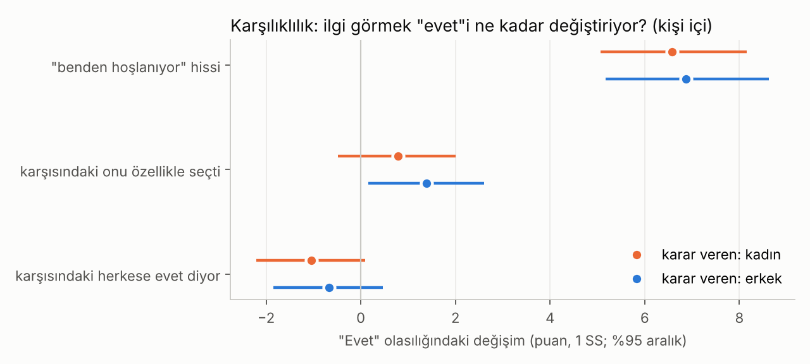

# Çekicilik ve Sohbet · Sürüm 2: Hoşlandığını Göstermek mi, Söylemek mi?

> **Sürüm:** 2 · **Tarih:** 2026-10-23 · **Durum:** güncel
>
> **Acelen varsa:** en alttaki [En basit özet](#en-basit-özet) bölümüne atla.
>
> Bu doküman **tıbbi tavsiye değildir.** İlişki tavsiyesi ya da "taktik" listesi de değildir; araştırmaların ortalama olarak ne bulduğunu anlatır.

**Kanıt seviyeleri:**

| Etiket | Anlamı |
|---|---|
| **A** | Meta-analiz ya da birden çok büyük, bağımsız çalışma |
| **B** | Tek büyük, iyi tasarlanmış çalışma |
| **C** | Küçük çalışma, vaka serisi, ikincil kaynak |
| **V** | Bu çalışmanın kendi gerçek veri analizi |
| **D** | Model, varsayım ya da kanıtların sentezi |

---

## Soru ve kapsam

1. Birinden hoşlandığını **göstermek** mi, açıkça **söylemek** mi daha olumlu sonuçlanıyor?
2. "Karşımdaki benden hoşlanıyor" hissi, insanın kendi ilgisini ne kadar artırıyor?
3. **Seçici ilgi** (yalnız o kişiye) ile **seçici olmayan ilgi** (herkese) aynı karşılığı görüyor mu?
4. İnsanlar karşısındakinin ilgisini ne kadar doğru okuyor?

**Benzetme:** İlgi bir radyo yayını gibi. Göstermek, frekansı kısık bir yayın yapmaktır: Karşındaki duyarsa iyi, ama çoğu zaman cızırtıda kaybolur. Söylemek, sesi açmaktır: Mesaj net ulaşır, ama herkes duyar ve geri alınamaz. Bu sürüm, yayının ne kadar ulaştığını ve ulaşınca ne olduğunu ölçüyor.

**Kapsam dışı:** Manipülasyon teknikleri; 18 yaş altı katılımcılarla deney; belirli bir kişiye yönelik tavsiye.

## Önceki sürümden değişenler

| Konu | Sürüm 1 | Sürüm 2 |
|---|---|---|
| Soru | İlk tanışmada hangi özellikler ve sohbet davranışları beğeniyi artırıyor? | İlgiyi göstermek mi söylemek mi; karşılıklılık; ilginin okunması |
| Veri analizi | 6 özellik, söylenen ve gerçek tercih, nesnel ve algılanan ortak ilgi | Aynı veride yeni ön kayıtlı analizler: algılanan karşılık, karşı tarafın seçici ve seçici olmayan ilgisi, ilgiyi okuma doğruluğu |
| Literatür | Sohbet davranışları, söylenen ve gerçek tercih, konuşma sesi hataları | Karşılıklı hoşlanma, belirsizlik, "zor beğenilen" oynamak, "seni seviyorum"u kimin önce söylediği, flört tarzları ve flörtün algılanması, açılma, pişmanlık, karşılıksız aşk, ergenlik |
| Düzeltme | Yapay zekâ ile yazılmış örnek diyaloglar sürüm 1'den sonradan çıkarılmıştı | Bu sürümde yapay zekâ ile üretilmiş örnek yok |

## Yöntem

**1. Literatür.** Kaynaklar PubMed ve yayıncı sayfalarından tarandı. Sonuçlarda kullanılan kilit bulguların özetleri bu sürüm yazılırken yeniden açıldı (13 PubMed özeti ve Eastwick ve ark. 2007'nin tam metni). Yalnız ikincil kaynakta ya da haber metninde görülebilenler `[ikincil]`, sayısı doğrulanamayanlar `[doğrulanmadı]` diye işaretlendi.

**2. Gerçek veri (V).** Sürüm 1 ile aynı hızlı tanışma verisi (Fisman ve Iyengar, Columbia Üniversitesi; aynı SHA-256). Her 4 dakikalık buluşmadan sonra katılımcı:
- karşısındakini 6 özellikte puanladı;
- karşısındakinin kendisine "evet" deme olasılığını tahmin etti (1-10);
- gizlice "evet" ya da "hayır" dedi.

Karşı tarafın bu kişi hakkındaki gizli kararı da veride var.

**Önemli sınır:** Veride kimse hoşlandığını açıkça **söylemedi.** Bu veri, 4 dakikalık sohbette davranışla gösterilen ve algılanan ilgiyi ölçebiliyor. "Söylemek" sorusu literatürden cevaplanıyor.

**Analiz planı ve kod sırasıyla:** Ön kayıt [0698ca9](https://github.com/cruciblelab/arastirma/commit/0698ca9), kod çalıştırılmadan önce [13d20f5](https://github.com/cruciblelab/arastirma/commit/13d20f5), çıktılar [520c144](https://github.com/cruciblelab/arastirma/commit/520c144).

- **Karşı tarafın kimliği:** Kayıtta bulunan, kişiye özgü sabit özelliklerden kuruldu: dalga, cinsiyet, yaş, köken ve etkinlik öncesi söylediği 6 tercih.
- **Karşı tarafın seçici olmayan ilgisi:** O kişinin bütün buluşmalarındaki "evet" oranı.
- **Karşı tarafın özgün ilgisi:** O kişinin **bu** kişiye kararı, eksi kendi "evet" oranı.
- **Model:** Sürüm 1'deki kişi içi doğrusal olasılık modeli. Katsayı × 100, yordayıcı 1 standart sapma arttığında "evet" olasılığındaki puan değişimini gösterir. %95 aralık: karar verenler üzerinden 2000 bootstrap (tohum 20261023).

| Kod | Analiz |
|---|---|
| B1 | Karar ~ 6 özellik + "benden hoşlanıyor" tahmini |
| B2 | Karar ~ 6 özellik + karşı tarafın özgün ilgisi + seçici olmayan ilgisi |
| B3 | B2'nin 6 özellik olmadan hali (betimsel) |
| B4 | "Benden hoşlanıyor" tahmini ile karşı tarafın gerçek kararı arasındaki kişi içi korelasyon |

**Komut:** `cd analiz && python calistir.py` (~3 saniye).

### Plandan sapmalar

Plandan sapma olmadı.

## Bulgular

### 1. Literatür

| Bulgu | Çalışma | Tasarım, n | Kanıt |
|---|---|---|---|
| **İlgi davranışa yansıyor ve karşılık doğuruyor.** Yakına gelmek ve konuşmaya gitmek gibi **doğrudan** davranışlar, göz teması, gülümseme ve taklit gibi **dolaylı** davranışlara göre çekimle daha güçlü ilişkili. Reddedilme korkusu doğrudan davranışı zayıflatıyor | Montoya, Kershaw ve Prosser 2018 | Meta-analiz | A |
| **Seçici ilgi karşılık görüyor, herkese ilgi ters tepiyor.** Kişiye özgü ilgi: karşı tarafın ilgisiyle r = .14, onun "kimya" hissiyle r = .20. Herkese ilgi: r = −.41 ve r = −.32. Herkese ilgi gösterenler "kime olsa evet der" diye algılanıyor. Sonuç, fiziksel çekicilik kontrol edilince de değişmedi | Eastwick, Finkel, Mochon ve Ariely 2007 | Hızlı tanışma, 156 üniversite öğrencisi, 9-13 kez 4 dakikalık buluşma | B |
| **Belirsizlik bir deneyde çekimi artırdı.** Erkeklerin kendilerinden "çok" mu "ortalama" mı hoşlandığı belirsiz bırakılan kadınlar, o erkekleri en çekici buldu; onları daha çok düşündüler. Ama gerçek bir etkileşim yoktu: Yalnız Facebook profilleri ve yalnız kadınlar | Whitchurch, Wilson ve Gilbert 2011 | Laboratuvar, küçük örneklem | C |
| **"Zor beğenilen" oynamak** karşı tarafın **isteğini** artırıp **hoşlanmasını** azaltıyor. Bu da yalnızca karşı taraf zaten bağlıysa oluyor; bağlı değilse ikisi de düşüyor | Dai, Dong ve Jia 2014 | 2 deney | B |
| Kapsam derlemesi: "Zor beğenilen" taktiği ancak belirsizlik ve zorluk optimal düzeydeyse işe yarıyor; bağlılık, cinsiyet ve bağlanma stiline bağlı | Houle, Barker ve Pronin 2023 | 18 çalışma | B |
| **"Seni seviyorum"u çoğu zaman önce erkekler söylüyor** ve duyunca daha mutlu oluyor. İnsanlar bunun tersini sanıyor. Tepkiler, itirafın cinsellikten önce ya da sonra gelmesine göre değişiyor | Ackerman, Griskevicius ve Li 2011 | 6 çalışma | B |
| Erkeğin önce söylemesi 7 ülkede tekrarlandı (%59-81); Fransa'da fark anlamlı değil `[ikincil]` | Watkins ve ark. 2022 | Kültürlerarası anket; n `[doğrulanmadı]` | B |
| **Flörtü algılamak zor.** Flört varken bunu doğru fark edenler: erkeklerde %36, kadınlarda %18 `[ikincil: üniversite haberi]` | Hall, Xing ve Brooks 2015 | 52 çift ve 261 gözlemci | B |
| **Sistematik yanlış okuma:** Erkekler kadınların cinsel ilgisini abartıyor; kadınlar erkeklerin cinsel ilgisini ve bağlılığını küçümsüyor | Haselton ve Buss 2000 (217 ve 289 kişi); Perilloux, Easton ve Buss 2012 (hızlı tanışma, 199 kişi) | Anket ve hızlı tanışma | B |
| **Sıcak, açık ve geniş beden dili** fotoğraflarda ve hızlı tanışmada seçilme olasılığını artırdı; aracı, baskınlık izlenimi | Vacharkulksemsuk ve ark. 2016 | Hızlı tanışma ve bir flört uygulamasında saha deneyi | B |
| **Birlikte zaman geçirmek çekimi artırıyor;** aracılar karşı tarafın ilgili ve anlayışlı olması, rahatlık ve tanışıklık | Reis ve ark. 2011 | Canlı etkileşim deneyleri | B |
| **Açılmak ve hoşlanmak birbirini besliyor:** Samimi açılan daha çok seviliyor, sevilene daha çok açılınıyor, açıldığımız kişiyi daha çok seviyoruz | Collins ve Miller 1994 | Meta-analiz | A |
| **Pişmanlık:** Yapılanlar kısa vadede, yapılmayanlar uzun vadede daha çok pişmanlık veriyor | Gilovich ve Medvec 1994 | Anket ve deneyler | B |
| **Karşılıksız aşkta iki taraf da zorlanıyor:** Reddeden taraf suçluluk duyuyor ve ne yapacağını bilemiyor `[ikincil]` | Baumeister, Wotman ve Stillwell 1993 | Otobiyografik anlatılar | B |
| **Ergenlik:** Romantik ilişkiye giren gençlerde depresif belirtiler biraz artıyor; kızlarda daha çok | Joyner ve Udry 2000 | Boylamsal, 8.181 genç | B |

### 2. Gerçek veri: karşılıklılık (V)

Kadın karar verenler: 3.415-3.457 değerlendirme, 265-267 kişi. Erkek karar verenler: 3.555-3.583 değerlendirme, 267-268 kişi. Tablo: [katsayilar.csv](analiz/ciktilar/katsayilar.csv).

| "Evet" olasılığındaki değişim (1 SS) | Kadın karar verirken | Erkek karar verirken |
|---|---|---|
| **B1: "Benden hoşlanıyor" hissi** (6 özellik sabitken) | **+6.6** [5.1, 8.2] | **+6.9** [5.2, 8.6] |
| B2: Karşısındaki onu özellikle seçti (6 özellik sabitken) | +0.8 [−0.5, 2.0] | **+1.4** [0.2, 2.6] |
| B2: Karşısındaki herkese evet diyor (6 özellik sabitken) | −1.0 [−2.2, 0.1] | −0.7 [−1.9, 0.5] |
| B3: Karşısındaki onu özellikle seçti (özellikler hesaba katılmadan) | **+3.8** [2.6, 5.1] | **+3.9** [2.5, 5.2] |
| B3: Karşısındaki herkese evet diyor (özellikler hesaba katılmadan) | **−4.3** [−5.7, −3.0] | **−3.9** [−5.4, −2.5] |

**Okuması:**
- **"Benden hoşlanıyor" hissi güçlü:** Etkisi, sürüm 1'deki ortak ilgi ve komiklikle aynı büyüklükte. Ama dikkat: Bu bir ilişki. Kişi biri hoşuna gidince onun da kendisinden hoşlandığını düşünmeye meyilli olabilir (yansıtma). Yani etkinin bir kısmı ters yönde de olabilir.
- **Seçici ve seçici olmayan ilgi:** Özellikler hesaba katılmadan (B3), Eastwick ve ark. 2007'deki desen tekrarlanıyor: Özellikle seçilen daha çok karşılık görüyor, herkese evet diyen daha az. Kişinin karşısındakini nasıl algıladığı (çekici, eğlenceli, ortak ilgili) hesaba katılınca (B2), etki büyük ölçüde kayboluyor. İki olası açıklama:
  1. İlgi, kendini karşı tarafın gözünde "daha çekici, daha eğlenceli" görünmek üzerinden gösteriyor.
  2. Herkese evet diyenler ortalamada daha az çekici bulunan kişiler.

  Bu veri ikisini ayıramıyor.
- **Karar kuralları:** K2 (seçici ilgi karşılık görüyor mu?) kadınlarda "belirgin fark yok", erkeklerde "evet" çıktı. K3 (herkese ilgi ters tepiyor mu?) iki cinsiyette de "belirgin fark yok".

### 3. İnsanlar ilgiyi ne kadar doğru okuyor? (V)

| Karar veren | "Benden hoşlanıyor" tahmini ile karşı tarafın gerçek kararı arasındaki kişi içi korelasyon |
|---|---|
| Kadın | **r = 0.12** [0.09, 0.15] (272 kişi, 4.020 değerlendirme) |
| Erkek | **r = 0.15** [0.12, 0.18] (276 kişi, 4.049 değerlendirme) |

İnsanlar karşısındakinin ilgisini tesadüften biraz daha iyi okuyor, ama **zayıf**. 4 dakikalık bir sohbette gösterilen ilginin çoğu fark edilmiyor. Bu, literatürdeki "flörtü algılamak zor" bulgusuyla (Hall ve ark. 2015) uyumlu.

### 4. Testler ve kararlar

**Teknik testler:** 5 testin 5'i geçti ([testler.csv](analiz/ciktilar/testler.csv)). Karşı taraf kimliği tutarlı (549 kişide 1 fark); bütün karşı tarafların "evet" oranı en az 5 buluşmadan hesaplandı.

| Kural | Kadın karar verenler | Erkek karar verenler |
|---|---|---|
| K1 "Benden hoşlanıyor" hissi kişinin evet'ini artırıyor mu? | **evet** | **evet** |
| K2 Seçici ilgi karşılık görüyor mu? | belirgin fark yok | **evet** (küçük) |
| K3 Herkese ilgi ters tepiyor mu? | belirgin fark yok | belirgin fark yok |
| K4 İlgiyi doğru okuyor mu? | okuyor, **zayıf** | okuyor, **zayıf** |

Tablo: [kararlar.csv](analiz/ciktilar/kararlar.csv).

### 5. Sentez: göstermek mi, söylemek mi? Merdiven modeli (D)

Kanıtlar "ya göster ya söyle" ikilemini desteklemiyor. Destekledikleri şu: **Göstererek başla, karşı taraftan gelen sinyale göre adım adım açıklaş, sonunda söyle.** Aşağıdaki merdiven, kanıtların bir sentezi; bu haliyle test edilmiş bir yöntem değil.

| Basamak | Ne | Dayanak |
|---|---|---|
| 1 | **Sıcak ve seçici ilgi göster:** göz teması, gülümseme, zaman ayırmak, sohbeti onun üzerine kurmak. İlgi o kişiye özel olsun | Montoya 2018; Eastwick 2007; sürüm 1 |
| 2 | **Karşılıklı açıl:** Kendinden bir şey anlat, onun anlatmasına alan bırak | Collins ve Miller 1994; Reis 2011 |
| 3 | **Küçük, düşük riskli bir adım at:** "Bir kahve içelim mi?" gibi bir davet. Sinyale tek başına güvenme; ilgi zayıf okunuyor | Bu çalışma B4; Hall 2015; Haselton ve Buss 2000 |
| 4 | **Açıkça söyle,** ama "seni seviyorum" değil, **"senden hoşlanıyorum"** düzeyinde. Söylememek uzun vadede daha çok pişmanlık bırakıyor | Gilovich ve Medvec 1994 |
| 5 | **"Seni seviyorum"u ilişki kurulduktan sonraya bırak.** Bu bir bağlılık sinyali | Ackerman 2011 |
| Her basamakta | **"Hayır"ı kabul et, ısrar etme.** Reddeden taraf da zorlanıyor | Baumeister 1993 |

**"Zor beğenilen" oynamak ve belirsizlik** üzerine: Tek bir küçük laboratuvar çalışmasında belirsizlik çekimi artırdı. Ama "zor beğenilen" oynamak hoşlanmayı düşürüyor ve karşı taraf zaten bağlı değilse isteği de düşürüyor. Bunu bir strateji olarak kullanmanın kanıtı zayıf.

## Sonuçlar

1. **"Karşımdaki benden hoşlanıyor" hissi, kişinin kendi ilgisiyle güçlü şekilde ilişkili:** "evet" olasılığında 1 standart sapma için +6.6 (kadın) ve +6.9 (erkek) puan. Bu, ortak ilgi ve komiklikle aynı büyüklükte. Bir kısmı yansıtma da olabilir. (V + A)
2. **İnsanlar karşısındakinin ilgisini zayıf okuyor:** Tahmin ile gerçek karar arasında yalnız r = 0.12-0.15. Flört varken bunu doğru fark edenlerin oranı düşük. Yalnızca göstermek, çoğu zaman karşıya ulaşmıyor. (V + B)
3. **Seçici ilgi karşılık görüyor, herkese ilgi ters tepebiliyor.** Bu desen özellikler hesaba katılmadan bu veride de tekrarlanıyor (+3.9 ve −4 puan). Ama karşı tarafın nasıl algılandığı hesaba katılınca büyük ölçüde kayboluyor. Yani ilgi muhtemelen kişinin daha çekici ve eğlenceli algılanması üzerinden etkiliyor. (B + V)
4. **Doğrudan davranışlar (yakınına gitmek, konuşmaya başlamak) dolaylı olanlardan daha güçlü bir sinyal.** Reddedilme korkusu doğrudan davranışı azaltıyor. (A)
5. **"Zor beğenilen" oynamak bir strateji olarak zayıf:** Hoşlanmayı düşürüyor; karşı taraf bağlı değilse isteği de düşürüyor. Belirsizliğin çekimi artırdığı bulgusu tek ve küçük bir laboratuvar çalışmasına dayanıyor. (B + C)
6. **Açıkça söylemek, yapılmamış bir şey olarak uzun vadede daha az pişmanlık bırakıyor.** "Hoşlanıyorum" demek, "seni seviyorum" demekten farklı; ikincisi bir bağlılık sinyali ve tipik olarak ilişki kurulduktan sonra söyleniyor. Çoğu zaman önce erkekler söylüyor. (B)
7. **En iyi desteklenen yol bir merdiven:** seçici ve sıcak ilgi göstermek, karşılıklı açılmak, küçük bir davetle test etmek, sonra "hoşlanıyorum" diye açıkça söylemek. Her basamakta "hayır"ı kabul etmek şart. (D)

## Sınırlamalar

- **Veride kimse hoşlandığını söylemedi.** "Söylemenin" etkisi yalnızca literatürden geliyor. Söylemek ile göstermeyi doğrudan karşılaştıran bir deney bulunamadı.
- **"Benden hoşlanıyor" hissi bir ilişki ölçüsü.** Ters yön (yansıtma) dışlanamıyor.
- **4 dakika:** Veri yalnız ilk izlenimi ölçüyor. Uzun bir tanışıklıkta ilgi çok daha iyi okunabilir.
- **Örneklem:** Veri 2002-2004 yıllarında ABD'deki yüksek lisans öğrencilerinden geliyor. Literatürün çoğu Batılı üniversite öğrencileriyle yapıldı. Ergenlerde "söylemek mi göstermek mi" sorusunu doğrudan test eden bir çalışma bulunamadı.
- **Bootstrap yalnız karar verenler üzerinden.** Aynı karşı taraf birden çok kez yer aldığı için aralıklar biraz dar olabilir.
- **Bazı literatür sayıları doğrulanamadı:** Watkins ve ark. 2022'nin örneklemi; Hall ve ark. 2015'in yüzdeleri (haber metninden).

## Kaynaklar

- [Montoya, Kershaw ve Prosser 2018: Çekim ve davranış, meta-analiz (PubMed 29733622)](https://pubmed.ncbi.nlm.nih.gov/29733622/)
- [Montoya ve Insko 2008: Karşılıklı hoşlanma (DOI)](https://doi.org/10.1002/ejsp.431)
- [Eastwick, Finkel, Mochon ve Ariely 2007: Seçici ve seçici olmayan romantik istek (PubMed 17470256)](https://pubmed.ncbi.nlm.nih.gov/17470256/) · [Tam metin (MIT)](https://web.mit.edu/ariely/www/MIT/Papers/reciprocity.pdf)
- [Whitchurch, Wilson ve Gilbert 2011: Belirsizlik ve çekim (PubMed 21169522)](https://pubmed.ncbi.nlm.nih.gov/21169522/)
- [Dai, Dong ve Jia 2014: Zor beğenilen oynamak ne zaman işe yarar? (PubMed 23668234)](https://pubmed.ncbi.nlm.nih.gov/23668234/)
- [Houle, Barker ve Pronin 2023: Zor beğenilen oynamak, kapsam derlemesi (PubMed 35580258)](https://pubmed.ncbi.nlm.nih.gov/35580258/)
- [Ackerman, Griskevicius ve Li 2011: "Seni seviyorum"u kim önce söylüyor? (PubMed 21319910)](https://pubmed.ncbi.nlm.nih.gov/21319910/)
- Watkins ve ark. 2022 `[ikincil]`: [DOI](https://doi.org/10.1177/02654075221075264)
- [Hall, Xing ve Brooks 2015: Flörtü doğru algılamak (DOI)](https://doi.org/10.1177/0093650214534972) · [Kansas Üniversitesi haberi](https://news.ku.edu/news/article/2014/06/03/flirting-hard-detect-study-finds)
- [Haselton ve Buss 2000: Hata yönetimi kuramı (PubMed 10653507)](https://pubmed.ncbi.nlm.nih.gov/10653507/)
- [Perilloux, Easton ve Buss 2012: Cinsel ilginin yanlış algılanması (PubMed 22261567)](https://pubmed.ncbi.nlm.nih.gov/22261567/)
- [Vacharkulksemsuk ve ark. 2016: Açık beden dili ve çekim (PubMed 27035937)](https://pubmed.ncbi.nlm.nih.gov/27035937/)
- [Reis ve ark. 2011: Tanışıklık canlı etkileşimde çekimi artırıyor (PubMed 21381850)](https://pubmed.ncbi.nlm.nih.gov/21381850/)
- [Collins ve Miller 1994: Açılma ve hoşlanma, meta-analiz (PubMed 7809308)](https://pubmed.ncbi.nlm.nih.gov/7809308/)
- [Gilovich ve Medvec 1994: Pişmanlığın zaman deseni (PubMed 7965599)](https://pubmed.ncbi.nlm.nih.gov/7965599/)
- Baumeister, Wotman ve Stillwell 1993 `[ikincil]`: [DOI](https://doi.org/10.1037/0022-3514.64.3.377)
- [Joyner ve Udry 2000: Ergen romantizmi ve depresyon (PubMed 11198563)](https://pubmed.ncbi.nlm.nih.gov/11198563/)
- Veri: [Hızlı tanışma deneyi (DataHub)](https://datahub.io/core/speed-dating)

## En basit özet

- **Ya göster ya söyle değil; önce göster, sonra söyle.** Kanıtlar adım adım açıklaşmayı destekliyor.
- **Karşındakinin senden hoşlandığını hissetmesi çok etkili.** Bu his, ilgiyi ortak ilgi ve mizah kadar artırıyor.
- **Ama gösterilen ilgi çoğu zaman fark edilmiyor:** İnsanlar karşısındakinin ilgisini çok zayıf okuyor. Bu yüzden yalnızca göstermek genelde yetmiyor.
- **İlgini herkese değil, o kişiye göster.** Herkese ilgi gösteren "kime olsa evet der" diye algılanıyor.
- **"Zor beğenilen" oynamak kanıtla desteklenmiyor;** hoşlanmayı düşürüyor.
- **Sıra şöyle:** sıcak ve özel ilgi → karşılıklı sohbet → küçük bir davet → "senden hoşlanıyorum." "Seni seviyorum" ilişki kurulduktan sonra.
- **Söylememek uzun vadede daha çok pişmanlık bırakıyor.** Ama "hayır" cevabı her zaman kabul edilir; ısrar edilmez.
