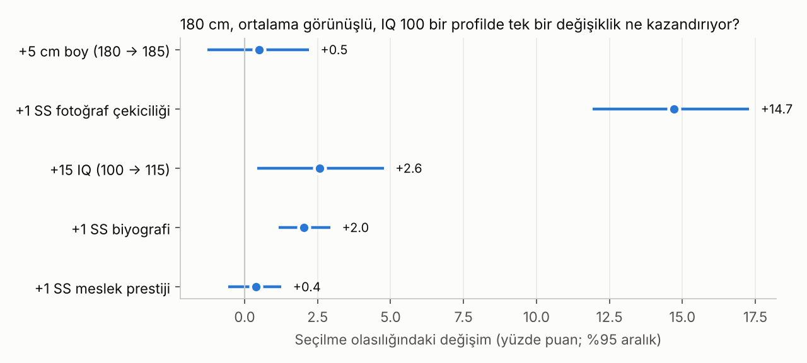
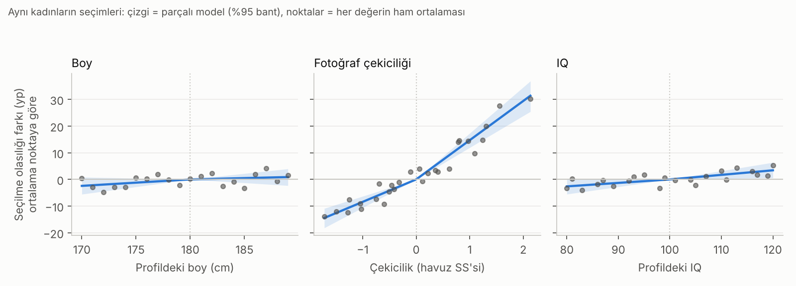

# Çekicilik ve Sohbet · Sürüm 3: Ortalama Boydan Sonra Ne Önemli? Boy mu, Fizik mi, Zekâ mı?

> **Sürüm:** 3 · **Tarih:** 2026-10-23 · **Durum:** güncel
>
> **Acelen varsa:** en alttaki [En basit özet](#en-basit-özet) bölümüne atla.
>
> Bu doküman **tıbbi tavsiye değildir.** İlişki tavsiyesi de değildir; araştırmaların ortalama olarak ne bulduğunu anlatır. Ortalama, tek bir insanın ne düşüneceğini söylemez.

**Kanıt seviyeleri:**

| Etiket | Anlamı |
|---|---|
| **A** | Meta-analiz ya da birden çok büyük, bağımsız çalışma |
| **B** | Tek büyük, iyi tasarlanmış çalışma |
| **C** | Küçük çalışma, vaka serisi, ikincil kaynak |
| **V** | Bu çalışmanın kendi gerçek veri analizi |
| **D** | Model ya da varsayım |

---

## Soru ve kapsam

Ortalama boya ulaşmış bir erkek için:

1. **Ek boy** mu, daha **çekici görünüş ve fizik** mi, **zekâ** mı, **kişilik** mi, **statü** mü daha çok fark yaratıyor?
2. Boyun etkisi ortalamanın üstünde **azalıyor** mu (eşik, plato)?
3. **Kadının kendi boyu**, erkeğin boyuna verdiği önemi değiştiriyor mu?
4. Özellikler birbirini **telafi** ediyor mu, yoksa önce bir **eşik** mi aşılmalı?
5. **Gerçek hayat sonuçlarında** (partner sayısı, ilişki, evlilik, çocuk) sıralama aynı mı?
6. **Türkiye'de** bir şey değişiyor mu?

**Kapsam:** Kadınların erkekleri seçmesi (soruyu soran kişi erkek). Çoğunlukla heteroseksüel örneklemler.

**Kapsam dışı:**
- Boy uzatma yöntemleri (ayrı konu: [boy-potansiyeli-gozden-kacanlar](../../boy-potansiyeli-gozden-kacanlar/)).
- Belirli bir kişiye tavsiye.
- 18 yaş altı katılımcılarla deney.

## Önceki sürümden değişenler

- **Yeni soru.** Sürüm 2 "hoşlandığını göstermek mi, söylemek mi?" sorusunu inceliyordu. Bu sürüm boy, görünüş/fizik ve zekânın göreli ağırlığını inceliyor. Sürüm 1 ve 2'nin bulguları geçerli kalıyor; ilgili yerlerde kullanılıyor.
- **Yeni yöntem: dört aşamalı çok ajanlı araştırma.**
  1. 10 paralel literatür ve veri ajanı.
  2. Ön kayıtlı kendi analiz.
  3. Bağımsız doğrulama: üç kaynak denetçisi, sıfırdan yeniden analiz yapan bir ajan ve bir "şeytanın avukatı".
  4. Rapor.
- **Yeni veri.** Üç açık veri seti eklendi: rastgele profilli seçim deneyi, gerçek boyutlu figür puanları ve erkeklerde gerçek partner davranışı.
- **Yeni analiz türleri:**
  - parçalı (kırılmalı) eğimler;
  - etkileşimler (kadının boyu, telafi mi çarpım mı);
  - koşullu logit ile ölçek denetimi;
  - ön kayıtsız keşif analizleri (ayrı dosyada ve ayrı etiketle).

## Yöntem

### 1. Dört aşama

| Aşama | Ne yapıldı |
|---|---|
| 1. Tarama | On paralel ajan: L1 boy eğrisi, L2 beden ipuçları, L3 yüz ve değiştirilebilir görünüm, L4 zekâ ve eğitim, L5 statü ve gelir, L6 kişilik, L7 gerçek hayat sonuçları, L8 özelliklerin birleşmesi, L9 Türkiye, D1 açık veri keşfi |
| 2. Kendi analiz | Ön kayıt (commit `8b9fda6`) → kod (`fad77cc`, çalıştırılmadan önce) → çıktılar (`afd8b4d`) |
| 3. Doğrulama | **V1-V3:** rapora girecek 35 kilit iddiayı birincil kaynaktan yeniden kontrol eden üç ajan. **R1:** ana kodu okumadan, analizleri kendi koduyla ve dört farklı yöntemle yeniden yapan ajan. **DA:** sonuçları çürütmeye çalışan şeytanın avukatı |
| 4. Rapor | Doğrulanamayan sayılar Sonuçlar bölümüne girmedi |

### 2. Veri (V)

| Kod | Veri | İçerik |
|---|---|---|
| UvA | [Witmer ve ark. 2025](https://doi.org/10.1016/j.chbr.2024.100579), Amsterdam Üniversitesi, kadın katılımcı dosyası | **Almanya'da flört uygulaması kullanan 224 kadın** (18-35 yaş, Appinio paneli; öğrenci örneklemi değil). Her kadın 12 kez 3 erkek profili gördü ve birini seçti ya da hiçbirini seçmedi: toplam 8.064 profil kararı. Profillerdeki 5 özellik birbirinden bağımsız ve rastgele atandı: **fotoğraf** (yüz ve gövde, yapay zekâyla üretilmiş yaklaşık 31 fotoğraf; çekicilik puanı ön testten), **yazılı boy** (170-189 cm), **yazılı IQ** (80-120), biyografi ve meslek. Kadının kendi boyu da kayıtlı |
| MA | [Mautz ve ark. 2013](https://pmc.ncbi.nlm.nih.gov/articles/PMC3637716/) ham verisi ([Aich ve ark. 2026](https://doi.org/10.1371/journal.pbio.3003595) ek dosyası) | Avustralya'da 105 kadın, **gerçek boyutta yansıtılan**, çıplak ve yüzsüz bilgisayar figürlerini 1-7 arası puanladı (5.142 puan). Boy 163-187 cm arasında 7 düzey (1 nüfus SS = 6 cm). Omuz-kalça oranı ve penis boyu, boydan bağımsız olarak değiştirildi |
| KO | [Kordsmeyer ve ark. 2018](https://doi.org/10.1016/j.evolhumbehav.2018.03.008) (Mendeley, CC BY 4.0) | 164 Alman erkek. Ölçülmüş boy, kuvvet ve 3B üst beden taraması; kadınların yüz ve beden çekiciliği puanları; son 12 ay ve yaşam boyu partner davranışı (SOI-R davranış); ilişki durumu |

Veri dosyaları repoya kopyalanmadı. Kod onları indiriyor ve SHA-256 özetlerini doğruluyor.

### 3. Analizler

**İstatistik:**
- **Model:** Kişi içi doğrusal model. Her kadının kendi ortalaması çıkarılır.
- **Aralıklar:** Kadınlar üzerinden 2000 bootstrap ile %95 aralık.
- **Birimler:**
  - boy: 5 cm;
  - fotoğraf çekiciliği: fotoğraf havuzunun 1 SS'si;
  - IQ: 15 puan;
  - biyografi ve meslek: 1 SS.
- **Kırılma noktaları:** boy 180 cm, IQ 100, çekicilik havuz ortalaması.

| Kod | Analiz | Kör mü? |
|---|---|---|
| U1 | Parçalı eğimler: çekicilik, boy ve IQ için ortalamanın altında ve üstünde ayrı eğim | Hayır (aşağıda) |
| U2 | Boy × kadının kendi boyu | Evet |
| U3 | Boy × çekicilik ve IQ × çekicilik | Evet |
| U4 | U1-U3'ün koşullu logit karşılığı (ölçek denetimi) | — |
| M1 | MA'da parçalı boy eğimi; omuz-kalça ve penis kontrol | Hayır |
| M2, M3 | Boy × puanlayanın boyu; boy × omuz-kalça | Evet |
| G1, G2 | KO'da SOI-R davranış ve ilişkide olma ~ boy + yüz + beden + kuvvet + yaş (keşif) | G1 hayır, G2 evet |

**Teknik testler (T1-T7):**
- veri özeti (SHA-256);
- tasarım yapısı;
- rastgeleleştirme: özellikler arası |r| < 0.05;
- merkezleme;
- kodlama yönü;
- örneklem boyutları;
- logit yakınsaması.

**Karar kuralları:** K1-K12, ön kayıtta yazıldığı biçimde.

**Şeffaflık:** Ön kayıttan önce 1. aşama ajanları veriyi tanımak için hızlı analizler yaptı. Bu yüzden U1, M1, G1 ve K1-K3 kör değil. Kör olanlar: U2, U3, M2, M3, G2 ve K4-K10.

**Keşif analizleri** (`analiz/kesif.py`, ön kayıtsız): 3. aşamada DA ve R1'in itirazlarını kontrol etmek için sonradan yazıldı. Bunlar **E** koduyla ayrıca etiketlenmiştir.

### Plandan sapmalar

| Sapma | Gerekçe ve etki |
|---|---|
| İlk çalıştırma çöktü; kod düzeltildi (commit `bc1d22f`) | MA'da 3 boş puan vardı (atıldı). KO'da bazı hücreler " " ya da "-,636" biçimindeydi (sayıya çevrildi, boşluklar eksik sayıldı). Analiz kararları değişmedi |
| KO'da tam vaka sayısı 151 | Planda 164 yazıyordu. Beden çekiciliği 13 kişide, yüz çekiciliği 1 kişide eksik |
| K11 MA kurallarına uygulanmadı | MA'daki puan ölçeğinin koşullu logit karşılığı yok. Planda bu açıkça yazılmamıştı; "uygulanmaz" diye raporlandı |
| Ön kayıttaki tanım hataları (3. aşamada bulundu) | "28 fotoğraf" yazmıştık; doğrusu yaklaşık 31 fotoğraf (28 farklı puan; iki puan ikişer fotoğrafta). UvA'daki kadınların 44'ü biseksüel, 8'i açık ilişkide; bunlar çıkarılınca sonuçlar değişmiyor (R1). KO'daki erkekler heteroseksüel olarak işe alınmış, ama veride Kinsey ölçeğinde 0: 138, 1: 24, 2: 2 |
| Çekicilik SS'si benzersiz puanlarla hesaplandı (plandaki tanım) | Satır ağırlıklı SS ile eğimler yaklaşık %3-4 küçülür (R1, DA). Sonuç değişmiyor |
| Keşif analizleri eklendi (E1-E5) | Planda yoktu; 3. aşamanın itirazlarını kontrol etmek için. Ayrı dosyada, ayrı etiketle |

## Bulgular

### 1. Seçim deneyi: neyin ne kadar işe yaradığı (V)

Bir profilin seçilme olasılığı ortalamada **%19,2**. 180 cm boyunda, ortalama görünüşlü ve IQ'su 100 olan bir profile tek bir değişiklik yapılınca seçilme olasılığı şöyle değişiyor (U1, yüzde puan, yp):

| Değişiklik | Etki (yp) | %95 aralık |
|---|---|---|
| +5 cm boy (180 → 185) | **+0,5** | −1,3 ile +2,2 |
| +1 SS fotoğraf çekiciliği | **+14,7** | +11,9 ile +17,3 |
| +15 IQ (100 → 115) | +2,6 | +0,4 ile +4,8 |
| +1 SS biyografi | +2,0 | +1,2 ile +2,9 |
| +1 SS meslek prestiji | +0,4 | −0,6 ile +1,3 |

**Adil karşılaştırma (E3, keşif).** Yukarıdaki tablo çekiciliğin en dik, boyun en düz parçasını karşılaştırıyor (DA itirazı 1). Doğrusal modelde ve SS başına karşılaştırınca:
- 1 SS fotoğraf çekiciliği: +11,8 yp [10,4; 13,2].
- 7 cm boy (yaklaşık 1 erkek boyu SS'si): +1,2 yp [0,04; 2,4].
- 15 IQ: +2,3 yp [1,2; 3,4].

Fotoğrafın etkisi boyunkinin **kabaca 10 katı** (aralık 5 ile 60 arası; boyun etkisi sıfıra yakın olduğu için oran kararsız). Witmer ve ark. kendi analizlerinde 7-20 kat diyor.

**Parçalı eğimler (U1):**

| Özellik | Ortalamanın altında | Ortalamanın üstünde |
|---|---|---|
| Boy (5 cm başına) | +1,2 [−0,4; 2,8] | +0,5 [−1,3; 2,2] |
| IQ (15 puan başına) | +2,0 [−0,2; 4,1] | +2,6 [0,4; 4,8] |
| Fotoğraf (1 SS başına) | +8,4 [6,3; 10,6] | +14,7 [11,9; 17,3] |

**Boy için dürüst okuma (DA itirazı 2):**
- 180 cm'nin altındaki ve üstündeki eğimler birbirinden ayırt edilemiyor (K3).
- Bu veri platoyu düz bir artıştan ayıramıyor.
- Dışlanabilen şu: 180'in üstünde 5 cm'nin göreli etkisi **en fazla yaklaşık %12** (2,2 / 19,2).
- Tüm aralıkta doğrusal etki 5 cm başına +0,9 yp [0,1; 1,7], yani göreli %5 civarında. Logit ölçeğinde bu doğrusal etki sınırda kalıyor.
- Tasarımda 170 cm'nin altı yok. Literatürde cezanın yoğunlaştığı alt %10 bu deneyde test edilmedi.

**Kadının kendi boyu (U2, kör; K6):**
- Kadın 5 cm daha uzunsa, 5 cm boyun etkisi **+0,9 yp artıyor** [0,3; 1,5].
- Logitte de anlamlı.
- R1 dört farklı yöntemde de aynı yönü buldu.

| Kadının boyu (E1, keşif) | Kadın sayısı | 5 cm boyun etkisi (yp) |
|---|---|---|
| < 163 cm | 57 | −0,8 [−2,3; 0,6] |
| 163-169 cm | 85 | +1,1 [−0,3; 2,6] |
| ≥ 170 cm | 82 | +1,9 [0,5; 3,3] |
| ≥ 175 cm | 30 | +3,9 [1,6; 6,3] |

**"Kendinden uzun" eşiği (E2, keşif; ilk kez R1 buldu):**
- Profil kadından uzun değilse seçilme olasılığı, doğrusal boy etkisinin ötesinde **6,7 yp düşüyor** [1,6; 11,8].
- Bu profiller tüm profillerin yalnızca %8,5'i.

**Telafi mi, çarpım mı (U3, kör; K8, K9):**
- Doğrusal olasılık modelinde boy × çekicilik (−0,46 [−1,19; 0,30]) ve IQ × çekicilik (−0,33 [−1,43; 0,73]) belirgin değil. Ön kayıtlı karara göre etkiler **toplanıyor**.
- Logit ölçeğinde IQ × çekicilik negatif ve anlamlı (−0,095 [−0,186; −0,006]). Yani çekici profillerde yazılı IQ biraz daha az fark yaratıyor olabilir. Bu bulgu ölçeğe bağlı.

**Çekiciliğin eğimi (K5):**
- Yüzde puan ölçeğinde ortalamanın üstünde daha dik.
- Log-odds ölçeğinde ise daha yatık (−0,33 [−0,67; −0,02]).
- Ön kayıtlı K11 kuralına göre bu karar **"ölçeğe bağlı"** etiketi alıyor. Sebep şu: taban oran düşükken aynı log-odds artışı daha az yüzde puana karşılık geliyor.

### 2. Gerçek boyutlu figürler (V)

**Boy eğimi (M1), puan / 1 nüfus SS (6 cm):**
- Ortalamanın altında: 0,27 [0,20; 0,34].
- Ortalamanın üstünde: **0,14** [0,07; 0,21].
- Eğim yarıya iniyor.

**Boy ile omuz-kalça karşılaştırması (E4, keşif):**

| Değişim (E4, keşif) | Puan (1-7) |
|---|---|
| Boy 163 → 175 cm | +0,55 [0,40; 0,69] |
| Boy 175 → 187 cm | +0,28 [0,13; 0,43] |
| Omuz-kalça oranı, en düşük → en yüksek düzey | +3,02 [2,71; 3,31] |
| Oran: omuz-kalça / boy (uçtan uca) | **3,6 kat** [3,0; 4,6] |

- Ön kayıt öncesi ham ortalamalarda 183 → 187 cm arası düz (−0,03).
- Bağımsız yeniden analizde bu son adımın eğimi −0,03 [−0,23; 0,17] çıktı.
- **Birim düzeltmesi (DA):** Bu karşılaştırma doğrudan model katsayılarıyla yapılamaz. Omuz-kalça katsayısı figür setinin SS'si başına, boy katsayısı ise nüfus SS'si başına. Bu yüzden iki özellik, tasarım aralığının ucundan ucuna karşılaştırıldı.

**Kör testler:**
- **Boy × puanlayanın boyu (M2, K7):** +0,043 [0,008; 0,079]. Uzun kadınlar boya daha çok önem veriyor; bu, UvA'daki bulgunun **bağımsız tekrarı**.
- **Boy × omuz-kalça (M3, K10):** +0,065 [0,035; 0,092]. Beden şekli iyiyken boy biraz daha çok fark yaratıyor. UvA'da boy × fotoğraf için böyle bir etkileşim çıkmadı; bu yüzden genellenebilirliği belirsiz.

### 3. Gerçek partner davranışı: 151-164 erkek (V, keşif)

**Ön kayıtlı model (G1).** Dört özellik ve yaş aynı modelde. SOI-R davranış puanını yalnız **yaş** yordadı (+0,25 SS). Diğer katsayılar (SS):

| Özellik | Katsayı (SS) | %95 aralık |
|---|---|---|
| Boy | +0,06 | −0,09 ile +0,22 |
| Yüz | +0,15 | −0,05 ile +0,34 |
| Beden çekiciliği | −0,05 | — |
| Kuvvet | +0,14 | −0,05 ile +0,31 |

**İlişkide olma (G2, kör).** Yaştan başka hiçbir özellik ilişkide olmayı yordamadı.

**Ayrı modeller (E5, keşif; DA itirazı 9).** Ortak modeldeki boş sonucun bir kısmı özellikler arası yüksek korelasyondan ve küçük örneklemden kaynaklanıyor. Her özellik yalnızca yaşla birlikte girilince sonuçlar şöyle (SS):

| Özellik | Katsayı (SS) | %95 aralık |
|---|---|---|
| Üst beden büyüklüğü (3B tarama) | **+0,28** | +0,13 ile +0,43 |
| Yüz çekiciliği | +0,19 | +0,03 ile +0,34 |
| Kuvvet | +0,18 | +0,01 ile +0,33 |
| Boy | +0,14 | −0,003 ile +0,29 (sınırda) |
| Beden çekiciliği puanı | +0,01 | — |

Bu desen yayımlanmış makaleyle ve aşağıdaki meta-analizle uyumlu. SOI-R davranış puanı kısa süreli cinsel davranışı ölçüyor, ilişki başarısını ölçmüyor.

### 4. Testler ve kararlar

**Teknik testler:** 7 testin **7'si geçti** ([testler.csv](analiz/ciktilar/testler.csv)).

| Kural | Soru | Karar |
|---|---|---|
| K1 | Ortalamanın üstünde 1 SS çekicilik mi, 5 cm boy mu? | **Çekicilik** (fark 14,2 yp [10,9; 17,4]) · kör değil |
| K2 | 15 IQ mı, 5 cm boy mu? | Ayırt edilemiyor (2,1 [−0,7; 5,0]) |
| K3 | Boyun getirisi 180 cm üstünde azalıyor mu? | Fark gösterilemedi; 180 üstünde belirgin etki yok · kör değil |
| K4 | IQ'nun getirisi 100 üstünde azalıyor mu? | Fark gösterilemedi. 100 üstündeki eğim pozitif: 2,6 [0,4; 4,8] |
| K5 | Çekiciliğin eğimi ortalamanın üstünde değişiyor mu? | Üstte daha dik → **K11: ölçeğe bağlı** |
| K6 | Uzun kadınlar boya daha çok önem veriyor mu? (UvA) | **Evet** → K11: sağlam |
| K7 | K6 bağımsız veride (MA) tekrarlanıyor mu? | **Evet, tekrarlandı** |
| K8 | Boy × çekicilik | Toplanıyor (etkileşim yok) |
| K9 | IQ × çekicilik | Toplanıyor (logitte negatif; bkz. bölüm 1) |
| K10 | Boy × omuz-kalça (MA) | Çarpımsal: şekil iyiyken boy daha etkili |
| K11 | Ölçek denetimi | K5 ölçeğe bağlı; K6 sağlam; diğerleri uygulanmaz |
| K12 | Gerçek davranış (KO, keşif) | Ortak modelde yalnızca yaş; bkz. E5 |

### 5. Bağımsız doğrulama (3. aşama)

**Bağımsız yeniden analiz (R1).**
- Ajan ana kodu okumadan, kendi koduyla bütün katsayıları yeniden hesapladı ve aynı sonuçları buldu. Örnek: boy üst eğimi 0,49; çekicilik üst eğimi 14,71.
- Dört farklı yöntem kullandı: kişi içi doğrusal model, koşullu logit, "hiçbiri" seçenekli çok terimli logit ve rastgele etkili lojistik model.
- Bütün eğimlerin işareti dört yöntemde de aynı. Hangi aralığın sıfırı dışladığı da aynı; tek fark K5 (yukarıda).

**Şeytanın avukatı (DA).** 13 itiraz getirdi. Başlıcaları ve raporda nasıl ele alındıkları:

| İtiraz | Güç | Ne yapıldı |
|---|---|---|
| "30 kat" oranı en dik parçayı en düz parçaya bölüyor | Güçlü | Oran bırakıldı. Doğrusal SS karşılaştırması kullanıldı: ~10 kat (E3) |
| "180 üstünde boy önemsiz" demek kanıt yokluğunu yokluk kanıtı saymak | Güçlü | Plato ile düz artış ayırt edilemiyor; dışlanabilen yalnızca göreli %12'den büyük etki |
| Boyun etkisi kadının boyuna göre göreli | Güçlü | K6 ve K7 (kör, tekrarlandı) ile E1 ve E2 raporlandı |
| Fotoğraf çekiciliği yüz, gövde/kas ve fotoğraf kalitesi bir arada; 1 SS, iki farklı insan arasındaki fark | Güçlü | Sınırlamalara ve sentez bölümüne eklendi |
| Yazılı boy, yüz yüze görülen boyla aynı şey değil; profilde boy abartılıyor | Güçlü | Bu deney boyun etkisini muhtemelen küçümsüyor. Yüz yüze literatür ayrıca verildi (bölüm 6) |
| Mautz'ta birim hatası ("4-8 kat") | Orta-güçlü | Düzeltildi: uçtan uca 3,6 kat (E4) |
| KO'daki boş sonuç model kaynaklı | Güçlü | Ayrı modeller eklendi (E5) |
| Literatürde plato 180'de değil, ortalama boylu kadın için ~183-188 cm'de | Orta | Bölüm 6'da doğrulanmış sayılarla verildi |

### 6. Literatür: boyun eğrisi

Aşağıdaki sayılar V1 denetçisi tarafından birincil kaynaktan doğrulandı.

- **Hız tanışma ([Stulp ve ark. 2013](https://pure.rug.nl/ws/files/6798184/2013AnimBehavStulp.pdf), 5.782 kişi, 128.104 seçim):** Boy beyana dayalı.
  - Kadınlar en çok **kendilerinden 25 cm uzun** erkeği seçiyor.
  - Erkeğin çekiciliği ortalamanın 21,3 cm üstünde tepe yapıyor, ama aralık çok geniş (12,9-64,0).
  - Kadınların söylediği kabul aralıklarına göre: **182,9 cm'yi kadınların %98,5'i** kabul ediyor, 195,6 cm'yi %54'ü. Yani söylenen tercihte tavan yaklaşık 183 cm, üstünde "fazla uzun" düşüşü var.
- **Online flört (Hitsch, Hortaçsu ve Ariely):**
  - 2010 AER: boy düzeyinin katsayısı inç başına 0,183. Modelde boy farkı terimleri de olduğu için bu sayı tek başına "inç başına etki" değil.
  - [2006 çalışma raporu](https://docs.asian-nation.org/online-dating-study.pdf), Tablo 5.5: 5'11,5" (182 cm) bir erkeğe denk olmak için gereken ek yıllık gelir:

    | Boy | Ek yıllık gelir |
    |---|---|
    | 5'8" (173 cm) | +138 bin $ |
    | 5'10" (178 cm) | +24 bin $ |
    | 6'0" (183 cm) | −8 bin $ |
    | 6'4" (193 cm) | −51 bin $ |

  - Ortalamanın altında boy çok pahalı, üstünde ucuz.
  - 6'3"-6'4" erkekler, 5'7"-5'8" erkeklere göre %65 daha fazla ilk mesaj alıyor.
  - Yazarlar, yayımlanmayan sonuçların sağlam çıkmadığını kendileri yazıyor.
- **Eşik ([Bruch ve ark. 2016](https://pmc.ncbi.nlm.nih.gov/articles/PMC5035909/)):** "Kadınlar genel olarak kendilerinden **3-4 inç (8-10 cm) uzun** erkekleri tercih ediyor; bu eşiğin altında belirgin bir düşüş var."
- **Gerçek çiftler ([Stulp ve ark. 2013, PLoS ONE](https://pmc.ncbi.nlm.nih.gov/articles/PMC3546926/), 12.502 İngiliz çift):**
  - Çiftlerin %92,5'inde erkek daha uzun; rastgele eşleşmede beklenen %89,8.
  - "Erkek uzun olsun" normu çiftlerin %7,5'inde bozuluyor; rastgelede beklenen %10,2.
  - Norm gerçek ama etkisi mütevazı.
- **Meta-analiz ([Lidborg ve ark. 2022](https://pmc.ncbi.nlm.nih.gov/articles/PMC9106334/), 96 çalışma):**

  | Sonuç | Kas/güç (beden erkeksiliği) | Boy | Yüz erkeksiliği |
  |---|---|---|---|
  | Eşleşme başarısı | **r = 0,133** | r = 0,057 | r = 0,080 (anlamsız) |
  | Çocuk sayısı | **r = 0,143** | r = 0,006 | — |

### 7. Literatür: görünüş, beden, kişilik

Aşağıdaki sayılar V2 denetçisi tarafından doğrulandı.

- **Witmer ve ark. 2025 (UvA verisinin makalesi; 445 kişi, iki cinsiyet):**
  - Logit katsayıları SS başına: çekicilik 0,80, IQ 0,12, biyografi 0,11, boy 0,05.
  - Boy tercihinde kadın-erkek farkı yok.
- **Canlı hız tanışma ([Sidari ve ark. 2021](https://storre.stir.ac.uk/bitstream/1893/30130/1/SPPS_20Manuscript_20Final.pdf), N=539):**
  - Erkeğin genel çekiciliğinde: **kişilik 0,44 > yüz 0,32 > beden 0,26**.
  - "Buluşalım" kararında boy 0,38/SS (boy beyana dayalı).
- **Meta-analiz ([Eastwick ve ark. 2014](https://pubmed.ncbi.nlm.nih.gov/23586697), k=97):** Gerçek romantik ilgide fiziksel çekicilik r≈0,40, kazanç beklentisi r≈0,10. İki cinsiyette de aynı (fark 0,03).
- **Güç ([Sell ve ark. 2017](https://pmc.ncbi.nlm.nih.gov/articles/PMC5745404/)):**
  - Algılanan güç, beden çekiciliği varyansının %61-73'ünü açıklıyor.
  - Ters U yok: "fazla kaslı" cezası gözlenmedi.
  - Bacaklar görünmeyince boyun etkisi kayboluyor (β 0,02).
- **Mautz 2013:** Omuz-kalça oranı puan varyansının %79,6'sını açıklıyor; boy %6,1, penis boyu %5,1 ekliyor.
- **Öznellik ([Germine ve ark. 2015](https://pmc.ncbi.nlm.nih.gov/articles/PMC4629915/)):** Yüz tercihlerinin %48'i ortak, **%52'si kişisel**. Kişisel kısmın büyük bölümü genlerden değil, kişinin kendi yaşantısından geliyor. UvA fotoğraflarının ön testinde tek puanlayıcı güvenilirliği de düşük (ICC 0,25). Yani "piyasa ortalaması" her kadın için geçerli değil.
- **Zorunluluk ve lüks ([Li ve ark. 2002](https://pubmed.ncbi.nlm.nih.gov/12051582)):** Kısıtlı bütçede kadınlar için statü ve kaynak zorunluluk; **nezaket ve zekâ iki cinsiyet için de zorunluluk**.
- **Gerçek sonuç ([Jokela 2009](https://pmc.ncbi.nlm.nih.gov/articles/PMC3000557/), ABD, Wisconsin Boylamsal Araştırması):**
  - En az çekici çeyrekteki erkekler **%13 daha az çocuk** sahibi.
  - Diğer üç çeyrek arasında fark yok.
  - Görünüşte de ceza alt uçta yoğunlaşıyor.

**Doğrulanamadı (erişim engeli):**
- Confer 2010 (kadınların %69'u yüzü seçti);
- Asendorpf 2011 (boy 0,17, yüz 0,49);
- Fletcher 2014 (10 dakikada çekicilik 0,50, sıcaklık 0,07);
- Thomas 2020'deki nezaket ve mizah payları;
- Driebe 2021 (ölçülen IQ ilk çekimi artırmıyor, algılanan zekâ artırıyor).

Bunlar `[doğrulanmadı]` sayılır ve sonuçlarda kullanılmadı.

### 8. Literatür: zekâ, eğitim, gelir

V1 ve V3 denetçileri tarafından doğrulandı.

- **Hız tanışma ([Fisman ve ark. 2006](https://wiwi.hs-duesseldorf.de/personen/christian.schwarz/Documents/genderDifferences.pdf), Tablo III):** 10'luk ölçekte +1 puanın "evet" olasılığına etkisi:

  | Özellik | Kadın karar verenlerde | Erkek karar verenlerde |
  |---|---|---|
  | Zekâ | **+4,6 yp** | +2,3 yp |
  | Çekicilik | +11,9 yp | +14,0 yp |
  | Hırs | +1,3 yp | +1,3 yp |

  Konsensüs puanlarıyla zekâdaki cinsiyet farkı anlamlı değil. Sürüm 1'in kendi analizi de benzer: çekicilik 1 SS başına +12,9 yp, zekâ +3,2 yp.
- **Eğitim ([Bruch ve Newman 2018](https://europepmc.org/article/PMC/PMC6082652)):** "Erkekler için **daha fazla eğitim her zaman daha çekici**. Kadınlar için en çekici düzey lisans."
- **Gelir ([Ong ve Wang 2015](https://doi.org/10.1016/j.jebo.2014.12.011)):** Gelir düzeyi rastgele atanmış sahte profillerde, en yüksek gelirli erkek profilleri en düşük gelirlilere göre **10 kat** ziyaret aldı. Ölçüt yalnızca tıklama.
- **IQ ve evlilik ([Kolk ve Barclay 2021](https://doi.org/10.1016/j.intell.2020.101514), 749.939 İsveçli erkek; ek tablo S13):** 45 yaşına kadar hiç evlenmiş olma oranı, IQ 96-104 grubuna göre:
  - IQ < 74: **−19,9 yp**;
  - IQ > 126: +8,4 yp;
  - eğitim ve gelir kontrol edilince: +0,7 yp;
  - kardeşler karşılaştırılınca: en düşük grup −17,8 yp, en yüksek grup −0,5 yp (anlamsız).

  Yani zekânın evlilikteki avantajı büyük ölçüde eğitim ve gelir üzerinden geliyor. Ceza alt uçta.
- **Gerçek ilgi ([Eastwick ve Finkel 2008](https://pubmed.ncbi.nlm.nih.gov/18211175/)):** İnsanlar ideallerini anlatırken klasik cinsiyet farkları çıkıyor: erkekler görünüşe, kadınlar kazanca daha çok önem verdiğini söylüyor. Gerçek ilgide bu farklar kayboluyor.

**Doğrulanamadı:**
- Gignac 2018 (zekâ çekiciliği yaklaşık 120 IQ'da tepe yapıyor, 99. yüzdelikte düşüyor): yalnızca ikincil kaynak.

### 9. Literatür: gerçek hayat sonuçları

- **[Stulp ve ark. 2012](https://pmc.ncbi.nlm.nih.gov/articles/PMC3277695/), ABD, 3.578 erkek:**
  - Çocuk sayısında en iyi boy **177,4 cm**.
  - Boy, hiç evlenmiş olmayla ilişkisiz.
- **[Stulp ve ark. 2014](https://pubmed.ncbi.nlm.nih.gov/24817592/), 165.606 kişi (yalnız özetten doğrulandı):**
  - Boy, eş kalitesini (eşin eğitimi ve geliri) kısadan ortalamaya geçerken daha çok yordar, ortalamadan uzuna geçerken daha az.
  - Yazarların ifadesiyle: "**uzun olmak, kısa olmamaktan daha az önemli.**"
- **[Nettle 2002](https://www.danielnettle.org.uk/wp-content/uploads/2024/06/019.pdf), İngiltere 1958 kohortu:**
  - Çocuksuzluk fazlası yalnızca en kısa %10'da.
  - Uzun süreli partner sayısı ise boyla kademeli olarak artıyor.
- **[Frederick ve Jenkins 2015](https://pmc.ncbi.nlm.nih.gov/articles/PMC10480972/), 60.058 kişi:**
  - Ortalama partner sayısı çok kısalarda 9,4, aşırı uzunlarda 12,3.
  - Kontrollerden sonra ilişkiler "küçük".

### 10. Türkiye

- **Tercihler.** Sürüm 1'in kendi analizine göre (45 ülke verisi, V) Türk kadınları ideal eşte **zekâyı** ilk sıraya koyuyor (6,01/7). Ardından sağlık (5,90), iyi kalplilik (5,72), fiziksel çekicilik (5,54) ve kaynak (5,50) geliyor. Türkiye, zekânın birinci olduğu 4 ülkeden biri.
- **Piyasa ([Conroy-Beam ve ark. 2019](https://europepmc.org/article/PMC/PMC6858324), 45 ülke):**
  - Türkiye, insanların ideal eşlerine **en az ulaştığı** ülke (7,73; en yükseği Malezya 9,09).
  - Aynı zamanda eşlerin genel "eş değeri"ne göre **en güçlü eşleştiği** ülke (β = 0,77; ülkeler arası aralık 0,21-0,77).
  - Yani rekabet tek bir özellik üzerinden değil, toplam paket üzerinden işliyor.
- **Aile ([Güvensoy ve Erdem 2022](https://doi.org/10.1177/02654075221114029)):** Vinyet deneyinde ebeveyn onayı evlenme isteğini laik örneklemde **4,24 kat** (N=331), muhafazakâr örneklemde 4,00 kat (N=484) artırıyor.
- **Boy referansı:** 18 yaşında medyan boy erkekte 176,2 cm, kızda 163,1 cm ([Neyzi ve ark. 2015](https://jcrpe.org/articles/doi/jcrpe.2183)). Bu örneklem İstanbul'un varlıklı kesiminden; ulusal ortalama muhtemelen biraz daha düşük. Bu repodaki önceki ulusal referans 18 yaşında erkekte 175,8 cm ([algılanan boy araştırması](../../algilanan-boy-ve-vucut-yapisi/1-literatur-ve-algi-simulasyonu/README.md)).
- **Türkiye'ye özgü boy tercihi çalışması bulunamadı.** Türkçe kaynaklar (DergiPark, YÖK Tez) tarandı ama boy tercihini ya da eşler arasındaki boy farkını ölçen bir çalışma çıkmadı. TÜİK'in görücü usulü oranları erişim sorunu yüzünden doğrulanamadı.

### 11. Sentez: önce eşik, sonra toplama (D)

Bulgular iki aşamalı bir modele uyuyor.

**Aşama 1: eşik ("elenmemek").**
- **Boy:** Kendinden kısa ya da kendine çok yakın boyda olmamak. Bu eşik kadının kendi boyuna göre (UvA E2, Bruch'un 3-4 inç eşiği).
- **Görünüş:** En alt çeyrekte olmamak (Jokela).
- **Kişilik ve sağlayıcılık:** Asgari nezaket ve sağlayıcılık (Li 2002).

Eşiğin altında kalmanın cezası büyük ve başka özellikle telafisi pahalı: Hitsch'te 173 cm bir erkeğe yıllık +138 bin $ gerekiyor.

**Aşama 2: toplama.** Eşik aşıldıktan sonra özellikler büyük ölçüde toplanıyor (K8, K9); her birinin getirisi kendi ölçeğinde. Boyun bu aşamadaki getirisi küçük:
- profil deneyinde 5 cm için göreli en fazla yaklaşık %12;
- gerçek boyutlu figürlerde ortalamanın üstünde eğim yarıya iniyor.

**Ortalama boylu bir Türk erkeği için** (yaklaşık 176 cm):
- Ortalama Türk kadınına (≤163 cm) göre 13 cm uzun, yani "3-4 inç uzun" eşiğini çoğu kadına karşı zaten geçiyor.
- Eşik, yalnızca uzun kadınlarda (yaklaşık 170 cm ve üstü) hâlâ önemli (E1).

**Benzetme.** Boy, bir sınava girmek için gereken baraj puanı gibi. Barajı geçemezsen diğer derslerin iyi olsa bile zorlanırsın. Geçtikten sonra barajın üstünde fazladan 5 puan seni pek öne geçirmez; asıl sıralamayı diğer dersler belirler.

**Diğer dersler (değiştirilebilir alanlar, kanıt düzeyine göre):**
- **Beden:**
  - Kas ve güç: meta-analizde r 0,13-0,14, boyun iki katından fazla.
  - Omuz-kalça görünümü: boyun yaklaşık 3,6 katı. Bir kısmı kemik yapısı, bir kısmı omuz kası ve bel yağı ([vücut oranları ve spor araştırması](../../algilanan-boy-ve-vucut-yapisi/3-vucut-oranlari-ve-spor/README.md): omzun en geniş yerinin yalnız %47'si kemikle açıklanıyor).
  - Beden yağı.
- **Fotoğraf ve bakım:** UvA'daki "fotoğraf çekiciliği" yüz, gövde ve fotoğraf kalitesini birlikte ölçüyor.
- **Sohbet ve kişilik:**
  - Canlı tanışmada genel çekiciliğin en büyük payı (Sidari).
  - Sürüm 1 ve 2'deki bulgular: algılanan ortak ilgi, komiklik, seçici ilgi.
- **Eğitim ve iş:** Uzun vadede erkekte "her zaman daha iyi" (Bruch ve Newman); gelir, profil aşamasında güçlü.

## Sonuçlar

1. **Profil seçiminde görünüş açık ara en güçlü etken.** (V + A)
   - Fotoğrafta (yüz ve gövde) 1 SS daha çekici olmak seçilme olasılığını +11,8 yp artırıyor; taban %19,2.
   - Aynı ölçekte 7 cm boy +1,2 yp, 15 IQ +2,3 yp getiriyor.
   - Yani fotoğrafın etkisi boyunkinin kabaca 10 katı.
   - Canlı tanışma meta-analizinde de fiziksel çekicilik (r≈0,40), kazanç beklentisinden (r≈0,10) çok daha güçlü.
2. **180 cm'nin üstünde ek boyun profil üzerindeki etkisi küçük.** (V)
   - +5 cm, seçilme olasılığına +0,5 yp ekliyor [−1,3; 2,2].
   - Eğimin 180'de azaldığı da gösterilemedi; plato ile düz artış ayırt edilemiyor.
   - Dışlanabilen: 5 cm'nin göreli etkisi yaklaşık %12'den büyük değil.
3. **Boyun değeri göreli: kadının kendi boyuna bağlı.** (V + B)
   - Ön kayıtlı kör testte uzun kadınlar boya daha çok önem verdi (UvA). Sonuç bağımsız ikinci bir veri setinde (Mautz) tekrarlandı.
   - Keşif analizinde 175 cm ve üstü kadınlarda 5 cm +3,9 yp; 163 cm altı kadınlarda ≈0.
   - Profil kadından uzun değilse seçilme olasılığı 6,7 yp düşüyor.
   - Literatür: kadınlar en çok kendilerinden yaklaşık 25 cm uzun erkeği seçiyor; online ortamda "3-4 inç uzun" eşiğinin altında belirgin düşüş var.
4. **Gerçek boyutlu figürlerde beden şekli (omuz-kalça oranı), tasarım aralığının ucundan ucuna boydan yaklaşık 3,6 kat etkili.** (V + B)
   - Boyun eğimi ortalamanın üstünde yarıya iniyor: 163 → 175 cm +0,55 puan, 175 → 187 cm +0,28 puan.
   - Beden şekli iyiyken boy biraz daha çok fark yaratıyor (kör test).
   - Algılanan güç, beden çekiciliği varyansının %61-73'ünü açıklıyor ve "fazla kaslı" cezası gözlenmedi.
5. **Gerçek eşleşme başarısında kas ve güç boydan daha tutarlı bir yordayıcı.** (A + V)
   - Meta-analizde partner sayısıyla korelasyon: kas/güç r=0,133, boy r=0,057. Çocuk sayısıyla: r=0,143'e karşı r=0,006.
   - Kendi analizimizde (164 erkek, keşif) yaş sabitken üst beden büyüklüğü (+0,28 SS), yüz (+0,19) ve kuvvet (+0,18) kısa süreli cinsel davranışı yordadı; boy sınırda kaldı (+0,14).
   - Ön kayıtlı ortak modelde ise hiçbiri belirgin değildi (n=151, güç düşük).
6. **Zekâ işe yarıyor ve getirisi ortalamanın üstünde de sürüyor, ama esas olarak eğitim ve gelir üzerinden.** (V + B + A)
   - Profilde yazılı +15 IQ seçilme olasılığını +2,3-2,6 yp artırıyor; 100'ün üstünde azaldığı gösterilemedi.
   - Hız tanışmada kadınlarda algılanan zekâda +1 puan, "evet" olasılığını +4,6 yp artırıyor.
   - Erkekte daha fazla eğitim her zaman daha çekici.
   - İsveç kayıt verisinde IQ < 74 olanların evlenme olasılığı 19,9 yp daha düşük. En yüksek IQ grubunun +8,4 yp avantajı, eğitim ve gelir kontrol edilince +0,7 yp'ye iniyor.
7. **Gerçek hayat sonuçlarında boyun cezası alt uçta, ortalamanın üstündeki kazanç küçük.** (B)
   - ABD'de çocuk sayısı için en iyi boy 177,4 cm; boy, hiç evlenmiş olmayla ilişkisiz.
   - Büyük bir ABD örnekleminde "uzun olmak, kısa olmamaktan daha az önemli".
   - Görünüşte de aynı desen: en az çekici çeyrekteki erkekler %13 daha az çocuk sahibi, diğer üç çeyrek arasında fark yok.
8. **Canlı etkileşimde kişilik yüz kadar, hatta daha fazla önemli.** (B)
   - Hız tanışmada erkeğin genel çekiciliğinde katsayılar: kişilik 0,44, yüz 0,32, beden 0,26.
   - Nezaket ve zekâ iki cinsiyet için de "zorunluluk".
   - Yüz tercihinin %52'si kişiye özgü, yani "piyasa ortalaması" her kadın için geçerli değil.
9. **Türkiye'de tercih sıralaması Batı'ya benziyor; seçim süreci farklı.** (B + V)
   - Türk kadınları ideal eşte zekâyı birinci sıraya koyuyor (sürüm 1).
   - Türkiye, 45 ülke içinde ideale ulaşmanın en düşük ve toplam eş değerine göre eşleşmenin en güçlü olduğu ülke (β=0,77).
   - Ebeveyn onayı evlenme isteğini yaklaşık 4 kat artırıyor.
   - Türkiye'ye özgü bir boy tercihi çalışması bulunamadı.
10. **Ortalama boylu bir erkek için en büyük marjinal kazanç büyük olasılıkla boyda değil, değiştirilebilir alanlarda.** (D)
    - Değiştirilebilir alanlar: beden (kas, güç, omuz-bel görünümü, yağ oranı), bakım ve fotoğraf, sohbet ve kişilik, eğitim ve iş.
    - Ortalama bir Türk erkeği (≈176 cm), ortalama Türk kadınına (≤163 cm) karşı "kendinden uzun" eşiğini zaten aşıyor.
    - Bu bir modeldir; bireysel sonuç kişiye ve karşıdaki kadının boyuna göre değişir.

## Sınırlamalar

- **UvA bir uygulama deneyi; seçimler varsayımsal.**
  - Boy yazılı olarak verildi, yüz yüze görülmedi. İnsanlar profillerde boylarını abartıyor; kadınlar yazılı boyu bu yüzden indirimli okuyor olabilir. Bu deney boyun yüz yüze etkisini **büyük olasılıkla küçümsüyor**.
  - Boy aralığı 170-189 cm, yani Almanya'nın 10.-90. yüzdeliği. Cezanın yoğunlaştığı en kısa %10 test edilmedi.
  - "Seçilme olasılığı", 3 profil ve "hiçbiri" seçeneği arasındaki **göreli** seçimdir; gerçek hayatta "evet" deme olasılığı değildir.
- **UvA fotoğrafları yapay zekâyla üretildi** (yaklaşık 31 erkek yüzü; yüz ve gövde görünüyor).
  - Kanıt, gerçek kadınların bu fotoğraflar arasındaki **gerçek seçimleridir**. Yapay zekâ yalnızca uyaran üretmek için kullanıldı; sonuç üretmedi.
  - Yine de yüz sayısı az ve bazı yüzler tekrarlandı; yazarlar bunun "yapay bir his" yaratmış olabileceğini yazıyor.
  - "1 SS fotoğraf çekiciliği", iki farklı insan arasındaki farktır. Bir erkeğin bunun ne kadarını değiştirebileceği bu veriden bilinemez.
- **Doğrudan etki, toplam etki değil.** Deneyde boy, fotoğraftan ve meslekten bağımsız. Gerçek hayatta boy gelir, statü ve "daha çekici algılanma" ile birlikte geliyor; boyun toplam etkisi bu deneydekinden büyük olabilir.
- **MA figürleri çıplak ve yüzsüz.** Omuz-kalça oranının ne kadarının antrenmanla değişebileceği bu veriden bilinemez.
- **KO küçük (151-164 erkek).** Saptanabilecek en küçük etki r≈0,23. SOI-R davranış, ilişki başarısını değil kısa süreli cinsel davranışı ölçüyor.
- **Analizlerin bir kısmı kör değildi** (U1, M1, G1, K1-K3); keşif analizleri (E1-E5) ön kayıtsız.
- **Örneklemler ağırlıklı olarak Batılı** (Almanya, Avustralya, ABD, İngiltere, İsveç). Türkiye'ye genellemek dikkat ister.
- **Doğrulanamayan kaynaklar** (Confer, Asendorpf, Fletcher, Driebe, Gignac, TÜİK, NCD-RisC, Thomas) sonuçlarda kullanılmadı.
- **Ortalama ≠ birey.** Kadınların yüz tercihinin yarısından fazlası kişisel.

## Kaynaklar

**Kendi analiz ve çıktılar:**
- [Analiz kodu (ön kayıtlı)](analiz/calistir.py) · [Keşif kodu (ön kayıtsız)](analiz/kesif.py)
- [Senaryo](analiz/ciktilar/senaryo.csv) · [Katsayılar](analiz/ciktilar/katsayilar.csv) · [Kararlar](analiz/ciktilar/kararlar.csv) · [Testler](analiz/ciktilar/testler.csv) · [Keşif](analiz/ciktilar/kesif.csv)

**Veri setleri:**
- [Witmer ve ark. 2025, Computers in Human Behavior Reports (makale, CC BY)](https://pure.uva.nl/ws/files/251503424/The_relative_importance_of_looks_height_job_bio_intelligence_and_homophily_in_online_dating.pdf) · [veri (OSF)](https://osf.io/jmgya/)
- [Mautz ve ark. 2013, PNAS](https://pmc.ncbi.nlm.nih.gov/articles/PMC3637716/) · [Aich ve ark. 2026, PLOS Biology (ham veri)](https://doi.org/10.1371/journal.pbio.3003595)
- [Kordsmeyer ve ark. 2018, Evolution and Human Behavior](https://doi.org/10.1016/j.evolhumbehav.2018.03.008) · [veri (Mendeley)](https://data.mendeley.com/datasets/4bwxnwhwd3)

**Boy:**
- [Stulp, Buunk, Kurzban ve Verhulst 2013, Animal Behaviour](https://pure.rug.nl/ws/files/6798184/2013AnimBehavStulp.pdf)
- [Hitsch, Hortaçsu ve Ariely 2010, AER](https://doi.org/10.1257/aer.100.1.130) · [2006 çalışma raporu](https://docs.asian-nation.org/online-dating-study.pdf)
- [Bruch, Feinberg ve Lee 2016, PNAS](https://pmc.ncbi.nlm.nih.gov/articles/PMC5035909/)
- [Stulp ve ark. 2013, PLoS ONE](https://pmc.ncbi.nlm.nih.gov/articles/PMC3546926/)
- [Stulp ve ark. 2012, Behavioral Ecology and Sociobiology](https://pmc.ncbi.nlm.nih.gov/articles/PMC3277695/)
- [Stulp ve ark. 2014, American Journal of Human Biology](https://pubmed.ncbi.nlm.nih.gov/24817592/)
- [Nettle 2002, Human Nature](https://www.danielnettle.org.uk/wp-content/uploads/2024/06/019.pdf)
- [Frederick ve Jenkins 2015, Evolutionary Psychology](https://pmc.ncbi.nlm.nih.gov/articles/PMC10480972/)
- [Lidborg, Cross ve Boothroyd 2022, eLife](https://pmc.ncbi.nlm.nih.gov/articles/PMC9106334/)

**Görünüş, beden, kişilik:**
- [Sidari ve ark. 2021, SPPS (kabul edilmiş metin)](https://storre.stir.ac.uk/bitstream/1893/30130/1/SPPS_20Manuscript_20Final.pdf)
- [Eastwick ve ark. 2014, Psychological Bulletin](https://pubmed.ncbi.nlm.nih.gov/23586697)
- [Sell, Lukaszewski ve Townsley 2017, Proc R Soc B](https://pmc.ncbi.nlm.nih.gov/articles/PMC5745404/)
- [Germine ve ark. 2015, Current Biology](https://pmc.ncbi.nlm.nih.gov/articles/PMC4629915/)
- [Li ve ark. 2002, JPSP](https://pubmed.ncbi.nlm.nih.gov/12051582)
- [Jokela 2009, Evolution and Human Behavior](https://pmc.ncbi.nlm.nih.gov/articles/PMC3000557/)

**Zekâ, eğitim, gelir:**
- [Fisman ve ark. 2006, QJE](https://wiwi.hs-duesseldorf.de/personen/christian.schwarz/Documents/genderDifferences.pdf)
- [Bruch ve Newman 2018, Science Advances](https://europepmc.org/article/PMC/PMC6082652)
- [Ong ve Wang 2015, JEBO](https://doi.org/10.1016/j.jebo.2014.12.011)
- [Kolk ve Barclay 2021, Intelligence](https://doi.org/10.1016/j.intell.2020.101514) · [ön baskı ve ek tablolar](https://ndownloader.figshare.com/files/21975858)
- [Eastwick ve Finkel 2008, JPSP](https://pubmed.ncbi.nlm.nih.gov/18211175/)

**Türkiye:**
- [Conroy-Beam ve ark. 2019, Scientific Reports](https://europepmc.org/article/PMC/PMC6858324)
- [Güvensoy ve Erdem 2022, JSPR](https://doi.org/10.1177/02654075221114029)
- [Neyzi ve ark. 2015, JCRPE](https://jcrpe.org/articles/doi/jcrpe.2183)
- [Walter ve ark. 2020, 45 ülke verisi (sürüm 1'de analiz edildi)](https://osf.io/gb5cn/)

## En basit özet

- **Fotoğraftaki görünüş, boydan çok daha güçlü.** Bir uygulama deneyinde yüz ve gövde fotoğrafı 1 adım (1 SS) daha çekici olunca seçilme olasılığı +11,8 puan arttı. Aynı ölçekte 7 cm boy +1,2 puan, 15 IQ +2,3 puan getirdi.
- **180 cm'den sonra +5 cm, profilde neredeyse fark yaratmıyor** (+0,5 puan, belirsiz). Ama "hiç fark yok" da denemez; etki küçük, yüz yüze biraz daha büyük olabilir.
- **Boy bir baraj puanı gibi: önemli olan kadından uzun olmak.** Uzun kadınlarda boy hâlâ önemli, kısa kadınlarda neredeyse hiç önemli değil. Ortalama bir Türk erkeği (≈176 cm), ortalama Türk kadınına (≈163 cm) göre bu barajı zaten geçiyor.
- **Gerçek hayatta kas ve güç, boydan daha tutarlı işe yarıyor.** Gerçek boyutlu figürlerde omuz-bel görünümü boydan yaklaşık 3,6 kat etkili.
- **Zekâ ve eğitim işe yarıyor, en çok da uzun vadede.** Yüz yüze tanışmada ise kişilik, yüz kadar önemli.
- **Ortalama boydaysan en büyük kazanç değiştirebildiğin şeylerde:** beden (kas, yağ, duruş), bakım ve fotoğraf, sohbet ve kişilik, okul ve iş. Bunlar ortalama bulgular; her kadının zevki farklı.
