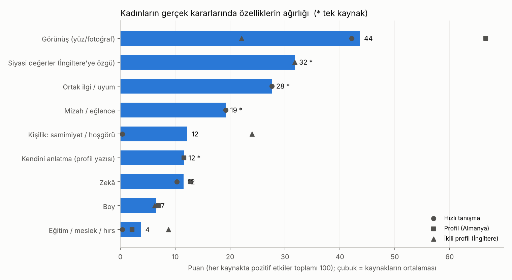

# Çekicilik ve Sohbet · Sürüm 4: Ağırlıklı Puan Tablosu — Kadınlar Bir Erkekte Neye Ne Kadar Bakıyor?

> **Sürüm:** 4 · **Tarih:** 2026-10-31 · **Durum:** güncel
>
> **Acelen varsa:** en alttaki "En basit özet" bölümüne atla.
>
> Bu doküman **tıbbi tavsiye değildir.** İlişki tavsiyesi de değildir; gerçek kadınların kararlarının **ortalama** olarak neye ağırlık verdiğini gösterir. Ortalama, tek bir insanın ne düşüneceğini söylemez.

**Kanıt seviyeleri:**

| Etiket | Anlamı |
|---|---|
| **A** | Meta-analiz ya da birden çok büyük, bağımsız çalışma |
| **B** | Tek büyük, iyi tasarlanmış çalışma |
| **C** | Küçük çalışma, ikincil kaynak |
| **V** | Bu çalışmanın kendi gerçek veri analizi |
| **D** | Model, yorum ya da varsayım |

---

## Soru ve kapsam

Gerçek kadınların kararlarında bir erkeğin özelliklerinin her biri **ne kadar ağırlık** taşıyor? Farklı veri setlerindeki etkiler tek bir **100 puanlık** ölçekte nasıl sıralanıyor? Türk kadınları ne olduğunu söylüyor? Bu ağırlıkların hangisi bir erkeğin **elinde**?

**Kapsam:** İlk tanışma ve profil seçimi (ilk izlenim). Uzun ilişkide neyin önemli olduğu bu verilerle ölçülemiyor; literatürden kısaca eklendi.

## Önceki sürümden değişenler

- **Yeni soru:** Sürüm 3 "boy mu, fizik mi, zekâ mı?" diye üç özelliği karşılaştırıyordu. Bu sürüm, dört gerçek veri setindeki **bütün** özellikleri tek bir puan tablosunda topluyor.
- **Yeni veri toplanmadı.** Sürüm 1'deki hızlı tanışma ve 45 ülke verisi, sürüm 3'teki seçim deneyi ve "kadınların boy beklentisi" araştırmasındaki ikinci seçim deneyi ortak ölçeğe çevrildi.
- **Yeni yöntem:** Ön kayıtlı puanlama kuralı. Her kaynakta pozitif etkilerin toplamı 100'e eşitleniyor, kategoriler eşleştiriliyor, "değiştirilebilirlik" ayrı sütunda.
- **Önceki sonuçlar değişmedi:** Sürüm 1-3'ün bulguları geçerli. Hızlı tanışmadaki ve seçim deneyindeki etkiler bu sürümde birebir tekrarlandı.

## Yöntem

**Veri:**

| Kod | Veri | Karar | Kadın / karar |
|---|---|---|---|
| HT | [Fisman ve ark. 2006 hızlı tanışma](https://datahub.io/core/speed-dating) (Columbia, ABD) | 4 dakikalık gerçek buluşmadan sonra evet/hayır; kadının o erkek hakkındaki algı puanları | 267 / 3.457 |
| UV | [Witmer ve ark. 2025](https://doi.org/10.1016/j.chbr.2024.100579) (flört uygulaması kullanan kadınlar, Almanya) | Rastgele özellikli profiller arasında seçim | 224 / 8.064 |
| SL | [Sleiman, Melios ve Dolan 2025](https://doi.org/10.1017/psrm.2025.10011) (İngiltere) | İki profil arasında seçim, 8 ikili özellik | 1.250 / 20.000 (10.000 ikili görev) |
| WA | [Walter ve ark. 2020](https://osf.io/download/5fmyu/), 45 ülke | Söylenen önem (1-7) | 563 Türk kadın; 45 ülkede 7.556 kadın |

**Puanlama kuralı** (ön kayıt: [PLAN.md](analiz/PLAN.md), commit `b2cc2fe`; kod çalıştırılmadan önce commit edildi):

1. **Etki:** Her davranış kaynağında kadın içi doğrusal olasılık modeli; bütün özellikler birlikte. Sonuç, seçilme ya da "evet" olasılığında yüzde puan (yp).
   - **"Gerçekçi fark":** HT'de kadının algısında 1 standart sapma. UV'de 1 SS: boy için 7 cm, IQ için 15 puan. SL'de özelliğin var/yok farkı; boy 7 cm'ye ölçeklendi.
   - Güven aralıkları kadına göre küme bootstrap (2.000 tekrar).
2. **Puan:** Her kaynakta pozitif etkilerin toplamı 100: puan = 100 × etki / toplam. Negatif etkiler ayrı yazıldı.
3. **Ortak kategoriler:** Aynı şeyi ölçen özellikler eşleştirildi (ör. HT "çekicilik" = UV "fotoğraf" = SL "çekici"). Genel puan, kategorinin bulunduğu kaynakların ortalaması.
4. **Değiştirilebilirlik (0-3):** Bir erkeğin o özelliği ne kadar değiştirebileceğine dair yorum (D). Puan değil, ayrı sütun.

**Körlük:** Ham etkilerin çoğu önceki sürümlerde görülmüştü. Bu yüzden hipotez testleri **kör değil**; ön kayıtlı olan, puanlama kuralı ve sınıf eşikleridir.

**Doğrulama:** Bu sürümde ayrı bir doğrulama ajanı çalıştırılmadı. Etkiler önceki sürümlerde bağımsız olarak yeniden hesaplanmıştı ve bu sürümde birebir tekrarlandı (T2, T3).

### Plandan sapmalar

- Yok. Kod ilk çalıştırmada bir dizi kopyalama hatası verdi (salt okunur dizi); düzeltildi, yöntem değişmedi. Bir pandas uyarısı giderildi.

## Bulgular

### 1. Puan tablosu: gerçek kararlarda ağırlıklar (V)

| Sıra | Kategori | Genel puan | HT (canlı) | UV (profil) | SL (profil) | Değiştirilebilirlik (0-3, D) |
|---|---|---|---|---|---|---|
| 1 | **Görünüş (yüz/fotoğraf)** | **44** | 42 | 67 | 22 | 2: yüz yapısı değişmez; bakım, cilt, saç, yağ oranı, kıyafet, fotoğraf değişir |
| 2 | **Ortak ilgi / uyum** (algılanan) | 28 · tek kaynak | 28 | — | — | 3: soru sormak ve dinlemek bu algıyı artırıyor (sürüm 1-2) |
| 3 | **Mizah / eğlence** | 19 · tek kaynak | 19 | — | — | 2: kısmen öğrenilir; rahatlık önemli |
| 4 | **Kişilik: samimiyet / hoşgörü** | 12 | 0,4 | — | 24 | 3: davranışla hemen gösterilir |
| 5 | **Kendini anlatma** (profil yazısı) | 12 · tek kaynak | — | 12 | — | 3 |
| 6 | **Zekâ** | 12 | 10 | 13 | — | 1: büyük ölçüde sabit; algılanan zekâ sohbetle kısmen değişir |
| 7 | **Boy** | **7** | — | 7 | 6 | 0 |
| 8 | **Eğitim / meslek / hırs** | 4 | 0,3 | 2 | 9 | 2: yıllar içinde |
| — | Siyasi değerler (İngiltere'ye özgü) | 32 · tek kaynak | — | — | 32 | Türkiye'ye aktarılamaz |
| — | Irk (İngiltere) | 7 | — | — | 7 | — |
| — | Vejetaryen olmak | **negatif:** −6,7 yp | — | — | — | — |

**Puanlar paydır, mutlak değil.** Bir kaynakta kaç özellik varsa 100 puan onlara bölünüyor. Bu yüzden UV'de görünüş 67 puan alıyor (sadece 5 özellik var), SL'de 22 (8 özellik var). Mutlak etkiler daha tutarlı:

| Özellik | HT | UV | SL |
|---|---|---|---|
| Görünüş | +12,9 yp [11,2; 14,5] | +11,8 [10,4; 13,2] | +16,6 [15,5; 17,8] |
| Boy (7 cm başına) | — | +1,2 [0,0; 2,4] | +4,7 [4,1; 5,3] |
| Zekâ | +3,2 [1,6; 4,9] | +2,3 [1,2; 3,4] | — |
| Ortak ilgi | +8,4 [6,8; 10,1] | — | — |
| Mizah | +5,9 [4,2; 7,7] | — | — |
| Samimiyet / hoşgörü | +0,1 [−1,3; 1,7] | — | +18,1 [17,1; 19,1] |
| Eğitim / meslek / hırs | +0,1 [−1,2; 1,4] | +0,4 [−0,5; 1,2] | +6,6 [6,1; 7,1] |

**Okuma:**
- **Görünüş üç kaynakta da en büyük ya da en büyüklerden biri:** gerçekçi bir farkta +12-17 yp.
- **Boy üç kaynakta küçük:** 7 cm başına +1-5 yp, görünüşün yaklaşık 1/3 ile 1/10'u. Bu, boy araştırmalarıyla tutarlı.
- **Canlı tanışmada, görünüşten sonra en büyük ağırlık sohbetin kendisinde:** "bu kişiyle ortak ilgimiz var" algısı (28 puan) ve mizah (19 puan). İkisi toplanınca görünüşü geçiyor.
- **Samimiyet çelişkisi:** SL'de "hoşgörülü" profil en güçlü özelliklerden (+18 yp). HT'de samimiyet algısı ise sıfıra yakın. HT'de puanlar birbirine çok bağlı: beğenilen erkek her açıdan iyi puan alıyor (hale etkisi). Ortak modelde samimiyet ve hırsın payı, ortak ilgi ve mizaha kaymış olabilir. Sürüm 3'ün literatüründe canlı etkileşimde kişiliğin ağırlığı yüz kadar ya da daha fazlaydı.
- **Eğitim profilde işe yarıyor** (SL'de üniversite +6,6 yp), canlı tanışmada "hırs" algısı yaramıyor.

### 2. Türk kadınları ne söylüyor? (V)

45 ülke anketinde 563 Türk kadını, ideal eşte 5 özelliğin önemini 1-7 arası puanladı:

| Sıra (Türkiye) | Özellik | Türk kadınları (1-7) | Kendi ortalamasına göre (göreli) | 45 ülke kadınları (1-7) | 45 ülkede sıra |
|---|---|---|---|---|---|
| 1 | **Zekâ** | 6,01 | +0,28 [0,22; 0,35] | 6,03 | 3 |
| 2 | Sağlık | 5,89 | +0,16 | 6,09 | 2 |
| 3 | İyi kalplilik | 5,71 | −0,02 | **6,23** | **1** |
| 4 | Fiziksel çekicilik | 5,53 | −0,19 | 5,56 | 4 |
| 5 | Kaynak (maddi imkân) | 5,50 | −0,23 | 5,48 | 5 |

- Türk kadınları zekâyı birinci koyuyor. 45 ülkenin geneli ise iyi kalpliliği birinci koyuyor; Türk kadınları iyi kalpliliğe dünya ortalamasından belirgin biçimde daha düşük puan veriyor (5,71'e karşı 6,23).
- **Söylenen ile yapılan farklı.** Türk kadınları dahil herkes, fiziksel çekiciliği dördüncü sıraya koyuyor. Ama gerçek seçimde görünüş birinci çıkıyor. Bu, sürüm 1'deki bulguyla aynı: söylenen önem gerçek kararı çoğunlukla öngörmüyor, zekâ istisna.
- **Boy bu ankette sorulmadı.**

### 3. Testler ve kararlar

| Kod | Test | Sonuç |
|---|---|---|
| T1 | Dört veri kaynağının SHA-256 özeti | GEÇTİ |
| T2 | HT çekicilik etkisi sürüm 1'i tekrar ediyor | GEÇTİ (12,88) |
| T3 | UV boy etkisi sürüm 3'ü tekrar ediyor | GEÇTİ (1,22) |
| T4 | WA Türk kadın sayısı ≥ 500 | GEÇTİ (563) |
| H1 | HT ve UV'de görünüş birinci (kör değil) | GEÇTİ (SL'de birinci "hoşgörülü") |
| H2 | Boy puanı görünüşten küçük (UV ve SL) | GEÇTİ (−60 ve −16 puan) |
| H3 | HT'de ortak ilgi > zekâ (kör değil) | GEÇTİ (+5,3 yp [2,6; 7,8]) |

**Sınıflar (K1):**
- **En büyük ağırlık (≥ 25 puan):** görünüş (3 kaynak); ortak ilgi (tek kaynak).
- **Büyük (12-25):** mizah (tek kaynak); samimiyet/hoşgörü.
- **Orta (6-12):** kendini anlatma (tek kaynak); zekâ; boy.
- **Küçük (< 6):** eğitim/meslek/hırs.

**K3:** Söylenen sıralama (zekâ > sağlık > iyi kalplilik > çekicilik > kaynak) ile davranış sıralaması (görünüş > ortak ilgi > mizah > …) farklı; ikisi de yazıldı.

### 4. Ağırlık × değiştirilebilirlik: bir erkeğin elinde olanlar (D)

Puanı yüksek **ve** değiştirilebilir olan özellikler, bir erkeğin emeğinin en çok karşılık bulacağı yerlerdir:

| Öncelik | Ne | Neden |
|---|---|---|
| 1 | **Görünüşün değişebilen kısmı:** bakım, cilt, saç, yağ oranı, kıyafetin oturması, iyi fotoğraf | En büyük ağırlık; yüz yapısı değişmese de görünüş puanının bir kısmı bunlardan geliyor ([algılanan boy, sürüm 3](../../algilanan-boy-ve-vucut-yapisi/3-vucut-oranlari-ve-spor/): omuz-bel oranı ve güç izlenimi beden çekiciliğinin büyük kısmı) |
| 2 | **Sohbette ortak ilgi algısı:** soru sormak, takip sorusu, dinlemek | Canlı tanışmada ikinci büyük ağırlık; [sürüm 1-2](../2-hoslandigini-gostermek-mi-soylemek-mi/): algılanan ortak ilgi gerçek hobi benzerliğinden çok daha güçlü |
| 3 | **Mizah ve rahatlık** | Canlı tanışmada üçüncü |
| 4 | **Samimiyet ve hoşgörü** | Profilde güçlü; uzun ilişkide literatüre göre daha da önemli |
| 5 | **Kendini iyi anlatmak** | Profil yazısı tek başına 12 puan |
| — | Boy | Değiştirilemez ve ağırlığı küçük |

## Sonuçlar

1. **Gerçek kadınların ilk izlenim kararlarında görünüş, üç bağımsız veri setinde de en büyük ağırlığa sahip: gerçekçi bir farkta seçilme olasılığı +12-17 yp, genel puan 44/100.** (V + A)
2. **Canlı tanışmada görünüşten sonra en büyük ağırlık sohbette: algılanan ortak ilgi 28 puan, mizah 19 puan; ikisi birlikte görünüşü geçiyor (tek kaynak).** (V)
3. **Boyun ağırlığı küçük: 7 cm başına +1-5 yp, genel puan 7/100; iki kaynakta da görünüşten anlamlı biçimde küçük.** (V)
4. **Zekâ orta ağırlıkta (12 puan), eğitim/meslek/hırs küçük (4 puan); eğitim profilde işe yarıyor (+6,6 yp), canlı tanışmada hırs algısı yaramıyor.** (V)
5. **Samimiyet/hoşgörünün ağırlığı ölçüme göre değişiyor: profilde güçlü (+18 yp), canlı tanışmanın ortak modelinde sıfıra yakın; büyük olasılıkla hale etkisi yüzünden.** (V + D)
6. **Türk kadınları söylenen önemde zekâyı birinci, fiziksel çekiciliği dördüncü koyuyor; 45 ülkenin geneli iyi kalpliliği birinci koyuyor ve Türk kadınları ona dünya ortalamasından düşük puan veriyor.** (V + B)
7. **Söylenen sıralama ile gerçek seçim farklı: herkes çekiciliği alt sıralara koyuyor, ama seçimde birinci çıkıyor.** (V + A)
8. **Bir erkeğin elinde en çok karşılık bulacak alanlar: görünüşün değişebilen kısmı (bakım, beden, kıyafet, fotoğraf), sohbette ortak ilgi ve mizah, samimiyet ve kendini iyi anlatmak; boy hem değiştirilemez hem de en küçük ağırlıklardan.** (D)

## Sınırlamalar

- **Puanlar paydır.** Bir kaynaktaki özellik sayısına bağlı; mutlak etkiler tablosu birlikte okunmalı.
- **Kategoriler tam eşleşmiyor.** "Hırs" ile "üniversite", "samimiyet" ile "hoşgörü" aynı şey değil; birleştirme bir yorumdur.
- **"Gerçekçi fark" tanımları farklı:** algıda 1 SS, profilde havuz SS'si, ikili özellik. Bu yüzden kaynaklar arası karşılaştırma kaba.
- **HT puanları algıdır.** Bir kadının "zeki" dediği erkek gerçekten zeki olmayabilir. Puanlar birbirine bağlı (hale etkisi).
- **Yalnız ilk izlenim.** Uzun ilişkide kişilik ve uyumun ağırlığı artıyor; bu veriler bunu ölçmüyor.
- **Türkiye'den davranış verisi yok.** Davranış kaynakları ABD (2002-04, öğrenciler), Almanya ve İngiltere'den; Türkiye'den yalnız söylenen önem var.
- **Bu sürümde ayrı bir doğrulama ajanı çalışmadı.** Tek tek etkiler önceki sürümlerde bağımsız olarak doğrulanmıştı.

## Kaynaklar

- [Fisman, Iyengar, Kamenica ve Simonson 2006](https://ideas.repec.org/a/oup/qjecon/v121y2006i2p673-697..html) · [Hızlı tanışma verisi (DataHub)](https://datahub.io/core/speed-dating)
- [Walter ve ark. 2020, 45 ülke açık verisi (OSF)](https://osf.io/download/5fmyu/)
- [Witmer ve ark. 2025, Computers in Human Behavior Reports](https://doi.org/10.1016/j.chbr.2024.100579) · [veri (OSF)](https://osf.io/jmgya/)
- [Sleiman, Melios ve Dolan 2025, PSRM](https://doi.org/10.1017/psrm.2025.10011) · [Dataverse G1H0UA](https://doi.org/10.7910/DVN/G1H0UA)
- Bu depoda: [Ön kayıt](analiz/PLAN.md) · [Kod](analiz/calistir.py) · [Çıktılar](analiz/ciktilar/) · [Sürüm 3](../3-boy-mu-fizik-mi-zeka-mi/) · [Sürüm 1](../1-literatur-ve-hizli-tanisma-analizi/) · [Kadınların boy beklentisi](../../kadinlarin-boy-beklentisi/1-soylenen-secilen-yasanan/)

## En basit özet

- **İlk izlenimde en büyük ağırlık görünüşte** (100 puanın ~44'ü). Ama görünüş yalnız yüz değil: bakım, cilt, saç, beden, kıyafet ve iyi bir fotoğraf da onun parçası ve bunlar değiştirilebilir.
- **Yüz yüze tanışmada sohbet neredeyse görünüş kadar önemli:** "bu kişiyle ortak noktamız var" hissi (28 puan) ve mizah (19 puan). Soru sormak ve dinlemek bu hissi artırıyor.
- **Boy küçük bir ağırlık** (100 puanın ~7'si), değiştirilemiyor da. Enerjini başka yerlere vermek daha çok karşılık bulur.
- **Türk kadınları "zekâ en önemlisi" diyor** ve fiziksel çekiciliği dördüncü sıraya koyuyor. Ama herkes gibi, söylenen ile gerçek seçim aynı değil.
- **En çok karşılık bulacak emek:** bakım ve beden, sohbette ilgi ve mizah, samimiyet, kendini iyi anlatmak.
