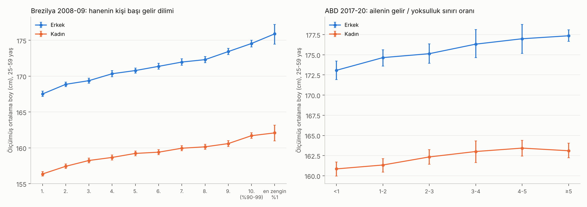

# Gelir ve Boy · Sürüm 1: Gelir Dilimlerinde Ölçülmüş Boy — Zenginler Ne Kadar Uzun?

> **Sürüm:** 1 · **Tarih:** 2026-11-04 · **Durum:** güncel
>
> **Acelen varsa:** en alttaki "En basit özet" bölümüne atla.
>
> Bu doküman **tıbbi tavsiye değildir.** Ortalamaları anlatır; tek bir insanın boyunu ya da gelirini söylemez.

**Kanıt seviyeleri:**

| Etiket | Anlamı |
|---|---|
| **A** | Meta-analiz ya da birden çok büyük, bağımsız çalışma |
| **B** | Tek büyük, iyi tasarlanmış çalışma |
| **C** | Küçük çalışma, ikincil kaynak |
| **V** | Bu çalışmanın kendi gerçek veri analizi |
| **D** | Model, yorum ya da varsayım |

---

## Soru ve kapsam

1. Yüksek gelirli, yüksek hayat standardında yaşayan yetişkinler ortalamada ne kadar uzun?
2. En zengin kesim ile ortanca ve en yoksul kesim arasında kaç cm fark var?
3. Bu farkın yönü ne? Uzun olmak mı insanı zengin yapıyor, varlıklı ailede büyümek mi insanı uzun yapıyor?
4. CEO'lar, aristokratlar ve milyarderler gibi elit gruplar hakkında ne biliniyor?

**Kapsam dışı:** Çocukların büyümesine dair klinik öneriler (bkz. repodaki boy araştırmaları). Bu araştırma yetişkinlerin ortalamalarını anlatıyor.

## Yöntem

**Dört aşama:**

1. **Literatür.** İki paralel ajan:
   - G1: gelir ile boy arasındaki ilişki ve nedenselliğin yönü;
   - G2: elit gruplar (CEO'lar, liderler, tarihsel üst sınıf, en üst %1).
2. **Kendi analiz.** Ön kayıtlı (PLAN.md commit `6901894`). Kod çalıştırılmadan önce commit edildi; çıktılar ayrı commit'te.
3. **Doğrulama.** Şeytanın avukatı kodu satır satır okudu, ana sayıları bağımsız tekrarladı ve sonuçları iki yönden çürütmeye çalıştı. İtirazlarının hesapları depoya keşif kodu olarak eklendi (`kesif.py`).
4. **Rapor.**

**Veri:**

| Kod | Veri | Boy | Gelir | Örneklem (25-59 yaş) |
|---|---|---|---|---|
| BR | [IBGE POF 2008-09](https://ftp.ibge.gov.br/Orcamentos_Familiares/Pesquisa_de_Orcamentos_Familiares_2008_2009/Microdados/) (Brezilya, ulusal temsilî) | **Ölçülmüş** | Hanenin kişi başı aylık geliri; 10 dilim + en zengin %1 | 33.643 erkek, 38.904 kadın |
| US | [NHANES 2017-Mart 2020](https://wwwn.cdc.gov/nchs/nhanes/) (ABD, ulusal temsilî) | **Ölçülmüş** | Ailenin geliri / yoksulluk sınırı oranı (5'te kesilmiş) | 1.906 erkek, 2.134 kadın |

**Neden bu iki ülke?** İkisinde de boy beyan değil, ölçüm. Gelir bilgisi var ve veriler herkese açık. Türkiye için gelire göre ölçülmüş yetişkin boyu verisi bulunamadı.

**Önemli sınır:** ABD'de gelir oranı 5'te kesildiği için en üst grup "yoksulluk sınırının ≥ 5 katı". Bu grup nüfusun ~%30'u; en zengin %1 ayrılamıyor. Brezilya'da en zengin %1 ayrılabiliyor.

### Plandan sapmalar

Tamamı [PLAN.md](analiz/PLAN.md) içinde:

1. **Bootstrap'te tekil matris:** ABD'de küme sayısı az; bazı bootstrap örneklerinde nadir bir kategori boş kaldı. Çözüme çok küçük bir sırt terimi eklendi; ana tahminler değişmedi.
2. **Doğrulama sonrası düzeltmeler:**
   - "≥5 grubu kabaca en zengin beşte bir" ifadesi yanlıştı; gerçek pay ~%30.
   - "Ortanca", 5. ve 6. dilimlerin ortalaması.
   - Ön kayıtlı K2 etiketi ("%X bileşimden") yanıltıcıydı, çünkü yaş düzeltmesi farkı büyütüyor. Raporda doğru hesap kullanıldı.
   - Ek kontroller ön kayıtsız keşif olarak eklendi.

## Bulgular

### 1. Gelir dilimlerinde ölçülmüş ortalama boy (V)

**Brezilya (2008-09), 25-59 yaş:**

| Gelir dilimi | Erkek (cm) | Kadın (cm) |
|---|---|---|
| 1. (en yoksul %10) | 167,5 | 156,4 |
| 5.-6. (ortanca) | 171,1 | 159,3 |
| 9. | 173,4 | 160,6 |
| 10. (en zengin %10) | 174,7 | 161,7 |
| **En zengin %1** | **175,9** | **162,1** |

**ABD (2017-20), 25-59 yaş:**

| Gelir / yoksulluk sınırı | Erkek (cm) | Kadın (cm) |
|---|---|---|
| < 1 (yoksul) | 173,1 | 160,9 |
| 2-3 | 175,1 | 162,3 |
| ≥ 5 (en üst ~%30) | 177,4 | 163,1 |

### 2. Farklar ve düzeltmeler

**Brezilya, en zengin %10 − en yoksul %10:**

| Model | Erkek | Kadın |
|---|---|---|
| Ham | **+7,2 cm** [6,6; 7,8] | +5,4 [4,9; 5,9] |
| Yalnız yaş düzeltmeli (keşif) | +7,6 [7,1; 8,2] | +5,9 [5,4; 6,4] |
| + eyalet, kent/kır, ırk (ön kayıtlı) | +5,2 [4,7; 5,8] | +4,1 [3,6; 4,6] |
| + eğitim (keşif) | +2,5 [1,6; 3,4] | +1,7 [0,9; 2,5] |

- **En zengin %10 − ortanca:** erkekte +3,6 cm ham, +3,3 düzeltmeli; kadında +2,4 ve +2,2.
- **En zengin %1 − en zengin %10'un geri kalanı:** erkekte +1,3 cm [−0,2; 2,7] ham, +1,6 [0,3; 2,8] düzeltmeli.
- En zengin %1'deki erkeklerin %26'sında ölçülmüş boy yok. Bu kişilerin beyan ettiği boy, ölçülenlerinkinden ~1 cm uzun. Bu yüzden en tepedeki ortalama gerçekte biraz daha yüksek olabilir.
- **Bölge içinde (keşif):** Fark Güneydoğu'da (en zengin bölge) 3,7 cm, Kuzey ve Kuzeydoğu'da ~7 cm. Eşitsizliğin en büyük olduğu yerde fark da en büyük.
- **Kohortlar:** 1949-63 doğumlularda 7,7 cm, 1974-84 doğumlularda 7,2 cm. Brezilya'da fark genç kuşakta pek daralmamış.
- **Tepede yassılaşma (keşif):** Gelir iki katına çıkınca boy alt yarıda ~1,4 cm artıyor (log birimi başına 2,1 cm); en üst %10'da artış bunun yarısından az (log birimi başına 0,9 cm).
- **Örtüşme:** En yoksul dilimden rastgele seçilen bir erkek, en zengin dilimden rastgele seçilen bir erkekten **%23 olasılıkla daha uzun.** Gruplar arasında ortalama fark var, ama bireyler arasında büyük örtüşme var.

**ABD, ≥5 − <1:**

| Model | Erkek | Kadın |
|---|---|---|
| Ham | +4,3 cm [3,1; 5,5] | +2,2 [0,9; 3,6] |
| + ırk/köken, doğum yeri (ön kayıtlı) | +3,1 [1,7; 4,3] | +1,7 [0,4; 3,1] |
| + eğitim (keşif) | +2,2 [0,5; 3,8] | −0,1 (sıfır) |
| **Yalnız ABD doğumlular (keşif)** | **+2,0** [0,6; 3,4] | +0,9 [−0,5; 2,6] |
| Yalnız ABD doğumlu beyazlar (keşif) | +1,3 [−1,0; 3,4] | +0,4 [−1,2; 2,5] |
| Yalnız yurt dışı doğumlular (keşif) | +7,1 [4,0; 10,0] | +3,6 [1,9; 5,0] |

- ABD'de en yoksul grubun %34'ü yurt dışında doğmuş, en üst grubun %15'i. Ham farkın önemli bir kısmı göçten geliyor: daha kısa nüfusların geldiği ülkelerden gelen göçmenler, ortalamada daha düşük gelir grubunda.
- ABD'de doğanlar arasında fark **~2 cm**. Bu, zengin ülkelerdeki literatür aralığıyla (1,5-3 cm) uyumlu.

### 3. Testler ve kararlar

| Kod | Test | Sonuç |
|---|---|---|
| T1-T4 | Veri bütünlüğü, örneklem büyüklükleri, ABD erkek ortalaması (175,9 cm) | 4/4 GEÇTİ |
| H1 | BR erkek: en zengin − en yoksul dilim ≥ 3 cm | GEÇTİ (+7,2) |
| H2 | BR: düzeltme farkı küçültüyor ama sıfırlamıyor | GEÇTİ (5,2) |
| H3 | US erkek: ≥5 − <1 > 0 | GEÇTİ (+4,3) |
| H4 | US erkek: ırk ve doğum yeri düzeltmesinden sonra da > 0 | GEÇTİ (+3,1). Ama yalnız ABD doğumlu beyazlarda anlamlı değil (keşif) |
| H5 | Kadınlarda da gradyan (BR ve US) | GEÇTİ |
| H6 | En zengin %1'de plato: %1 − üst dilimin geri kalanı < 2 cm | **KALDI** (+1,3, üst sınır 2,7). Plato gösterilemedi; ama log-gelir eğimi tepede yarıya iniyor |

**K1:** Brezilya'da en zengin %10 ortancadan **3,3 cm** (düzeltmeli; ham 3,6) uzun. Ön kayıtlı sınıflandırmaya göre bu "belirgin uzun". Not: bu, gelir eşitsizliği çok yüksek bir ülkede, 2008-09 verisi. Zengin ülkelerde fark yaklaşık yarısı.

**K2 (düzeltilmiş):** Yaş düzeltmeli farktan (7,6 cm) bölge, kent/kır ve ırk düzeltmesine (5,2 cm) inince farkın ~%32'si kayboluyor. Bunun neredeyse tamamı coğrafyadan geliyor, ırkın katkısı ~0,2 cm.

### 4. Literatür: zengin ülkelerde fark ve nedenselliğin yönü

| Bulgu | Kaynak | Kanıt |
|---|---|---|
| Zengin ülkelerde en üst ve en alt gelir/sınıf grubu arasında ~1,5-3 cm (ABD, İngiltere, Avrupa) | G1 taraması: Komlos 2009 (NHANES), Case ve Paxson, Avrupa eğitim verileri | B |
| 54 düşük ve orta gelirli ülkede en zengin beşte birdeki kadınlar en yoksuldan ~2 cm uzun | [Subramanian ve ark. 2011, PLoS ONE](https://pmc.ncbi.nlm.nih.gov/articles/PMC3080396/) | A |
| **İngiliz çocuklarında sınıf farkı daraldı:** 1946 kohortunda ~4 cm, 2001 kohortunda 1,2-1,7 cm | Bann ve ark. 2018, Lancet Public Health | B |
| Brezilya (Pelotas): **Doğumdaki aile geliri** yetişkin boyunu 19 yaştaki gelirden daha iyi öngörüyor; erkekte ~4 cm fark | [Barros ve ark. 2006, IJE](https://pmc.ncbi.nlm.nih.gov/articles/PMC2667095/) | B |
| **Boyun gelire nedensel etkisi küçük:** UK Biobank genetik analizinde 6,3 cm fazla boy yılda ~£1.130 daha yüksek hane geliri getiriyor (erkekte). Bu, gözlemsel ilişkinin ~üçte biri | [Tyrrell ve ark. 2016, BMJ](https://pmc.ncbi.nlm.nih.gov/articles/PMC4783516/) | B |
| Kardeşler içinde genetik analizde boyun eğitime etkisi sıfıra iniyor | [Brumpton ve ark. 2020, Nature Communications](https://pmc.ncbi.nlm.nih.gov/articles/PMC7360778/) | B |
| Boy primi büyük ölçüde çocukluk bilişsel becerisiyle açıklanıyor; ergenlik boyu yetişkin boyundan daha önemli | [Case ve Paxson 2008](https://www.nber.org/papers/w12466) · [Persico ve ark. 2004](https://www.nber.org/papers/w10522) | B |
| İsveç: 10 cm başına ~%6 gelir; prim büyük ölçüde ortalamanın altındaki boylarda | [Lundborg ve ark. (IZA DP 4266)](https://docs.iza.org/dp4266.pdf) | B |

### 5. Literatür: elit gruplar

| Bulgu | Kaynak | Kanıt |
|---|---|---|
| **İsveç, 1,27 milyon erkek (askerlikte ölçülmüş):** nüfus 179,1 cm; küçük şirket CEO'su 180,3 (+1,2); **en büyük şirketlerin CEO'su 183,5 (+4,4)**; aile şirketini miras alan CEO yalnız +0,8 | [Adams, Keloharju ve Knüpfer 2018, J Financial Economics (çalışma makalesi)](https://www.ifn.se/media/u32noglv/wp1024.pdf) | B |
| Aynı çalışmada büyük şirket CEO'ları boyda nüfusun %74'ünü, bilişsel beceride %83'ünü, bilişsel olmayan becerilerde %92'sini geçiyor. **Boy, onları en az ayıran özellik** | Aynı | B |
| İsveç: 10 cm daha uzun olmak yönetici olma olasılığını 2,2 yp artırıyor; beceriler eklenince ilişki yarıdan fazla küçülüyor | [Lindqvist 2012 (IFN WP 835)](https://www.ifn.se/media/hfuhpv0i/wp835.pdf) | B |
| Tarihte uç örnek: 1800'lerde İngiltere'de Sandhurst askeri okulu öğrencileri ile yoksul çocuklar arasında ergenlikte 16-22 cm fark. Temsilî yetişkin verilerinde tarihsel sınıf farkı 1-5 cm | [Floud ve Harris 1997](https://www.nber.org/chapters/c7429) ve G2 taraması | B + C |
| **En üst %1 gelir ya da servet için ölçülmüş boy verisi yayımlanmamış.** Milyarder listeleri ünlülük yanlılığı taşıyor | G2 taraması; ayrıca bu çalışmadan önce yapılan bir deneme (repoya eklenmedi): Forbes'un ilk 1.000 milyarderinden yalnız 10'unun boyu kamuya açık kaynaklarda bulunabildi, 53 Türk milyarderinin hiçbirinin bulunamadı | C |
| Türkiye'de gelire göre temsilî yetişkin boy verisi yok. İstanbul'da üniversite öğrencilerinde en düşük sosyoekonomik gruptaki 29 erkek diğerlerinden ~4 cm kısa | [Bayrak Demirel ve ark. 2026](https://pmc.ncbi.nlm.nih.gov/articles/PMC12989891/) | C |

### 6. Sentez (D)

Gelir ile boy arasındaki ilişki üç kattan oluşan bir yapıya benziyor:

- **Alt kat, çocukluk koşulları (en büyük pay):** Varlıklı ailede büyüyen çocuk daha iyi beslenir, daha az hastalanır ve daha uzun olur. Aynı aile ona eğitim ve fırsat da verir. Boy ile gelir arasındaki ilişkinin çoğu buradan geliyor: ikisi de aynı kaynaktan besleniyor. Eğitim hesaba katılınca farkın yarıya inmesi ve Pelotas'ta doğumdaki gelirin daha iyi öngörmesi bunu gösteriyor.
- **Orta kat, bileşim:** Bölge, göç, kent ve kır. Brezilya'da zengin bölgeler daha uzun; ABD'de yoksul gruplarda daha kısa nüfuslardan göçmenler fazla. Bu katman farkın üçte biri kadarını açıklıyor.
- **Üst kat, boyun kendi etkisi (küçük):** Uzun olmanın gelire doğrudan etkisi var ama gözlemsel ilişkinin yaklaşık üçte biri kadar. Bu etki esas olarak ortalamanın altındaki boylarda görülüyor. Elitlerde bu küçük etki seçimin her basamağında birikiyor: en büyük şirketlerin CEO'ları +4,4 cm.

## Sonuçlar

1. **Yüksek gelirliler ortalamada daha uzun, ama fark ülkeye göre çok değişiyor: Brezilya'da (2008-09, ölçülmüş boy) en zengin %10'daki erkekler en yoksul %10'dan 7,2 cm, ortancadan 3,6 cm uzun; ABD'de doğmuş Amerikalılarda en üst ve en alt gelir grubu arasında ~2 cm; zengin ülkelerin literatüründe 1,5-3 cm.** (V + B)
2. **En zengin %1, en zengin %10'un geri kalanından yalnızca ~1-1,6 cm daha uzun; gelir arttıkça eklenen boy tepede yarıdan fazla azalıyor (ön kayıtlı plato testi kesin sonuç vermedi).** (V)
3. **Farkın büyük kısmı boyun kendisinden değil, kişinin nereden geldiğinden: eğitim hesaba katılınca fark yarıya iniyor (Brezilya erkek 4,7 → 2,5 cm); bölge ve göç de üçte birini açıklıyor.** (V)
4. **Nedensellik çoğunlukla çocukluktan boya doğru işliyor: varlıklı ailede büyümek hem boyu hem fırsatları artırıyor; boyun gelire doğrudan etkisi gözlemsel ilişkinin ~üçte biri ve kardeşler arasında bazen sıfır.** (B + A)
5. **Elitlerde fark birikiyor ama yine sınırlı: İsveç'te en büyük şirketlerin CEO'ları nüfustan 4,4 cm uzun; küçük şirket CEO'ları 1,2 cm, aile şirketini miras alanlar 0,8 cm; boy CEO'ları zekâ ve liderlik becerilerinden daha az ayırıyor.** (B)
6. **Gruplar arasında büyük örtüşme var: Brezilya'da en yoksul dilimden rastgele bir erkek, en zengin dilimden rastgele bir erkekten %23 olasılıkla daha uzun.** (V)
7. **Sınıf farkı ülkeler zenginleştikçe daralıyor: İngiltere'de çocuklarda ~4 cm'den 1,2-1,7 cm'ye; Brezilya 2008-09'da henüz daralmamış.** (B + V)
8. **En üst %1 gelir ya da servet ve Türkiye için ölçülmüş, temsilî yetişkin boy verisi yayımlanmamış; milyarder boy listeleri ünlülük yanlılığı taşıyor.** (C)

## Sınırlamalar

- **Kesitsel veri.** Analiz ilişkiyi ölçer, yönü ayıramaz. Yön yorumu literatüre dayanıyor.
- **Brezilya aşırı bir örnek.** Gelir eşitsizliği çok yüksek ve veri 2008-09'dan. Türkiye'ye doğrudan aktarılamaz.
- **ABD'de en üst grup geniş** (~%30). En zengin %1 ayrılamıyor; küme sayısı az olduğu için güven aralıkları biraz dar olabilir.
- **Gelir tek dönemlik ve hane düzeyinde.** Ölçüm hatası farkı küçültür. Ebeveyninin evinde yaşayan yetişkinlerin geliri aslında ailenin geliri. Gelir tanımını değiştirmek sonucu ±0,7 cm oynatıyor.
- **Eksik boy:** Brezilya'da 25-59 yaştakilerin ~%14'ünde, en zengin %1'de ~%26'sında ölçülmüş boy yok. Atanmış boyla sonuç değişmiyor.
- **Bu sürümde ayrı bir kaynak denetçisi çalışmadı.** Literatür sayılarının doğrulama düzeyi ajan raporlarında etiketli; bazıları yalnız özetten.

## Kaynaklar

**Veri:**
- [IBGE, Pesquisa de Orçamentos Familiares 2008-2009, mikro veri](https://ftp.ibge.gov.br/Orcamentos_Familiares/Pesquisa_de_Orcamentos_Familiares_2008_2009/Microdados/)
- [CDC, NHANES 2017-Mart 2020 Pre-Pandemic](https://wwwn.cdc.gov/nchs/nhanes/)

**Literatür:**
- [Adams, Keloharju ve Knüpfer 2018 (IFN WP 1024)](https://www.ifn.se/media/u32noglv/wp1024.pdf)
- [Lindqvist 2012 (IFN WP 835)](https://www.ifn.se/media/hfuhpv0i/wp835.pdf)
- [Tyrrell ve ark. 2016, BMJ](https://pmc.ncbi.nlm.nih.gov/articles/PMC4783516/)
- [Brumpton ve ark. 2020, Nature Communications](https://pmc.ncbi.nlm.nih.gov/articles/PMC7360778/)
- [Case ve Paxson 2008 (NBER w12466)](https://www.nber.org/papers/w12466)
- [Persico, Postlewaite ve Silverman 2004 (NBER w10522)](https://www.nber.org/papers/w10522)
- [Lundborg, Nystedt ve Rooth (IZA DP 4266)](https://docs.iza.org/dp4266.pdf)
- [Böckerman ve Vainiomäki 2013 (IZA DP 7424)](https://docs.iza.org/dp7424.pdf)
- [Subramanian ve ark. 2011, PLoS ONE](https://pmc.ncbi.nlm.nih.gov/articles/PMC3080396/)
- [Barros ve ark. 2006, International Journal of Epidemiology](https://pmc.ncbi.nlm.nih.gov/articles/PMC2667095/)
- [Komlos 2009 (NBER w14635)](https://www.nber.org/papers/w14635)
- [Floud ve Harris 1997 (NBER)](https://www.nber.org/chapters/c7429)
- [Bayrak Demirel ve ark. 2026](https://pmc.ncbi.nlm.nih.gov/articles/PMC12989891/)

**Bu depoda:** [Ön kayıt](analiz/PLAN.md) · [Kod](analiz/calistir.py) · [Keşif kodu](analiz/kesif.py) · [Çıktılar](analiz/ciktilar/) · [Kadınların boy beklentisi](../../kadinlarin-boy-beklentisi/1-soylenen-secilen-yasanan/) · [Çekicilik ve sohbet, sürüm 4](../../cekicilik-ve-sohbet/4-agirlikli-puan-tablosu/)

## En basit özet

- **Zenginler ortalamada biraz daha uzun.** Zengin ülkelerde en zengin ile en yoksul grup arasındaki fark yaklaşık 2-3 cm; Brezilya gibi eşitsizliğin çok yüksek olduğu ülkelerde 7 cm'ye kadar çıkıyor.
- **En tepe pek farklı değil:** En zengin %1, zengin %10'un geri kalanından yalnızca ~1-1,5 cm uzun.
- **Sebep çoğunlukla ters yönde:** Varlıklı ailede büyüyen çocuk iyi beslenip sağlıklı büyüdüğü için uzun oluyor; aynı aile ona eğitim ve fırsat da veriyor. Uzun olmanın zengin etmesi gerçek ama küçük bir etki.
- **Büyük şirketlerin CEO'ları ortalamadan ~4 cm uzun,** ama onları en çok ayıran şey boy değil: zekâ, liderlik ve stres dayanıklılığı.
- **Bireyler arasında örtüşme büyük:** En yoksul gruptan rastgele bir erkek, en zengin gruptan rastgele bir erkekten her 4-5 karşılaştırmanın birinde daha uzun.
