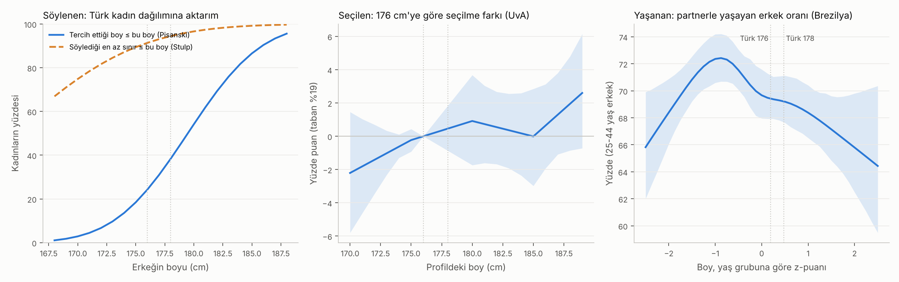

# Kadınların Boy Beklentisi · Sürüm 1: Söylenen, Seçilen, Yaşanan

> **Sürüm:** 1 · **Tarih:** 2026-10-31 · **Durum:** güncel
>
> **Acelen varsa:** en alttaki "En basit özet" bölümüne atla.
>
> Bu doküman **tıbbi tavsiye değildir.** Amaç teselli etmek değil, gerçek insan verisinin ne söylediğini olduğu gibi göstermek. Sonuç ne çıktıysa öyle yazıldı.

**Kanıt seviyeleri:**

| Etiket | Anlamı |
|---|---|
| **A** | Meta-analiz ya da birden çok büyük, bağımsız çalışma |
| **B** | Tek büyük, iyi tasarlanmış çalışma |
| **C** | Küçük çalışma, ikincil kaynak, anket |
| **V** | Bu çalışmanın kendi gerçek veri analizi |
| **D** | Model, aktarım ya da varsayım |

---

## Soru ve kapsam

Gerçek kadınlar partnerde hangi boyu bekliyor? Özellikle Türkiye'de **176 cm** ve **178 cm** bir erkek bu beklentilerin neresinde duruyor, aradaki 2 cm ne kadar şey değiştiriyor?

Literatür, insanların **söylediği** tercih ile **gerçekte yaptığı** seçimin sık sık ayrıştığını gösteriyor. Bu yüzden soru üç katmanda ayrı ayrı ölçüldü:

1. **Söylenen:** Kadınlar anketle hangi boyu ideal ya da kabul edilebilir diye beyan ediyor?
2. **Seçilen:** Boyu rastgele atanmış profiller arasında kadınlar gerçekte kimi seçiyor?
3. **Yaşanan:** Ölçülmüş boylarla, gerçek çiftlerde kimler birlikte ve erkeklerin partnerle yaşama oranı boya göre değişiyor mu?

**Kapsam dışı:** Kısa süreli ilişki ve flört uygulamalarının iç verileri (şirketler yayımlamıyor), boy dışındaki özelliklerin ayrıntısı (bkz. [Çekicilik ve sohbet, sürüm 3](../../cekicilik-ve-sohbet/3-boy-mu-fizik-mi-zeka-mi/)). Araştırmayı başlatan kişinin kişisel bilgileri rapora alınmadı.

## Yöntem

**Dört aşama:**

1. **Tarama.** Altı paralel ajan:
   - L1: söylenen tercihler (ideal, en az, en çok boy; "benden uzun olsun");
   - L2: gerçek davranış (online flört, hızlı tanışma, uygulama filtreleri);
   - L3: gerçek çiftlerde boy farkı;
   - L4: Türkiye verileri;
   - L5: indirilebilir açık veri setleri;
   - L6: karşı kanıtlar ve beklentiyi değiştiren etkenler.
2. **Kendi analizler.** Ön kayıtlı (PLAN.md commit `cb0885a`). Kod çalıştırılmadan önce commit edildi (`93d0be8`), çıktılar ayrı commit'te (`318e566`). Ön kayıtsız keşif analizleri sonradan, ayrı dosyada (`kesif.py`).
3. **Doğrulama.** Üç bağımsız ajan:
   - kaynak denetçisi (12 kilit iddia birincil kaynaktan);
   - bağımsız yeniden analiz (kodu görmeden aynı veriden);
   - şeytanın avukatı (sonuçları iki yönden çürütmeye çalıştı, kodu satır satır okudu).
4. **Rapor.**

**Veri:**

| Kod | Veri | Ne içeriyor |
|---|---|---|
| PI | [Pisanski ve ark. 2022](https://doi.org/10.3389/fpsyg.2022.937146), [OSF ah97w](https://osf.io/ah97w/) | Kanada, Küba, Norveç, ABD; 319 kadın; kendi boyu + tercih edilen partner boyu (5 silüet: 165-185 cm) |
| UV | [Witmer ve ark. 2025](https://osf.io/84abw/) (Amsterdam Üniversitesi deneyi; katılımcılar Almanya'da) | 224 kadın, 8.064 seçim; profil boyu 170-189 cm rastgele |
| SL | [Sleiman, Melios ve Dolan 2025](https://doi.org/10.7910/DVN/G1H0UA) (CC0) | İngiltere, 1.250 kadın × 16 ikili seçim; profil boyu 172,7 / 182,9 cm rastgele |
| BR | [IBGE POF 2008-09](https://ftp.ibge.gov.br/Orcamentos_Familiares/Pesquisa_de_Orcamentos_Familiares_2008_2009/Microdados/) (Brezilya, kamu verisi) | ~190 bin kişi, **ölçülmüş** boy, hane içi konum; 30.789 çift; 22.378 erkek (25-44 yaş) |
| TR | [TBSA 2017](https://krtknadmn.karatekin.edu.tr/files/sbf/TBSA_RAPOR_KITAP_20.08.pdf) | 19-30 yaş, stadiometre: kadın 160,5 ± 6,62, erkek 174,7 ± 6,88 cm |

**Neden Brezilya?** Türkiye için hem eşlerin boyunu hem de partnersiz erkekleri içeren açık bir veri bulunamadı. Brezilya verisi ölçülmüş boy içeriyor, büyük ve ulusal temsilî. Ortalamalar da Türkiye'ye yakın (25-44 yaş erkek 171,9 cm). Karşılaştırma yüzdelikle yapıldı: Türkiye'de 176 cm genç erkeklerin %57,5'inden uzun, 178 cm %68,4'ünden. Brezilya'da aynı yüzdeliklere bakıldı.

**Gizlilik:** SL dosyasında katılımcıların IP adresi ve konumu vardı. Kod dosyayı indirip gerekli sütunları aldıktan sonra ham dosyayı siliyor; bu bilgiler hiçbir çıktıya yazılmadı.

### Ön kayıtlı analizler (özet)

| Katman | Analiz | Yöntem |
|---|---|---|
| Söylenen | A1-A2 | Aralıklı (sansürlü) normal regresyon: tercih = kendi boy + ülke. Türk kadın boy dağılımına aktarım |
| Söylenen | A3 | Stulp 2013'ün "en az kabul edilen" ve "istenen" fark parametreleri, Türk dağılımına aktarım |
| Seçilen | B1-B2 | UV: kadın içi doğrusal olasılık modeli, parçalı doğrusal boy (175/180/185 cm düğüm), kadına göre bootstrap |
| Seçilen | B3-B5 | SL: 8 özellikli seçim modeli; kadının kendi boyuna göre alt gruplar |
| Yaşanan | C1 | BR: gerçek çiftler, "kadın daha uzun" oranı; rastgele eşleşmeyle karşılaştırma (1.000 karıştırma) |
| Yaşanan | C2-C4 | BR: 25-44 yaş erkeklerde partnerle yaşama ~ boy (yaş grubu içinde z-puanı, kübik spline), örneklem birimine göre bootstrap; eşin boyu; eksik boy duyarlılığı |

**Testler:** 14 ön kayıtlı test (5 teknik, 9 hipotez). **10 geçti, 2 kaldı, 2 geçersiz** (ayrıntı: Bulgular, bölüm 5).

### Plandan sapmalar

Tamamı [PLAN.md](analiz/PLAN.md) içinde, tarih ve gerekçeyle:

1. **Kod yazılırken (sonuçlardan önce):** PI kodlama ayrıntıları, UV göreli boy düğümleri, SL'nin 8 özelliği netleştirildi.
2. **T1 yanlış referansa dayanıyordu.** SL kodlama kontrolü için seçilen yayımlanmış değerler, kadınların kısa/uzun seçimi değil, tüm katılımcılarda parti eşleşmesine göre hesaplanmış başka bir modelin çıktısıydı (yazarların kodu, satır 122-125). T1 kurala uygun olarak KALDI sayıldı. Bu yüzden SL'ye dayanan iki hipotez (H4, H5) doğrulayıcı değil, **keşif** olarak raporlanıyor. Doğru karşılaştırmada (makalenin kadınlar için AMCE değeri 0,062) bizim kodlamamız +0,069 veriyor. Yazarların modeli biraz farklı olduğu için bu yakınlık beklenen düzeyde.
3. **C4 kod eksikliği:** Eksik boy oranı partnerlilerle partnersizler arasında 8,2 yp farklı çıktı (%16,4'e karşı %24,6). Plan bu durumda atanmış boyla tekrar istiyordu; ilk kod bunu yalnız bildiriyordu. Adım ilk çalıştırmadan sonra eklendi.
4. **Tarih düzeltmesi:** PLAN.md'de tarih yanlışlıkla bir gün ileri yazılmıştı; düzeltildi. Commit sırası değişmedi.
5. **H6a'nın sınırı:** 176'nın yüzdeliğini medyanla karşılaştırıyor. Soruyla doğrudan ilgili karşılaştırma (176 → 178 ve 183) ön kayıtta yoktu, keşif olarak eklendi.

## Bulgular

### 1. Türkiye: neyi biliyoruz, neyi bilmiyoruz?

- **Türk kadınlarının partner boyu tercihi hiçbir yerde ölçülmemiş.** İdeal boy, en az kabul edilen boy ya da "benden uzun olsun" diyen kadın oranı için tek bir Türkiye sayısı bulunamadı. Türk eş seçimi çalışmalarında (1.126 kişilik bir üniversite çalışması, 35.475 kişilik TAYA 2016) "boy" maddesi yok.
- **Medyadaki iki "Türkiye" sayısı yanlış çıktı:** Hürriyet'teki "%91" bir Fransız anketinden; Sözcü'nün "ideal boy 185" sayısı gazetenin kendi hesabı.
- **Ölçülmüş nüfus boyu var (TBSA 2017, 19-30 yaş):**
  - Kadın 160,5 ± 6,62 cm. Kadınların ~%92'si 170 cm'nin, ~%99'u 176 cm'nin altında.
  - Erkek 174,7 ± 6,88 cm. 176 cm erkeklerin %57,5'inden, 178 cm %68,4'ünden uzun.
  - İstanbul'daki bir üniversite örnekleminde ortalamalar daha yüksek: kadın 164,3, erkek 178,1 cm.
- **Bu yüzden aşağıdaki her Türkiye sayısı bir aktarımdır:** başka ülkelerde ölçülen "kadının boyu → beklediği boy" ilişkisi, Türk kadınlarının boy dağılımına uygulandı. Kültürel farklar bu aktarıma girmiyor.

### 2. Söylenen: ideal ve kabul

**İdeal (PI, 319 kadın, aralıklı model):**
- 165 cm'lik bir kadının tercih ettiği ortalama partner boyu 180,8 cm. Kadın 1 cm uzadıkça tercih 0,30 cm [0,21; 0,40] artıyor.
- Kadınların %36'sı ölçeğin en uzun silüetini (185) seçti. Model bunu sansürlü veri olarak ele alıyor.
- Kısa ve uzun süreli ilişki arasında fark yok (aynı sonuç makalede de var).

**Türk kadın dağılımına aktarım:**

| Erkeğin boyu | Bu boy kadının **idealine** ulaşıyor ya da geçiyor (PI) | Silüet sınırları ±1 cm kaydırılınca | Bu boy kadının söylediği **en az** sınırı geçiyor (Stulp) |
|---|---|---|---|
| 174,7 (Türk erkek ort.) | %17 | %12-22 | — |
| 176 | **%24** [18; 30] | %18-31 | **%88-91** |
| 178 | **%38** [32; 44] | %31-46 | **%93-95** |
| 180 | %54 | %46-62 | %97 |

- 160,5 cm'lik bir kadının (Türk ortalaması) medyan ideali **179,5 cm** [178,8; 180,2].
- Kentli üniversiteli kadınlarda (ort. 164,3 cm) idealin ≤176 olduğu pay %17, ≤178 olduğu pay %30.
- **İdeal ile kabul farklı şeyler.** Kadınların çoğunun ideali yalnız 176'nın değil, ortalama Türk erkeğinin de üstünde. "İdeal" çoğu insanda ortalamanın üstünde bir şeydir. Kabul sınırı ise çok daha aşağıda: Stulp 2013'te kadınlar partnerin kendilerinden en az **+3,7 cm** uzun olmasını istiyor; "istenen" fark +13,5 cm.
- **176 ile 178 arasındaki ideal farkı kaba.** Silüet ölçeği 5 cm adımlı ve iki boy arasında tek bir sınır var (177,5). Aradaki 14 puanlık fark, büyük ölçüde modelin ara değerinden geliyor.

**Literatürden ek sayılar:**
- **Birleşik Krallık (Dial ve ark. 2025, 122 kadın):** ideal 181,2, en az 169,0, en çok 192,7 cm; kadınların %43'ü boyu "önemli" buluyor.
- **ABD hızlı tanışma (Stulp ve ark. 2013, 2.847 kadın):** 175 cm'lik bir erkeği kadınların **%33,5**'i, 178 cm'liği **%13,5**'i, 180 cm'liği %5,3'ü kendi aralığına göre "çok kısa" buluyor. ABD'li genç kadınlar Türk kadınlarından ortalama ~3 cm uzun (NCD-RisC: 163,5'e karşı 160,5); kısa kadınlarda bu oranlar daha düşük.
- **ABD YouGov 2021:** Kadınların %63'ü partnerinin kendisinden uzun olmasını tercih ediyor, %24'ü "fark etmez" diyor.

### 3. Seçilen: rastgele boylu profillerde gerçek seçim

**UV (224 kadın, taban seçilme oranı %19,2):**

| Karşılaştırma | Seçilme olasılığı farkı (yp) |
|---|---|
| 176 → 178 (ön kayıtlı spline) | **+0,5** [−0,9; +1,8] |
| 176 → 178 (basit doğrusal, keşif) | **+0,35** [+0,03; +0,69], göreli ~%2 |
| 176 → 180 | +0,9 [−1,7; +3,7] |
| 2 cm, kadın ≤ 163 cm (Türk ortalamasına yakın; keşif) | −0,15 [−0,71; +0,35] |
| 2 cm, kadın ≥ 170 cm (keşif) | +0,74 [+0,19; +1,30] |
| Profil kadından 10 cm kısa ↔ eşit boy | −14 [−28; +0,3] |

- 2 cm'lik fark seçimde ölçülebilir ama çok küçük. Türk ortalamasına yakın boydaki kadınlarda sıfırdan ayırt edilemiyor.
- Boy bantlarında ham ortalamalar (modelsiz) düzenli bir artış göstermiyor: 176-177 cm %20,8, 178-179 cm %18,5, 180-182 cm %20,9.

**SL (1.250 kadın, keşif; seçim iki profil arasında):**

| Özellik | Seçilme farkı (yp) |
|---|---|
| Uzun (182,9) vs kısa (172,7) | +6,9 [6,0; 7,6] |
| Çekici fotoğraf | +16,6 [15,5; 17,8] |
| Üniversite mezunu | +6,6 [6,0; 7,1] |
| Boy, kadın < 160 cm | +4,1 [2,3; 5,9] |
| Boy, kadın 160-169 cm | +6,2 [5,1; 7,3] |
| Boy, kadın ≥ 170 cm | +10,6 [8,9; 12,4] |

- 10 cm boy farkı, üniversite diploması kadar etkili; çekici fotoğrafın etkisi bunun 2,4 katı.
- Türk kadın boy dağılımıyla ağırlıklandırılınca 10 cm'lik etki +5,5 yp. Doğrusal kabulle 2 cm'ye düşen pay ~+1 yp; kısa kadınlarda ~+0,8 yp.

**Literatürden:**
- **Online flört (Hitsch, Hortaçsu ve Ariely 2006, ABD, ~22 bin kişi):** 6'3"-6'4" erkekler, 5'7"-5'8" erkeklerden %65 daha fazla ilk mesaj alıyor. Yıllık 62.500 $ kazanan, 5'11,5" boyunda bir erkekle eşit ilgi görmek için 5'8" (172,7 cm) erkeğe +138 bin $, 5'10" (177,8 cm) erkeğe ise yalnızca +24 bin $ gerekiyor. Ceza boy kısaldıkça hızla büyüyor.
- **Hızlı tanışma (Belot ve Francesconi, İngiltere):** +5 cm, kadının teklif olasılığını ~0,7 yp artırıyor (taban %11,3). Kadın erkekten uzunsa −3,9 yp (%35 daha az).
- **Söylenen ≠ seçilen (Kurzban ve Weeden 2007):** Kadınların ilanda yazdığı boy tercihi, etkinlikte gerçekten seçtikleri erkeğin boyundaki farkın yalnızca %0,3'ünü açıklıyor.

### 4. Yaşanan: gerçek çiftler ve partnerle yaşama (Brezilya, ölçülmüş boy)

**Çiftler (30.789):**
- Eşler arası boy korelasyonu r = 0,37. Ortalama fark 11,4 ± 8,3 cm.
- Kadının daha uzun olduğu çift **%7,0**. Rastgele eşleşmede %13,2 beklenirdi. Aynı eyalet, kent/kır, yaş ve eğitim grubundan rastgele eşleşmede ise %10,6. Yani "erkek daha uzun olsun" normu gerçek. Ama gözlenen ile rastgele arasındaki farkın ~%40'ı, insanların zaten benzer gruplardan eşleşmesinden geliyor.
- Türkiye'deki 176 yüzdeliğindeki partnerli erkeklerin eşinin kendisinden uzun olma olasılığı **%1,8**; 178 yüzdeliğinde %1,0.

**Partnerle yaşama (25-44 yaş erkek, ortalama %69,7):**

| Karşılaştırma | Fark (yp) |
|---|---|
| Türk-176 yüzdeliği − medyan (ön kayıtlı H6a) | −0,2 [−1,0; +0,5] |
| 176 → 178 (keşif) | −0,2 [−1,4; +1,0] |
| 176 → 183 (keşif) | −1,5 [−3,7; +0,7] |
| 176 → 178, yalnız 35-44 yaş (keşif) | +0,3 [−1,3; +1,7] |
| 176 → 183, yalnız 35-44 yaş (keşif) | −0,6 [−3,2; +2,0] |
| En kısa %10 − medyan (ön kayıtlı H6b, ceza bekleniyordu) | **+2,0** [−0,6; +4,6] |
| Aynısı, eğitim ve eyalet düzeltmeli | +0,7 [−2,1; +3,6] |
| Aynısı, atanmış boyla (eksik boy duyarlılığı) | +0,7 [−1,6; +3,2] |

- **176'dan daha uzun olmak partnerle yaşamayı artırmıyor.** 25-34 yaşta uzunlarda görülen hafif düşüş, uzun erkeklerin ortalamada daha eğitimli olmasından ve geç evlenmesinden geliyor. 35-44 yaşta eğri düz.
- **Kısa uçta beklenen ceza ön kayıtlı testte görülmedi.** Ama bunun nedeni büyük olasılıkla sosyoekonomik farklar. Brezilya'da boy eğitimle (r = 0,20) ve gelirle (r = 0,29) ilişkili, eğitimli erkekler de daha geç birlikte yaşıyor. Eğitim katmanları içinde bakınca, 11 yıldan fazla eğitimli erkeklerde en kısa %10'un partnerle yaşama oranı %58, ortadakilerin %65 (keşif, 503 kişi).
- **Diğer ülkelerde ceza alt uçta görülüyor:**
  - Fransa 2001, 30-39 yaş: 170 cm altı %60, 170-180 cm %76, 180 üstü %74.
  - ABD: ortalamanın 1 SS altındaki erkeklerin evlenme hızı %18 daha düşük; ama evlilikleri daha az bozuluyor (ayrılık hızı %32 düşük).

### 5. Testler ve kararlar

| Kod | Test | Sonuç |
|---|---|---|
| T0 | Beş veri dosyasının SHA-256 özeti | GEÇTİ |
| T1 | SL kodlama kontrolü | **KALDI** (yanlış referans; sapma 2) |
| T2 | UV rastgeleleştirme | GEÇTİ (en büyük \|r\| 0,015) |
| T3 | BR çift sayısı ve r | GEÇTİ (30.789; 0,367) |
| T4 | PI örneklem | GEÇTİ (319) |
| H1 | Türk ortalaması kadının medyan ideali < 180 | GEÇTİ (179,5; üst sınır 180,2) |
| H2 | Kadın boyu → tercih eğimi > 0 | GEÇTİ (0,30) |
| H3 | UV 176 → 178 farkı küçük (üst sınır < 3 yp) | GEÇTİ (+0,5; üst sınır 1,8) |
| H4 | SL boy avantajı uzun kadınlarda daha büyük | GEÇERSİZ (T1); hesap +6,6 yp, p < 0,001 |
| H5 | SL boy etkisi < çekicilik etkisi | GEÇERSİZ (T1); hesap −9,8 yp |
| H6a | BR Türk-176 yüzdeliğinde ceza yok | GEÇTİ (−0,2; alt sınır −1,0) |
| H6b | BR en kısa %10'da ceza var | **KALDI** (+2,0) |
| H7 | Kadın uzun çift oranı rastgeleden düşük | GEÇTİ (%7,0 vs %13,2) |
| H8 | 176/178 yüzdeliğinde eşin daha uzun olma olasılığı < %5 | GEÇTİ (%1,8 / %1,0) |

**Karar kuralları:**
- **K1:** İdeale göre 176, Türk kadınlarının çoğunun söylediği tercihin altında. 178 için durum "yarı yarıya".
- **K2:** 176 → 178 seçimde küçük fark.
- **K3:** Medyanın biraz üstündeki erkekler için partnerle yaşamada ceza görülmedi.
- **K4:** Katmanlar farklı sonuç veriyor: söylenen ideal 176'yı "altta" gösterirken, seçim ve gerçek birliktelik 2 cm için küçük ya da sıfır fark gösteriyor. İkisi de raporlandı.

### 6. Bağımsız doğrulama (3. aşama)

- **Kaynak denetimi:** 12 kilit iddianın 11'i birincil kaynakta doğrulandı. Sleiman değeri 0,062 (0,063 değil). Dört atıf düzeltildi:
  - Hitsch rakamları 2006 çalışma raporundan, 2010 makalesinden değil.
  - Kurzban rakamları 2007 makalesinden.
  - Herpin rakamları 2003 makalesinden.
  - Belot'nun boy katsayısı uyum modelinde yarıya iniyor.
- **Bağımsız yeniden analiz:** Kod görülmeden yazılan ayrı bir analiz, ana sayıların hepsini tekrarladı:
  - tercihi ≤176 olan pay %24,3;
  - UV 176 → 178 farkı +0,46 yp;
  - Brezilya'da Türk-176 yüzdeliği − medyan −0,29 yp;
  - kadın uzun çift oranı %6,98.
- **Şeytanın avukatı:** Ölümcül bir hata bulmadı. Getirdiği itirazlar ve rapora etkisi:
  - H6a zayıf bir karşılaştırma. Doğrudan "176 → daha uzun" karşılaştırması eklendi.
  - 176 ile 178 arasındaki ideal farkı ölçek sınırına bağlı. Sınır kaydırma duyarlılığı eklendi.
  - Uygulama filtreleri hiçbir katmanda ölçülmedi. Bu, sonuçta açıkça yazıldı.
  - Rastgele eşleşme referansı fazla yüksekti. Katmanlı karıştırma eklendi.
  - "+gelir" modeli yorumlanamaz, çünkü hane geliri birlikte yaşamanın sonucu.
  - Stulp aktarımındaki 0,3 eğim senaryosu abartılı bir alt sınır. Kabul aralığı %88-91 / %93-95 olarak verildi.

### 7. Sentez (D)

Üç katman bir bina gibi düşünülebilir:

- **Söylenen ideal binanın vitrini.** Herkes vitrine biraz "ortalamanın üstünü" koyar. Bu vitrinde 176 kadınların çoğunun idealinin altında. Ama ortalama Türk erkeği de öyle.
- **Kabul sınırı kapı.** Kadınların büyük çoğunluğu kendisinden birkaç cm uzun erkeği içeri alıyor. 176 ve 178, Türk kadınlarının ~%90'ı için kapının içinde.
- **Seçim ve birliktelik binanın içi.** Burada 2 cm'lik fark ya çok küçük ya da hiç görülmüyor. Belirleyici olan çekicilik (fotoğraf), eğitim, kişilik gibi başka özellikler.
- **Ölçemediğimiz yer otomatik kapılar: uygulama filtreleri.** Bir kadın "180+" filtresi koyarsa 176 ve 178'in ikisi de görünmez olur. Orada önemli olan 2 cm değil, yuvarlak bir eşiğin altında ya da üstünde olmak. Türk kadınlarının bu filtreyi ne sıklıkla kullandığı bilinmiyor; hiçbir şirket bunu yayımlamıyor.

## Sonuçlar

1. **Türk kadınlarının partner boyu beklentisi hiç ölçülmemiş; bu rapordaki her Türkiye sayısı, başka ülkelerden Türk kadın boy dağılımına yapılmış bir aktarımdır.** Medyada dolaşan iki "Türkiye" sayısı yanlış kaynağa dayanıyor. (C + D)
2. **Söylenen idealde 176 cm, Türk kadınlarının çoğunun idealinin altında kalıyor: ideali ≤176 olan kadınlar ~%24 (ölçek duyarlılığıyla %18-31), ≤178 olanlar ~%38 (%31-46); 160,5 cm'lik kadının medyan ideali 179,5 cm.** Ortalama Türk erkeği (174,7) de kadınların ~%83'ünün idealinin altında; yani "ideal" çoğu insanda ortalamanın üstüdür. (V + D)
3. **Söylenen alt sınıra göre 176 cm'yi Türk kadınlarının ~%88-91'i, 178 cm'yi ~%93-95'i kabul ediyor.** Kadınlar ortalamada partnerin kendilerinden en az ~4 cm uzun olmasını istiyor; ABD'de 175 cm'yi kadınların %33'ü, 178'i %14'ü "çok kısa" buldu, ama Türk kadınları ortalama ~3 cm daha kısa. (B + D)
4. **Boyu rastgele atanmış profillerde 176 → 178 cm farkı seçimde çok küçük: +0,35 yp (göreli ~%2); Türk ortalamasına yakın boydaki kadınlarda sıfırdan ayırt edilemiyor, 170 cm üstü kadınlarda ~+0,7 yp.** (V)
5. **Boyun değeri kadının kendi boyuna bağlı ve diğer özelliklerden küçük: 10 cm boy farkının etkisi 170 cm üstü kadınlarda 160 cm altındakilerin ~2,6 katı; çekici fotoğrafın etkisi 10 cm boyun ~2,4 katı (keşif).** Türk kadınlarının ~%92'si 170 cm'nin altında. (V + B)
6. **Ölçülmüş boyla Brezilya'da, 176 cm'nin yüzdeliğinden 178'e ya da 183'e çıkmak partnerle yaşama oranını artırmıyor (176 → 178: −0,2 yp [−1,4; +1,0]; 35-44 yaşta eğri düz).** Uzunlarda gençken görülen hafif düşüş geç evlilikten geliyor. (V)
7. **"Erkek daha uzun olsun" normu gerçek ama 176-178 cm için pratikte devreye girmiyor: kadının daha uzun olduğu çift %7 (rastgele %10,6-13,2); bu yüzdelikteki erkeklerin eşinin kendisinden uzun olma olasılığı %1-2.** (V + A)
8. **Boyun bedeli ortalamanın altında başlıyor, üstünde değil.** Fransa'da 170 cm altı erkeklerin birlikte yaşama oranı %60, 170-180 arası %76, 180 üstü %74. ABD'de kısa erkekler (ortalamanın 1 SS altı) daha geç evleniyor. Brezilya'da ön kayıtlı "kısa uçta ceza" testi kaldı; bunun sebebi büyük olasılıkla sosyoekonomik karıştırıcılar. (B + V)
9. **Bu çalışmanın ölçemediği tek büyük alan uygulama filtreleri; orada sonucu 2 cm değil, 180 gibi yuvarlak bir eşiğin altında ya da üstünde olmak belirliyor ve 176 ile 178 aynı tarafta kalıyor.** Filtre kullanım oranını hiçbir uygulama yayımlamıyor. (C + D)
10. **Toplam: Türkiye'de 176 ile 178 cm, kadınların büyük çoğunluğunun kabul sınırının üstünde; aradaki 2 cm söylenen idealde görünür bir fark, seçimde ve gerçek birliktelikte ise küçük ya da sıfır.** Bu sonuç, en zayıf halkası olan Türkiye aktarımı ve uygulama filtrelerinin ölçülememesiyle birlikte okunmalı. (V + D)

## Sınırlamalar

- **Türkiye verisi yok.** Tercih tarafındaki her sayı aktarım. Türkiye'deki kültürel normlar (görücü usulü, aile onayı, hipergami) modelde yok. Türkiye'de genç kadın ve erkek ortalamaları arasındaki fark 14,2 cm, Brezilya çiftlerinde ortalama fark 11,4 cm; bu, aktarımı 176/178 lehine bir miktar daha olumlu yapabilir, ama test edilmedi.
- **Söylenen tercih kaba ölçülmüş.** PI'nin 5 basamaklı silüet ölçeği (165-185) hem tavanlı hem de 176 ile 178'i tek bir sınırla ayırıyor.
- **Seçim deneyleri varsayımsal.** UV ve SL'de profiller metin ve fotoğraf; gerçek bir buluşma ya da uygulama değil. SL'de boy yalnız iki düzeyli (172,7 / 182,9).
- **SL bulguları keşif.** Ön kayıtlı kodlama kontrolü yanlış referans yüzünden kaldı; kodlama başka yoldan doğrulandı ama kural gereği doğrulayıcı sayılmadı.
- **"Partnerle yaşama" kaba bir ölçü.** Ayrı yaşayan sevgilileri, flörtü, ilk ilgiyi, ilişki kalitesini ve kiminle eşleşildiğini yakalamıyor. Brezilya verisi 2008-09'dan, uygulamalar yaygınlaşmadan önce.
- **Brezilya ≠ Türkiye.** Yüzdelik eşlemesi ortalama ve dağılım farkını giderir, kültürü gidermez.
- **Uygulama filtreleri ölçülmedi.** Erkeklerin profilde boyunu ortalama ~1,5 cm şişirmesi ve "180" yığılması, 176-178 cm'yi uygulamalarda olduğundan daha kısa gösterebilir.
- **Çoklu karşılaştırma.** 14 test ve birçok keşif hesabı var. Keşif sonuçları ön kayıtlı testler kadar güvenilir değil.

## Kaynaklar

**Veri:**
- [Pisanski ve ark. 2022, Frontiers in Psychology](https://doi.org/10.3389/fpsyg.2022.937146) · [OSF ah97w](https://osf.io/ah97w/)
- [Witmer ve ark. 2025, seçim deneyi verisi (OSF)](https://osf.io/84abw/)
- [Sleiman, Melios ve Dolan 2025, PSRM](https://doi.org/10.1017/psrm.2025.10011) · [Dataverse G1H0UA](https://doi.org/10.7910/DVN/G1H0UA)
- [IBGE, Pesquisa de Orçamentos Familiares 2008-2009, mikro veri](https://ftp.ibge.gov.br/Orcamentos_Familiares/Pesquisa_de_Orcamentos_Familiares_2008_2009/Microdados/)
- [Türkiye Beslenme ve Sağlık Araştırması (TBSA) 2017 raporu](https://krtknadmn.karatekin.edu.tr/files/sbf/TBSA_RAPOR_KITAP_20.08.pdf)
- [NCD-RisC boy verileri](https://www.ncdrisc.org/data-downloads-height.html)

**Literatür:**
- [Stulp, Buunk ve Pollet 2013, Personality and Individual Differences](https://doi.org/10.1016/j.paid.2012.12.019)
- [Stulp, Buunk, Kurzban ve Verhulst 2013, Animal Behaviour](https://doi.org/10.1016/j.anbehav.2013.03.038)
- [Stulp ve ark. 2013, PLoS ONE](https://doi.org/10.1371/journal.pone.0054186)
- [Dial ve ark. 2025, Human Nature](https://doi.org/10.1007/s12110-025-09504-x)
- [Hitsch, Hortaçsu ve Ariely 2006, çalışma raporu](https://docs.asian-nation.org/online-dating-study.pdf)
- [Kurzban ve Weeden 2007, Personal Relationships](https://doi.org/10.1111/j.1475-6811.2007.00175.x)
- [Belot ve Francesconi 2007, ISER çalışma raporu](https://www.iser.essex.ac.uk/wp-content/uploads/files/working-papers/iser/2007-17.pdf)
- [Herpin 2003, Économie et Statistique 361](https://www.insee.fr/fr/statistiques/fichier/1375874/es361d.pdf)
- [Weitzman ve Conley 2014, NBER w20402](https://www.nber.org/papers/w20402)
- [YouGov ABD 2021, beden imajı ve partner](https://yougov.com/en-us/articles/36102-body-image-romantic-partners-body)
- [YouGov İngiltere 2014, ideal boy](https://yougov.com/en-gb/articles/9836-ideal-height-56-woman-511-man)

**Bu depoda:**
- [Ön kayıt (PLAN.md)](analiz/PLAN.md) · [Analiz kodu](analiz/calistir.py) · [Keşif kodu](analiz/kesif.py) · [Çıktılar](analiz/ciktilar/)
- [Çekicilik ve sohbet, sürüm 3: boy mu, fizik mi, zekâ mı](../../cekicilik-ve-sohbet/3-boy-mu-fizik-mi-zeka-mi/)
- [Algılanan boy ve vücut yapısı](../../algilanan-boy-ve-vucut-yapisi/)

## En basit özet

- **Türk kadınlarının partnerde istediği boy hiç ölçülmemiş.** Buradaki her sayı başka ülkelerden Türkiye'ye aktarılmış bir tahmin.
- **"İdeal" sorulunca 176 cm çoğu kadının idealinin altında kalıyor** (ideali 176 ya da altı olan ~%24, 178 ya da altı olan ~%38). Ama ortalama Türk erkeği de öyle: ideal, çoğu insan için "ortalamanın biraz üstü"dür.
- **"Kabul" sorulunca tablo değişiyor:** 176 cm'yi Türk kadınlarının ~%90'ı, 178'i ~%94'ü kabul sınırının üstünde buluyor. Türk kadınlarının ~%99'u 176 cm'den kısa.
- **Gerçek seçimde 176 ile 178 arasındaki fark çok küçük** (seçilme şansında ~%2 göreli fark; ortalama boylu kadınlarda sıfıra yakın). Çekici bir fotoğraf, 10 cm boydan 2,4 kat daha etkili.
- **Gerçek hayatta (ölçülmüş boy, 30 bin çift) 176'dan daha uzun olmak partnerle yaşama şansını artırmıyor.** Boyun bedeli ortalamanın altında (yaklaşık 170 cm ve altı) başlıyor.
- **Ölçemediğimiz yer: uygulamalardaki "180+" filtreleri.** Orada 176 ile 178 aynı tarafta kalıyor; yani orada da önemli olan 2 cm değil.
