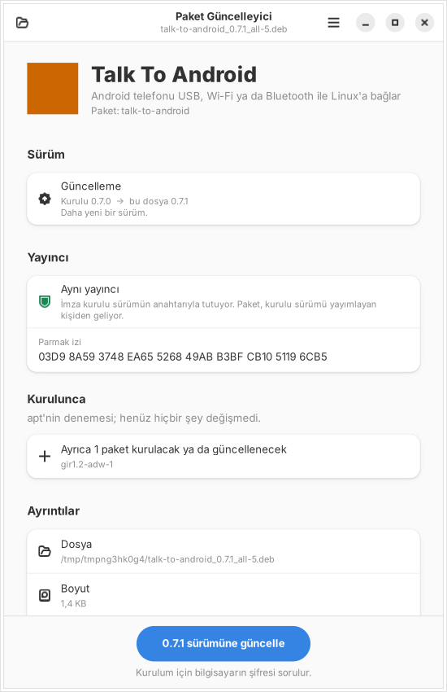
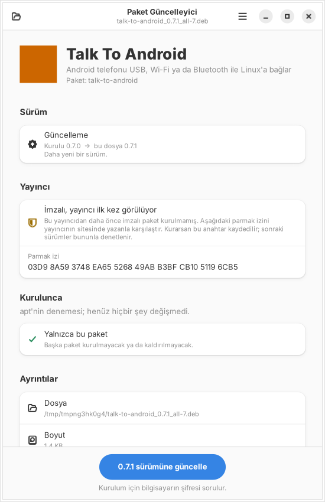
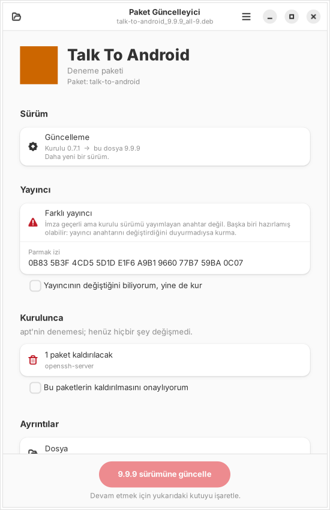
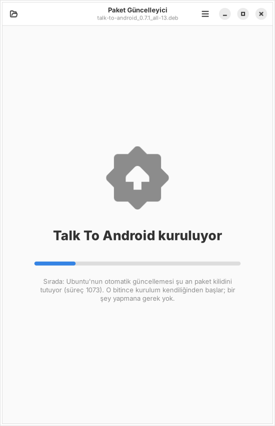

# Paket Güncelleyici

**Durum:** 0.1.0, ilk sürüm. Testler sanal ekranda ve gerçek apt kurulumuyla geçiyor; gerçek bir masaüstünde (şifre penceresi, "Birlikte aç" menüsü) henüz denenmedi.

| Güncelleme, aynı yayıncı | Yayıncı ilk kez görülüyor | Farklı yayıncı (onay ister) | Ubuntu meşgulken sırada |
|---|---|---|---|
|  |  |  |  |

Ubuntu'nun Uygulama Merkezi yerel bir `.deb` dosyasında sürümleri karşılaştırmıyor: o adla paket kuruluysa "Güncelle" yerine yalnızca çöp kutusu (kaldır) gösteriyor. Paket Güncelleyici bu boşluğu doldurur:

| Ne yapar | Nasıl |
|---|---|
| **Sürüm karşılaştırma** | Dosyadaki sürümü kurulu olanla dpkg'nin kendi kuralıyla karşılaştırır: *Yeni kurulum*, *Güncelleme (0.7.0 → 0.7.1)*, *Aynı sürüm* (yeniden kur) ya da *Eski sürüm* (geri dönmek ayrıca onay ister). Başka işlemci mimarisi için olan paketi kurdurmaz. |
| **Yayıncı imzası** | Paket imzalıysa ([debsigs](https://manpages.debian.org/debsigs) biçimi, `_gpgorigin`) imzayı **kurulu sürümün anahtarıyla** denetler. Android'in APK güncellemesinde aynı sertifikayı istemesi gibi: *Aynı yayıncı* ✓, *ilk kez görülen yayıncı* (parmak izi gösterilir, kurulunca kaydedilir), *farklı yayıncı* ya da *imza tutmuyor* (kurmak için kutuyu işaretlemen gerekir). Önceki sürüm imzalıyken imzasız gelen dosya da ayrıca onay ister. |
| **Önce ne olacağını göster** | `apt-get -s` ile yetki istemeden dener: başka hangi paketler kurulacak/güncellenecek, hangileri **kaldırılacak**. Kaldırma varsa onay kutusu işaretlenmeden kurulum başlamaz; onaylanmadıysa apt `--no-remove` ile çalışır (deneme göstermediği bir şey kaldırılacaksa hiç başlamaz). Bağımlılık eksikse nedenini yazar. |
| **Ubuntu meşgulse sıraya girer** | Otomatik güncelleme (unattended-upgrades) paket kilidini tutuyorsa terminaldeki "kilit alınamadı" yazıları yerine "Sırada: Ubuntu'nun otomatik güncellemesi şu an paket kilidini tutuyor (süreç 1073). O bitince kurulum kendiliğinden başlar" yazar ve bekler (en çok 2 saat). |
| **Kurulum** | `pkexec apt-get install`: şifre penceresinde çalışacak komut görünür. İlerleme çubuğu apt'nin kendi durum çıktısından gelir. Bitince uygulamanın "Aç" düğmesi. |

Denetlenen ve kurulan dosya aynıdır: dosya önce özel bir geçici klasöre kopyalanır, imza ve kurulum o kopya üzerinde yapılır (arada değiştirilemez).

## Kullanım

- `.deb` dosyasına **sağ tık → Birlikte aç → Paket Güncelleyici**. Hep bununla açılsın istersen aynı menüde "Varsayılan olarak ayarla".
- Ya da uygulamayı aç, **Dosya seç** ya da dosyayı pencereye sürükle.

## Kurulum

İlk kurulumu terminalden yap (Uygulama Merkezi eksik bağımlılıkları kendisi indirmiyor):

```bash
sudo apt install ./paket-guncelleyici_0.1.0_all.deb
```

Sonraki sürümleri Paket Güncelleyici'nin kendisiyle açıp güncelleyebilirsin.

## Kendi paketini imzalamak

Paket Güncelleyici'nin "aynı yayıncı" diyebilmesi için paketin iki şeyi olmalı:

1. Yayıncının açık anahtarı paketin içinde: `/usr/share/keyrings/<paket-adı>-paket.gpg` (`gpg --export` çıktısı).
2. `_gpgorigin` imzası: `python3 paket/deb-imzala.py imzala paketim.deb gizli-anahtar.asc`.

Talk To Android 0.7.1 ve Paket Güncelleyici'nin kendisi böyle imzalanır (anahtar parmak izi `68E7 8B0A 596A 2E51 8DA0  526B CFBF 9E59 8C96 C9F4`). dpkg ve apt `_` ile başlayan parçayı yok sayar; imzalı paket her yerde aynı kurulur.

## Bilinçli sınırlar

- **Genel "depoyu bul ve listele" yok.** Uygulamanın bilgisindeki adresten kendiliğinden paket bulup kurmak, o adresi kontrol edene yönetici yetkisi vermek olur. İleride liste + yayıncı denetimiyle düşünülebilir; şimdilik yalnızca senin açtığın dosya.
- Anahtar değiştirme (yayıncı yeni anahtara geçerse) için özel bir yol yok: *farklı yayıncı* uyarısı çıkar, bilerek onaylarsın, yeni anahtar kaydedilir.
- Çalışan uygulama kendiliğinden yeniden başlatılmaz; "kapatıp açınca yeni sürüm devreye girer" yazar.
- Kurulum başladıktan sonra iptal yok (yönetici olarak çalışan apt'yi yarıda kesmek paket sistemini bozabilir).

## Ne test edildi

| Ne | Nasıl | Sonuç |
|---|---|---|
| Sürüm kararları | dpkg kuralı (`0.10 > 0.9`, `1.0~rc1 < 1.0`), mimari | geçti |
| İmza | gerçek GPG anahtarları ve gerçek `.deb`'lerle: aynı yayıncı (kurulu anahtar / onaylanan anahtar), ilk kez, farklı yayıncı, imzasız (önceki imzalı/imzasız), kurcalanmış paket | geçti |
| apt | deneme çıktısı (kurulacak, kaldırılacak, karşılanmayan bağımlılık), kilit satırı (İngilizce ve Türkçe), `\r` ile yenilenen bekleme satırı, durum çıktısı | geçti |
| **Uçtan uca (CI, her push'ta)** | Gerçek pencerede: imzalı 1.0 kurulu → 2.0 açılır, "aynı yayıncı", güncelle → kurulu; farklı yayıncının 9.9'u onaysız kurulamaz; **dpkg kilidi root olarak tutulurken** kurulum "Sırada" gösterip bekler, kilit bırakılınca kurar; eski sürüme dönüş onay ister. Ubuntu 22.04 ve 24.04 | CI |
| **Denenmeyenler** | Gerçek `pkexec` şifre penceresi, GNOME'da "Birlikte aç" menüsü, gerçek unattended-upgrades ile bekleme | denenmedi |

```bash
cd paket-guncelleyici && xvfb-run -a python3 -m unittest discover -s tests -v
```
