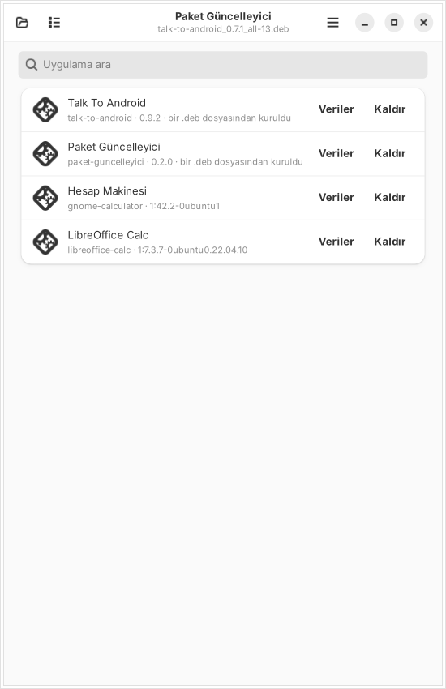
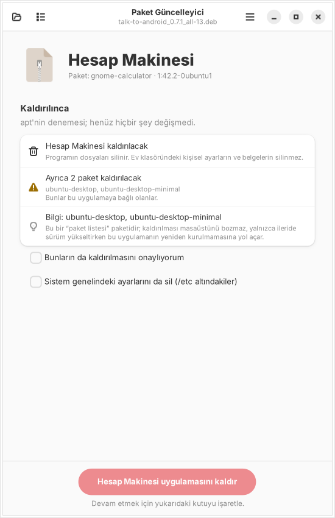
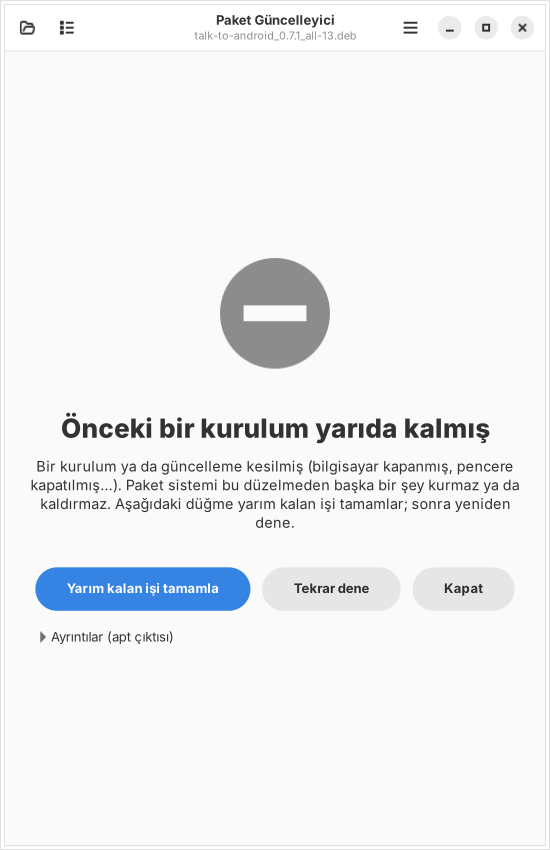

# Paket Güncelleyici

**Durum:** 0.3.0. Kurulu uygulamaların ev klasöründeki verilerini (önbellek, ayarlar) çöp kutusuna taşıyarak temizler ve apt'nin paket önbelleğini boşaltır; 0.2.0 kurulu uygulamaları kaldırır, apt/dpkg hatalarını anlaşılır açıklamaya çevirip onarır, sağ tık listesinde her zaman görünür. Önceki: 0.1.0 gerçek Ubuntu 22.04 masaüstünde Talk To 0.7.0 → 0.7.1 güncellemesinde kullanıldı (sağ tık → Birlikte aç, şifre penceresi, kurulum çalıştı); o denemede açık kalan Talk To'nun eski sürümle sürdüğü görüldü. 0.1.1 bunun için "Yeniden başlat"ı ve yayıncı kartını ekler. Testler sanal ekranda ve gerçek apt kurulumuyla geçiyor.

| Güncelleme, aynı yayıncı | Yayıncı ilk kez görülüyor | Farklı yayıncı (onay ister) | Ubuntu meşgulken sırada |
|---|---|---|---|
|  |  |  |  |

| Kurulu uygulamalar | Kaldırmadan önce | Anlaşılır hata ve onarım |
|---|---|---|
|  |  |  |

Ubuntu'nun Uygulama Merkezi yerel bir `.deb` dosyasında sürümleri karşılaştırmıyor: o adla paket kuruluysa "Güncelle" yerine yalnızca çöp kutusu (kaldır) gösteriyor. Paket Güncelleyici bu boşluğu doldurur:

| Ne yapar | Nasıl |
|---|---|
| **Sürüm karşılaştırma** | Dosyadaki sürümü kurulu olanla dpkg'nin kendi kuralıyla karşılaştırır: *Yeni kurulum*, *Güncelleme (0.7.0 → 0.7.1)*, *Aynı sürüm* (yeniden kur) ya da *Eski sürüm* (geri dönmek ayrıca onay ister). Başka işlemci mimarisi için olan paketi kurdurmaz. |
| **Yayıncı imzası** | Paket imzalıysa ([debsigs](https://manpages.debian.org/debsigs) biçimi, `_gpgorigin`) imzayı **kurulu sürümün anahtarıyla** denetler. Android'in APK güncellemesinde aynı sertifikayı istemesi gibi: *Aynı yayıncı* ✓, *ilk kez görülen yayıncı* (parmak izi gösterilir, kurulunca kaydedilir), *farklı yayıncı* ya da *imza tutmuyor* (kurmak için kutuyu işaretlemen gerekir). Önceki sürüm imzalıyken imzasız gelen dosya da ayrıca onay ister. |
| **Önce ne olacağını göster** | `apt-get -s` ile yetki istemeden dener: başka hangi paketler kurulacak/güncellenecek, hangileri **kaldırılacak**. Kaldırma varsa onay kutusu işaretlenmeden kurulum başlamaz; onaylanmadıysa apt `--no-remove` ile çalışır (deneme göstermediği bir şey kaldırılacaksa hiç başlamaz). Bağımlılık eksikse nedenini yazar. |
| **Ubuntu meşgulse sıraya girer** | Otomatik güncelleme (unattended-upgrades) paket kilidini tutuyorsa terminaldeki "kilit alınamadı" yazıları yerine "Sırada: Ubuntu'nun otomatik güncellemesi şu an paket kilidini tutuyor (süreç 1073). O bitince kurulum kendiliğinden başlar" yazar ve bekler (en çok 2 saat). |
| **Yayıncı kartı ve site doğrulaması** | Paket bir yayıncı kartı taşıyorsa (`/usr/share/keyrings/<paket>-paket.json`: ad, kurum, yetkili, site, iletişim, doğrulama adresi) gösterilir. Kart yayıncının **kendi beyanıdır**; onu bağlayan şey doğrulama: kartta yazan https adresindeki sayfa imzanın parmak izini içeriyorsa "Site doğruladı", adres yayıncının sitesiyle aynı yerde değilse bu ayrıca söylenir, sayfa parmak izini içermiyorsa uyarı. Güncellemede **kurulu sürümün** kartındaki adres kullanılır (yeni paket kendi adresini yazarak kendini doğrulatamasın); ad ya da site değişmişse gösterilir. İmzasız pakette doğrulama yapılmaz. İnternet yoksa "doğrulanamadı" der, kurulumu engellemez. |
| **Kurulum** | `pkexec apt-get install`: şifre penceresinde çalışacak komut görünür. İlerleme çubuğu apt'nin kendi durum çıktısından gelir. |
| **Uygulama kaldırma** | Başlıktaki liste düğmesi ya da boş sayfadaki “Kurulu uygulamalar”: paketle kurulmuş masaüstü uygulamaları, **bir .deb dosyasından kurulanlar üstte ve işaretli**, arama kutusuyla. “Kaldır”a basınca önce yetki istemeden denenir: başka hangi paketlerin de gideceği gösterilir (onay kutusu işaretlenmeden kaldırılmaz; “ubuntu-desktop” gibi paket listesi paketlerinin ne anlama geldiği yazılır). İsteğe bağlı: sistem genelindeki ayarlarını da sil (/etc). Ev klasöründeki kişisel ayarlar kendiliğinden silinmez; kalanlar kaldırma bittikten sonra sunulur. Açılan .deb kuruluysa Ayrıntılar'da “Kurulu sürümü kaldır”. Ubuntu'nun otomatik güncellemesi kilidi tutuyorsa kurulumdaki gibi sırada bekler. |
| **Veri temizleme** | Kurulu uygulamalar → “Veriler”: uygulamanın ev klasöründeki önbelleği (`~/.cache`), ayarları (`~/.config`) ve kayıtlı verilerini (`~/.local/share`, `~/.local/state`) boyutlarıyla gösterir. Bir klasörün hangi uygulamaya ait olduğunu tutan bir kayıt yok: yalnızca adı uygulamanın paket adı, masaüstü kimliği, komutu ya da adıyla **tam** eşleşen klasörler önerilir, ortak klasörler (gtk-3.0, autostart, dconf…) hiç önerilmez. Önbellek işaretli gelir, ayarlar işaretsiz; seçilenler **çöp kutusuna taşınır** (geri alınabilir; taşınamazsa dokunulmaz). Uygulama açıksa uyarır. Listede en üstte “Paket önbelleği (apt)”: indirilip saklanan paket dosyalarını `apt-get clean` ile siler. |
| **Anlaşılır hatalar ve onarım** | “E: Sub-process /usr/bin/dpkg returned an error code (1)” yerine ne olduğunu ve ne yapılacağını söyler: önceki kurulum yarıda kalmış, bozuk bağımlılıklar, bulunamayan gerekli paket (başka Ubuntu sürümü için yapılmış olabilir), dosya çakışması (hangi paketle), diskte yer yok, paketin kendi betiği hata verdi, internete ulaşılamadı, sistemin temel paketi, zaten kurulu değil. İngilizce ve Türkçe apt çıktısını tanır. **Yarım kalan kurulum** (dpkg --configure -a) ve **bozuk bağımlılıklar** (apt-get -f install) tek tıkla onarılır, sonra “Tekrar dene”. Yarım kalan iş, kur/kaldır'a basmadan önce de fark edilir (apt'nin denemesi bunu görmez). Ham çıktı “Ayrıntılar”da seçilebilir durur. |
| **Sağ tık listesi** | Sağ tık → “Başka uygulamayla aç” listesi sistemin dosya türü önbelleğinden gelir; önbellek güncellenmediyse (desktop-file-utils yoksa) uygulama listede hiç çıkmıyordu. Artık paket desktop-file-utils'e bağlı ve kurulunca önbelleği yeniler; ayrıca uygulama açılışta listede değilse kendini kullanıcı ayarına ekler (varsayılan uygulamayı değiştirmeden). Boş sayfadaki “Çift tıklayınca .deb dosyaları bununla açılsın” varsayılan yapar (yalnızca basınca). |
| **Bitince** | Uygulama kapalıysa "Aç". Açıksa (eski sürüm bellekte çalışıyor) ve kapatılabiliyorsa **"Yeniden başlat"**: uygulamaya oturum veriyolundan "quit" der, kapanınca yeni sürümle açar. Kendini güncellenince yeniden başlatan uygulamalarda (masaüstü dosyasında `X-Guncellenince-Yeniden-Baslar=true`, ör. Talk To 0.8.1+) işarete körü körüne güvenmez: bellekte çalışan eski sürüm bunu bilmeyebilir (ör. Talk To 0.8.0 → 0.8.1). Uygulamanın oturum veriyolundaki bağlantısı 15 saniye içinde yenilenirse "yeni sürümle yeniden başladı" der, yenilenmezse "Yeniden başlat"ı önerir. |

Denetlenen ve kurulan dosya aynıdır: dosya önce özel bir geçici klasöre kopyalanır, imza ve kurulum o kopya üzerinde yapılır (arada değiştirilemez).

## Kullanım

- `.deb` dosyasına **sağ tık → Birlikte aç → Paket Güncelleyici**. Hep bununla açılsın istersen aynı menüde "Varsayılan olarak ayarla".
- Ya da uygulamayı aç, **Dosya seç** ya da dosyayı pencereye sürükle.

## Kurulum

İlk kurulumu terminalden yap (Uygulama Merkezi eksik bağımlılıkları kendisi indirmiyor):

```bash
sudo apt install ./paket-guncelleyici_0.3.0_all.deb
```

Sonraki sürümleri Paket Güncelleyici'nin kendisiyle açıp güncelleyebilirsin.

## Kendi paketini imzalamak

Paket Güncelleyici'nin "aynı yayıncı" diyebilmesi için paketin iki şeyi olmalı:

1. Yayıncının açık anahtarı paketin içinde: `/usr/share/keyrings/<paket-adı>-paket.gpg` (`gpg --export` çıktısı).
2. `_gpgorigin` imzası: `python3 paket/deb-imzala.py imzala paketim.deb gizli-anahtar.asc`.
3. İsteğe bağlı yayıncı kartı: `/usr/share/keyrings/<paket-adı>-paket.json`

   ```json
   {"yayinci": "Ad ya da ekip", "kurum": "isteğe bağlı", "yetkili": "isteğe bağlı",
    "web": "https://...", "iletisim": "https://... ya da e-posta",
    "dogrulama": "https://.../YAYINCI.txt"}
   ```

   Doğrulama sayfası parmak izini içermeli (boşluklar önemsiz). Kişisel e-posta yazmak zorunlu değil; bir sorun bildirme sayfası da olur. Bu paketin kendi sayfası: [`YAYINCI.txt`](YAYINCI.txt).

Talk To Android 0.7.1 ve Paket Güncelleyici'nin kendisi böyle imzalanır (anahtar parmak izi `68E7 8B0A 596A 2E51 8DA0  526B CFBF 9E59 8C96 C9F4`). dpkg ve apt `_` ile başlayan parçayı yok sayar; imzalı paket her yerde aynı kurulur.

## Bilinçli sınırlar

- **Genel "depoyu bul ve listele" yok.** Uygulamanın bilgisindeki adresten kendiliğinden paket bulup kurmak, o adresi kontrol edene yönetici yetkisi vermek olur. İleride liste + yayıncı denetimiyle düşünülebilir; şimdilik yalnızca senin açtığın dosya.
- Anahtar değiştirme (yayıncı yeni anahtara geçerse) için özel bir yol yok: *farklı yayıncı* uyarısı çıkar, bilerek onaylarsın, yeni anahtar kaydedilir.
- "Yeniden başlat" yalnızca uygulama oturum veriyolunda "quit" eylemini sunuyorsa çıkar (GTK/GApplication uygulamalarının çoğu); sunmayanlar için "kapatıp açınca yeni sürüm devreye girer" yazar. Uygulama kapanırken bir şey sorarsa 10 saniye bekler, sonra kendin kapatmanı söyler.
- Site doğrulaması bir sertifika otoritesi değildir: "bu adresi yöneten kişi bu anahtarı yayımlıyor" demektir, o kadar. Adresin kime ait olduğunu (ör. github.com/cruciblelab) yine sen değerlendirirsin.
- Kurulum başladıktan sonra iptal yok (yönetici olarak çalışan apt'yi yarıda kesmek paket sistemini bozabilir).

## Ne test edildi

| Ne | Nasıl | Sonuç |
|---|---|---|
| Sürüm kararları | dpkg kuralı (`0.10 > 0.9`, `1.0~rc1 < 1.0`), mimari | geçti |
| İmza | gerçek GPG anahtarları ve gerçek `.deb`'lerle: aynı yayıncı (kurulu anahtar / onaylanan anahtar), ilk kez, farklı yayıncı, imzasız (önceki imzalı/imzasız), kurcalanmış paket | geçti |
| Yayıncı kartı | bozuk/adsız/aşırı büyük kart, https olmayan adresler; GitHub'da sahip eşleşmesi (`github.com/x` ↔ `raw.githubusercontent.com/x`), alt alan, benzer ad (`example.org.evil.com`); **gerçek HTTPS sunucusuyla** doğrulandı / listede yok / 404 / aşırı büyük sayfa / http'ye yönlendirme / tanınmayan sertifika; gerçek pencerede kartın ve "Site doğruladı" satırının çıkması | geçti |
| Kaldırma ve onarım (uçtan uca, CI) | Kurulu uygulamalar listesinde dosyadan kurulan paketin işaretli görünmesi, listeden kaldırma (deneme → gerçek apt kaldırma); **gerçek bir yarım kalmış dpkg** (dpkg'nin yarım iş dosyası): kurmadan önce “Önceki bir kurulum yarıda kalmış” + düğme, onarım (gerçek dpkg --configure -a), tekrar deneyince kurulum | geçti |
| Hata açıklamaları | gerçek apt/dpkg çıktısı örnekleri (İngilizce ve Türkçe): yarım kalan, bozuk bağımlılık, bulunamayan bağımlılık, dosya çakışması, yer yok, betik hatası, ağ, temel paket, kurulu değil, şifre penceresi; paket adı doğrulama (seçenek gibi görünen adlar reddedilir) | geçti |
| Sağ tık listesi | geçici kullanıcı klasörleriyle: önbellekte yalnızca başka bir kurucu varken uygulama listeye eklenir, varsayılan değişmez; istenince varsayılan olur. CI'da kurulan pakette listede görünmesi | geçti |
| Açık uygulama | ayrı bir oturum veriyolunda gerçek GApplication: açık olduğunun görülmesi, "quit" eyleminin bulunması ve uygulamanın kapatılması; "quit" sunmayan uygulama; masaüstü dosyasındaki "kendini yeniden başlatır" işareti. **Gerçek pencerede sonuç sayfası:** kurulumdan sonra kendini yenileyen uygulama → "yeniden başladı"; yenilemeyen (işaret olduğu hâlde) → süre dolunca "Yeniden başlat", tıklanınca uygulama kapanıp masaüstü dosyasıyla yeniden açıldı | geçti |
| Gerçek paketle akış | Bu makinede kurulu imzalı Talk To 0.8.0 → imzalı 0.8.1: "Aynı yayıncı", gerçek GitHub sayfasından "Site doğruladı", kurulum (`sudo -n` ile) | geçti |
| apt | deneme çıktısı (kurulacak, kaldırılacak, karşılanmayan bağımlılık), kilit satırı (İngilizce ve Türkçe), `\r` ile yenilenen bekleme satırı, durum çıktısı | geçti |
| **Uçtan uca (CI, her push'ta)** | Gerçek pencerede: imzalı 1.0 kurulu → 2.0 açılır, "aynı yayıncı", güncelle → kurulu; farklı yayıncının 9.9'u onaysız kurulamaz; **dpkg kilidi root olarak tutulurken** kurulum "Sırada" gösterip bekler, kilit bırakılınca kurar; eski sürüme dönüş onay ister. Ubuntu 22.04 ve 24.04 | CI |
| Gerçek masaüstünde | 0.1.0: Ubuntu 22.04'te sağ tık → Birlikte aç, `pkexec` şifre penceresi, Talk To 0.7.0 → 0.7.1 (kullanıcı denemesi) | çalıştı |
| **Denenmeyenler** | 0.1.1'in "Yeniden başlat"ı gerçek masaüstünde, gerçek unattended-upgrades ile bekleme | denenmedi |

```bash
cd paket-guncelleyici && xvfb-run -a python3 -m unittest discover -s tests -v
```
