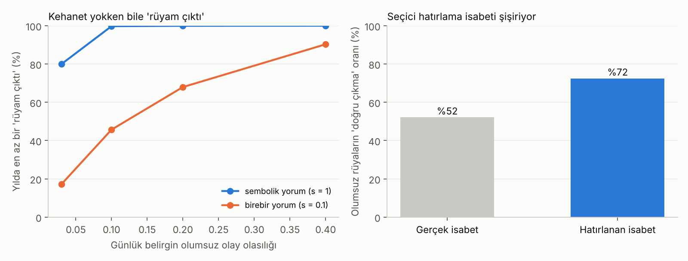

# Rüyalar · Sürüm 1: İnanç, Bilim ve Tesadüf

> **Sürüm:** 1 · **Tarih:** 2026-10-30 · **Durum:** güncel
>
> **Acelen varsa:** en alttaki [En basit özet](#en-basit-özet) bölümüne atla.
>
> Bu doküman **tıbbi tavsiye değildir.** Dinî inançları yargılamaz. Bilimsel yöntemin neyi test edebildiğini ve edemediğini ayırarak, rüya hakkında bilineni ve bilinmeyeni anlatır.

**Kanıt seviyeleri:**

| Etiket | Anlamı |
|---|---|
| **A** | Meta-analiz ya da birden çok büyük, bağımsız çalışma |
| **B** | Tek büyük, iyi tasarlanmış çalışma |
| **C** | Küçük çalışma, ikincil kaynak |
| **V** | Bu çalışmanın kendi gerçek veri analizi |
| **D** | Model, simülasyon ya da varsayım |

---

## Soru ve kapsam

1. İnsanlar rüyalara neden inanıyor?
2. Bilim rüya hakkında ne biliyor? Rüyalar neyi yansıtır, ne işe yarar?
3. Rüyalar geleceği gösterir mi? "Rüyam çıktı" deneyimi kehanet olmadan ne kadar açıklanabilir?
4. Türkiye'de ve İslam geleneğinde rüyaya nasıl bakılıyor?

**Kapsam dışı:** Rüya tabiri (sembollerin anlamı), uyku bozukluklarının tedavisi, kişisel rüya yorumu. Araştırmayı başlatan kişinin kendi rüyası rapora alınmadı.

## Yöntem

**Dört aşama:**

1. **Tarama.** Beş paralel literatür ajanı:
   - R1: inancın psikolojisi;
   - R2: rüyanın bilimi;
   - R3: kehanet rüyaları ve tesadüf;
   - R4: rüya içeriği istatistikleri ve açık veri;
   - R5: Türkiye ve İslam geleneği.
2. **Kendi analizler.** İkisi de ön kayıtlı (commit `5e7f59e`). Kod çalıştırılmadan önce commit edildi (`b298ad2`), çıktılar ayrı commit'te (`8d8c748`).
   - (a) **Tesadüf simülasyonu:** rüyaların geleceği hiç göstermediği bir dünyada kaç "rüyam çıktı" yaşanır? Plan: [simulasyon/PLAN.md](simulasyon/PLAN.md).
   - (b) **DreamBank içerik sayımı:** 27.941 gerçek rüya raporunda olumsuz içerik ve hayvan saldırısı ne sıklıkta geçiyor?
3. **Doğrulama:**
   - İki ajan, kilit 18 iddiayı birincil kaynaktan yeniden kontrol etti.
   - Bir "şeytanın avukatı" ajanı sonuçları çürütmeye çalıştı.
   - Koordinatör, itirazları ön kayıtsız keşif betikleriyle ([simulasyon/kesif.py](simulasyon/kesif.py), [analiz/kesif.py](analiz/kesif.py)) yeniden hesapladı.
4. **Rapor.** Doğrulanamayan sayılar Sonuçlar bölümüne girmedi.

### Ön kayıtlı analizler (özet)

**Simülasyon:** Rüyalar ve olaylar birbirinden bağımsız üretildi. Her kişi için 365 gün simüle edildi. Parametreler ve ızgara [PLAN.md](simulasyon/PLAN.md) dosyasında. Temel senaryo:

| Parametre | Temel değer |
|---|---|
| Hatırlanan rüya | haftada 1 |
| Olumsuz rüya oranı | %33 |
| Belirgin olumsuz olay | günde %10 |
| Rüya-olay penceresi | 7 gün |
| Eşleştirme | Sembolik (s = 1): her olumsuz rüya her olumsuz olaya bağlanabilir |
| Seçici hatırlama | Doğrulanan rüyalar 0.52, doğrulanmayanlar 0.215 olasılıkla hatırlanır (Watt ve ark. 2014) |

Izgarada 192 senaryo var. Eşleştirme gevşekliği s = 1 (sembolik), 0.3 ve 0.1 (birebir) değerlerini alıyor.

**DreamBank:**
- Veri: DreamBank (Domhoff ve Schneider; CC BY-NC-SA 4.0), Cortal'ın Hugging Face kopyası. Kod indiriyor ve SHA-256 ile doğruluyor; veri repoya girmiyor.
- Yöntem: Önceden sabitlenmiş İngilizce kelime listeleri. Listeler [analiz/calistir.py](analiz/calistir.py) içinde ve ön kayıtla aynı.
- Kesinlik kontrolü: Koordinatör 60 rastgele raporu elle okudu.

### Plandan sapmalar

| Sapma | Gerekçe ve etki |
|---|---|
| **"bit" kelimesi hatası** | Ön kayıtlı listedeki "bit" (ısırdı) kelimesi, İngilizcedeki "a bit" (biraz) kalıbını da yakaladı. T7 testi bunu yakalamadı. Hayvan+saldırı işaretli raporların %45'i yalnızca bu yüzden işaretlendi. Ön kayıtlı ham oran (%2.3) raporlandı. Düzeltilmiş oran keşif analizinde verildi: "bit" çıkarıldı, hayvan ve saldırı kelimesi en fazla 8 kelime arayla geçmeli (E6) |
| **Doğrulanamayan "haftada 1 rüya" değeri** | Temel senaryodaki bu değerin dayandığı Schredl 2008'in ortalaması 3. aşamada birincil kaynaktan doğrulanamadı. Izgara zaten 0.25-5 rüya/hafta aralığını kapsıyor |
| **Hatırlama parametrelerinin kaynağı** | Seçici hatırlama değerleri, katılımcıların **başkasına ait** bir rüya günlüğünü okuyup kısa süre sonra hatırladığı bir laboratuvar görevinden geliyor. Gerçek hayattaki seçici hatırlamayı büyük olasılıkla olduğundan küçük gösteriyor |
| **Grafik başlığı ile K3 kararı** | Grafik başlığı ("Seçici hatırlama isabeti şişiriyor") sonuçlar görülmeden yazıldı. Ön kayıtlı K3 kararı temel senaryoda ise "sınırlı" çıktı. İkisi de raporda aynen veriliyor |
| **Keşif analizleri** | Planda yoktu. Şeytanın avukatının itirazlarını kontrol etmek için eklendi (E1-E8) ve ayrı etiketlendi |

## Bulgular

### 1. İnsanlar rüyalara neden inanıyor? (literatür)

Aşağıdaki sayılar 3. aşamada birincil kaynaktan doğrulandı.

- **Rüyanın gizli gerçekleri gösterdiği inancı yaygın.** Rüyaların "gizli gerçekleri açığa çıkardığı" görüşünü en doğru kuram olarak seçen öğrenciler ([Morewedge ve Norton 2009](https://www.hbs.edu/ris/Publication%20Files/morewedge%20norton%20when%20dreaming%20is_deebd872-2003-4409-8e96-6725c7b204aa.pdf)):

  | Ülke | Oran | n |
  |---|---|---|
  | ABD | %56 | 50 |
  | Güney Kore | %65 | 57 |
  | Hindistan | %74 | 42 |

  Boston'da 81 yolcuyla yapılan ek ankette %68 rüyaların geleceği bildirdiğine inanıyor, %63 en az bir rüyasının gerçekleştiğini düşünüyor.
- **Rüya, aynı içerikteki uyanık düşünceden daha ağır basıyor** (aynı makale, n = 182):
  - Uçuştan önce uçak kazası **rüyası gördüğünü** düşünen kişiler, aynı şeyi **uyanıkken düşündüğünü** düşünenlerden daha çok uçuş iptali eğilimi gösterdi (r = .32).
  - Rüyanın etkisi gerçek bir kaza haberinden geri kalmadı.
  - Yazarların açıklaması: Rüya "içeriden, durduk yere" geliyormuş gibi algılandığı için insanlar onu bir dış kaynağa bağlayıp küçümseyemiyor.
- **Yorum güdülenmiş.** İnsanlar, hoşlandıkları kişiyle ilgili hoş rüyaları ve hoşlanmadıkları kişiyle ilgili hoş olmayan rüyaları daha anlamlı buluyor (etkileşim β = .28). Bu eğilim agnostiklerde de görüldü; yalnızca dindarlara özgü değil.
- **Seçici hatırlama ölçülmüş** ([Watt ve ark. 2014](https://www.pure.ed.ac.uk/ws/portalfiles/portal/15020439/WattIJoDRAuthorVersion.pdf), n = 85):
  - Bir rüya günlüğündeki 4 "doğrulanan" rüya-olay çiftinden ortalama **2.09**'u hatırlandı; 4 doğrulanmayandan yalnızca **0.86**'sı.
  - Bu yanlılık paranormal inancı olan ve olmayanlarda aynıydı.
  - İkinci çalışmada (n = 50) inançlılar rüya ile haber arasında daha çok bağlantı buldu (r = .33).
- **Kehanet rüyası deneyiminin yaygınlığı:**
  - Eski anketlerde insanların yaklaşık %18-38'i hayatı boyunca en az bir kehanet rüyası bildiriyor; yeni ve öğrenci örneklemlerinde %70'e kadar `[doğrulanmadı]` (ikincil derleme).
  - Bir çalışmada bu vakaların yaklaşık %80'inin rüyanın olaydan **sonra** hatırlanmasından ibaret olduğu bildiriliyor (Fukuda 2002) `[doğrulanmadı]`.

### 2. Bilim rüya hakkında ne biliyor? (literatür)

- **Rüya yalnızca REM'de görülmez.** Literatüre göre REM uyanışlarının yaklaşık %85'inde, NREM uyanışlarının %40-60'ında rüya raporu var ([Wong ve ark. 2025](https://www.nature.com/articles/s41467-025-61945-1) girişinde aktarılıyor).
  - Rüya görülüp görülmediğini, uyku evresinden çok arka korteksteki bir "sıcak bölge" belirliyor.
  - Bu bölgeye bakılarak NREM'de rüya var mı yok mu, gerçek zamanlı olarak %87 doğrulukla tahmin edildi ([Siclari ve ark. 2017](https://pmc.ncbi.nlm.nih.gov/articles/PMC5462120/); küçük örneklem: 62 uyanış).
- **Rüyalar gündelik hayatı yansıtıyor ama tekrar etmiyor** ([Malinowski ve Horton 2014](https://doi.org/10.1111/jsr.12134)). Rüyaların %80'inden fazlası kişinin kendi hayatından parçalar içeriyor, ama bir olayı birebir tekrar eden rüya yalnızca %0.5.
- **Yaklaşan önemli olaylar rüyaya giriyor, genellikle sorunlu biçimde** ([Arnulf ve ark. 2014](https://doi.org/10.1016/j.concog.2014.06.010), 719 tıp öğrencisi):
  - Sınavdan önceki gece öğrencilerin %60'ı sınavı rüyasında gördü.
  - Bu rüyaların %78'inde bir sorun vardı: geç kalmak, cevabı unutmak gibi.
  - Beklenen gelecek olaylar gece boyunca rüyalarda sabit oranda yer alıyor ([Picard-Deland ve ark. 2023](https://doi.org/10.1093/sleep/zsac292)).
- **Rüyaların çoğunda tehdit unsuru var.**
  - Revonsuo ve Valli 2000'de %66.
  - Valli'nin 2008 tezinde üç çalışmanın ortalaması %72 ([tez](https://www.utupub.fi/bitstream/10024/42466/3/b315.pdf)).
- **İşlev.** Rüyanın belleği pekiştirdiğine ve duyguları işlediğine dair tekrarlanmış korelasyonlar var (Wamsley 2010, 2019; Sterpenich 2020). Ama rüyanın kendisinin nedensel rolü kanıtlanmış değil. Veriler en çok "geçmişi işleyip geleceğe dönük senaryo kuran" bir süreci destekliyor; geleceği gördüğüne dair veri yok.
- **Hatırlama farkları.** Kadınlar biraz daha fazla rüya hatırlıyor (etki 0.24-0.27; [Schredl ve Reinhard 2008](https://doi.org/10.1111/j.1365-2869.2008.00626.x), 175 çalışma).

### 3. Kehanet: lehte ve aleyhte kanıtlar (literatür)

| Kanıt | Bulgu | Değerlendirme |
|---|---|---|
| Rüya-ESP meta-analizi ([Storm ve ark. 2017](https://nectar.northampton.ac.uk/id/eprint/11135/), 50 çalışma; savunucuların analizi) | Maimonides laboratuvarında ES = .33, diğerlerinde .14, homojen sette .20 | Küçük ama istatistiksel olarak anlamlı birleşik etki bildiriliyor. Etki yıllar içinde küçülüyor. Bir yeniden analizde ağırlıklandırma değişince r ≈ .07 `[doğrulanmadı]` |
| Bem 2011 "Feeling the future" replikasyonları ([Galak ve ark. 2012](https://repository.upenn.edu/server/api/core/bitstreams/5cdf9c95-987f-4dab-b9c7-ba44c638b339/content)) | 19 deneylik meta-analiz (yazarların 7 deneyi dahil, N = 3.289 yalnız yazarlarınki): d = .04 [−.00, .09] | Sıfırdan ayırt edilemiyor |
| [Ritchie, Wiseman ve French 2012](https://journals.plos.org/plosone/article?id=10.1371/journal.pone.0033423) | 3 önceden kayıtlı replikasyon, n = 150, birleşik p = .83 | Etki yok |
| Transparent Psi Project (Kekecs ve ark. 2023; savunucular ve şüpheciler birlikte tasarladı, önceden kayıtlı) | İsabet %49.89, şans %50 | Şeytanın avukatı ajanının aktarımı ([DOAJ kaydı](https://doaj.org/article/03421869af02442eb64c56cb49061e54)); bağımsız doğrulama yapılmadı |
| Watt 2014 (ev ortamında rüya prekognisyonu) | %32 isabet, şans %25 | Tek çalışma, bağımsız replikasyonu yok |

**Tesadüf matematiği** ([Diaconis ve Mosteller 1989](https://www.stat.berkeley.edu/users/aldous/157/Papers/diaconis_mosteller.pdf), tam metin):
- "Bir kişinin başına her gün milyonda bir olasılıkla gelen bir tesadüf, 250 milyon kişilik bir ülkede günde 250, yılda yaklaşık 100.000 kez yaşanır."
- "Başarısız birçok tahmini unutmak, başarıyı olduğundan daha şaşırtıcı gösterir."

**Olumsuz olaylar sık** ([Almeida ve ark. 2002](https://europepmc.org/search?query=DOI%3A%2210.1177%2F1073191102091006%22), N = 1.031): Günlerin %40'ında en az bir stres etkeni yaşanıyor, %11'inde birden fazla.

### 4. Tesadüf simülasyonu: kehanet yokken kaç "rüyam çıktı"? (D)

**Ön kayıtlı sonuçlar (temel senaryo, 100.000 kişi):**

| Ölçü | Sembolik yorum (s = 1) | Birebir yorum (s = 0.1) |
|---|---|---|
| Yılda ortalama "rüyam çıktı" eşleşme fırsatı | 5.7 (rüya başına sayılırsa 4.7) | 0.6 |
| Yılda en az bir kez yaşayanlar | %99 | %46 |
| Milyon kişide günde | ~15.700 | ~1.700 |

**Önemli yorum (şeytanın avukatının itirazı):** Bu sayılar **tesadüfi eşleşme fırsatlarını** ölçüyor, insanların gerçekten "kehanet" dediği deneyimi değil. Anketlerde insanların ancak bir kısmı hayatı boyunca bir kehanet rüyası bildiriyor. Yani insanlar bu fırsatların çok azını "kehanet" diye sayıyor.

**Varsayımlar değişince (keşif E1-E3, ön kayıtsız):**

| Senaryo | Yılda ≥1 (s = 1) | Yılda ≥1 (s = 0.1) |
|---|---|---|
| Temel (herkes aynı) | %99 | %46 |
| Üçte biri rüyasını hiç hatırlamıyor (E1) | %61 | %32 |
| Ayrıca olay sıklığı da kişiden kişiye değişiyor (E2) | %57 | %29 |
| Yalnızca ağır olaylar: ölüm, kaza, ağır hastalık; yılda ~3-4 (E3) | %44 | %6 |
| Ağır olay yılda ~1 (E3) | %16 | %2 |

- **192 senaryonun %81'inde** insanların çoğu yılda en az bir eşleşme yaşıyor (K2).
- Ancak en muhafazakâr çeyrekte bu koşul **16 senaryonun yalnızca 2'sinde** sağlanıyor. Bu çeyrek şu ayarlardan oluşuyor:
  - birebir ya da yarı birebir yorum;
  - ayda en fazla ~3 olay;
  - haftada en fazla 1 hatırlanan rüya;
  - en fazla %33 olumsuz rüya.
- Aynı muhafazakâr çeyrekte bile milyon kişide günde **en az ~80** eşleşme bekleniyor.

**Seçici hatırlama (K3 ve keşif E4):**
- Temel senaryoda olumsuz rüyaların %52'si gerçekten bir olayla eşleşiyor, ama hatırlananların %72'si "doğru çıkmış" görünüyor. Oran 1.39; ön kayıtlı eşiğe (1.5) göre karar **"sınırlı"**.
- Bu, temel senaryodaki yüksek gerçek eşleşme oranından kaynaklanıyor. Birebir yorumda gerçek oran %7, hatırlanan %15 (2.2 kat).
- Senaryodan bağımsız ölçü olan **odds oranı her senaryoda 2.4**.

**Simülasyon neyi gösterir, neyi göstermez:**
- Simülasyon kehanetin olmadığını **kanıtlamaz**. Gösterdiği şu: Kehanet olmasa bile bu kadar çok "rüyam çıktı" fırsatı doğar. Bu yüzden kişisel deneyimler kehanet lehine kanıt sayılamaz.
- Gerçek hayatta rüya ve olay her zaman bağımsız da değildir. Bir kaygı (hasta bir yakın, yaklaşan bir sınav ya da açılma) hem rüyayı hem olayı etkileyebilir. Bu tür ortak nedenler eşleşmeleri daha da artırır, ama kehanet gerektirmez.

### 5. DreamBank: gerçek rüya raporlarında ne var? (V)

| Ölçü (27.941 rapor) | Tümü | Hall ve Van de Castle normları (981) | Kadın | Erkek |
|---|---|---|---|---|
| Olumsuz olay kelimesi | %38.1 | %35.6 | %38.6 | %37.3 |
| Olumsuz duygu kelimesi | %22.7 | %25.2 | %25.7 | %16.3 |
| Olumsuz olay ya da duygu | **%47.9** [47.3; 48.5] | %48.9 | %49.6 | %44.2 |
| Hayvan | %12.9 | %8.5 | %13.3 | %11.8 |
| Hayvan + saldırı (ön kayıtlı ham sayım) | %2.3 | %1.2 | %2.5 | %1.8 |

**Kesinlik kontrolü (koordinatör 60 raporu okudu):**
- "Olumsuz" işaretli 30 rapordan:
  - 14'ü açıkça olumsuz;
  - 3'ü kısmen olumsuz;
  - 5'i yanlış işaretlenmiş (ör. bir dizinin konusu olarak geçen "death");
  - 8'inde eşleşen kelime okunabilen kısmın dışında kaldı.
- "Hayvan + saldırı" işaretli 30 rapordan yalnızca **4'ü açıkça** (8'i kısmen) gerçek bir hayvan saldırısı içeriyordu. Örnekler: aslanların insan avlaması, bir kaplanın saldırısı, böcek saldırısı.

**Düzeltmeler (keşif E6-E8):**
- **"bit" hatası düzeltilince hayvan saldırısı rüyası %0.48.** Bu, elle kontrolle de uyumlu.
  - Hesap: "bit" listeden çıkarıldı ve hayvan ile saldırı kelimesinin en fazla 8 kelime arayla geçmesi şartı kondu.
  - Haftada bir hatırlanan rüya varsayımıyla, milyon kişide gecede ~690 hayvan saldırısı rüyası hatırlanır.
  - Bağımsız bir uzun dizide de hayvan ısırması 266 hayvan etkileşiminin 2'si ([Schredl 2021](https://www.readkong.com/page/animals-in-a-long-dream-series-michael-schredl-central-2971150)).
- **"Olumsuz" oranı rapor uzunluğuna bağlı.** Kısa raporlarda (medyan 30 kelime) %19, uzun raporlarda (372 kelime) %79. %48, ortalama uzunluktaki (117 kelime) bir rapor için geçerli.
- **Tek kişilerin ağırlığı:** Raporların %44'ü beş kişiden geliyor. Ama diziler eşit ağırlıkla alınınca olumsuz oranı değişmiyor: %50.6, medyan %50.2.

### 6. Türkiye ve İslam geleneği (literatür)

- **Türkiye'de rüya ya da tabir inancının yaygınlığını ölçen bir anket bulunamadı.** Türkiye'deki nicel çalışmalar (Ankara, n = 230; Çorum'da lise öğrencileri, n = 316) inancı değil rüya temalarını ölçüyor.
- **İslam geleneği rüyaları üçe ayırır** ([TDV İslâm Ansiklopedisi, "Rüya"](https://islamansiklopedisi.org.tr/ruya)):
  - **rahmânî** (sâdık rüya, müjde);
  - **nefsânî** (kişinin kendi meşguliyet ve kuruntularının yansıması);
  - **şeytânî** (hulm; kaygı veren, karışık rüya).

  Maddeye göre "Kelâm âlimlerinin umumi kanaatine göre rüya kesin bilgi vasıtası değildir", rüya "hiçbir zaman genel ve kesin bir hüküm ifade etmez" ve kötü rüyaların anlatılması ve yorumlanması tavsiye edilmez.
- **Bu çalışmanın test ettiği şey:** yalnızca olumsuz rüya ile olumsuz olay arasındaki tesadüfler. Bu, geleneğin de "anlatılmaması ve yorumlanmaması" gereken kategori olarak gördüğü türdür. Rüyanın ilahî kaynaklı olabileceği inancı (sâdık rüya) bilimsel yöntemin test edebileceği bir iddia değildir; bu rapor onu yargılamaz.

### 7. Sentez (D)

**Benzetme:** Rüya bir **ayna**, dürbün değil. Ayna o gün aklını meşgul eden şeyi gösterir: kaygıyı, isteği, yaklaşan bir olayı. Ertesi gün o konuda bir şey olunca, aynada gördüğün şey dürbünden bakılmış gibi gelir. Ama ayna yalnızca o an zihnindeki şeyi yansıttı.

"Rüyam çıktı" deneyimini dört kehanet gerektirmeyen mekanizma birlikte üretiyor:
1. **Taban oranlar:** Rüyaların yaklaşık yarısı olumsuz, olumsuz olaylar da sık.
2. **Ortak kaygı:** Seni meşgul eden konu hem rüyana hem hayatına girer.
3. **Gevşek eşleştirme:** Sembolik yorum (kedi ısırığı ↔ reddedilmek) eşleşme fırsatını birebir yoruma göre 2 kattan fazla artırıyor.
4. **Seçici hatırlama:** "Tutan" rüya hatırlanır, tutmayan unutulur.

## Sonuçlar

1. **Rüyaların gizli gerçekleri gösterdiği inancı farklı kültürlerde yaygın.** ABD, Güney Kore ve Hindistan'da öğrencilerin %56-74'ü bu kuramı en doğru buluyor. Rüya, aynı içerikteki uyanık düşünceden daha ağır basıyor; insanlar inançlarına ve isteklerine uyan rüyalara daha çok anlam veriyor. Bu eğilim agnostiklerde de görülüyor. (B)
2. **"Tutan" rüya-olay çiftleri, tutmayanlardan iki kattan fazla hatırlanıyor** (4 çiftte 2.09'a karşı 0.86). Bu seçici hatırlama, paranormal inancı olan ve olmayanlarda aynı. (B)
3. **Rüyalar en çok gündelik hayatı ve yaklaşan olayları yansıtıyor.** Sınavdan önceki gece öğrencilerin %60'ı sınavı rüyasında görüyor ve bu rüyaların %78'i sorunlu geçiyor. Rüyaların çoğu kişinin kendi hayatından parçalar içeriyor, ama olayları birebir tekrar etmiyor. (B)
4. **Kontrollü deneylerde tekrarlanabilir bir kehanet etkisi bulunamadı.** Savunucuların meta-analizleri küçük birleşik etkiler bildiriyor ve bu etkiler yıllar içinde küçülüyor. Büyük, önceden kayıtlı replikasyonlar şans düzeyinde kaldı (19 deneylik meta-analizde d = .04; üç önceden kayıtlı replikasyonda p = .83). Doğru ifade "kanıt yok" değil, "güvenilir ve tekrarlanabilir kanıt yok". (A)
5. **Kehanet olmayan bir dünyada bile "olumsuz rüya → olumsuz olay" eşleşme fırsatları bol.** Temel senaryoda insanların %99'u yılda en az bir kez böyle bir fırsatla karşılaşıyor (birebir yorumda %46). Varsayımlar ağırlaştırılınca bu oran %2-61'e iniyor. Ama en muhafazakâr ayarlarda bile milyon kişide her gün onlarca ile yüzlerce eşleşme bekleniyor. Bu yüzden kişisel "rüyam çıktı" deneyimleri kehanet lehine kanıt sayılamaz. (D)
6. **Sembolik yorum tesadüfü büyütüyor; seçici hatırlama isabeti şişiriyor.** Gevşek eşleştirmede yıllık eşleşme fırsatı, birebir yoruma göre yaklaşık 9 kat. Hatırlanan isabet, gerçek isabeti senaryodan bağımsız olarak 2.4 kat odds ile şişiriyor. Temel senaryoda ön kayıtlı karar "sınırlı" (oran 1.39), birebir yorumda 2.2. (D)
7. **Gerçek rüya raporlarının yaklaşık yarısında olumsuz bir olay ya da duygu geçiyor** (%48; Hall ve Van de Castle normlarında %49). Oran rapor uzunluğuyla artıyor. Hayvan saldırısı içeren rüya nadir: kelime hatası düzeltilince yaklaşık %0.5. (V)
8. **İslam geleneği her rüyayı mesaj saymıyor.** Nefsânî ve karışık rüyaları ayırıyor ve rüyayı kesin bilgi kaynağı kabul etmiyor. Sâdık rüya inancı bilimin test edebileceği bir iddia değil; bu çalışma onu yargılamıyor. Türkiye'de rüya inancının yaygınlığını ölçen bir anket bulunamadı. (A + C)

## Sınırlamalar

- **Simülasyon bir model.** Sonuç en çok eşleştirme gevşekliğine (s) ve olay sıklığına (p_e) bağlı. Bu ikisi varsayım. Hatırlama parametreleri laboratuvardan geliyor ve gerçek hayattaki seçici hatırlamayı muhtemelen küçümsüyor. Model insanların ne zaman "kehanet" dediğini değil, eşleşme fırsatlarını sayıyor.
- **DreamBank örneklemi temsilî değil.** Kolayda seçilmiş, İngilizce ve çoğunlukla ABD'den; 1940'lardan 2010'lara uzanıyor ve kadınlar ağır basıyor. Türkiye'ye genellenemez.
- **Kelime sayımı kaba bir ölçü.** Kesinliği sınırlı ("bit" hatası); duyarlılığı ölçülmedi (ör. "monster", "nightmare" listede yok).
- **Bazı literatür sayıları doğrulanamadı.** Örnekler: Fukuda 2002, Storm meta-analizinin yeniden analizi, Transparent Psi Project'in sonucu, kehanet rüyası yaygınlık anketleri. Bunlar sonuçlarda kullanılmadı ya da `[doğrulanmadı]` diye işaretlendi.
- **Bilimin sınırı.** Laboratuvar sonuçları, laboratuvarda ölçülebilir büyüklükteki etkileri dışlar. Çok nadir, tekil ya da metafizik iddialar hakkında hüküm vermez.

## Kaynaklar

**Kendi analiz ve çıktılar:**
- [Simülasyon planı (ön kayıt)](simulasyon/PLAN.md) · [Simülasyon kodu](simulasyon/calistir.py) · [Keşif kodu](simulasyon/kesif.py) · [Simülasyon özeti](simulasyon/ciktilar/ozet.json) · [Izgara](simulasyon/ciktilar/izgara.csv)
- [DreamBank kodu](analiz/calistir.py) · [Keşif kodu](analiz/kesif.py) · [Oranlar](analiz/ciktilar/oranlar.csv) · [Keşif sonuçları](analiz/ciktilar/kesif.json)

**Literatür:**
- [Morewedge ve Norton 2009, JPSP](https://www.hbs.edu/ris/Publication%20Files/morewedge%20norton%20when%20dreaming%20is_deebd872-2003-4409-8e96-6725c7b204aa.pdf)
- [Watt, Ashley, Gillett, Halewood ve Hanson 2014, IJoDR](https://www.pure.ed.ac.uk/ws/portalfiles/portal/15020439/WattIJoDRAuthorVersion.pdf)
- [Watt 2014, Journal of Parapsychology](https://www.pure.ed.ac.uk/ws/files/15018943/WattDreamsJPAuthorVersion.pdf)
- [Galak, LeBoeuf, Nelson ve Simmons 2012, JPSP (ön baskı)](https://repository.upenn.edu/server/api/core/bitstreams/5cdf9c95-987f-4dab-b9c7-ba44c638b339/content)
- [Ritchie, Wiseman ve French 2012, PLoS ONE](https://journals.plos.org/plosone/article?id=10.1371/journal.pone.0033423)
- [Storm ve ark. 2017, rüya-ESP meta-analizi](https://nectar.northampton.ac.uk/id/eprint/11135/)
- [Kekecs ve ark. 2023, Transparent Psi Project (DOAJ)](https://doaj.org/article/03421869af02442eb64c56cb49061e54)
- [Diaconis ve Mosteller 1989, JASA](https://www.stat.berkeley.edu/users/aldous/157/Papers/diaconis_mosteller.pdf)
- [Almeida, Wethington ve Kessler 2002, Assessment](https://europepmc.org/search?query=DOI%3A%2210.1177%2F1073191102091006%22)
- [Siclari ve ark. 2017, Nature Neuroscience](https://pmc.ncbi.nlm.nih.gov/articles/PMC5462120/)
- [Wong ve ark. 2025, Nature Communications (DREAM veritabanı)](https://www.nature.com/articles/s41467-025-61945-1)
- [Malinowski ve Horton 2014, J Sleep Res](https://doi.org/10.1111/jsr.12134)
- [Arnulf ve ark. 2014, Consciousness and Cognition](https://doi.org/10.1016/j.concog.2014.06.010)
- [Picard-Deland ve ark. 2023, Sleep](https://doi.org/10.1093/sleep/zsac292)
- [Valli 2008, doktora tezi](https://www.utupub.fi/bitstream/10024/42466/3/b315.pdf)
- [Schredl ve Reinhard 2008, J Sleep Res](https://doi.org/10.1111/j.1365-2869.2008.00626.x)
- [Schredl 2021, Animals in a long dream series](https://www.readkong.com/page/animals-in-a-long-dream-series-michael-schredl-central-2971150)
- [TDV İslâm Ansiklopedisi, "Rüya"](https://islamansiklopedisi.org.tr/ruya)
- [DreamBank](https://dreambank.net/) · [Cortal'ın DreamBank kopyası (Hugging Face)](https://huggingface.co/datasets/gustavecortal/DreamBank-annotated)

## En basit özet

- **Rüya bir ayna, dürbün değil.** O gün aklını meşgul eden şeyi (kaygı, istek, yaklaşan olay) gösterir. Geleceği gösterdiğine dair güvenilir, tekrarlanabilir kanıt yok.
- **"Rüyam çıktı" hissi kehanet olmadan da çok sık doğar.** Rüyaların yaklaşık yarısı olumsuz, hayatta kötü olaylar da sık; ikisi bir hafta içinde kolayca denk gelir. Rüyayı sembolik yorumlarsan (kedi ısırdı = reddedildim) denk gelme fırsatı 2 kattan fazla artar.
- **"Tutan" rüyayı hatırlar, tutmayanları unutursun.** Bu yüzden rüyalar olduğundan daha isabetli görünür.
- **İnsanlar inandıklarına ve isteklerine uyan rüyaları daha çok ciddiye alıyor.** Bu eğilim inananda da inanmayanda da görülüyor.
- **İslam geleneği de her rüyayı mesaj saymaz,** rüyayı kesin bilgi kaynağı kabul etmez ve kötü rüyaların yorumlanmamasını tavsiye eder.
- **Kötü bir rüyadan sonra kötü bir şey olunca,** bunu rüyanın uyarısı değil, o günlerde aklını meşgul eden şeyin rüyana yansıması olarak düşünmek gerçeğe daha yakın.
