# Talk To

Linux bilgisayar ile Android telefonu **USB kablosu**, **Wi-Fi** ya da **Bluetooth** üzerinden birbirine bağlar. İki tarafta da adı **Talk To**:

| Uygulama | Nerede | Ne ile yazıldı |
|---|---|---|
| **Talk To** (telefon) | Android telefon (APK) | Kotlin + Jetpack Compose, Material 3 |
| **Talk To** (bilgisayar) | Linux bilgisayar | Python + GTK4/libadwaita; terminal komutu `talk-to-android` |

Eski adları *Talk To Linux* (telefondaki) ve *Talk To Android* (bilgisayardaki) idi; paket adları ve komut aynı kaldı (`lab.crucible.talktolinux`, `talk-to-android`), güncellemeler eskisinin üstüne kurulur.

> **Açık kaynak ve tamamen yerel.**
> - **Açık kaynak:** uygulamanın bütün kodu bu klasörde; herkes okuyabilir, derleyebilir, değiştirebilir. Lisans: [GPL-3.0](LICENSE) (değiştirip dağıtan da kodunu açmak zorunda).
> - **Tamamen yerel:** telefon ve bilgisayar **doğrudan** konuşur (aynı kablo, aynı Wi-Fi ya da Bluetooth), araya bir sunucu girmez. Bağlantı şifrelidir (TLS); ilk eşleşmede iki ekranda aynı numara görünür, böylece araya giren olmadığı anlaşılır.
> - **Hiçbir veri bize ya da başka bir yere gitmez:** hesap yok, reklam yok, izleme ve istatistik yok. Bildirimlerin, dosyaların, şarkıların yalnızca senin iki cihazın arasında dolaşır.
> - İnternete yalnızca **sen istersen** çıkılır: telefon ekranı aracını (scrcpy) GitHub'dan indirmek, “Sorun bildir” ile GitHub sayfasını açmak. İnternet üzerinden uzak bağlantı (Tailscale) da yalnızca sen kurarsan olur.

İki uygulama birbirini tanır: ilk bağlantıda bir kez onaylanır (ya da şifre girilir), sonra telefon bağlandığı anda bilgisayar onu tanır ve **profilini** uygular.

**Durum:** 0.27.0 (her sürümde ne değiştiği ve nasıl denendiği [aşağıda](#ne-test-edildi)). Ubuntu 22.04 + gerçek bir telefonda USB bağlantısı kuruldu; 0.2.x'te bildirim ve müziğin gelmediği bildirildi, 0.4.x bunun sebebini iki tarafta da gösteriyor ve en olası sebebi (Android'in bildirim dinleyicisini bağlamaması) düzeltmeye çalışıyor; emülatörde çalışıyor, gerçek telefonda henüz doğrulanmadı. 0.5.0 bir denetimde bulunan güvenlik ve sağlamlık hatalarını düzeltti; 0.6.0 arayüzü araştırmalara göre düzenler ve telefonu bilgisayardan tek tıkla ayarlamayı ekler; 0.7.0 **basit mod**u (varsayılan), mini oynatıcıyı ve şarkı bildirimini ekler; 0.8.0 ilk gerçek deneme geri bildirimlerini (mini oynatıcının kapanması, eski scrcpy, Xiaomi ayarları, telefon teması) giderir; 0.8.1 güncellenince kendini yeni sürümle yeniden başlatır (önceden arka planda eski sürüm çalışmaya devam ediyordu) ve pakete yayıncı kartı ekler; 0.9.0 telefonu **bilgisayardan bağlar** (USB'deki telefon için “Bağlan”; telefonda dokunmak gerekmez) ve telefonda verilmiş izinleri yeniden istemez; 0.9.1 WhatsApp/Instagram/telefon **aramalarını** bilgisayarda gösterir (önceden hiç gelmiyordu); 0.9.2 arama düğmelerini gerçek bir aramayla (emülatör) dener, mini oynatıcının “üstte tut” düğmesini düzeltir, telefon ekranını daha akıcı ve keskin açar, telefonun sistem bilgilerini gösterir; 0.10.0 her telefonu tek satırda gösterir, mini oynatıcıya ⋮ menüsü (Wayland'de tek tıkla üstte tutma, tepecik, boyut) ve telefon ekranına akıcılık ön ayarı ekler; 0.10.1 takılmaları kendiliğinden kaydeder (donma bekçisi, `talk-to-android teshis`); 0.11.0 USB hata ayıklaması kapalı telefon için markaya göre adım adım yol gösterir ve Tercihler'e **Veriler** (önbelleği temizle, uygulamayı sıfırla) ekler; 0.12.0 22.04'teki bir donmayı düzeltir, telefonun ses tuşlarını mini oynatıcıya yansıtır ve Komutlar sekmesini Tercihler → **Araçlar**'a taşıyıp oraya USB'deki telefon için geliştirici araçları ekler; **telefon ve bilgisayar birlikte güncellenmeli**: 0.5 ve sonrası telefon, 0.4 ve öncesi bilgisayara şifre ya da onayla bağlanmaz. Bluetooth gerçek donanımda denenmedi; neyin nasıl test edildiği [aşağıda](#ne-test-edildi).

| Telefon | Bilgisayar |
|---|---|
| 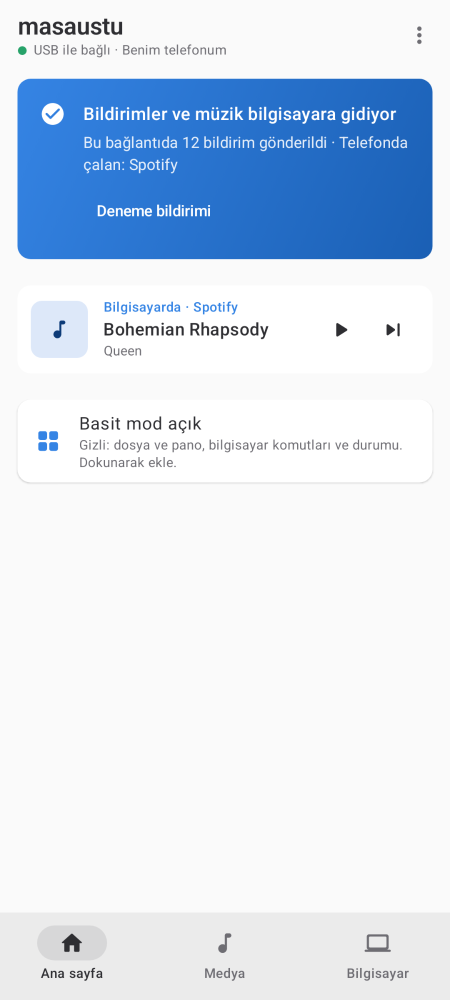 | 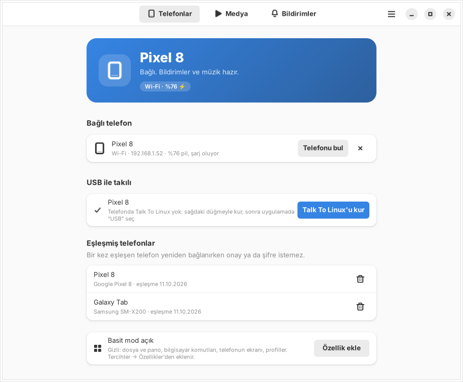 |
| 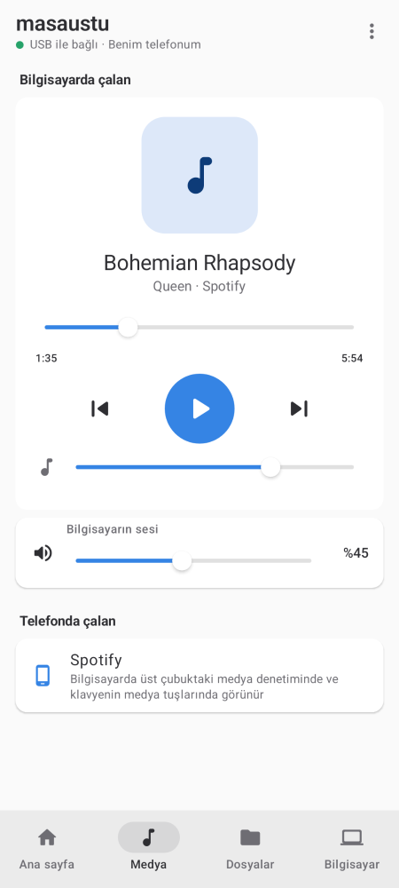 | 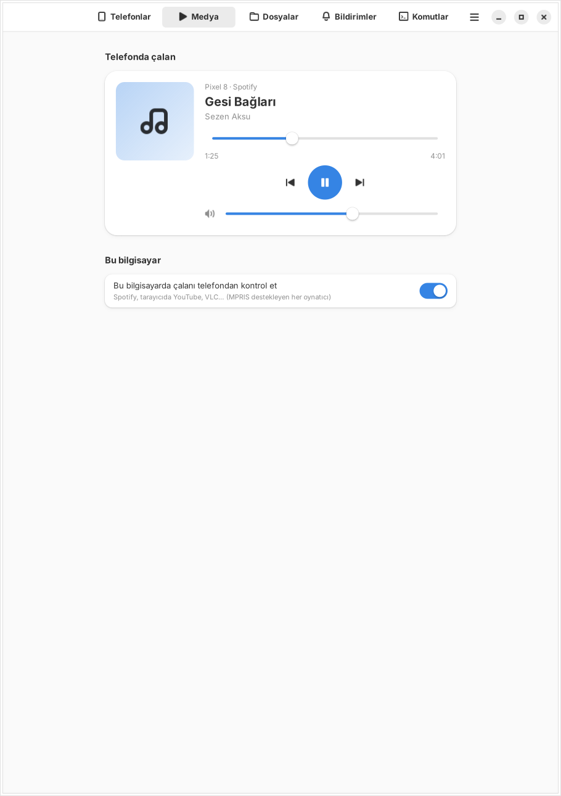 |
| 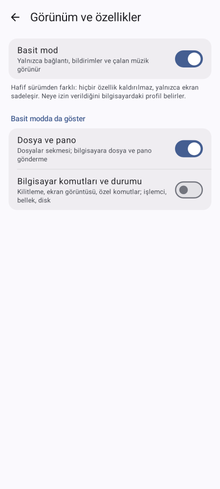 | 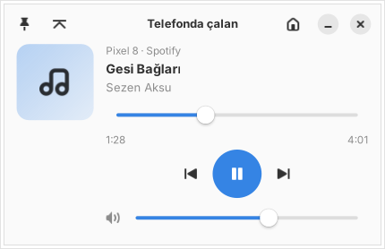 |
| 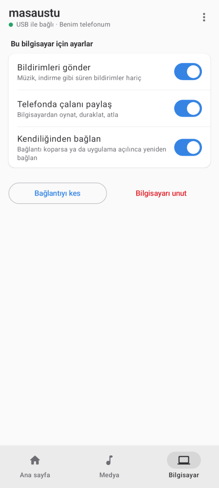 | 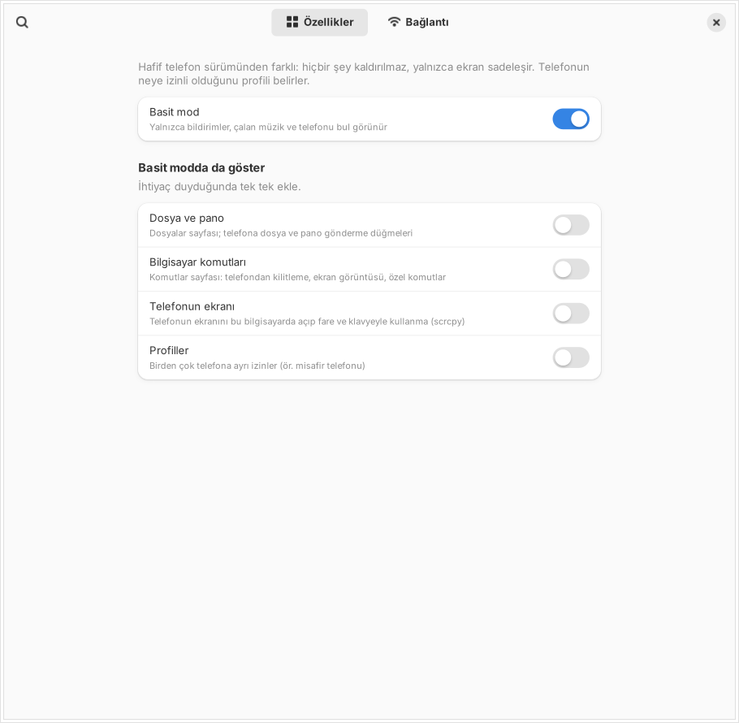 |
| 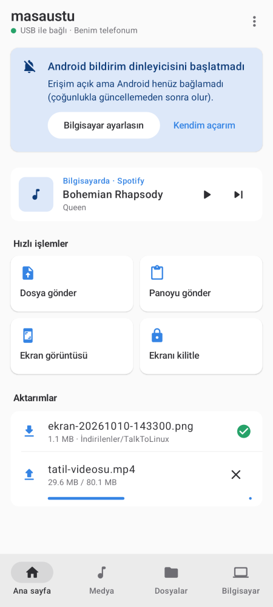 | 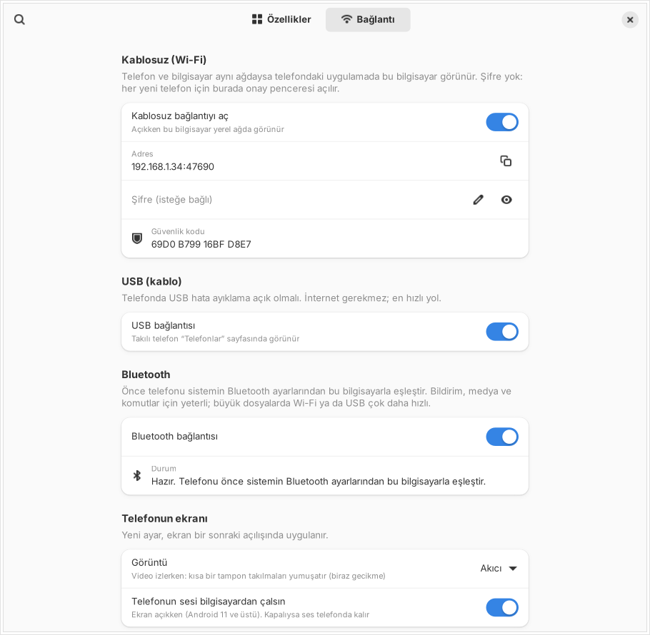 |
| 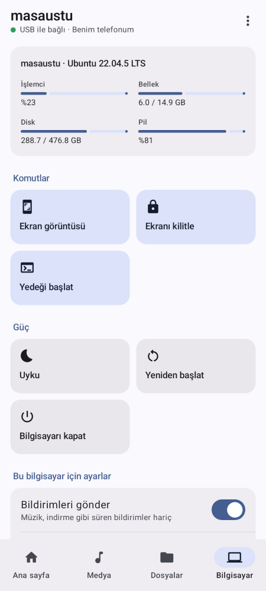 | 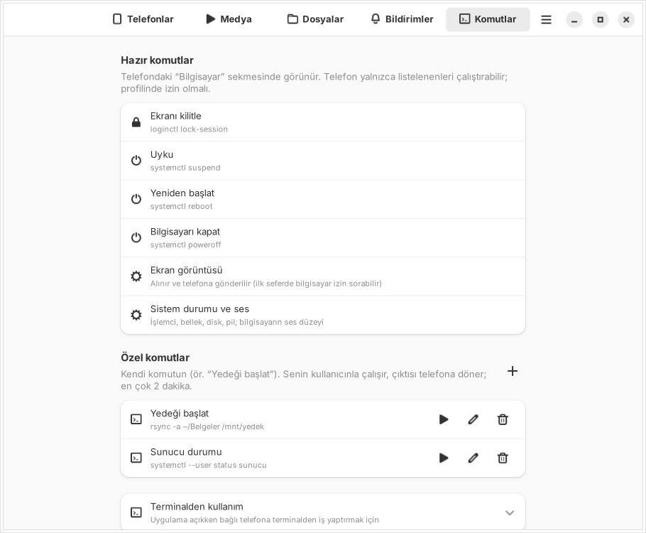 |
| 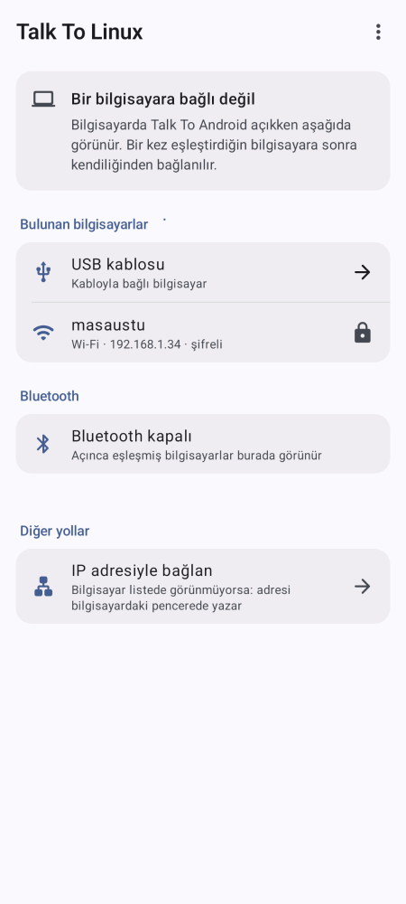 | 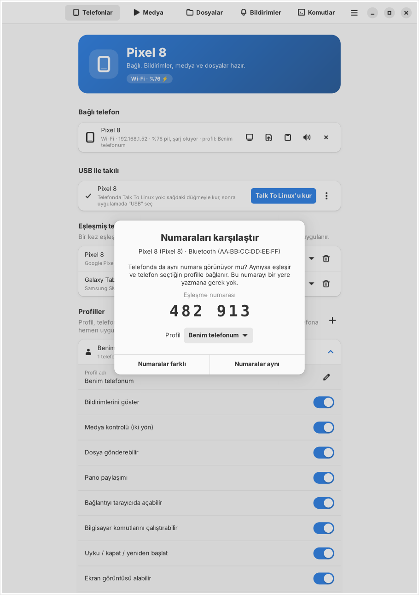 |
| 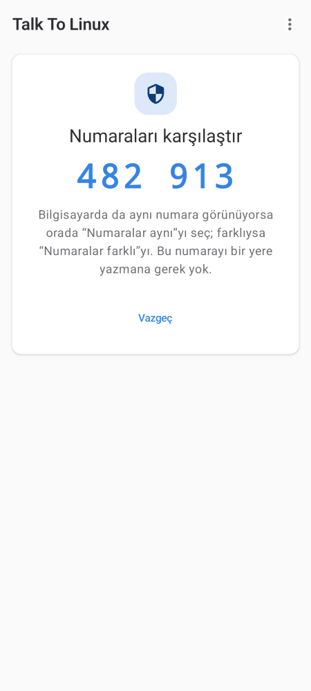 | 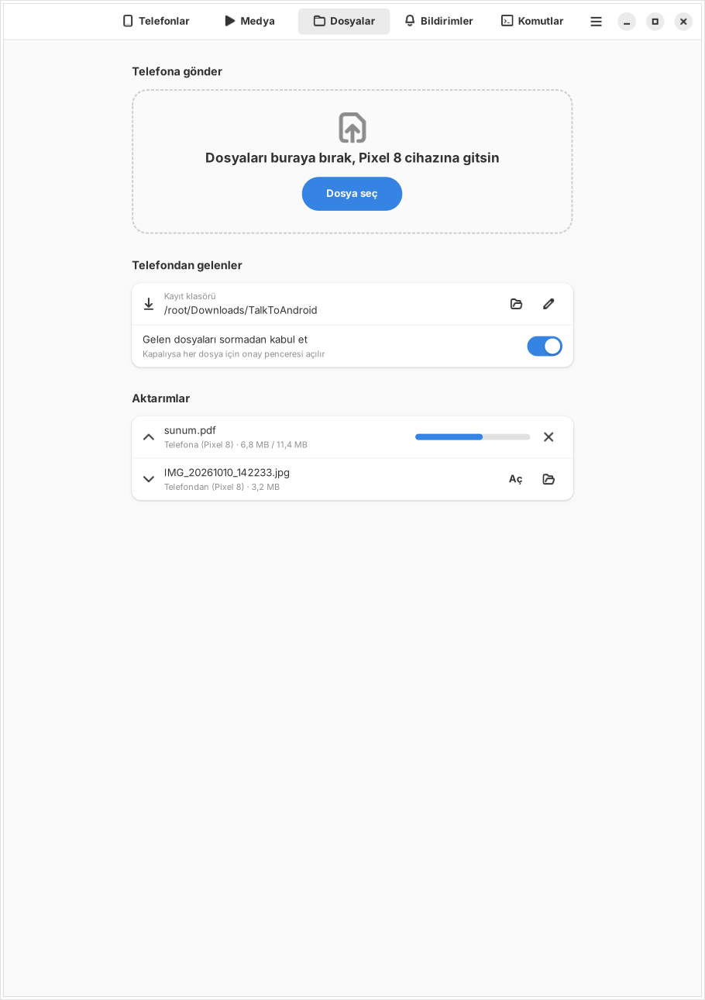 |
| 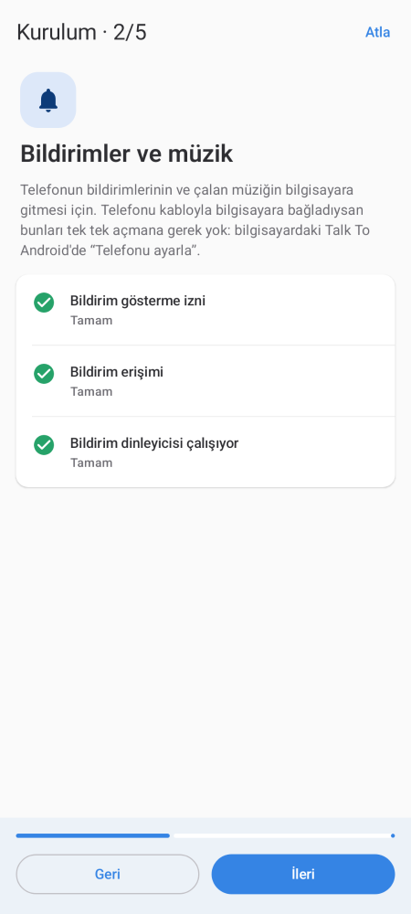 | 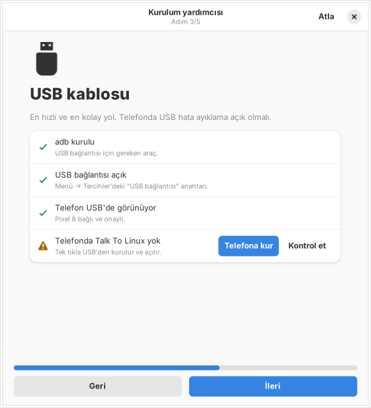 |
| 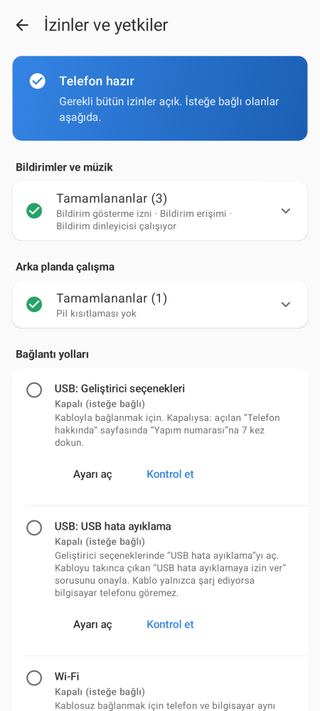 | |

Arayüz kararlarının dayandığı araştırmalar ve talepler: [`TASARIM.md`](TASARIM.md).

## Ne yapar

**Basit mod** (yeni kurulumda açık): iki uygulamada da yalnızca bildirimler, telefonda çalan müzik ve telefonu bul görünür. Dosya ve pano, bilgisayar komutları, telefonun ekranı ve profiller kaldırılmaz, gizlenir; bilgisayarda *Menü → Tercihler → Özellikler*, telefonda *⋮ → Görünüm ve özellikler*'den tek tek eklenir ya da basit mod kapatılır. Bu yalnızca görünümdür: hafif telefon sürümünden farklıdır (orada bildirim özelliği hiç yok) ve bir telefonun neye izinli olduğunu yine profil belirler.

| Özellik | Yön | Not |
|---|---|---|
| Bildirimler | telefon → bilgisayar | Masaüstünde uygulama simgesiyle çıkar; telefonda silinince masaüstünden de kalkar. |
| **Aramalar** | telefon → bilgisayar → telefon | WhatsApp, Instagram, Telegram ve telefonun kendi araması bilgisayarda bildirim olur. Çalarken uygulamanın kendi düğmeleri (**Cevapla / Reddet**), sürerken **Kapat** ve **görüşme sesi −/+**. Düğmeler telefondaki uygulamanın düğmeleridir; uygulama bildirimine “Sessize al” koyuyorsa o da çıkar. **Yapılamayanlar** (Android başka uygulamanın aramasına izin vermiyor): hoparlör / ahize / kulaklık arasında geçiş, WhatsApp ve Instagram'da mikrofonu bilgisayardan kapatmak (uygulama düğme koymuyorsa), görüşmeyi bilgisayarın mikrofonu ve hoparlörüyle yapmak (bilgisayarın Bluetooth kulaklık gibi davranması gerekir; ayrı ve büyük iş). |
| Telefonda çalan medya | telefon → bilgisayar | Spotify, YouTube, YouTube Music… Bilgisayarda gerçek bir oynatıcı gibi görünür: GNOME üst çubuğundaki medya denetimi, klavyenin medya tuşları, `playerctl`. Kapak, ilerleme; oynat/duraklat/atla/sar/ses. |
| **Mini oynatıcı, şarkı bildirimi** | telefon → bilgisayar | Telefonda çalan küçük, başlık çubuğusuz ayrı bir pencerede (Medya → Mini oynatıcı ya da menü); her yerinden sürüklenir. Ayarlar mini oynatıcıdaki **⋮** menüsünde: **Üstte tut**, **Tepecik** (tek satırlık ince şerit; çift tıklayınca büyür), **Boyut** (küçük / orta / büyük), **Müzik başlayınca kendiliğinden aç** (üst ada ekrandayken açılmaz: çalanı ada gösterir; elle açılabilir). Ekranın üstüne sürükleyince tam ekran olmaz, tepeciğe döner. Çalarken küçük bir dalga oynar (gerçek sesten gelmez; telefon ses verisi göndermiyor, yalnızca çalıyor/duraklatıldı). Üstte tutma: X11 oturumunda pencere doğrudan üstte tutulur; Wayland'de (Ubuntu'nun varsayılanı) uygulamaların kendini üstte tutmasına izin yok, bu yüzden mini oynatıcı XWayland'de (masaüstünün X11 uygulamaları için çalıştırdığı katman) açılır ve orada üstte tutulur, tepecik ekranın üst ortasına yerleşir; ölçekli (HiDPI) ekranda biraz bulanık görünebilir. XWayland yoksa: boş bir yere sağ tık (ya da Alt+Boşluk) → “Her zaman üstte”. Şarkı değişince ekranın üstünde kısa bir bildirim çıkar (Duraklat, Sonraki; tıklayınca mini oynatıcı); mini oynatıcı açıkken çıkmaz. |
| **Üst ada** (GNOME) | telefon → bilgisayar → telefon | Ekranın üst ortasında, üst çubuktan sarkan küçük bir ada: hep küçük durur (çalan şarkı ve dalga, süren arama, zamanlayıcı ya da telefon ve pil), bir şey olunca büyür (şarkı değişti, arama geldi, bildirim geldi; birkaç saniye sonra küçülür, arama sürdükçe açık kalır). Büyükken üst satırda saat, tarih ve telefonun pili (çalan aşağıda; iki kez yazmaz). Tıklayınca büyür/küçülür; **yukarı kaydırınca** (tekerlek, dokunmatik yüzey ya da yukarı sürükleme) bir kademe küçülür: büyük → normal → ince şerit (yalnızca su); ince şeridin **üstüne gelince** normal hâli hafif saydam (geçici) görünür, **tıklayınca** doğrudan büyür, kapanınca normal kalır; ince şeritteyken şarkı ve bildirim adayı büyütmez, yalnızca arama büyütür. **Basılı tutup sağa-sola sürükleyince** sayfa değişir: arama (varsa) · çalan (kapak, oynat/duraklat, önceki/sonraki) · bildirimler (uygulamanın simgesi, kaç tane, sonuncusu) · zamanlayıcı (1/5/10/25/60 dk; “Telefonda da kur” açıksa telefonda da geri sayım bildirimi ve alarm) · diğer (**Özelleştir**: ada büyür; tema, kip, “şarkı değişince masaüstü bildirimi de”, geri bildirim (dokunma sesi, telefonda titreşim), **Konumu değiştir** (kilit açılır, ada üst kenar boyunca sağa-sola sürüklenir, ekrandan taşmaz, “Bitti” ile kilitlenir, “Ortala”), Tüm ayarlar; ✕ ile kapanır; seçimler Tercihler'e de yazılır · **Sorun bildir**: GitHub'da sorun sayfası, sürüm ve sistem bilgisi yazılı açılır; hiçbir şey kendiliğinden gönderilmez, günlük eklenmez). Bildirim sayfasında **Temizle** (adadaki listeyi boşaltır, telefondakilere dokunmaz). Sayfa sürüklerken fareyi bire bir izler, bırakınca eskisi kayıp çıkar, yenisi kayarak gelir; sürükleme bir düğmenin üstünden başlasa da çalışır. Ada ekrandayken şarkı değişince masaüstü bildirimi çıkmaz (ada gösteriyor); GNOME'un bildirimleri adanın üstünde görünür. Kipler: *Sakin* (dalga yalnızca adanın içinde) ve *Taşan dalgalar* (çalarken su adanın altından taşar, çalkalanır, ara ara damlar; süs, gerçek sesten gelmez: telefon ses verisi göndermiyor). Görüşme sürerken hoparlör ve sessiz düğmeleri yazı değil simge: açıkken parlak. Büyüyüp küçülürken boyutu kayarak değişir, olay olunca hafifçe sıçrar, üstüne gelince hafifçe kabarır, dalga duraklayınca birden donmaz durulur (sistemde animasyonlar kapalıysa bunlar da kapalı). Şarkı değişirken telefon bir an “çalmıyor” derse (3 sn'den kısa) bu durma sayılmaz: ada ve mini oynatıcı boşa düşmez, kapatılan mini oynatıcı yeniden açılmaz, aynı şarkı için yeniden bildirim çıkmaz; yeni kapak gelene kadar eski kapak soluk durur (en çok 4 sn). Şarkılar arası geçişte (sonraki/önceki basıldı, telefon bir an “çalmıyor” dedi, şarkı bitti) “çalmıyor” gibi görünmek yerine hafif bir “yükleniyor” görünür: adada suyun üstünde kayan bir parıltı, mini oynatıcıda sırayla yanan çubuklar; yazı biraz söner (en çok 4 sn). Hazır temalar: Deniz, Gece, Gün batımı, Orman. Kurulum: *Tercihler → Özellikler → Üst ada → Kur*, sonra **bir kez oturumu kapatıp aç** (GNOME yeni eklentiyi ancak oturum açılırken yükler; sonraki güncellemelerde de yenisi bir sonraki oturumda devreye girer). Neden eklenti: Wayland'de bir uygulama penceresi kendini ekranın bir yerine sabitleyip her şeyin üstünde tutamaz; GNOME'un kendi kabuğu tutabilir. Yalnızca GNOME 42–48 (Ubuntu 22.04 ve 24.04); KDE ve diğer masaüstlerinde yok. Dalga gerçek sesten gelmez (mini oynatıcıdaki gibi). |
| **Karekodla eşleşme** | bilgisayar → telefon | En kolay yol: bilgisayarda **Telefon ekle** (Telefonlar sayfası, kurulum yardımcısı) bir karekod gösterir, telefonda **Karekodu tara** ile okutulur; başka hiçbir şey sorulmaz, numara karşılaştırılmaz. Karekod 10 dakika geçerli ve bir kez kullanılır; içinde bilgisayarın adresleri, güvenlik kodu ve tek kullanımlık bir anahtar var (anahtar ağdan gitmez, telefon yalnızca bildiğini kanıtlar). Telefon ve bilgisayar aynı ağda (ya da Tailscale'de) olmalı; Wi-Fi bağlantısı kapalıysa karekod açılınca açılır. Kamera görüntüsü yalnızca telefonda işlenir. Telefonun kendi kamerası da okuyabilir (`talkto://pair?…` bağlantısı); o zaman uygulama önce “… ile eşleşilsin mi?” diye sorar. |
| **İlk kurulum** | iki taraf | İlk açılışta adım adım yardımcı: telefonda bildirim izni, bildirim erişimi (Android 13+'ta “Kısıtlanmış ayar” açıklamasıyla), pil, USB hata ayıklama / Wi-Fi / Bluetooth; bilgisayarda **Telefonu bağla** adımı (USB'deki telefon için “Kur ve bağlan” / “Güncelle” / “Bağlan”, kablo yoksa Wi-Fi yolu, telefondaki izinlerin gerçek durumu), Wi-Fi, güvenlik duvarı (ufw), Bluetooth, scrcpy, oturumla başlat. Her satırda durum ve ayarı yapan düğme; satırlar kendiliğinden güncellenir (telefondaki ayarlar pencere açıkken birkaç saniyede bir yeniden okunur), “Kontrol et”e basmak gerekmez. Sonradan: telefonda ⚙ “İzinler ve yetkiler”, bilgisayarda menü → “Kurulum yardımcısı”. |
| **İzinler ve yetkiler** | telefon | Telefonun Android izinleri tek ekranda (durum + aç) ve bağlı bilgisayarın bu telefona verdiği yetkiler (profil; değiştirmek bilgisayardan). |
| **Neden çalışmıyor?** | iki yön | Telefon bildirim erişimini, Android'in bildirim dinleyicisini bağlayıp bağlamadığını ve sürümünü bilgisayara bildirir; bir şey gelmeyecekse iki tarafta da sebebi ve çözümü yazar. Telefonda "Deneme bildirimi gönder" ile yol baştan sona denenir. |
| Bilgisayarda çalan medya | bilgisayar → telefon | Spotify masaüstü, tarayıcıda YouTube, VLC (MPRIS destekleyen her oynatıcı). |
| Dosya gönderme | iki yön | Telefonda "Paylaş → Bilgisayara gönder"; bilgisayarda sürükle-bırak, "Dosya seç" ya da terminalde `talk-to-android gonder`. SHA-256 ile doğrulanır. |
| Gelen dosyalar klasörü | | Bilgisayarda `~/İndirilenler/TalkToAndroid` (genel ya da profil başına değiştirilebilir). Telefonda `İndirilenler/TalkToLinux`. |
| Pano, bağlantı açma | iki yön / telefon → bilgisayar | Paylaşılan YouTube bağlantısı bilgisayarın tarayıcısında açılır. |
| **Bilgisayar komutları** | telefon → bilgisayar | Ekranı kilitle, uyku, yeniden başlat, kapat ve **senin eklediğin Linux komutları** (çıktısı telefona döner). Bilgisayarda Tercihler → Araçlar'dan yönetilir. |
| **Telefon araçları** (geliştiriciler için) | bilgisayar → telefon (USB, adb) | Tercihler → Araçlar: **Uygulamalar** (zorla durdur, verilerini sil, devre dışı bırak, bu kullanıcı için kaldır ya da geri yükle; sistem uygulamaları dahil, paket adlarıyla), **Dosyalar** (telefonun depolamasını gez; Android/data gibi telefondan silinemeyen klasörleri sil; bilgisayara al; silme yalnızca /sdcard altında), **telefonun kabuğu** (adb shell terminalde), **sistem kaydı** (logcat dosyaya), **animasyonlar** aç/kapa, **yeniden başlat** (normal, kurtarma, önyükleyici). Root gerekmez; geri dönüşü zor işler önce sorar. |
| **Telefonun ekranı bilgisayarda** | bilgisayar → telefon | Telefonun ekranı bir pencerede açılır, fare ve klavyeyle kullanılır (scrcpy). Kalite: USB'de 16 Mbit/s, kısa kenar en çok 1920 piksel, 60 kare/s; Wi-Fi'de 8 Mbit/s ve 1600 piksel (scrcpy'nin varsayılanı yeni telefonların 2,7K / 120 Hz ekranında bulanık ve ~10 kare/s kalıyordu). Tercihler → Bağlantı → **Telefonun ekranı**: *Akıcı* (varsayılan; kareler kısa bir tamponda biriktirilip düzgün aralıkla gösterilir, takılmaları yumuşatır, bedeli USB'de ~60 ms, Wi-Fi'de ~120 ms gecikme), *Hızlı tepki* (tampon yok; oyun ve yazı), *Hafif* (1280 piksel; zayıf Wi-Fi ya da eski telefon) ve “Telefonun sesi bilgisayardan çalsın”. Saniyedeki kare sayısı `~/.cache/talk-to-android/scrcpy-<seri>.log` dosyasına yazılır: takılma sürerse sorunun telefonun kodlayıcısında mı bilgisayarda mı olduğu oradan görülür. Dağıtımın scrcpy'si çoğu zaman çok eski (Ubuntu 22.04: 1.21, yeni Android'lerde açılmıyor); bu yüzden resmi 5.0.1 sürümü şifre gerekmeden kullanıcı klasörüne (`~/.local/share/talk-to-android/scrcpy`) indirilir ve SHA-256 ile doğrulanır; ilerleme pencerede görünür. USB'de doğrudan; Wi-Fi için telefon bir kez USB'deyken “Kablosuz ekranı hazırla” (telefon yeniden başlayınca tekrar). USB hata ayıklama açık olmalı. |
| **Ekran görüntüsü** | telefon → bilgisayar → telefon | Bilgisayarın ekranı alınır, telefona dosya olarak gelir. |
| **Sistem durumu ve ses** | bilgisayar → telefon | İşlemci, bellek, disk, pil, açık kalma süresi; bilgisayarın ses düzeyi ve sessize alma. |
| **Terminalden telefona** | bilgisayar → telefon | `talk-to-android bildirim "Derleme bitti"`, `gonder`, `pano`, `cal`, `medya` (aşağıda). |
| Telefonu bul, pil | | Telefon sessizdeyken de 30 sn çalar; telefonun pili bilgisayarda görünür. |
| **Telefonun sistem bilgileri** | telefon → bilgisayar | Telefonlar sayfasının üstündeki baloncuğa (ör. “USB · %76”) tıkla: model, Android sürümü ve güvenlik yaması, pil (sıcaklık, sağlık), depolama, bellek, ağ türü, açık kalma süresi. Telefon numarası ya da Wi-Fi adı gibi kişisel bilgi gönderilmez. |

**Bir şey ters giderse:** bilgisayardaki uygulamanın günlüğü `~/.cache/talk-to-android/gunluk.txt`, çökme kaydı `cokme.txt`. Telefondaki uygulama çökerse bir sonraki bağlantıda raporu bilgisayara gelir (`~/.cache/talk-to-android/telefon-cokme-*.txt`) ve masaüstünde haber verilir. Bu dosyaları göndermek nedenini bulmayı çok kolaylaştırır.

## Bağlantı yolları

| Yol | Ne gerekir | İlk bağlantı | Hız |
|---|---|---|---|
| **USB** | Telefonda *Geliştirici seçenekleri → USB hata ayıklama*, bilgisayarda `adb` (uygulama içinden "Kur" düğmesiyle kurulur) | İki ekranda aynı 6 haneli numara; bilgisayarda “Numaralar aynı” | En hızlı |
| **Wi-Fi** | Aynı ağ; bilgisayarda "Kablosuz bağlantı" (yeni kurulumda açık) | Şifre koyduysan şifre, koymadıysan onay penceresi | Hızlı |
| **Bluetooth** | Telefonla bilgisayarı **önce sistemin Bluetooth ayarlarından eşleştir** | Onay penceresi | Yavaş (bildirim, medya, komut için yeterli; büyük dosyada Wi-Fi/USB tercih et) |

**USB hata ayıklama neden gerekiyor?** Android, kabloyla takılan bilgisayarın bir uygulamayla konuşmasına kendiliğinden izin vermez; kablo varsayılan olarak yalnızca şarj ve dosya aktarımı (MTP) içindir. USB'de bu iş için iki yol var: `adb` (USB hata ayıklama; şu an kullanılan) ve Android'in "USB aksesuar" modu (hata ayıklama gerektirmez, telefon takılınca "Talk To açılsın mı?" diye sorar; henüz yapılmadı). Hata ayıklamayı açmak istemezsen Wi-Fi ya da Bluetooth aynı özellikleri verir. Telefon takılıp hata ayıklama kapalıysa bilgisayardaki uygulama *Telefonlar → USB ile takılı* altında bunu gösterir ve adımları yazar.

**Xiaomi / Redmi / POCO.** Bu telefonlar adb'ye iki ek anahtar ister: Geliştirici seçeneklerinde “USB hata ayıklama (Güvenlik ayarları)” (izinleri bilgisayarın vermesi için) ve “USB üzerinden yükle” (uygulamayı kurup güncellemek için); ikisi de SIM kart ve Mi hesabı ister. Kurulum yardımcısı ve Telefonlar sayfası bunların açık olup olmadığını okur ve kapalıysa ne yapılacağını yazar. “Güvenlik ayarları” kapalı olsa da bağlanmak engellenmez; yalnızca eksik izinleri bilgisayar veremez (telefonda verilir). Telefondaki Talk To bilgisayardakinden eskiyse de yakalanır ve tek tıkla güncellenir.

**Telefonu bilgisayardan bağlamak.** Telefon USB ile takılı ve USB hata ayıklama açıksa telefona gitmek gerekmez: bilgisayardaki **“Bağlan”** (Telefonlar sayfasının üstünde ve kurulum yardımcısında) telefondaki Talk To'yu açar, uygulama USB tünelinden bağlanır, ilk seferde bilgisayarda iki ekrandaki numara karşılaştırılır. Uygulama yoksa ya da eskiyse “Kur ve bağlan” / “Güncelle” kurar, açar ve bağlar. Telefondaki kurulum sihirbazı açıksa kendiliğinden kapanır (adımları bilgisayar yapıyor). Bunun için telefonda yalnızca adb'nin açabildiği bir kapı var (`android.permission.DUMP` ile korunan bir giriş): telefondaki başka bir uygulama Talk To'yu kendi dinlediği adrese bağlatamaz.

**Telefonu bilgisayardan ayarlamak.** Bildirim erişimi, pil kısıtlaması, bildirim ve Bluetooth izni telefonun ayar menülerinde dağınık; Android 13+'ta dışarıdan kurulan uygulamaya bildirim erişimi ayrıca "kısıtlanmış ayar" engeline takılır. Bilgisayar bunların durumunu USB'den okur: telefonda elle verilmiş olanlar “tamam” görünür ve yeniden istenmez. Eksik varsa **“İzinleri tamamla”** (kurulumda “Tamamla”, ya da telefondaki **“Bilgisayar ayarlasın”**) yalnızca eksikleri adb ile bir kerede verir. Yalnızca Talk To'nun kendi izinlerine dokunulur. Bazı telefonlarda bunun için Geliştirici seçeneklerinde ayrı bir anahtar gerekir: Xiaomi/Redmi/POCO'da “USB hata ayıklama (Güvenlik ayarları)” (bilgisayar okuyup durumunu gösterir), Oppo/Realme/OnePlus'ta “İzin izlemeyi devre dışı bırak” (durumu okunamıyor; izin verilemezse söylenir).

Bağlantı koparsa telefon 2 dakika boyunca kendiliğinden yeniden dener (bilgisayara özel ayarlardan kapatılabilir).

**Farklı ağdan (internet üzerinden) bağlanmak.** Uygulamanın kendi aktarma sunucusu yok (olsaydı birinin işletmesi gerekirdi). Bugün çalışan yol bir VPN: telefona ve bilgisayara [Tailscale](https://tailscale.com) (ya da ZeroTier, WireGuard) kurup aynı hesaba bağla; bilgisayar `100.x.y.z` gibi bir adres alır ve *Tercihler → Bağlantı → Adres*'te görünür. Telefonda *Diğer yollar → IP adresiyle bağlan* ile bu adrese bir kez bağlan. Sonra telefon, duyuru ulaşmasa da kayıtlı adrese kendiliğinden yeniden bağlanmayı dener (arka planda dakikada bir, uygulama açıkken 5 dakikada bir; güvenlik kodu yine denetlenir). Trafik zaten TLS ile şifreli; VPN ikinci bir katman ekler. Bilgisayarda ufw açıksa 47600/tcp'ye izin olmalı (kurulum yardımcısındaki “İzin ver”). Gerçek bir VPN üzerinden **henüz denenmedi**.

## Profiller: birbirini tanıma

Bilgisayarda *Telefonlar → Profiller*: her profil bir telefonun bu bilgisayarda neleri yapabileceğini söyler.

| İzin | "Benim telefonum" | "Misafir" |
|---|---|---|
| Bildirimlerini göster, medya kontrolü, dosya gönderebilir | ✓ | ✓ |
| Pano, tarayıcıda bağlantı açma | ✓ | — |
| Bilgisayar komutları, ekran görüntüsü | ✓ | — |
| Uyku / kapat / yeniden başlat | ✓ | — |

- Onay penceresinde telefonun profilini seçersin; şifreyle eşleşen telefon "yeni telefonlar bununla başlar" profilini alır.
- Profil oluşturma, yeniden adlandırma, silme, profil başına ayrı kayıt klasörü: *Telefonlar → Profiller* (+).
- Bir telefonun profilini *Telefonlar → Eşleşmiş telefonlar*'dan değiştirebilirsin; bağlıysa **hemen** uygulanır.
- Telefon bağlanınca "Bilgisayar seni “Benim telefonum” profiliyle tanıyor" yazar ve yalnızca izin verilen düğmeleri gösterir.
- Telefonda da her bilgisayarın kendi ayarları var: bildirim gönder, medya paylaş, kendiliğinden bağlan.

## Bilgisayar komutları

Telefon **yalnızca bilgisayarda tanımlı komutları adıyla** tetikleyebilir; telefondan komut metni gelmez, gelse de çalıştırılmaz.

- **Hazır:** `loginctl lock-session` (kilitle), `systemctl suspend|reboot|poweroff` (uyku, yeniden başlat, kapat; telefonda "emin misin?" sorulur).
- **Özel:** *Komutlar → Özel komutlar → +* ile ad ve komut gir (ör. "Yedeği başlat" → `rsync -a ~/Belgeler /mnt/yedek`). Senin kullanıcınla, ev klasöründe `sh -c` ile çalışır, en çok 2 dakika; çıktısı telefonda gösterilir. "Burada dene" düğmesiyle önce bilgisayarda deneyebilirsin.
- Telefondan çalıştırılan her komut bilgisayarda **masaüstü bildirimi** ve *Komutlar → Telefondan çalıştırılanlar* listesinde görünür.

## Terminalden kullanım

Uygulama açıkken (pencere kapalı, arka planda da olur):

```bash
talk-to-android durum                                  # bağlı telefonlar, pil, profil
talk-to-android gonder foto.jpg rapor.pdf              # telefona dosya (bitince ✓/✗ yazar)
talk-to-android bildirim "Derleme bitti" "0 hata"      # telefonda bildirim
echo "merhaba" | talk-to-android pano                  # telefonun panosuna
talk-to-android cal              # telefonu çaldır;  --durdur ile sustur
talk-to-android medya sonraki    # oynat | duraklat | oynat-duraklat | sonraki | onceki
talk-to-android ekran            # telefonun ekranını bilgisayarda aç (scrcpy)
talk-to-android teshis           # uygulama takıldıysa: o anki durumu günlüğe yaz (gunluk.txt + cokme.txt)
talk-to-android gonder x.zip -c Pixel                  # birden fazla telefon bağlıysa adla seç
```

Örnek: uzun bir işin bitince telefona haber vermesi: `make && talk-to-android bildirim "Derleme bitti" || talk-to-android bildirim "Derleme HATALI"`.

Komut satırı, çalışan uygulamayla `$XDG_RUNTIME_DIR/talk-to-android.sock` üzerinden konuşur; soketin izni 600 ve bağlanan sürecin kullanıcısı denetlenir, yani yalnızca sen kullanabilirsin.

## Kurulum

### Linux (bilgisayardaki Talk To)

**Ubuntu / Debian / Mint / Pop!_OS: terminal gerekmez.** `talk-to-android_0.9.2_all.deb` dosyasına çift tıkla, Uygulama Merkezi'nde **Kur**, sonra uygulama menüsünden "Talk To"ı aç. (Çift tıklayınca arşiv yöneticisi açılırsa: sağ tık → "Birlikte aç" → Uygulama Merkezi.)

- **Güncellerken:** eski sürüm kuruluyken Uygulama Merkezi yeni `.deb` için çoğu zaman "Güncelle" göstermez, yalnızca çöp kutusu (kaldır) çıkar. Kaldırmaya gerek yok: terminalde dosyanın olduğu klasörde `sudo apt install ./talk-to-android_0.9.2_all.deb` eskisinin üstüne kurar (ya da **Paket Güncelleyici**: `.deb`'e sağ tık → Birlikte aç; sürümü ve imzayı karşılaştırıp kurar); ayarlar ve eşleşmeler `~/.config` altında kalır. "dpkg/lock-frontend kilidi alınamadı … (unattended-upgr)" hatası, Ubuntu'nun kendi otomatik güncellemesi o an çalışıyor demek: birkaç dakika bekleyip yeniden dene.
- Uygulama Merkezi yerel `.deb` kurarken eksik bağımlılıkları kendisi indirmiyor (0.2.0'da "unmet dependencies" hatası bundandı). Bu yüzden paketin zorunlu bağımlılığı yalnızca `python3`. GTK4/libadwaita eksikse uygulama **ilk açılışta** "kurulsun mu?" diye sorar ve bilgisayarın şifre penceresiyle kurar.
- Terminal kullanmak istersen tek komut her şeyi birlikte kurar: `sudo apt install ./talk-to-android_0.9.2_all.deb`.

`.deb` dosyasını üretmek (bir kez): `sh talk-to/linux/paket/deb-olustur.sh`

Uygulamanın içinden, terminalsiz:
- **adb eksikse** kurulum yardımcısının USB adımında **Kur** düğmesi: bilgisayarın kendi şifre penceresi açılır, dağıtımın paket yöneticisiyle (apt, dnf, pacman, zypper) kurulur.
- **Oturum açılınca başlat** (menü → *Tercihler* → Genel).

**Fedora, Arch ve diğerleri:** henüz paket yok; bir kez terminalde:

```bash
# Fedora:  sudo dnf install python3-gobject gtk4 libadwaita python3-cryptography android-tools
# Arch:    sudo pacman -S python-gobject gtk4 libadwaita python-cryptography android-tools
cd talk-to/linux && sh kur.sh          # yalnızca bu kullanıcıya, sudo gerekmez (kaldırmak: sh kur.sh --kaldir)
```

Gerekenler: Python 3.10+, GTK 4.6+, libadwaita 1.1+ (Ubuntu 22.04 ve üstü, Debian 12+, Fedora 36+, güncel Arch). Eski kütüphanelerde (Ubuntu 22.04) yeni libadwaita parçalarının yerine `ui/compat.py`'deki yedekler kullanılır; görünüm biraz sadeleşir, özellikler aynıdır. Bluetooth için BlueZ (masaüstü dağıtımlarında hazır gelir).
Kurmadan denemek: `cd talk-to/linux && python3 -m talkto`.
Güvenlik duvarı (ufw) açıksa Wi-Fi için bir kez: `sudo ufw allow 47600/tcp && sudo ufw allow 47601/udp`.

### Android (telefondaki Talk To)

Android 10 ve üstü. Üç sürüm var; aynı uygulama oldukları için biri diğerinin üzerine kurulabilir:

| Sürüm | Dosya | Nasıl kurulur | Eksik olan |
|---|---|---|---|
| **Tam** | `talk-to-linux-0.18.0.apk` (ayrıca `.deb`'in içinde) | Bilgisayardan USB ile (aşağıda) | — |
| **Play** (hilesiz) | `talk-to-linux-0.18.0-play.apk`; Play Console için `…-play.aab` | Google Play'den (yayınlanırsa) ya da dosya yöneticisinden | Bazı telefonlarda (Xiaomi/HyperOS) WhatsApp, Instagram gibi uygulamaların aramasını bilgisayardan **cevaplamak** |
| **Hafif** | `talk-to-linux-0.18.0-hafif.apk` | Telefonda dosya yöneticisinden açıp doğrudan | Telefon bildirimlerinin bilgisayara gelmesi, telefonda çalan müziğin bilgisayardan kontrolü |

**Play sürümü neden ayrı, “hile” ne?** Android, arka plandaki bir uygulamanın ekran açmasını engelliyor. WhatsApp'ın “Cevapla” düğmesi arama ekranını açtığı için, bilgisayardan basılınca bazı telefonlarda hiçbir şey olmuyor. Tam sürüm bunu “diğer uygulamaların üzerinde göster” izniyle, bir anlığına görünmez küçük bir pencere açarak aşıyor (ekranda bir penceremiz varken engel yok). Bu, Android'in sınırını dolanmak demek; Google Play bu tür kullanımı kabul etmeyebilir. Play sürümünde bu izin ve hile yok; geri kalanı aynı (bildirim erişimi, telefonun kendi aramasını Android'in resmi yoluyla cevaplama). **Tam sürüme geçmek:** telefonu USB ile tak, bilgisayardaki Talk To'da **“Tam sürüme yükselt”** düğmesi çıkar; tek tıkla kurulur, eşleşme ve ayarlar korunur. Hafif sürümde de aynı düğme çıkar. (Play'den kurulan uygulamanın üzerine kurabilmek için Play'deki imza anahtarı bizimkiyle aynı olmalı; değilse bilgisayar kaldırıp kurmayı önerir, o zaman eşleşme sıfırlanır.)

**Tam sürüm için önerilen yol: bilgisayardan USB ile kur.** Telefonda *Geliştirici seçenekleri → USB hata ayıklama*'yı aç, kabloyu tak, telefonda çıkan "USB hata ayıklamaya izin ver" sorusunu onayla. Bilgisayardaki Talk To'da *Telefonlar* sayfasında telefonun yanında **“Kur ve bağlan”** düğmesi çıkar; basınca APK telefona kurulur, açılır ve bağlanır (APK `.deb` paketinin içinde gelir).

**Neden APK'yı telefona indirip açmak yerine bu yol?** Google Play Protect, bazı ülkelerde internetten (tarayıcı, mesajlaşma, dosya yöneticisi) yüklenen ve **bildirim erişimi** isteyen uygulamaları "Yine de yükle" seçeneği vermeden engelliyor; dolandırıcıların tek kullanımlık şifreleri okumak için kullandığı izinlerden biri bu. Talk To bildirimleri bilgisayara iletmek için bu izni istediğinden engele takılabiliyor. Bu engel USB (adb) ile kuruluma uygulanmıyor. Uygulama bilgileri eksik diye engellenmiyor; sebep bu izin. Hafif sürüm bu izni hiç istemediği için dosya yöneticisinden kurulabilir.

APK'yı kendin derlemek (JDK 17+, Android SDK) ya da [GitHub'daki derlemeden](#otomatik-derleme) indirmek de mümkün:

```bash
cd talk-to/android
echo "sdk.dir=$HOME/Android/Sdk" > local.properties
./gradlew assembleTamRelease assembleHafifRelease assemblePlayRelease
adb install app/build/outputs/apk/tam/release/app-tam-release.apk      # ya da hafif/release/app-hafif-release.apk
```

İmza: `TALKTO_KEYSTORE` ve `TALKTO_KEYSTORE_PASSWORD` ortam değişkenleri tanımlıysa APK o anahtarla, değilse bilgisayarın hata ayıklama anahtarıyla imzalanır. Yeni sürümün eskisinin **üzerine** kurulabilmesi için hep aynı anahtar gerekir; farklı anahtarla imzalanmış sürümü kurmadan önce eskisini kaldırman gerekir. Uygulama kimliği değiştiği için eski "Köprü" sürümü ayrı bir uygulama olarak kalır; onu kaldırabilirsin.

Telefonda verilecek izinler: **bildirim izni** (Android 13+), **bildirim erişimi** (bildirimler ve telefondaki müzik için, uygulamadaki "İzin ver" kartı), **Bluetooth izni** (yalnızca Bluetooth kullanacaksan), **pil kısıtlamasını kaldır** (ekran kapalıyken kopmasın diye; bazı üreticiler yine de kapatabilir).

## Otomatik derleme

GitHub'a her push'ta [`.github/workflows/talk-to.yml`](../.github/workflows/talk-to.yml) çalışır:

| İş | Ne yapar | Çıktı |
|---|---|---|
| Linux | testler, arayüzün sanal ekranda açılması, `.deb` üretip kurma | `talk-to-android-deb`, `linux-ekran-goruntuleri` |
| Android | derleme, birim testleri, lint, gerçek Linux sunucusuna karşı canlı test | `talk-to-linux-apk`, `android-raporlar` |
| Sürüm | `v0.2.0` gibi bir etiket push edilince GitHub Release açar | APK + `.deb` sürüm sayfasında |

Dosyalar: GitHub → **Actions** → son çalışma → sayfanın altındaki **Artifacts**.

APK'nın her derlemede aynı anahtarla imzalanması için depoya iki sır eklenmeli (bir kez, tarayıcıdan):
**Settings → Secrets and variables → Actions → New repository secret**
- `TALKTO_KEYSTORE_BASE64`: imza anahtarının base64 metni
- `TALKTO_KEYSTORE_PASSWORD`: parolası

Sırlar yoksa derleme yine çalışır ama APK her seferinde farklı geçici anahtarla imzalanır (uyarı verir). **Anahtarı depoya koyma:** depo herkese açık; anahtarı ele geçiren, telefonuna "güncelleme" diye başka uygulama kurdurabilir.

## Güvenlik

- Bütün trafik **TLS** ile şifreli (Bluetooth dahil). Telefon ilk eşleşmede bilgisayarın sertifika parmak izini kaydeder; değişirse bağlanmaz ("güvenlik kodu değişmiş").
- İlk eşleşmede iki ekrandaki 6 haneli numarayı karşılaştır: telefon kendi rastgele değerini numaradan önce taahhüt ettiği için araya giren biri iki ekranda aynı numarayı çıkaramaz. Düğmeler “Numaralar aynı / Numaralar farklı”; Enter, Esc ve pencereyi kapatmak “farklı” sayılır (araştırmada “Evet/Hayır” düğmeleriyle kullanıcıların %20'si eşleşmeyen kodu onaylamıştı, bkz. [TASARIM.md](TASARIM.md)). Numaralara bakmadan onaylarsan bu koruma yok.
- Wi-Fi şifresi kısa olmasın: şifre kanıtı PBKDF2 (100 000 tur) ile yavaşlatılır ama çok kısa bir şifre yine de çevrimdışı denenerek bulunabilir. Emin değilsen şifresiz bırak, onay penceresini kullan. Biri şifreyle eşleşince bilgisayarda bildirim çıkar.
- Aynı adresten 10 dakikada 5 hatalı denemede o adres geçici olarak engellenir (USB/yerel bağlantıda 20). Kimlik doğrulanmadan önce büyük ileti ve dosya parçası kabul edilmez.
- Telefon, kayıtlı bir bilgisayarın güvenlik kodu değişmişse ya da tanımadığı bir şey telefonun USB portunu açmışsa kendiliğinden bağlanmaz. Paylaş menüsünden gelen her gönderim telefonda kısa bir onay ister (başka bir uygulama sessizce bilgisayarda bağlantı açamasın).
- Ekran görüntüsünü masaüstü reddederse başka yoldan alınmaz; alındığında bilgisayarda bildirim çıkar.
- **Komutlar en güçlü izin:** "komut çalıştırabilir" açık bir profildeki telefon, bilgisayarda tanımladığın her komutu çalıştırabilir. Kaybolan telefonu *Güvenilen cihazlar*'dan hemen **unut**. Güç komutları ayrı izindir.
- Bir telefon dosyayı yalnızca kayıt klasörüne yazabilir; başka klasöre çıkamaz, var olan dosyanın üzerine yazamaz. Bilgisayardaki dosyaları okuyamaz.
- USB ve Bluetooth bağlantısı otomatik güvenilir sayılmaz, her yeni telefon için onay ister.
- **`.deb` paketi imzalı** (0.7.1'den itibaren): yayıncının açık anahtarı paketin içinde `/usr/share/keyrings/talk-to-android-paket.gpg`, imza paketin `_gpgorigin` parçasında (debsigs biçimi; dpkg/apt bu parçayı yok sayar). Anahtarın parmak izi `68E7 8B0A 596A 2E51 8DA0  526B CFBF 9E59 8C96 C9F4`. Elle doğrulamak: `python3 talk-to/linux/paket/deb-imzala.py dogrula talk-to-android_0.9.2_all.deb`. Gizli anahtar depoda değil, yalnızca GitHub'da sır olarak durur.
- **Yayıncı kartı** (0.8.1'den itibaren): paketin içinde `/usr/share/keyrings/talk-to-android-paket.json` (ad, site, iletişim, doğrulama adresi). Veri arşivinde olduğu için imzanın kapsamında. Kartın kendisi yalnızca beyandır; Paket Güncelleyici, kartta yazan doğrulama adresini ([`YAYINCI.txt`](YAYINCI.txt)) açıp imzanın parmak izinin orada yayımlandığını denetler. Kişisel e-posta yok; iletişim GitHub sorunları üzerinden.
- **Güncellenince yeniden başlama:** Talk To kendi sürüm dosyasını izler; paket güncellenince (aktarım sürmüyorsa) aynı süreç yeni sürümle yeniden başlar, telefon birkaç saniyede yeniden bağlanır.
- Ayarlar `~/.config/talk-to-android/` altında, yalnızca senin okuyabileceğin izinlerle (600). Wi-Fi şifresi orada düz metin durur (doğrulama için gerekli).

## Bilinen sınırlamalar

- **Linux ↔ Linux** bağlantısı yok (protokol uygun, Linux tarafında istemci yazılmadı). iPhone yok.
- Bluetooth **yalnızca sistemde önceden eşleştirilmiş** cihazlarla çalışır; uygulama kendi başına Bluetooth taraması/eşleştirmesi yapmaz. Büyük dosyalarda yavaştır (gerçek hız denenmedi; Bluetooth Classic'te tipik olarak saniyede birkaç yüz KB).
- Ekran görüntüsü GNOME/KDE'de ilk seferde bilgisayarda izin sorar; görüntü bilgisayarın Resimler klasöründe de kalabilir. Portal yoksa `gnome-screenshot`, `spectacle`, `grim`, `scrot` denenir.
- "Ekranı kilitle" `loginctl lock-session` ile çalışır; bazı hafif masaüstlerinde (kilit ekranı olmayan) etkisiz olabilir. Uyku/kapat, oturumu açık kullanıcıya polkit izin veriyorsa şifresiz çalışır (çoğu masaüstünde öyle).
- Bilgisayar sesi `wpctl` (PipeWire) ya da `pactl` (PulseAudio) ister.
- Bildirime bilgisayardan cevap yazma yok. GTK4'te sistem tepsisi simgesi yok (pencere kapanınca arka planda sürer; tamamen kapatmak: menü → "Tamamen kapat").
- Birden fazla telefon bağlanabilir; sürükle-bırak dosyalar en son bağlanana gider (diğerine *Telefonlar*'daki düğme ya da `-c AD`).
- Keşif UDP yayınıyla çalışır: misafir ağları ve "istemci yalıtımı" açık modemler engeller; o zaman "IP adresiyle bağlan".
- Paket yalnızca Ubuntu/Debian ailesi için (.deb); rpm, Flatpak, Snap yok.

## Sıradaki işler (onay bekliyor, yapılmadı)

Konuşulan iki istek; ikisinde de amaç kullanıcıya iş çıkarmamak. Onay gelmeden kodlanmayacak.

1. **Telefondan bilgisayarın ekranı (şifre gerekiyorsa şifreyle).**
   - *Önerilen yol: GNOME'un kendi Uzak Masaüstü'sü (RDP).* Ubuntu 22.04 ve sonrasında kurulu geliyor (`gnome-remote-desktop`). Talk To *Tercihler*'de tek anahtar: açınca RDP'yi etkinleştirir, rastgele kullanıcı adı/şifre üretir ve bunları zaten şifreli olan Talk To bağlantısıyla telefona verir; telefonda tek dokunuşla bağlanılır. Ekran kilitliyse kilit ekranı görünür, şifre telefondan yazılır. Sınırlar (dürüstçe): 22.04'te yalnızca açık oturum paylaşılır (oturum açma ekranından uzaktan giriş 24.04'te); telefonda bir RDP istemcisi gerekir (gömmek büyük iş, harici uygulamaya şifreyi kendiliğinden geçirmek her uygulamada mümkün değil; en kötü durumda şifre pano eşitlemesiyle yapıştırılır).
   - *Önerilmeyen yol: kendi görüntü akışımız* (ekran portalı → video → telefon, dokunuşları geri gönderme). Çok iş, gecikme, güvenlik yüzeyi büyük; Wayland her seferinde izin sorar.
2. **Telefonla kilidi aç.** Telefon parmak izi/yüz ile onaylar (Android BiometricPrompt), eşleşmiş ve "kilidi açabilir" izni verilmiş profil bilgisayara iletir, bilgisayar `loginctl unlock-session` ile kendi oturumunun kilidini açar ve "telefonla açıldı" bildirimi gösterir. İsteğe bağlı (varsayılan kapalı), yalnızca yakın bağlantıda (USB/Bluetooth/aynı Wi-Fi). Denenmesi gereken: GNOME'un bu çağrıyı her sürümde kabul edip etmediği.
   - **Unutulan şifreyi telefondan sıfırlama önerilmiyor:** telefonu ele geçiren bilgisayarın yönetici şifresini de değiştirebilir hâle gelir. Unutulan şifre için Ubuntu'nun kurtarma kipi doğru yol; "telefonla kilidi aç" günlük kullanımı karşılar.
3. **Destek ol alanı ve destekçi temaları** (konuşuldu, sıradaki iş). Destekçi temaları ayrı ve daha gösterişli olacak; Play sürümünde Play Billing, ötekilerde GitHub Sponsors; sunucu yok, kilit değil teşekkür.
4. **Kendi teman (sonraya; acelesi yok).** Hareketli duvar kâğıdı gibi kendi zeminini seçmek. Ölçekleme dürüstçe: ada küçükken ~300×29, büyükken ~340×400 ve boyutu sürekli değişiyor; video/GIF ya kırpılır ya sündürülür ve kabuğun içinde video çözmek işlemciyi geri harcar. Önerilen yol: kendi **resmin** zemin olur (kırpma ve odak noktası seçilir), üstüne Ada Place'in süsleri ve renkleri; her boyutta düzgün ve ucuz.

## Ne test edildi

| Ne | Nasıl | Sonuç |
|---|---|---|
| Linux çekirdeği | 28 test: gerçek TLS sunucusu + Python sahte telefon. USB onayı, reddetme, belirteçle yeniden bağlanma, Wi-Fi şifresi, deneme sınırı, iki yönlü dosya, bozuk dosya, `../` adları, bildirim/pano/bağlantı, medya; **profil tanıma, onayda profil seçimi, misafir kısıtları, profil değişikliğinin anında uygulanması, özel komut ve çıktısı, güç komutu izni, sistem bilgisi, terminal aracı (durum/bildirim/pano/gonder), Bluetooth yolu** (BlueZ'in verdiği soket yerine kabul edilmiş soket: aynı TLS + onay) | geçti |
| Android ↔ Linux | Android ağ kodu JVM'de **gerçek Linux sunucusuna** bağlandı: (1) TCP/TLS: şifre → eşleşme → iki yönlü dosya → belirteçle yeniden bağlanma; (2) **Bluetooth'ta kullanılan TLS katmanı** (SSLEngine) TCP akışı üzerinden: eşleşme, profil, özel komut ve çıktısı, sistem bilgisi, 1,5 MB dosya | geçti |
| Telefon müziği masaüstünde | Oturum D-Bus'ında MPRIS oynatıcısı açıldı; `gdbus` ile şarkı adı/sanatçı/süre okundu, İleri/Oynat-Duraklat/Konuma git komutları telefona gitti; bilgisayar medyası listesinde kendi oynatıcımız görünmüyor (geri yansıma yok). 22.04 kütüphaneleriyle de geçti | geçti |
| Telefonun ekranı (scrcpy) | Sahte adb/scrcpy ile: USB'deki oturumun adb seri numarasının bulunması ve doğru argümanlarla scrcpy açılması, ikinci pencere açılmaması, scrcpy/adb yokken açıklama, Wi-Fi için `adb tcpip`/`adb connect`, terminal komutu. Gerçek scrcpy + telefon denenmedi | geçti |
| Kurulum yardımcısı (bilgisayar) | Denetimlerin hangi durumda ne söylediği ve hangi düğmeyi gösterdiği (adb yok, telefon takılı değil / hata ayıklama kapalı / onay bekliyor / uygulama yok, ufw açık, ekler); pencere 24.04 ve 22.04 (libadwaita 1.1) kütüphaneleriyle açıldı | geçti |
| Kurulum sihirbazı (telefon) | Emülatörde ilk açılışta sihirbazın bütün adımlarından geçiliyor (ekran görüntüleri), sonra bağlantı testleri | CI |
| "Neden gelmiyor" uyarıları | Telefonun `phone_status` iletisinden bilgisayardaki uyarılar (hafif sürüm, erişim kapalı, dinleyici bağlı değil, profil izni) | geçti |
| **Gerçek Android (emülatör, her push'ta)** | Android 14 emülatöründe tam sürüm APK: USB yolu (adb reverse) ile gerçek Linux sunucusuna bağlanma, bilgisayarda onay, telefonun bildirdiği durum (erişim + dinleyici), telefondaki bildirimin bilgisayara ulaşması, "Deneme bildirimi gönder", uygulama adlarının paket adı yerine çıkması, başlıksız medya oturumunun müzik sayılmaması, USB'den yeniden kurulum sonrası onaysız yeniden bağlanma ve bildirimlerin sürmesi. Ekran görüntüleri `emulator-sonuc` içinde | geçti |
| Şifre kanıtı, onay kodu, çerçeve | Python ve Kotlin aynı test vektörlerini üretiyor | geçti |
| Basit mod, mini oynatıcı | Linux: yeni ayarların varsayılanı, eklenen özelliklerin sayfaları göstermesi, gerçek pencerede basit modu açıp kapatınca sayfaların gizlenmesi/görünmesi, sabitlenmiş mini oynatıcının müzik başlayınca açılması, şarkı bildiriminin yalnızca mini oynatıcı kapalıyken çıkması ve düğmeleri, çalanın izi (başladı / parça değişti / durdu, iki telefon); kurulum yardımcısında basit modda Wi-Fi'nin öne geçmesi. 24.04 ve 22.04 (GTK 4.6) kütüphaneleriyle. Android: birim testi, ekran görüntüleri; emülatör testi basit modda Dosyalar sekmesinin olmadığını ve “Dosya ve pano” eklenince göründüğünü dener | geçti / CI |
| 0.8.0 düzeltmeleri | Mini oynatıcı: boş ve çalan hâlin aynı yüksekliği kapladığı, pencerenin yeniden boyutlanabildiği (Wayland'deki kapanmanın şüphelenilen nedeni); gerçek uygulama + sahte telefonla (şarkı, kapak) açıldı, 22.04 ve 24.04 kütüphaneleriyle. scrcpy: eski sistem sürümünün kullanılmadığı, indirmenin SHA-256 doğrulaması (yanlış özet reddedilir), durdurma. Kurulum: Xiaomi anahtarları ve eski telefon uygulaması (sahte adb ile), tanınmayan telefonda görülen USB aygıtları. Telefon çökme raporunun kaydedilmesi | geçti |
| 0.8.1 | **Güncellenince yeniden başlama, uçtan uca:** uygulama arka planda başlatıldı, sürüm dosyası dpkg gibi (yeni dosya yazılıp üstüne taşınarak) değiştirildi; aynı süreç (aynı PID) yeni sürümle, yine arka planda yeniden başladı. 22.04 (GTK 4.6) ve 24.04 kütüphaneleriyle. Yayıncı kartının pakete girdiği ve imzanın kapsamında olduğu | geçti |
| 0.13.1 | **Gerçek GNOME Shell 46'da (CI):** mini oynatıcının ⋮ menüsü üstte tutulurken (XWayland) tıklanınca açık kalıyor, başka yere tıklanınca kapanıyor; Wayland'de de (0.12.0–0.13.0'da XWayland'de menü açılır açılmaz kapanıyordu; test eski kodda bu hatayı yakalıyor). Üst ada: adanın dışında bırakılan sürükleme de sayfa değiştiriyor (GNOME 42'de bırakma kaçıyor, sürükleme takılı kalıyordu; düzeltme 42'de denenmedi), bildirimde uygulama simgesi, yukarı kaydırınca normal → ince şerit, üstüne gelince normal görünüm, ayrılınca ince, tıklayınca normal (yükseklikler ölçülerek). Arka planda başlayan uygulamada (oturum açılışı, güncelleme sonrası) kurulum yardımcısının ilk görünüşte açılması; ayarlar çalışırken dışarıdan silinince eskilerinin geri yazılmaması ve sıfırdan başlama | geçti |
| 0.17.0 | **Yeniden başlayınca kendiliğinden bağlanma.** Telefon: açılış ve güncelleme haberini alan bir alıcı (BOOT_COMPLETED, MY_PACKAGE_REPLACED, bazı üreticilerin QUICKBOOT_POWERON'u) kayıtlı ve “kendiliğinden bağlan” açık bir bilgisayar varsa servisi başlatır; servis bilgisayarı arar, 2 dakikada bulamazsa durur. Xiaomi/HyperOS'ta “Otomatik başlatma” kapalıyken telefon bu haberi vermez: bilgisayar USB kurulumunda bu izni de verir (MIUI izin no. 10008), verilemezse nedeniyle söyler. Bilgisayar: “Oturum açılınca başlat” bir kez kendiliğinden açılır, kullanıcı kapatırsa öyle kalır. **Emülatörde (CI):** güncellemeden sonra uygulama açılmadan yeniden bağlanma; uygulama kapatılıp açılış haberi verilince (adb root ile) kendiliğinden bağlanma. Birim: Xiaomi'de 10008'in verilmesi, Xiaomi olmayanda dokunulmaması, otomatik başlatmanın bir kez açılması. **Ada tekerleği (kullanıcı: küçülüyor ama geri büyümüyor):** yalnızca yukarı yön dinleniyordu; aşağı kaydırma artık ince şerit → normal → büyük. Gerçek GNOME Shell 46'da ölçüldü (29 px → 153 px). **Gerçek telefonda gerçek yeniden başlatma ve 10008'in HyperOS'ta gerçekten bu izin olduğu denenmedi** | CI / denenmedi |
| 0.18.0 | **Açık kaynak ve tamamen yerel, “Talk To” adı, Play'e uygun sürüm.** Lisans GPL-3.0 (`LICENSE`); telefonun karşılama ekranında, bilgisayarın kurulum yardımcısında ve Hakkında'da “açık kaynak, tamamen yerel, hiçbir veri bir yere gitmez” sade bir dille yazar; internete çıkan iki iş (scrcpy'yi indirmek, Sorun bildir) açıkça söylenir. İki uygulamanın görünen adı **Talk To** (paket adları aynı; eskisinin üstüne kurulur). Yeni **play** telefon sürümü: “diğer uygulamaların üzerinde göster” izni ve onunla yapılan görünmez nokta hilesi yok; bilgisayar USB'de Play ya da hafif sürümü görünce **“Tam sürüme yükselt”** der ve neyin eksik olduğunu söyler; Play sürümüne üstte gösterme izni vermeye çalışmaz. **Emülatörde (CI):** önce Play sürümü kuruluyor; eşleşme, bildirim erişimi ve bildirimler onunla deneniyor; sonra tam sürüm üzerine kuruluyor ve eşleşme korunarak, onaysız, kendiliğinden yeniden bağlanıyor. Birim: Play/hafif/tam ayrımı, aynı sürüm numarasında da yükseltme önerisi, telefondaki daha yeni Play sürümünün eski tam sürümle değiştirilmemesi. **Play Console'a yükleme ve Play'in incelemesi yapılmadı** | CI / denenmedi |
| 0.19.0 | **Karekodla eşleşme.** Bilgisayarda “Telefon ekle” karekodu, telefonda “Karekodu tara” (CameraX + ZXing, internetsiz); onay ve numara karşılaştırması yok. Güvenlik: karekoddaki tek kullanımlık 128 bitlik anahtar ağdan gitmez, telefon HMAC ile bildiğini kanıtlar; kanıta bilgisayarın parmak izi girdiği için araya giren biri aktaramaz; telefon parmak izini karekoddakiyle karşılaştırır; anahtar 10 dakika geçerli ve bir kez geçer; telefon yalnızca yerel ağ adreslerine gider. Karekod çizimi pakete gömülü qrcodegen ile (MIT; ek bağımlılık yok). **Birim:** iki tarafın aynı kanıtı üretmesi (ortak vektör), Linux'un çizdiği karekodun Android'in ZXing'iyle çözülmesi, karekodun bir kez geçmesi, yanlış/süresi dolmuş anahtar, internet adresi ve bozuk karekodun reddi. **Gerçek pencerede:** karekod penceresi açılıyor, sahte telefon okuyunca onaysız eşleşiyor ve pencere kapanıyor. **Emülatörde (CI):** bilgisayar telefonu unutuyor, karekod açıyor, karekoddaki bağlantı telefona veriliyor, “Eşleş” → onaysız eşleşme. **Gerçek telefonun kamerasıyla okutma denenmedi** (emülatörde kamera yok) | CI / denenmedi |
| 0.20.0 | **Protokol 1.0.** Telefonla bilgisayarın konuştuğu dil kısa ve kesin bir İngilizce belgede ([`PROTOCOL.md`](PROTOCOL.md)); her ileti ve alanı tek bir dosyada ([`protocol/messages.json`](protocol/messages.json)), belgedeki tablo bu dosyadan üretiliyor. Değerlerde Türkçe kalmadı (sürüm türü `full`/`play`/`lite`, ağ, pil sağlığı, görüşme kipi); bilgisayar eski telefonların Türkçe değerlerini de anlıyor. Belgede olmayan `call_result`, `profile.vibrate`, `sysinfo.time`, `phone_info.fingerprint` eklendi; telefon pili -1 göndermiyor, bilgisayarın ses düzeyi 100'ü aşmıyor. **Denetim:** bilgisayarın birim testlerinde gönderdiği her ileti, canlı testte Android ağ kodunun ve emülatörde gerçek uygulamanın gönderdiği her ileti tanıma göre denetleniyor; uymayan ileti testi düşürüyor. mDNS keşfi eklenmedi (UDP duyurusu yeterli; ileride) | CI |
| 0.21.0 | **Tüketici gözüyle kurulum (kullanıcı: “zorlayıcı”).** Telefondaki sihirbaz 5 adımdan 3'e indi: hoş geldin → **bilgisayara bağlan** (büyük “Karekodu tara” düğmesi, altında ağda bulunan bilgisayarlar ve USB; bağlanınca kendiliğinden ilerler) → izinler (USB'deyse “Bilgisayar ayarlasın” tek düğme; tamamlananlar toplanır). Geliştirici seçenekleri / USB hata ayıklama / Bluetooth listesi sihirbazdan çıktı (İzinler ve yetkiler ekranında duruyor). Bilgisayardaki kurulum yardımcısının “Telefonu bağla” adımında ilk satır “Karekodla bağla (en kolayı)”; USB satırları her kipte isteğe bağlı. **Emülatörde:** sihirbazın bağlanma adımında “Karekodu tara” düğmesi var ve tarayıcı açılıyor. **Gerçek telefonda kamerayla okutma denenmedi** | CI / denenmedi |
| 0.22.0 | **Telefon widget'ı:** ana ekranda bilgisayarın adı, nasıl bağlı olduğu (Wi-Fi / USB / Bluetooth), dizüstüyse pili (birkaç dakikada bir sorulur), bilgisayarda çalan (oynat/duraklat, sonraki) ve kilitle / uyut / panoyu gönder. Kilitle ve uyut bilgisayardaki hazır komutlar; profil izin vermiyorsa söylenir. Pano: Android panoyu yalnızca öndeki ekrana okuttuğu için görünmez bir ekran bir anlığına açılıp okur. Bağlı değilken dokununca uygulama açılır. Telefonun Wi-Fi'sini açıp kapamak yok (Android 10'dan beri uygulamalara izin yok). **Bilgisayar:** üst adanın ayarları ana pencerede kendi **Ada** sekmesinde (Tercihler'in dibindeydi; adadaki “Tüm ayarlar” da oraya açılır). Kurulum yardımcısı ana pencereye bağlı (modal): GNOME iki ayrı pencere göstermiyor. Ada dosyaları silinip yeniden kurulunca (kabuk eskisini çalıştırırken) “Açık” yerine “oturumu bir kez kapatıp aç” denir. GTK 4.6'nın zararsız “bildirim kuyruğu” uyarısı basılmıyor (basılırken iç içe geçip süreci düşürebiliyordu; 22.04). **Emülatörde:** widget sistemde kayıtlı ve “kilitle” düğmesi bilgisayarda kilitleme komutunu çalıştırıyor. **Widget'ın ana ekrandaki görünüşü gerçek telefonda denenmedi** | CI / denenmedi |
| 0.23.0 | **Ada ekrandayken bildirimler yalnızca adada (kullanıcı: masaüstü bildirimi adanın üstünü kapattı, aramayı masaüstü bildiriminden cevapladı, düğmeler ayırt edilmiyordu).** GNOME'un bildirimi ekranın üst ortasında, adanın üstünde çıkıyordu. Artık telefon bildirimleri ve aramalar ada ekrandayken masaüstü bildirimi olmaz (adada arama düğmeleri yeşil Cevapla / kırmızı Reddet); Ada sekmesinde “Masaüstü bildirimi de göster” ile açılır. Eklenti gerçekten çalışmıyorsa (kapatıldı, oturum yenilenmedi; 15 sn'de bir GNOME'a sorulur) bildirimler kaybolmaz, masaüstüne gelir. Ada yokken masaüstü bildiriminde “✓ Cevapla” önce, “✕ Reddet” sonra. Telefon uygulaması değişmedi (0.22.0) | birim |
| 0.24.0 | **Adadaki bildirimlerde ne zaman geldiği (kullanıcı: “bildirimin ne zaman geldiği yazmıyor”).** Bildirimler sayfasında her satırın sonunda “şimdi”, “3 dk önce”, “2 sa önce”, “1 gün önce”; sayfa açıkken kendiliğinden ilerler. Eklenti sürümü 14: paket güncellenince kullanıcının kopyası yenilenir, **oturumu kapatıp açınca** görünür. Telefon uygulaması değişmedi (0.22.0) | birim + GNOME Shell uçtan uca (ekran görüntüsünde “şimdi”) |
| 0.25.0 | **Ada Place (kullanıcı: “animasyonlu, tatlıdan havalıya adalar; önizlemede görünsünler; sis, bulut gibi adanın üstünden geçen saydam şeyler”).** 16 tema (4 eski + 12 yeni) üç grupta: Tatlı (Pamuk şeker: bulutlar, Sakura, Baloncuk, Kalpler), Sakin (Deniz, Orman, Gün batımı, Gece, Sisli sabah, Ateş böceği, Kar), Havalı (Kuzey ışıkları, Galaksi, Neon, Fırtına, Altın). Süsler adanın üstünde ayrı, saydam ve tepkisiz bir katman: tıklamaları almaz, büyükken soluklaşır, aramada ve ince şeritte çekilir. Ada sekmesinde **Ada Place**: her temanın canlı önizlemesi (küçük masaüstü + sarkan ada), tıklayınca ada hemen değişir; eklenti kurulmadan da gezilir. Adanın Özelleştir sayfasında temalar küçük, süsleri canlı mini adalar. **Süslerin hareketi**: Canlı (20 kare/sn), Yavaş (10), Durgun; GNOME'da canlandırmalar kapalıysa süsler durur, ekran kilitliyken çizilmez. Önizleme çizimi (Python) adanın çizimiyle (gjs) aynı: test ikisini piksel piksel karşılaştırır (fark 0). Eklenti sürümü 15 (oturumu kapatıp açınca). `python3-gi-cairo` önerilen paket (yoksa önizlemeler düz renk). Telefon uygulaması değişmedi (0.22.0) | birim (22.04 + 24.04 GTK) + GNOME Shell uçtan uca (süslü temalar, süsün altındaki adaya tıklama, süs katmanı adayla aynı yerde) + kabuk işlemci ölçümü |
| 0.26.0 | **Başarım ve gerçek ekran geri bildirimi (kullanıcı: “performans büyük sorun; kullanıcı kullanmıyorken gereksiz harcama yapmasın”, “yazılar bulanık”, “zamanlayıcı sırıtıyor”, “telefonun kodu yazıyor”, “yandaki dalga tuhaf”, “Özelleştir'den boşluğa basarak çıkılsın”).** Önce ölçüldü (`gnome-ada/test/olcum.sh`: gerçek GNOME Shell + Talk To, durum başına 10 sn işlemci): müzik çalarken dalga tek başına kabukta %8, süsler +%3; kimse bakmazken hiçbir şey durmuyordu (%10,4); Ada sekmesi Talk To'da %12. Yapılanlar: adada **tek canlandırma saati** (dalga, su, süsler, mini adalar aynı karede; dalga 20 kare/sn, ağır süsler 10–15); **boşta dur**: 60 sn dokunulmazsa (GNOME'un boşta izleyicisi), tam ekranda, kilitte, güç tasarrufu kipinde ve Durgun'da ada kıpırdamaz; aynı durum ikinci kez gönderilmez/kurulmaz; Ada Place'te yalnızca **farenin üstündeki kart** oynar, o da pencere öndeyken; pencere kapalıyken ilerleme çubukları güncellenmez. Sonuç (aynı makine): kimse bakmazken %10,4 → **%0,2**, Ada sekmesi %12,3 → **%0,5**, müzik+süs %11,4 → %8,6 (Yavaş %4,9). Sayılar sanal ekranda yazılımla çizimde; gerçek ekran kartında daha az. CI her sürümde ölçer, “boşta durur” ve “sekme boşuna çizmez” denetlenir. **Hareket** ayarı artık dalgayı da kapsar. Görünüm: süslü temalarda zemin ve süsler **adanın altındaki katmanda** (yazılar süslerin üstünde, net); üstüne gelince büyüme kalktı (ölçeklenen yazı bulanıklaşıyordu); bir şey çalmazken dalga **adanın sol ucunda**, sağa doğru eriyen su; pil azken yüzde iki kez yazmıyor ve uyarı kırmızı bir rozet (simge ile yüzde bitişik, her temada okunur; kullanıcı: “şarjla ikon arasında baya mesafe var, pek okunmuyor”), açık temalarda uyarı kırmızısı koyu. **Zamanlayıcı sayfası isteğe bağlı** (varsayılan kapalı; Ada sekmesi ve Özelleştir). **Özelleştir** adada boş yere ya da adanın dışına tıklayınca kapanır. Yeni tema **Gün döngüsü** (şafak sis + sönen yıldız, gündüz bulut, akşam turuncu bulut, gece yıldız ve kayan yıldız; aralarda yavaş geçiş; yazı rengi o anki zemine göre; önizlemede gün 12 sn'de geçer). Okunurluk testi: her temada yazı/zemin karşıtlığı ≥ 4,5 (gün döngüsü her an ≥ 3,5). Telefon **0.23.0**: bilgisayarda görünen ad telefonun kendi adı (“Telefon hakkında → Cihaz adı”, ör. POCO X6 Pro), model kodu değil. Eklenti sürümü 16 | birim (22.04 + 24.04 GTK) + Android derleme/lint/birim + GNOME Shell uçtan uca (Özelleştir'den boşluğa/dışarı tıklama, boşta sol su) + başarım ölçümü |
| 0.27.0 | **Dalga adanın parçası (kullanıcı: “dalga belli sınırlar içinde değil de adanın kendisinden çıksa; sola taşıdığın fotoğrafa sonradan eklenmiş hareketli şey gibi duruyor”), saate göre temalar, pilde yavaşla.** Normal hâlde ayrı dalga kutuları (sağdaki ve soldaki) kalktı: adanın **alt kenarı su**, adanın genişliğinde ve yuvarlak köşelerine göre kırpılmış; çalarken dalgalanır, çalmazken sakin bir çizgi; ince şeritte şeridin kendisi su. Zemin artık her temada adanın altındaki katmanda (su ve süsler yazıların altında). **Saate göre değişsin** (varsayılan açık, Ada sekmesi): Deniz (gün batımı, yıldızlı gece), Orman (akşam, ateş böcekli gece), Kar (pembe akşam, yıldızlı gece); gündüz temanın kendi renkleri; pembe/tatlı ve havalı temalar ile Gün batımı/Gece/Ateş böceği/Sisli sabah değişmez; yazı her saatte okunur (karşıtlık testte ≥ 3,5, ölçülen en kötü 7,2). **Pildeyken yavaşla** (varsayılan açık): dizüstü pildeyken Canlı → Yavaş (UPower), prize takılınca döner. Sonraya not: destekçi temaları (ayrı, daha gösterişli) ve kendi teman (resimle; ölçekleme notu “Sıradaki işler”de). Dürüst not: ada genişliğindeki su, çalarken eski küçük dalgadan biraz daha çok iş (ölçümde ~%1, ölçüm gürültüsü ±%1,5); Deniz geceleri yıldızlı olduğu için gece biraz daha iş yapar (boşta durma ve pilde yavaşlama yine geçerli). Eklenti sürümü 17 | birim (22.04 + 24.04 GTK; saat sabitlenerek saate göre tema) + GNOME Shell uçtan uca (su adanın alt kenarında ve genişliğinde, ince şerit genişliği) + başarım ölçümü |
| 0.16.1 | **Takılı ama şarj yetmiyor** (kullanıcı: kasanın USB'sine takılıyken pil düşmeye devam etti): takılıyken pil gördüğümüz en yüksekten 2 puan düşerse uyarılar takılı değilmiş gibi sürer, ayrı mesajla (“takılı ama şarj yetmiyor · duvar şarjına tak”); tek puanlık oynama sayılmaz, en yükseğe dönünce kalkar. Birim ve gerçek GNOME Shell'de (%9 takılı → %7: ada uyardı). **Ayrıca:** 0.16.0'daki yanıp sönen pil simgesi her canlandırma bitince yenisini başlatıyordu; canlandırma anında bitince (ada gizli, “canlandırmaları azalt”) sonsuz döngüye girip eklentiyi durduruyordu. Gerçek kabuk testi yakaladı (0.16.0 kullanıcıya gönderilmedi); zamanlayıcıyla düzeltildi | geçti |
| 0.16.0 | **Düşük pil uyarısı** (kullanıcı: telefonun şarjı bitip kapandı, bilgisayarda fark etmedi): pil %15, %10, %5'e inince birer kez; şarja takılınca baştan. **Gerçek GNOME Shell 46'da:** pil %9'a inince ada büyüyüp kırmızı pil sayfasını gösterdi (“Telefonun pili %9 · şarja tak”), şarja takılınca düşük pil durumu kalktı. Birim: eşikler, bağlanırken zaten düşükse bir kez, şarjda sıfırlanma, iki telefon; ada yokken masaüstü bildirimi (%5'te acil), şarjda bildirimin kapanması. **Bu sırada bulunan eski hata:** ada Talk To'dan önce açılınca ilk durum isteği boşa gidiyordu ve Talk To adanın ekranda olduğunu bilmiyordu (ada varken mini oynatıcının açılmaması gibi kurallar o durumda çalışmıyordu); ada artık yeniden deniyor, düğmeye basması da “ekranda” sayılıyor. Gerçek telefonda pilin gerçekten azalması denenmedi (telefon her yüzde değişiminde bildiriyor) | geçti / denenmedi |
| 0.15.4 | **Şelale, üçüncü deneme (kullanıcının tarifiyle):** 0.15.3'teki aşağı sarkan sütunlar dikkat dağıtıyordu; istenen, suyun yanlardan adanın **alt çizgisine** kadar inmesi ve alt çizginin dalgalı olmasıydı. Şimdi öyle: yan akıntı köşeyi sarar, alt kenarda en çok 22 px'lik dalgalı şerit; aşağı sarkan şelale ve damlalar yok. Gerçek GNOME Shell 46'da: suyun adanın altına en çok 30 px indiği ölçülüyor | geçti |
| 0.15.3 | **Şelale, ikinci deneme:** kullanıcının ekranında 0.15.2'nin suyu alt köşelerde dışa doğru sivrilip adadan geniş yayılıyordu (yine "taşma" gibi). Şimdi yan akıntılar köşeden dümdüz aşağı düşen iki şelale sütununa dönüşüp aşağıda soluyor; alttaki su adanın genişliğinde kalıyor. Gerçek GNOME Shell 46'da büyük ve küçük adada ekran görüntüsü | geçti |
| 0.15.2 | **Taşan dalgalar şelale gibi:** çizim adanın üst kenarından başlıyor, su iki yandan (alt köşeleri sararak) dökülüyor, altta toplanıyor. Gerçek GNOME Shell 46'da: suyun yüksekliği adanınkinden büyük (yanlardan iniyor), ekran görüntüsünde büyük ve küçük adada. Ubuntu 22.04'ün GNOME 42'sinde ekranda görülmedi (sözdizimi denetimi geçti) | geçti / denenmedi |
| 0.15.1 | **Aramayı cevaplama, ikinci deneme:** kullanıcının telefonunda (HyperOS) “Yanıtla” hatasız basıldı ama arama cevaplanmadı; Android arka plandaki uygulamanın arama ekranını açmasını sessizce engelliyor, 0.14.0'ın aramayı cevaplama izni de telefonda hiç verilmemişti (izin adımı yalnızca elle “Bilgisayar ayarlasın” denince çalışıyordu). Şimdi: USB'den kurma/güncellemeden sonra izin adımı kendiliğinden çalışır; bilgisayar “üstte gösterme” iznini ve Xiaomi'de “arka planda açılır pencereler”i de verir; telefon “Cevapla”ya basarken bir anlığına 1×1 saydam bir pencere açar (Android'in engeli görünür penceresi olan uygulamaya uygulanmaz). Sahte adb ile: izinlerin hangi komutlarla verildiği, verilmişse yeniden verilmediği, Xiaomi dışındaki telefonda Xiaomi iznine dokunulmadığı, verilemeyenin nedeniyle söylendiği, kurulumdan sonra izin adımının çalıştığı. Birim: 3 sn sonra hâlâ çalıyorsa bildirimin ve adanın “telefondan cevapla” demesi ve Yanıtla'yı kaldırması, cevaplandıysa susması. **Gerçek telefonda cevaplamanın artık çalıştığı denenmedi** (emülatörde gerçek arama yok); çalışmazsa en azından dürüstçe söyler. Wi-Fi: telefon bağlanamayınca nedeni ayrı söylenir (yanıt yok → modem yalıtımı / güvenlik duvarı; reddedildi → bilgisayar dinlemiyor; yol yok → adres/ağ), bilgisayar gelen her ağ bağlantısını günlüğe yazar. **Kullanıcının Wi-Fi sorununun kendisi henüz bulunmadı** | geçti / denenmedi |
| 0.15.0 | **Gerçek GNOME Shell 46'da:** ince şeritten görünen adaya tek tıklamanın büyütmesi; Özelleştir'deki dokunma sesi / telefonda titreşim anahtarlarının Talk To'ya (titreşim telefona) ulaşması; Konumu değiştir'de adanın sağa sürüklenip (~200 px) konumunun saklanması; Temizle'nin bildirim listesini boşaltması; düğmenin üstünden başlayan sürüklemenin sayfa değiştirmesi (sayfa değiştirme testi bunu kapsıyor); sistem bildiriminin adanın üstünde görünmesi (ekran görüntüsü). Birim: adanın hızlı ayarları ve doğrulaması, “Sorun bildir” adresi (sürüm var, günlük içeriği yok), ada varken şarkı bildiriminin kurulmaması, titreşim tercihinin profil iletisiyle telefona gitmesi. **Telefonda titreşimin gerçek telefonda hissedilmesi denenmedi** | geçti / denenmedi |
| 0.14.0 | **Aramayı bilgisayardan cevaplama (HyperOS):** telefonun kendi arama uygulamasının “Cevapla”sı bazı telefonlarda başka uygulamadan basılınca çalışmıyor (kullanıcı denemesi: reddetme çalıştı, cevaplama olmadı). Telefon artık arama hâlâ çalıyorsa Android'in resmi yoluyla da cevaplar (`ANSWER_PHONE_CALLS` izni; bilgisayar “Bilgisayar ayarlasın”da verir, emülatör testi izni denetler). **Gerçek HyperOS telefonda henüz denenmedi.** Üst ada (gerçek GNOME Shell 46): görüşmede hoparlör/sessiz simgeli düğme ve basılınca telefona gitmesi; Diğer → Özelleştir'de adanın büyümesi, Gece teması ve Taşan dalgalar seçiminin Talk To ayarlarına yazılması, çalarken taşan suyun görünmesi, ✕ ile kapanması | geçti / denenmedi |
| 0.13.1 aramanın bitmesi | **Bulunan hata:** arama biterken uygulama (telefonun kendisi, WhatsApp…) bildirimi önce düğmesiz güncelleyip sonra kaldırınca telefon uygulaması “arama bitti” yerine “bildirim kalktı” gönderiyordu: bilgisayarda arama hep sürüyor görünüyordu. Emülatörde hoparlöre basıldıktan sonra bilgisayardan kapatılan aramada yakalandı. Telefon uygulaması düzeltildi; bilgisayar eski telefon uygulamasından gelen “bildirim kalktı”yı da “arama bitti” sayar (birim testleri iki tarafta) | geçti |
| 0.13.0 üst ada | **Gerçek GNOME Shell 46 içinde (sanal ekran, her push'ta CI):** eklenti ve gerçek Talk To (sahte telefon olaylarıyla) birlikte çalıştı; sanal fareyle adadaki Oynat'a tıklanınca telefona oynat/duraklat, arama sayfasında Yanıtla'ya tıklanınca aramanın düğmesi, sürükleyip zamanlayıcı sayfasında 1 dk'ya basınca telefona zamanlayıcı gitti; şarkı değişince büyümesi, bildirim ve arama sayfaları, geri sayım ekran görüntüleriyle (`ust-ada-ekran`). Birim: durum, olaylar, eylemler, zamanlayıcı, D-Bus arayüzü, eklentinin iki sürümünün üretimi ve kurulumu. **GNOME 42 sürümü** (Ubuntu 22.04) yalnızca sözdizimi denetiminden geçti, gerçek GNOME 42'de çalıştırılmadı; **telefondaki zamanlayıcı bildirimi** derlendi, gerçek telefonda denenmedi | geçti / denenmedi |
| 0.10.0 | Telefonlar sayfası: Wi-Fi'den bağlı ve USB'de takılı telefonun tek satırda görünmesi (“USB'de takılı”), eşleşmiş telefonların tek katlanmış satır olması; oturumun USB'deki telefonla yapı parmak iziyle eşleşmesi. Mini oynatıcı (gerçek pencere): boyut ön ayarlarının pencereyi küçültüp büyütmesi, tepeciğin ince şerit olması, büyütme isteğinin tepeciğe dönmesi, üstte tut ayarı (X11'de açık kalır; üstte tutulabilecek ekran yoksa kapanır ve yolu söylenir). **Weston (Wayland + XWayland) içinde gerçek uygulamayla, 22.04 ve 24.04 kütüphaneleriyle:** üstte tut açılınca pencerenin XWayland'de yeniden açılıp üstte tutulması, kapatınca Wayland'e dönmesi, Wayland'de ve XWayland'de büyütmenin tepeciğe dönmesi. scrcpy ön ayarlarının argümanları (eski sürümde `--display-buffer`). **Gerçek GNOME (mutter) ve gerçek telefonla denenmedi**: tepeciğin üst ortaya yerleşmesi ve takılmanın azalıp azalmadığı | geçti / denenmedi |
| 0.9.1 aramalar | Telefonda: arama bildiriminin tanınması (kategori ve Android 12 arama şablonu), çalıyor/sürüyor ayrımı (birim testi). Bilgisayarda: arama iletisinin temizlenmesi (bozuk/uzun düğmeler), düğmenin ve görüşme sesinin telefona gitmesi, bildirimler kapalıyken aramaların da gelmemesi; gerçek pencerede çalarken acil bildirim + uygulamanın düğmeleri, sürerken kalıcı bildirim + Kapat ve ses düğmeleri. **Gerçek WhatsApp/Instagram aramasıyla denenmedi**; özellikle “Cevapla” Android 14'te bazı telefonlarda arama ekranını açamayabilir | geçti / denenmedi |
| 0.9.0 | **Bilgisayardan bağlanma, gerçek Android 14 emülatöründe (CI):** telefondaki sihirbaz açıkken adb'nin açtığı kapıyla uygulama açıldı, telefonda dokunmadan bağlandı, sihirbaz kendiliğinden kapandı. Sahte adb ile: “Bağlan”ın komutları, eski telefon uygulamasında anlaşılır hata, kurulumdan sonra kendiliğinden bağlanma, telefonda verilmiş izinlerin okunup yeniden istenmemesi (Xiaomi engeli varken de), Bluetooth izninin eksik sayılmaması. Kurulum adımının her durumu (kur, güncelle, bağlan, bağlı, eksik izin, Xiaomi). Derlenmiş APK'nın manifestinde kapının DUMP iznine bağlı olduğu | geçti / CI |
| Ubuntu 22.04 uyumu | Ubuntu 22.04'ün gerçek GTK 4.6.9 / libadwaita 1.1.7 kütüphaneleriyle arayüz açıldı ve uyumluluk testleri geçti; çekirdek testleri 22.04'ün Python 3.10'uyla geçti. GitHub'daki derleme her push'ta ubuntu-22.04 ve ubuntu-24.04 makinelerinde çalışır | geçti |
| Arayüzler | Linux: sanal ekranda ekran görüntüsü (geniş ve dar). Android: Paparazzi ekran görüntüsü | yukarıdaki görüntüler |
| Android derlemesi | tam ve hafif sürüm + lint; hafif sürümün manifestinde bildirim erişimi olmadığı aapt ile denetlendi | 0 hata |
| `.deb` | Ubuntu 24.04'te `apt install ./talk-to-android_0.9.2_all.deb`; `talk-to-android` komutu, menü kısayolu ve pakete gömülü APK | geçti |
| Gerçek telefonda | Ubuntu 22.04 + USB hata ayıklama açık telefon: USB tüneli ve bağlantı çalıştı (kullanıcı denemesi). 0.2.x'te bildirim ve müzik gelmedi; 0.4/0.5'in düzeltmesi gerçek telefonda henüz doğrulanmadı | kısmen |
| **Denenmeyenler** | Mini oynatıcının Wayland'de artık kapanmadığı (şüphelenilen neden giderildi, gerçek Wayland'de denenmedi), gerçek bir Xiaomi'de anahtar okuma, gerçek GNOME'da şarkı bildiriminin görünüşü ve düğmeleri, mini oynatıcıda “Her zaman üstte” menüsü, Tailscale üzerinden bağlantı; gerçek telefonda 0.7.0 (bildirim dinleyici, medya oturumları, MediaStore, ön plan servisi, USB tüneli, Wi-Fi keşfi), **gerçek Bluetooth** (BlueZ'e profil kaydı ve RFCOMM bağlantısı), gerçek `pkexec` şifre penceresi, Uygulama Merkezi'nden çift tıkla kurulum, ekran görüntüsü portalı, `systemctl`/`loginctl` komutları | **denenmedi** — ilk denemede sorun çıkarsa beklenen yerler bunlar |

Testleri çalıştırmak:

```bash
cd talk-to/linux && dbus-run-session -- python3 -m unittest discover -s tests -v     # Linux (D-Bus'sız masaüstü medya testleri atlanır)
sh talk-to/linux/tests/android_canli_test.sh                     # Android ağ kodu ↔ gerçek Linux sunucusu
cd talk-to/android && ./gradlew testTamReleaseUnitTest lintTamRelease lintHafifRelease   # Android birim testleri + lint
```

## Klasörler

```
talk-to/
  PROTOCOL.md                    tel protokolü 1.0 (İngilizce, kısa)
  protocol/                      mesaj tanımları (messages.json), denetleyici (check.py), ortak test vektörleri
  ekran/                         ekran görüntüleri
  linux/                         Talk To (bilgisayar)
    talkto/
      hub.py                     sunucu, kimlik doğrulama, oturumlar, profil izinleri, dosya aktarımı
      config.py                  ayarlar, güvenilen cihazlar, profiller, özel komutlar
      pc.py                      bilgisayar komutları, sistem bilgisi, ses, ekran görüntüsü araçları
      ipc.py cli.py              terminal komutu (talk-to-android ...)
      bluetooth.py               BlueZ RFCOMM profili
      protocol.py auth.py        çerçeve ve eşleştirme hesapları
      discovery.py usb.py        Wi-Fi keşfi, adb tüneli
      media.py                   MPRIS (bilgisayardaki oynatıcılar)
      ui/                        GTK4 + libadwaita arayüzü (+ ekran görüntüsü portalı)
    tests/                       testler, sahte telefon, canlı sunucu, ekran görüntüsü betiği
    kur.sh  paket/deb-olustur.sh  data/
  gnome-ada/                     üst ada: GNOME Shell eklentisi (src/), iki sürümü üreten build.py,
                                 gerçek GNOME Shell'de uçtan uca test (test/)
  android/                       Talk To (telefon; Gradle projesi)
    app/src/main/java/lab/crucible/talktolinux/
      net/                       protokol istemcisi, SSLEngine TLS katmanı (Android'den bağımsız)
      core/                      uygulama durumu, Bluetooth, medya, dosyalar, bildirimler
      service/                   ön plan servisi, bildirim dinleyici
      ui/                        Compose ekranları
```
