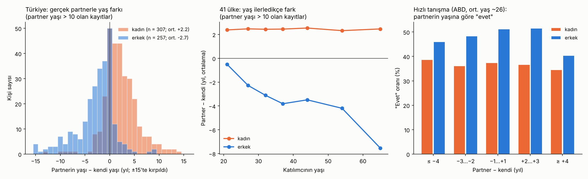

> **Güncel sürüm:** [2-kadinin-buyuk-oldugu-ciftler](../2-kadinin-buyuk-oldugu-ciftler/). Bu sürüm dondurulmuştur.

# Yaş Farkı Tercihleri · Sürüm 1: Literatür ve Gerçek Veri

> **Sürüm:** 1 · **Tarih:** 2026-10-16 · **Durum:** güncel
>
> **Acelen varsa:** en alttaki [En basit özet](#en-basit-özet) bölümüne atla.
>
> Bu doküman **tıbbi tavsiye değildir.** İlişki tavsiyesi de değildir; insanların ortalama olarak ne tercih ettiğini ve ne yaşadığını anlatır.

**Kanıt seviyeleri:**

| Etiket | Anlamı |
|---|---|
| **A** | Meta-analiz ya da birden çok büyük, çok ülkeli çalışma |
| **B** | Tek büyük, iyi tasarlanmış çalışma ya da deney |
| **C** | Küçük çalışma, anket, resmi istatistik özeti, kamuoyu yoklaması |
| **V** | Bu çalışmanın kendi gerçek veri analizi |
| **D** | Model ya da varsayım |

---

## Soru ve kapsam

1. Kadınlar ve erkekler partnerlerinde **hangi yaş farkını tercih ediyor**, hangisini **kabul edilebilir** buluyor?
2. **Gerçekte** kiminle birlikte oluyorlar?
3. Bu tercih **yaşla nasıl değişiyor?**
4. **Türkiye'de** durum ne?
5. Yaş farkı **ilişkinin gidişatını** etkiliyor mu?

**Kaynak türleri:**
- akademik makaleler;
- çok ülkeli açık veri;
- bir hızlı tanışma (speed dating) deneyinin ham verisi;
- resmi istatistik (TÜİK);
- kamuoyu yoklamaları ve flört sitesi verileri.

Forum ve sosyal medya içerikleri temsili olmadığı için yalnız bağlam olarak ele alındı.

**Kapsam dışı:** İlişki tavsiyesi; 18 yaş altı ile yetişkin arasındaki ilişkiler. Bunlar Türkiye'de suç kapsamındadır; bkz. Sınırlamalar.

**Benzetme:** Bir pazarı düşün. Herkesin bir **alışveriş listesi** var (ideal tercih). Bir de **cüzdanında kabul ettiği fiyat aralığı** (kabul edilebilir yaş aralığı). Ama eve götürdüğün şey, **karşı tarafın da seni seçmesine** bağlı (gerçek partner). Bu araştırma üçüne ayrı ayrı bakıyor.

## Yöntem

**1. Literatür.** PubMed özetleri, açık erişimli tam metinler ve yoklama raporları doğrudan okundu. Yalnız ikincil kaynaklardan doğrulanabilen sayılar `[ikincil]` diye işaretlendi.

**2. Gerçek veri (V).** Analiz planı ve testler, kod yazılmadan önce commit edildi; kod da çalıştırılmadan önce ayrıca commit edildi.

| Veri | İçerik |
|---|---|
| **D1: 45 ülke açık verisi** (Walter ve ark. 2020, OSF) | 14 399 kişi; 8920'si partnerinin yaşını bildirmiş. **Türkiye: 1061 kişi** (İstanbul, İzmir), 734'ü partner yaşını bildirmiş. Değişken **gerçek partnerin yaşı**, ideal yaş değil |
| **D2: Hızlı tanışma deneyi** (Fisman ve Iyengar, Columbia Üniversitesi) | 21 dalga, 549 kişi, 8378 dört dakikalık buluşma. Her buluşmadan sonra herkes karşısındakine "evet" ya da "hayır" diyor. Katılımcılar çoğunlukla yüksek lisans öğrencisi, ortalama yaş ~26 |
| **TÜİK 2024-2025** | İlk evlenme yaşı ortalamaları (haberlerde aktarılan resmi rakamlar) |

**Analizler:**
- **A1-A5 (D1):**
  - genel ortalama ve makalenin replikasyonu;
  - Türkiye;
  - ülke sıralaması;
  - yaşla değişim;
  - duyarlılık: partner yaşı 10'un altında bildirilen kayıtlar çıkarılarak.
- **B1-B2 (D2):**
  - partnerin yaş farkına göre "evet" oranı;
  - kişinin genel seçiciliği çıkarıldıktan sonra her bir yaş farkı yılının etkisi; %95 aralık için kişiler üzerinden 1000 bootstrap.

**Komut:** `cd analiz && python calistir.py` (~20 saniye). Veriler kaynağından indirilir, SHA-256 doğrulanır; repoya kopyalanmaz.

### Plandan sapmalar

| Sapma | Gerekçe |
|---|---|
| **Hızlı tanışma verisinde kişi kimliği yeniden kuruldu** | Erişilebilen açık kopyada kişi numarası yok. Kişi, buluşmadan buluşmaya değişmeyen kendi beyanlarından yeniden kuruldu: dalga, cinsiyet, yaş, ırk, bölüm, önem puanları, kendine verdiği puanlar ve 17 hobi. Yeni test T6: kişilerin %99.6'sında satır sayısı, dalgadaki karşı cins sayısıyla tutarlı |
| **Bir kod hatası düzeltildi** | Kişi anahtarı oluşturulurken boş değerler metne çevrilemedi; yöntem değişmeden düzeltildi |
| **Yorum ve grafikler için temizlenmiş veri (A5) esas alındı** | Ham veride partner yaşı olarak 0-5 gibi geçersiz değerler var (bkz. Bulgular 2.1). Ön kayıtta ana analiz ham veriyle tanımlanmıştı; o sonuçlar da raporda veriliyor |

## Bulgular

### 1. Literatür: ne tercih ediliyor, ne kabul ediliyor, ne yaşanıyor?

| Konu | Bulgu | Kanıt |
|---|---|---|
| **Klasik bulgu** | 37 kültürün hepsinde erkekler daha genç, kadınlar daha büyük eş tercih ediyor. Ortalama: erkekler ~2.7 yaş genç, kadınlar ~3.4 yaş büyük `[ikincil]`. | A |
| **45 ülke, 2020** | 14 399 kişi ile tekrarlandı. Erkekler genç ve çekici, kadınlar daha büyük ve maddi imkânı olan eşi daha çok tercih ediyor. **Toplumsal cinsiyet eşitliği arttıkça iki cinsiyet de kendi yaşına daha yakın eşlerle birlikte.** Türkiye bu çalışmada var. | A |
| **Fark ne kadar büyük?** | 37 kültür verisinde eş tercihleri birlikte ele alınınca kadın ve erkek dağılımları yalnız %22.8 örtüşüyor; tercihlere bakarak cinsiyet %92 doğrulukla tahmin edilebiliyor. Bu fark cinsiyet eşitliği arttıkça küçülüyor ama her yerde var. | A |
| **Yaşla değişim** | Kadınlar her yaşta biraz büyük erkekleri tercih ediyor; aralıkları dar. Erkekler, kendi yaşları ne olursa olsun 20'li yaşlardaki kadınlara ilgi duyuyor. Ama **yaşlandıkça kabul aralıkları genişliyor**, kendi yaşlarını ve büyükleri de kapsıyor. Genç kadınlara ilgi çoğunlukla **davranışa dönüşmüyor.** (Finlandiya, 2655 yetişkin) | B |
| **Gençler** | 12-19 yaş arası 209 genç: **Ergen erkekler, yetişkin erkeklerin tersine, kendilerinden birkaç yaş büyük kızları ideal buluyor;** küçükleri de kabul ediyor ama sınırları büyüklere doğru çok daha geniş. Ergen kızlar yetişkin kadınlar gibi: kendi yaşından birkaç yaş büyüğe kadar. | C |
| **Yaşam boyu** | 600 internet ilanı: Erkekler yaşlandıkça kendilerinden giderek daha genç kadın arıyor. Kadınlar 75 yaşına kadar büyük erkek arıyor; 75'ten sonra genç. | C |
| **Gerçek buluşmalar** | Gazetelerin ayarladığı kör randevularda eşleştiriciler büyük erkekle genç kadını eşleştiriyordu; ama **yaş farkı buluşmanın nasıl değerlendirildiğini etkilemiyordu.** | C |
| **Evlilik memnuniyeti** | Avustralya panel verisi: Genç eşle evli erkekler ve genç eşle evli kadınlar başlangıçta daha memnun. Ama yaş farklı çiftlerde memnuniyet daha hızlı düşüyor ve bu avantaj **6-10 yılda kayboluyor.** Olası neden: ekonomik zorluklara karşı daha kırılganlar. | B |

**Flört sitesi ve yoklama verileri** (davranış değil, beyan; temsili değil):

| Kaynak | Bulgu | Kanıt |
|---|---|---|
| OkCupid (Rudder, *Dataclysm*, 2014) | Kadınlar 20'li yaşlarında 2-3 yaş büyük erkekleri en çekici buluyor; yaşları ilerledikçe kendi yaşına, 30'lardan sonra daha gence kayıyor. Erkekler her yaşta 20'li yaşların başındaki kadınlara en yüksek puanı veriyor. **Ama mesaj attıkları kişiler çok daha yakın yaşta;** 40 yaşındaki erkekler en çok 30-35 yaşındaki kadınlara yazıyor `[ikincil]`. | C |
| Ipsos 2022, ABD (1005 kişi) | **%71**'e göre bir erkeğin 10+ yaş küçükle çıkması kabul edilebilir; bir kadın için bu oran **%60**. Erkeklerin %25'i 10+ yaş küçükle, kadınların %28'i 10+ yaş büyükle çıkmış. | C |
| "Yaşının yarısı + 7" kuralı | Sokakta yapılan bir ankette erkeklerin beyan ettiği alt sınıra kabaca uyuyor, üst sınıra uymuyor; kadınların beyan ettiği alt sınır kuralın öngördüğünden yüksek. Kaynak yalnız ikincil olarak doğrulanabildi `[ikincil]`. | C |
| Forumlar, sosyal medya, YouTube "sosyal deneyleri" | Sistematik bir veri kaynağı bulunamadı. Bu içerikler seçilmiş örneklere ve dikkat çekmeye dayanıyor; bu raporda sonuç çıkarmak için kullanılmadı. Gerçek bir "sosyal deney" olarak hızlı tanışma verisi analiz edildi (aşağıda). | – |

### 2. Gerçek veri: 45 ülke ve Türkiye (V)

#### 2.1 Veri kalitesi sorunu (önce bunu söylemek gerekiyor)

Ham veride bazı katılımcılar "partnerinin yaşı" olarak **0, 1, 2, 3, 4** gibi değerler yazmış. Türkiye'de 48 kişi 3, 48 kişi 4 yazmış. Bunlar bir yetişkin partnerin yaşı olamaz; muhtemelen soru yanlış anlaşıldı ya da başka bir şey (örneğin ilişki süresi) yazıldı. Makalenin yazarları da bunu fark edip partner yaşı 10'un üstünde olanlarla ayrıca analiz yapmış.

- **Ham veriyle** (ön kayıttaki ana analiz) Türkiye'de kadınların partnerleri ortalama −4.4 yaş, erkeklerinki −8.2 yaş çıkıyor. Bu sonuç geçersiz kayıtlardan kaynaklanıyor.
- **Makaledeki değerler** (kadın +2.43, erkek −2.26), bizim temizlenmiş veri analizimizde (A5, n = 8614) **birebir** çıktı.
- Ön kayıtlı replikasyon testi (T2) ham veriye göre tanımlandığı için **kaldı**. Neden kaldığı açık: makale ortalamaları temizlenmiş veriden vermiş.

**Bundan sonraki bütün sayılar temizlenmiş veriden** (partner yaşı > 10).

#### 2.2 Bulgular

| | Kadınların partneri | Erkeklerin partneri |
|---|---|---|
| **41 ülke ortalaması** (n = 8614) | **+2.4 yaş büyük** | **−2.3 yaş küçük** |
| **Türkiye** (n = 307 kadın, 257 erkek) | **+2.2 yaş büyük** (%95: +1.8 … +2.6) | **−2.8 yaş küçük** (−3.2 … −2.3) |
| Türkiye: yaşı eşit (±1 yıl) | %38 | %39 |
| Türkiye: partner 5+ yaş büyük | %13 | %1 |
| Türkiye: partner 5+ yaş küçük | %2 | %18 |
| Türkiye: partner 10+ yaş büyük ya da küçük | %2 büyük | %5 küçük |
| **TÜİK 2024, ilk evlenme yaşı** | kadın 25.8 | erkek 28.3 → fark **2.5 yaş** |

**Yaşla değişim:**
- **Kadınlarda fark yaşla neredeyse sabit:** 20'li yaşlarda da 60'lı yaşlarda da partner ortalama ~2.4 yaş büyük. 41 ülkede eğim yılda −0.001 yaş, yani sıfır.
- **Erkeklerde fark yaşla açılıyor:** her yıl ~0.12 yaş daha genç partner. 20'li yaşların başında fark −0.5, 30'larda −3, 60'larda −7.5.
- **Türkiye'de aynı desen:**
  - erkek 18-24 yaş: −0.6; 25-34: −2.7; 35+: −4.9;
  - kadın 18-24 yaş: +1.4; 25-34: +1.5; 35+: +3.3.

**Türkiye dünyada nerede?** Cinsiyetler arası fark (erkeklerin ortalaması − kadınlarınki) Türkiye'de −4.9 yaş. 41 ülkenin ortancası −4.2. Türkiye, en büyük farktan sayınca **12. sırada**, yani ortanın biraz üstünde bir fark (K2: evet). Ham veriyle bu sıra 30 çıkıyordu; o sonuç veri hatasından etkileniyor.

#### 2.3 Hızlı tanışma deneyi: dört dakikada "evet" (V)

Yaş bilgisi olan 543 kişi, 8180 değerlendirme. Katılımcılar ABD'de, çoğu 21-35 yaş arası öğrenci.

| Partner − kendi | Kadınların "evet" oranı | Erkeklerin "evet" oranı |
|---|---|---|
| 4+ yaş küçük | %39 | %46 |
| 2-3 yaş küçük | %36 | %48 |
| **±1 yaş** | %37 | **%51** |
| 2-3 yaş büyük | %37 | **%52** |
| 4+ yaş büyük | **%35** | **%40** |

Kişinin genel seçiciliği çıkarıldıktan sonra (B2):

| | Partner her 1 yaş **büyük** | Partner her 1 yaş **küçük** |
|---|---|---|
| Kadınların "evet" olasılığı | **−1.0 puan** (−1.6 … −0.4) | −0.5 puan (−1.4 … +0.4; belirsiz) |
| Erkeklerin "evet" olasılığı | **−1.8 puan** (−2.5 … −1.2) | **−1.0 puan** (−1.8 … −0.3) |

- **Erkekler kendinden büyük kadınlara belirgin daha az "evet" diyor;** 4+ yaş büyükte oran %51'den %40'a düşüyor. Ama bu yaş grubunda daha genç kadınlara da biraz daha az "evet" diyorlar. En çok "evet" kendi yaşına yakın olanlara.
- **Kadınlarda, beklenenin aksine, büyük erkek avantajı görülmedi.** Kendi yaşları ile birkaç yaş büyük arasında fark yok; çok büyüklerde hafif bir düşüş var. Bu, kör randevu çalışmasıyla ("yaş farkı değerlendirmeyi etkilemiyor") uyumlu.
- **Dikkat:** Yaş aralığı dar ve katılımcılar öğrenci. Dört dakikalık bir buluşmada fiziksel çekicilik ve sohbet, yaştan çok daha belirleyici. Yaşın etkisi yıl başına yalnız 1-2 puan (K3: etkiliyor, ama küçük).

### 3. Testler

[testler.csv](analiz/ciktilar/testler.csv). Ön kayıtlı 5 testten **4'ü geçti**; ek test T6 geçti; toplamda 6 testten 5'i geçti.

| Test | Ne sınıyor | Sonuç | |
|---|---|---|---|
| T1 | İki veri dosyasının SHA-256 özeti | eşleşti | ✅ |
| T2 | Replikasyon, ham veriyle: kadın +2.43, erkek −2.26 | +1.51, −3.07 | ❌ (makale değerleri temizlenmiş veride birebir çıktı) |
| T3 | Hızlı tanışma verisi yapısı | 8378 satır | ✅ |
| T4 | Kişi içi merkezleme | 6 × 10⁻¹⁷ | ✅ |
| T5 | Bootstrap hatası < 0.01 | 0.0046 | ✅ |
| T6 | Yeniden kurulan kişi kimliği tutarlı (sapma testi) | %99.6 | ✅ |

**Karar kuralları (önceden sabit), temizlenmiş veriyle:**
- **K1, "Türkiye'de kadınların partneri büyük, erkeklerinki küçük mü?":** **Evet.** İki aralık da 0'ı dışlıyor. Ham veriyle "hayır" çıkıyordu, veri hatası yüzünden.
- **K2, "Türkiye'deki cinsiyet farkı ülke ortancasından büyük mü?":** **Evet**, biraz (−4.9'a karşı −4.2).
- **K3, "Hızlı tanışmada yaş, 'evet' kararını etkiliyor mu?":** **Etkiliyor, ama küçük.** Yıl başına 1-2 puan.

## Sonuçlar

1. **Evrensel desen gerçek:** Hemen her ülkede erkekler biraz daha genç, kadınlar biraz daha büyük partnerle birlikte. Ortalama fark ~2-3 yaş. (A + V)
2. **Türkiye bu desenin tam ortasında:** Kadınların partneri ortalama +2.2, erkeklerinki −2.8 yaş. TÜİK'teki 2.5 yıllık evlenme yaşı farkıyla uyumlu. Çiftlerin ~%40'ı yaşıt (±1 yıl). 5 yaştan büyük farklar azınlık; 10+ yaş fark nadir. (V + C)
3. **Fark asıl yaşla açılıyor, ve bunu erkekler belirliyor.** Kadınların partneri her yaşta ~2-3 yaş büyük kalıyor. Erkeklerinki gençken neredeyse yaşıt, yaş ilerledikçe giderek daha genç. (V + B)
4. **"İdeal" ile "gerçek" farklı:** Erkekler ilgi beyan ederken çok genç kadınları da sayıyor, ama gerçek ilişkileri ve hatta mesajları kendi yaşlarına çok daha yakın. Gerçek eşleşme iki tarafın da seçmesine bağlı. (B + C)
5. **İlk izlenimde yaşın etkisi küçük:** Hızlı tanışmada partnerin yaşı her yıl için "evet" olasılığını yalnız 1-2 puan değiştiriyor. Erkekler büyük kadınlara daha az "evet" diyor; kadınlarda büyük erkek avantajı görülmedi. (V)
6. **Ergen erkekler bu açıdan farklı:** Yetişkin erkeklerin aksine, kendilerinden biraz büyük kızları ideal buluyorlar. (C)
7. **Büyük yaş farkının uzun vadede bir bedeli olabilir:** Yaş farklı evliliklerde başlangıçtaki memnuniyet avantajı 6-10 yılda kayboluyor. (B)
8. **Toplumsal eşitlik arttıkça yaş farkı küçülüyor.** Bu, tercihin bir kısmının kültürel ve ekonomik koşullara bağlı olduğunu gösteriyor. (A)

## Sınırlamalar

- **"Gerçek partner yaşı" ile "ideal yaş" farklı şeyler.** 45 ülke verisinde ölçülen, kişinin şu anki ya da son partnerinin yaşı; tercih değil, eşleşmenin sonucu.
- **45 ülke verisinde Türkiye örneklemi** iki büyük şehirden (İstanbul, İzmir); temsili değil. Ham veride geçersiz kayıtlar var; temizleme kuralı (partner yaşı > 10) bütün hataları yakalamayabilir.
- **Hızlı tanışma verisi** ABD'deki bir üniversitenin 2002-2004 yıllarındaki öğrencilerinden; yaş aralığı dar. Kişi kimliği yeniden kuruldu; %99.6 tutarlı, ama kesin değil.
- **OkCupid, "yarısı + 7" kuralı ve 37 kültür çalışmasının ortalamaları** yalnız ikincil kaynaklardan doğrulanabildi. Orijinal makaleler bu çalışmada okunamadı.
- **Yoklamalar beyandır;** insanlar gerçekte söylediklerinden farklı davranabilir.
- **Eşcinsel ilişkiler** bu verilerde ayrı incelenmedi.
- **Yasal sınır:** Bu araştırma yetişkinlerin tercihleri hakkındadır. Türkiye'de 18 yaşından küçükler reşit sayılmaz. Bir yetişkinle 18 yaş altındaki biri arasındaki cinsel ilişki, onam olsa bile Türk Ceza Kanunu kapsamında suçtur. Ergenlerin yaş tercihleri hakkındaki bulgu (Sonuç 6) yalnız akranlar arası flörte dair bir tanımlamadır.

## Kaynaklar

**Akademik**
- [Walter KV ve ark. Psychol Sci 2020;31:408](https://pubmed.ncbi.nlm.nih.gov/32196435/): 45 ülke, 14 399 kişi; [açık veri (OSF)](https://osf.io/gb5cn/)
- [Conroy-Beam D ve ark. Pers Soc Psychol Bull 2015;41:1082](https://pubmed.ncbi.nlm.nih.gov/26068718/): 37 kültür, çok değişkenli cinsiyet farkı
- [Antfolk J. Evol Psychol 2017;15:1474704917690401](https://pubmed.ncbi.nlm.nih.gov/28127998/): yaş sınırları, Finlandiya
- [Kenrick DT ve ark. Child Dev 1996;67:1499](https://pubmed.ncbi.nlm.nih.gov/8890497/): ergenlerin yaş tercihleri
- [Alterovitz SS, Mendelsohn GA. Psychol Aging 2009;24:513](https://pubmed.ncbi.nlm.nih.gov/19485668/): yaşam boyu internet ilanları
- [Kelley JM, Malouf RA. Evol Psychol 2013;11:1](https://pubmed.ncbi.nlm.nih.gov/23282582/): gazete kör randevuları
- [Lee WS, McKinnish T. J Popul Econ 2018;31:337](https://spot.colorado.edu/~mckinnis/AgeGapJPopE.pdf): yaş farkı ve evlilik memnuniyeti
- [Fisman ve Iyengar hızlı tanışma verisi (DataHub kopyası, kamu malı)](https://datahub.io/core/speed-dating) · [Gelman'ın veri notu](https://statmodeling.stat.columbia.edu/2008/01/21/the_speeddating_1/)

**İstatistik ve yoklama**
- [TÜİK 2024 evlenme istatistikleri (Forbes Türkiye aktarımı)](https://www.forbes.com.tr/makale/tuik-evlenme-ve-bosanma-istatistiklerini-acikladi-bosanma-sayisi-2024-te-rekor-kirdi) · [2025 verisi (Cumhuriyet)](https://www.cumhuriyet.com.tr/turkiye/tuik-2025-in-verilerini-yayimladi-aile-yili-nda-evlilikler-azaldi-bosanmalar-artti-2481562)
- [Ipsos 2022, yaş farklı flört](https://www.ipsos.com/en-us/news-polls/age-gap-dating)

**İkincil (yalnız bağlam)**
- [Psychology Today: 37 kültür ortalamaları](https://www.psychologytoday.com/us/blog/head-games/201308/when-it-comes-to-dating-do-age-differences-matter)
- [The New Republic: "yarısı + 7" kuralı ve Buunk ve ark.](https://newrepublic.com/article/119282/science-does-not-support-rule-seven-relationships)
- [FiveThirtyEight: Rudder ve OkCupid verisi](https://fivethirtyeight.com/features/christian-rudder-dataclysm-okcupid)
- [Randal Olson: OkCupid ve "yarısı + 7"](https://randalolson.com/2014/11/08/do-women-on-okcupid-follow-the-standard-creepiness-rule)

## En basit özet

- **Evrensel desen:** Hemen her ülkede kadınların partneri ortalama 2-3 yaş büyük, erkeklerinki 2-3 yaş küçük.
- **Türkiye ortalamada:** Kadınların partneri +2.2, erkeklerinki −2.8 yaş; TÜİK'te evlenme yaşı farkı 2.5 yıl. Çiftlerin yaklaşık %40'ı yaşıt; 10 yaştan büyük farklar nadir.
- **Fark yaşla açılıyor, ama yalnız erkeklerde:** Genç erkekler genelde yaşıtıyla, yaşlandıkça daha genç biriyle. Kadınların partneri her yaşta 2-3 yaş büyük kalıyor.
- **İlk tanışmada yaş az şey değiştiriyor:** 4 dakikalık buluşmalarda yaşın etkisi yıl başına 1-2 puan. Erkekler büyük kadınlara daha az "evet" diyor; kadınlarda "büyük erkek" avantajı görülmedi.
- **"İdeal" ile "gerçek" farklı:** İnsanların söylediği tercihler ile kurdukları ilişkiler aynı değil; eşleşme iki tarafın da seçmesine bağlı.
- **Ergen erkekler genelde biraz büyük kızları ideal buluyor;** ama 18 yaş altı ile yetişkin arası ilişki Türkiye'de suç.
- **Benzetme:** Pazarda alışveriş listen (ideal) ile eve götürdüğün (gerçek) aynı değil, çünkü satıcının da seni seçmesi gerekiyor. Çoğu insan sonunda kendine yakın bir yaşla eve dönüyor.
