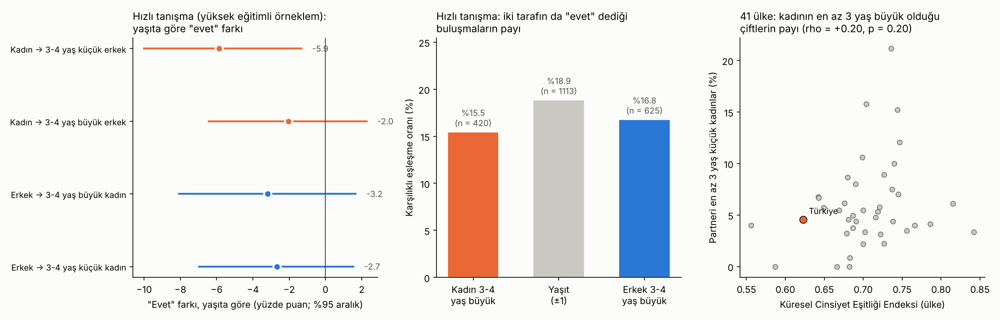

# Yaş Farkı Tercihleri · Sürüm 2: Kadının Büyük Olduğu Çiftler ve Eğitim

> **Sürüm:** 2 · **Tarih:** 2026-10-16 · **Durum:** güncel
>
> **Acelen varsa:** en alttaki [En basit özet](#en-basit-özet) bölümüne atla.
>
> Bu doküman **tıbbi tavsiye değildir.** İlişki tavsiyesi de değildir; insanların ortalama olarak ne yaptığını ve ne yaşadığını anlatır.

**Kanıt seviyeleri:**

| Etiket | Anlamı |
|---|---|
| **A** | Meta-analiz ya da birden çok büyük, çok ülkeli çalışma |
| **B** | Tek büyük, iyi tasarlanmış çalışma ya da kayıt verisi |
| **C** | Küçük çalışma, anket, resmi istatistik özeti |
| **V** | Bu çalışmanın kendi gerçek veri analizi |
| **D** | Model ya da varsayım |

---

## Soru ve kapsam

Sürüm 1'in ardından gelen soru:

1. Eğitim ya da gelişmişlik düzeyi yüksek ortamlarda, **erkeğin 3-4 yaş büyük olduğu** çiftlerle **kadının 3-4 yaş büyük olduğu** çiftler arasında bir fark var mı?
2. Erkeğin ya da kadının yaşı ilişkiyi **etkiliyor mu?** Etkiliyorsa **hangi yaşlarda?**
3. Kadınlar kendilerinden 3-4 yaş küçük erkekleri **özellikle tercih ediyor ya da reddediyor mu?**

İlişkiyi üç aşamada inceliyoruz:
- **ilk izlenim:** "evet" mi, "hayır" mı;
- **eşleşme:** iki taraf da "evet" diyor mu;
- **uzun vade:** memnuniyet ve ayrılık.

**Benzetme:** Bir iş görüşmesi düşün. Önce CV'ye bakılır (ilk izlenim), sonra iki taraf da "olur" der (eşleşme), sonra yıllar içinde işin yürüyüp yürümediği görülür (uzun vade). Yaş farkının etkisi her aşamada farklı olabilir. Bu sürüm üç aşamaya ayrı ayrı bakıyor.

**Kapsam dışı:** İlişki tavsiyesi; 18 yaş altı. Eşcinsel çiftler bu verilerde ayrı incelenmedi.

## Önceki sürümden değişenler

| Konu | Sürüm 1 | Sürüm 2 |
|---|---|---|
| Yaş farkının yönü | Ortalama fark ve yıl başına eğim | **Kadın 3-4 yaş büyük** ile **erkek 3-4 yaş büyük** doğrudan karşılaştırıldı |
| Eğitim | Ele alınmadı | Yüksek eğitimli örneklem (hızlı tanışma) ayrı yorumlandı; eğitim düzeyine göre literatür |
| Eşleşme | Yalnız tek tarafın "evet" kararı | **İki tarafın da "evet" dediği** buluşmalar |
| Gelişmişlik | Literatürden: eşitlik arttıkça fark küçülüyor | 41 ülkede kendi testimiz: yön aynı, ama **anlamlı değil**. Sürüm 1'in 8. sonucu zayıflatıldı |
| Uzun vade | Lee ve McKinnish 2018 | Ayrılık riski: İtalya (kohort karşılaştırması), ABD; çiftlerin yaş dağılımı: ABD 2022, İngiltere/ABD eğilimi |

## Yöntem

**1. Literatür.** Tam metinler doğrudan okundu: Skopek ve ark. 2011, Lee ve McKinnish 2018, Corti ve ark. 2024. Özetten okunanlar: Drefahl 2010 (PubMed), Pew 2024. Yalnız ikincil kaynaklardan doğrulanabilen bulgular `[ikincil]` diye işaretlendi.

**2. Gerçek veri (V).** Veriler sürüm 1 ile aynı. Analiz planı ve testler kod yazılmadan önce commit edildi; kod da çalıştırılmadan önce ayrıca commit edildi.

| Veri | Bu sürümdeki rolü |
|---|---|
| **D1: 45 ülke açık verisi** (Walter ve ark. 2020) | Partner yaşı 10'dan büyük kayıtlar (sürüm 1'deki temizlenmiş veri). Ülke düzeyinde Küresel Cinsiyet Eşitliği Endeksi ve kişi başı gelir. Değişken **gerçek partnerin yaşı**, ideal yaş değil |
| **D2: Hızlı tanışma deneyi** (Columbia Üniversitesi) | **Yüksek eğitimli örneklem.** Katılımcılar üniversite öğrencileri, çoğu yüksek lisans. Kadınların yaşı ortanca 26 (19-55). Her buluşmadan sonra iki taraf da "evet" ya da "hayır" diyor |

**Tanımlar:**
- yaş farkı = partnerin yaşı − kendi yaşı;
- "3-4 yaş büyük" = fark +3 ya da +4;
- "3-4 yaş küçük" = fark −3 ya da −4;
- referans **yaşıt** = fark −1, 0 ya da +1.

**Analizler:**

| Kod | Analiz |
|---|---|
| C1 | Kadınların "evet" kararı: 3-4 yaş küçük ve 3-4 yaş büyük erkekler, yaşıt erkeklere göre. Kişinin genel seçiciliği çıkarılır (kişi içi sapma). %95 aralık için kişiler üzerinden 2000 bootstrap |
| C2 | Erkeklerin "evet" kararı: aynı hesap, 3-4 yaş büyük ve 3-4 yaş küçük kadınlar |
| C3 | C1 ve C2, karar verenin yaşına göre ikiye bölünerek (cinsiyet içinde yaş ortancası) |
| C4 | Karşılıklı eşleşme oranı: kadın 3-4 büyük, yaşıt, erkek 3-4 büyük |
| C5 | 41 ülke: partneri en az 3 yaş küçük kadınların payı; cinsiyet eşitliği ve gelirle Spearman korelasyonu |
| C6 | Kadınların yaş grubuna göre partneri en az 3 yaş küçük olanların payı; bütün ülkeler ve Türkiye |

**Komut:** `cd analiz && python calistir.py` (~2 saniye). Veriler kaynağından indirilir, SHA-256 doğrulanır; repoya kopyalanmaz.

### Plandan sapmalar

| Sapma | Gerekçe |
|---|---|
| **Keşif analizi eklendi:** yaş farkı −8 ile +8 arasında yıl yıl "evet" oranı ([kesif_yil_yil.csv](analiz/ciktilar/kesif_yil_yil.csv)) | Ön kayıtta yoktu; **sonuçlar görüldükten sonra** eklendi. K1 "evet" çıkınca bunun tutarlı bir desen mi, yoksa iki yıllık bir çukur mu olduğunu görmek gerekti. Karar kurallarını değiştirmiyor; yalnız yorumu etkiliyor |
| **Ham "evet" oranları da kaydedildi** | Kişi içi sapmalar soyut. Okuru için ham oranlar da gerekiyordu |

## Bulgular

### 1. Literatür

#### 1.1 Uzun vade: memnuniyet ve ayrılık

| Çalışma | Ne buldu | Kanıt |
|---|---|---|
| **Lee ve McKinnish 2018**, Avustralya, ~19 900 kişilik panel | **Hem erkekler hem kadınlar daha genç eşle biraz daha memnun.** Erkekte karısının kendisinden büyük olduğu her yıl memnuniyeti 0-10 ölçeğinde 0.044 puan düşürüyor. Kadında kocasının kendisinden küçük olduğu her yıl +0.039 puan, ama anlamlı değil. Kocası kendisinden büyük olan kadında her yıl −0.032 puan. Etkiler **çok küçük:** 4 yıl fark ≈ 0.15 puan. Yaş farklı çiftlerin başlangıçtaki avantajı 6-10 yılda kayboluyor; ekonomik şoklara daha dayanıksızlar | B |
| **Corti ve ark. 2024**, İtalya, resmi istatistik kurumu anketi, 1970-1990'ların evlilikleri | 1970'lerde kadının büyük olduğu evlilikler daha sık ayrılmış: yılda binde 5.2, erkeğin büyük olduğu evliliklerde binde 2.5. **1990'larda fark kalmamış:** binde 9.4, 9.0 ve yaşıtlarda 8.2. Yazarlar bunu kültürel değişime bağlıyor | B |
| **England, Allison ve Sayer 2016**, ABD ulusal aile anketi | İki cinsiyette de eşi kendisinden büyük olan kişinin ayrılma olasılığı daha yüksek. Kadın, kocasından büyük olduğunda yaşıt eşe göre daha sık ayrılmıyor. Yaş farkının kendisi boşanmayı artırmıyor. Sayısal değerler okunamadı `[ikincil]` | B |
| **Lehmiller ve Agnew 2008**, ABD | Kadının büyük olduğu çiftler bağlılık ve memnuniyette yaşıt çiftlerden düşük değil, hatta yüksek. Ama bu çiftler toplumdan daha fazla onaylamama görüyor `[ikincil]` | C |
| **Drefahl 2010**, Danimarka, bütün nüfus kaydı | Yaşlılıkta: erkek için genç eş daha uzun yaşamla, kadın için hem büyük hem genç eş daha kısa yaşamla ilişkili. Eğitim ve servet kontrol edildi. **Nedeni bilinmiyor;** ilişkinin kalitesi değil, sağlık sonucu | B |

#### 1.2 Kim kiminle ve eğitim

| Çalışma | Ne buldu | Kanıt |
|---|---|---|
| **Pew 2024**, ABD 2022 nüfus verisi | Evliliklerin %40'ında erkek en az 3 yaş büyük, %51'inde eşler ±2 yaş içinde, **%10'unda kadın en az 3 yaş büyük.** Kadının büyük olduğu evliliklerin payı 2000'deki %11 zirvesinden biraz düşmüş. Üniversite mezunu erkekler daha sık yaşıtla evli: %55'e karşı %48 | C |
| **Coles ve Francesconi 2011**, ABD ve İngiltere | Kadının en az 5 yaş büyük olduğu evlilikler 1970'lerden beri **üç katına** çıkmış. Model: kariyerde başarı zaman alıyor; başarılı ve daha yaşlı olan taraf, daha genç ama daha az başarılı biriyle evlenebiliyor. Kadınlar kariyer yaptıkça bu yön kadınlar için de açılıyor | B |
| **Skopek ve ark. 2011**, Almanya, büyük bir flört sitesi: 10 427 mesaj gönderen; anket 2271 kişi | Erkekler ortalama 4.8 yaş küçük kadınlara, kadınlar 2.7 yaş büyük erkeklere yazmış. **Yaşlandıkça erkekler giderek daha genç kadın istiyor; kadınların tercihi ise çeşitleniyor:** genç erkeğe ve "fark etmez"e açılıyor. **Eğitim:** yüksek eğitimli erkekler genç kadını daha sık istiyor (+7.7 puan). Yüksek eğitimli kadınlar genç erkeği **daha az** istiyor ve daha sık "yaş fark etmez" diyor. Kadınlardaki bu bulgu zayıf (%10 anlamlılık düzeyi) | B |
| **Walter ve ark. 2020**, 45 ülke | Cinsiyet eşitliği arttıkça iki cinsiyetin partneri de kendi yaşına yaklaşıyor | A |
| Kadınların "kuguar" ilişkileri üzerine küçük çalışma (24 kadın) | 7-10 yaş küçük erkekle birlikte olan kadınlar mutluluk ölçeklerinde düşük değil. Örneklem sonuç çıkarmak için çok küçük | C |

### 2. Gerçek veri: yüksek eğitimli örneklemde ilk izlenim (V)

**Ham "evet" oranları:**

| Karar veren | Partner 3-4 yaş küçük | Partner yaşıt (±1) | Partner 3-4 yaş büyük |
|---|---|---|---|
| Kadın | %34.0 (420 buluşma) | %37.4 (1113) | %35.8 (625) |
| Erkek | %46.7 (625) | %51.2 (1113) | %48.8 (420) |

**Kişinin genel seçiciliği çıkarıldıktan sonra, yaşıta göre fark** (yüzde puan, %95 aralık):

| Karar veren → partner | Fark | Anlamı |
|---|---|---|
| Kadın → 3-4 yaş küçük erkek | **−5.9** [−10.0, −1.3] | Anlamlı düşüş |
| Kadın → 3-4 yaş büyük erkek | −2.0 [−6.4, +2.3] | Belirgin fark yok |
| Erkek → 3-4 yaş büyük kadın | −3.2 [−8.1, +1.7] | Belirgin fark yok |
| Erkek → 3-4 yaş küçük kadın | −2.7 [−7.0, +1.5] | Belirgin fark yok |

**Ama keşif analizi bu düşüşün tutarlı olmadığını gösteriyor.** Kadınlarda yıl yıl kişi içi sapma (yüzde puan):

| Partner ne kadar küçük (−) / büyük (+) | −6 | −5 | **−4** | **−3** | −2 | −1 | 0 | +1 | +2 | +3 | +4 | +5 | +6 |
|---|---|---|---|---|---|---|---|---|---|---|---|---|---|
| Kadınların "evet" sapması | +1.0 | +5.7 | **−3.3** | **−4.2** | +0.6 | +2.2 | +4.5 | +0.1 | +1.8 | +1.0 | −1.0 | +1.0 | −4.9 |
| Erkeklerin "evet" sapması | −4.5 | +3.8 | +1.5 | −0.2 | +1.3 | +2.1 | +4.3 | +3.5 | +3.6 | +2.0 | −2.0 | **−11.9** | −5.3 |

Ne gösteriyor:
- **Kadınlarda** 3 ve 4 yaş küçük erkeklerde bir çukur var, ama 5-6 yaş küçük erkeklerde yok. Gerçek bir "küçük erkeğe çekince" olsaydı, fark büyüdükçe düşüşün sürmesi beklenirdi. Bu yüzden ön kayıtlı K1 "evet" çıksa da bunu **sağlam bir tercih olarak yorumlamıyoruz.** En tutarlı bulgu, kadınların **tam yaşıta** en sık "evet" demesi (+4.5).
- **Erkeklerde** 3-4 yaş büyük kadınlarda belirgin bir düşüş yok. Düşüş **5 yaştan itibaren** başlıyor (−11.9). Sürüm 1'de "erkekler büyük kadınlara daha az 'evet' diyor" bulgusunu taşıyan, 5 ve daha fazla yaş büyük kadınlar.

**Karar verenin yaşına göre (C3):**

| Grup | Partner 3-4 yaş küçük | Partner 3-4 yaş büyük |
|---|---|---|
| Kadın, 26 yaş altı (ort. 23) | −14.0 [−25.5, −3.4]; **yalnız 44 buluşma** | −0.1 [−5.3, +5.2] |
| Kadın, 26 ve üstü (ort. 29) | −5.8 [−11.0, −0.5] | −5.2 [−12.9, +2.3] |
| Erkek, 27 yaş altı (ort. 24) | −10.9 [−16.7, −5.3] | −2.1 [−7.5, +3.4] |
| Erkek, 27 ve üstü (ort. 29) | +1.3 [−4.4, +7.3] | −8.8 [−18.1, +0.8]; yalnız 94 buluşma |

Ne gösteriyor:
- **Gençlerde iki cinsiyet de 3-4 yaş küçüğe daha az "evet" diyor.** 23-24 yaşındaki biri için 3-4 yaş küçük, 19-20 yaşında bir lisans öğrencisi demek. Bu, "küçük erkek" ya da "küçük kadın"dan çok hayat evresi farkına benziyor: lisans ile yüksek lisans arası.
- **29 yaş civarında** erkekler 3-4 yaş küçük kadınlara yaşıtları kadar "evet" diyor. 3-4 yaş büyük kadınlarda ise düşüşe doğru bir eğilim var, ama aralık 0'ı içeriyor.

### 3. Gerçek veri: eşleşme (V)

İki tarafın da "evet" dediği buluşmaların payı:

| Çift | Eşleşme | Yaşıta göre fark |
|---|---|---|
| Kadın 3-4 yaş büyük | %15.5 (420 buluşma) | −3.4 puan [−7.8, +1.0] |
| Yaşıt (±1) | %18.9 (1113) | – |
| Erkek 3-4 yaş büyük | %16.8 (625) | −2.1 puan [−5.8, +1.4] |

**İki yön arasında belirgin bir fark yok.** İkisi de yaşıt çiftlerden biraz düşük, ama aralıklar 0'ı içeriyor. Yüksek eğitimli bu örneklemde en çok eşleşen, yaşıt çiftler.

### 4. Gerçek veri: 41 ülke ve gelişmişlik (V)

**Kadınların partnerinin en az 3 yaş küçük olduğu çiftler:**
- 41 ülkenin ortancası **%5.0**;
- en düşük İran, Malezya ve Endonezya (%0), en yüksek Kosta Rika (%21);
- **Türkiye %4.6**, 41 ülke içinde 23. sırada, yani ortalarda.

**Gelişmişlikle ilişki:**

| Karşılaştırma | Spearman rho | p |
|---|---|---|
| Kadın büyük çiftlerin payı ~ cinsiyet eşitliği | +0.20 | 0.20 |
| Kadın büyük çiftlerin payı ~ kişi başı gelir | −0.10 | 0.55 |
| Cinsiyet farkı (erkek − kadın partner yaşı) ~ cinsiyet eşitliği | +0.27 | 0.085 |

- **Cinsiyet eşitliği ile kadının büyük olduğu çiftlerin payı arasında anlamlı ilişki yok.** Yön pozitif, ama 41 ülkede gürültüden ayırt edilemiyor. Gelirle ilişki de yok.
- Eşit ülkelerde yaş farkı biraz daha küçük, ama sınırda (p = 0.085). Walter ve ark. aynı yönü daha güçlü bir yöntemle bulmuştu. Sürüm 1'in 8. sonucu, yönü doğru ama **etkisi zayıf** diye okunmalı.

**Kadının yaşına göre** (C6):

| Kadının yaşı | Partneri ≥ 3 yaş küçük: bütün ülkeler | Türkiye | Partneri ≥ 3 yaş büyük: bütün ülkeler | Türkiye |
|---|---|---|---|---|
| 18-24 | %1.2 (n = 2097) | %1.6 (n = 122) | %38 | %22 |
| 25-34 | %8.3 (n = 1236) | %6.9 (n = 58, az) | %43 | %36 |
| 35+ | %9.7 (n = 1419) | %6.3 (n = 127) | %48 | %59 |

**Kadının büyük olduğu çiftler 25 yaşından sonra yaygınlaşıyor:** %1'den %8-10'a. Bu, kısmen matematiksel. 20 yaşındaki bir kadının 3 yaş küçük partneri 17 yaşında olurdu. Ama aynı zamanda Skopek'in bulgusuyla da uyumlu: kadınların yaş tercihi yaşla çeşitleniyor.

### 5. Testler

[testler.csv](analiz/ciktilar/testler.csv). Ön kayıtlı **5 testin 5'i geçti.**

| Test | Ne sınıyor | Sonuç | |
|---|---|---|---|
| T1 | İki veri dosyasının SHA-256 özeti (sürüm 1 ile aynı) | eşleşti | ✅ |
| T2 | Sürüm 1 ile tutarlılık: kadınlarda yaşıt bölmesinin "evet" oranı 0.3738 | 0.3738 | ✅ |
| T3 | Her bölmede en az 150 buluşma | en az 420 | ✅ |
| T4 | Bootstrap standart hatası < 3 puan | en büyük 2.48 | ✅ |
| T5 | En az 35 ülke | 41 | ✅ |

**Karar kuralları (önceden sabit):**
- **K1, "Eğitimli örneklemde kadınlar 3-4 yaş küçük erkeklere daha az 'evet' diyor mu?":** **Evet** (−5.9 puan). Ama keşif analizi çukurun 5-6 yaş küçükte sürmediğini gösteriyor; sağlam bir tercih olarak yorumlanmadı.
- **K2, "Erkekler 3-4 yaş büyük kadınlara daha az 'evet' diyor mu?":** **Belirgin fark yok.** Düşüş 5 yaştan itibaren.
- **K3, "Kadının 3-4 yaş büyük olduğu buluşmalarda eşleşme düşük mü?":** **Belirgin fark yok.**
- **K4, "Cinsiyet eşitliği yüksek ülkelerde kadının büyük olduğu çiftler daha mı yaygın?":** **Hayır** (rho = +0.20, p = 0.20).

## Sonuçlar

1. **3-4 yaşlık fark, yönü ne olursa olsun, küçük bir fark.** Yüksek eğitimli örneklemde kadının 3-4 yaş büyük olduğu çiftlerle erkeğin 3-4 yaş büyük olduğu çiftler arasında eşleşme açısından belirgin fark yok. İkisi de yaşıt çiftlerden biraz geride. (V)
2. **Uzun vadede de büyük bir fark beklenmiyor.** İtalya'da kadının büyük olduğu evliliklerin ayrılık dezavantajı 1970'lerde vardı, 1990'larda kayboldu. Avustralya'da yönün memnuniyete etkisi yıl başına 0.03-0.05 puan (0-10 ölçeği). (B)
3. **Kadınlar 3-4 yaş küçük erkekleri "özellikle reddetmiyor".** 3-4 yaş küçük erkeklere biraz daha az "evet" dediler, ama bu, fark 5-6 yaşa çıkınca sürmüyor. Tutarlı bir ret ya da tercih deseni yok. En belirgin bulgu, kadınların **tam yaşıta** en sık "evet" demesi. Eğitimli kadınlar flört sitelerinde de daha sık "yaş fark etmez" diyor. (V + B)
4. **Erkeklerde eşik yaklaşık 5 yaş.** Erkekler 3-4 yaş büyük kadınlara yaşıtları kadar "evet" diyor; düşüş 5 yaştan itibaren başlıyor. (V)
5. **Yaş, karar verenin hayat evresine göre etkiliyor.** 23-24 yaşında 3-4 yaş küçük, lisans öğrencisi demek; iki cinsiyet de bu farka daha az "evet" diyor. 29 yaşında aynı fark daha az önemli. Kadının büyük olduğu çiftler 25 yaşından sonra yaygınlaşıyor: %1'den %8-10'a. (V + B)
6. **Eğitim yönü tersine çevirmiyor, yaşıtlığı artırıyor.** Eğitimli erkekler daha sık yaşıtla evli (ABD). Eğitimli kadınlar yaşa daha kayıtsız. Kadının büyük olduğu evlilikler son 50 yılda arttı, ama hâlâ ~%10. (C + B)
7. **Gelişmişlik etkisi beklenenden zayıf.** 41 ülkede cinsiyet eşitliği ile kadının büyük olduğu çiftlerin payı arasında anlamlı ilişki yok. Türkiye bu payda ortalarda: %4.6. (V)
8. **Asıl fark toplumsal bakışta olabilir.** Kadının büyük olduğu çiftler daha fazla onaylamama görüyor, ama ilişki kalitesi düşük değil `[ikincil]`. (C)

## Sınırlamalar

- **Hızlı tanışma verisi** ABD'deki tek bir üniversitenin 2002-2004 yıllarındaki öğrencilerinden. Yaş aralığı dar; "3-4 yaş küçük" bölmesinde gençlerde yalnız 44 buluşma var. Kişi kimliği yeniden kuruldu (sürüm 1, %99.6 tutarlı).
- **İlk izlenim, ilişki değildir.** 4 dakikalık bir buluşmadaki "evet", uzun süreli bir ilişkinin başarısını göstermez.
- **Örneklemde eğitim düzeyi karşılaştırılamadı.** Hızlı tanışma verisinde herkes yüksek eğitimli; 45 ülke verisinde eğitim değişkeni yok. Eğitimin etkisi yalnız literatürden (Skopek, Pew) geliyor.
- **Ülke karşılaştırması** her ülkede tek bir, temsili olmayan örneklemle yapıldı. Türkiye örneklemi İstanbul ve İzmir'den. Kadın büyük çiftlerin payı küçük olduğu için (%0-21) ülke değerleri gürültülü. 41 ülke korelasyon için az.
- **Keşif analizi** sonuçlar görüldükten sonra eklendi. Yıl yıl tablolar daha gürültülüdür; tek tek yılları yorumlamak yanıltabilir.
- **Lehmiller ve Agnew 2008 ile England ve ark. 2016** yalnız ikincil kaynaklardan ya da özetlerden okundu.
- **Literatür** çoğunlukla Batı ülkelerinden. Türkiye için kadının büyük olduğu evliliklerin payını ve ayrılık riskini gösteren resmi bir tablo bulunamadı.

## Kaynaklar

**Akademik**
- [Lee WS, McKinnish T. J Popul Econ 2018;31:337](https://spot.colorado.edu/~mckinnis/AgeGapJPopE.pdf): yaş farkı, yön ve evlilik memnuniyeti
- [Corti G ve ark. Comparative Population Studies 2024;49:337](https://comparativepopulationstudies.de/index.php/CPoS/article/view/603): İtalya, kadının büyük olduğu evlilikler ve ayrılık ([tam metin](https://ddd.uab.cat/pub/artpub/2024/305974/Corti_et_al.pdf))
- [Skopek J, Schmitz A, Blossfeld HP. Zeitschrift für Familienforschung 2011;23:267](https://fis.uni-bamberg.de/handle/uniba/5038): Almanya, çevrimiçi flörtte yaş tercihleri ve eğitim
- [Drefahl S. Demography 2010;47:313](https://pubmed.ncbi.nlm.nih.gov/20608099/): eşler arası yaş farkı ve yaşam süresi
- [Coles MG, Francesconi M. Int Econ Rev 2011;52:825](https://doi.org/10.1111/j.1468-2354.2011.00651.x): kadının büyük olduğu evliliklerin artışı
- [England P, Allison PD, Sayer LC. J Marriage Fam 2016 (Stanford özeti)](https://inequality.stanford.edu/node/7684): eşin yaşı ve ayrılma
- [Walter KV ve ark. Psychol Sci 2020;31:408](https://pubmed.ncbi.nlm.nih.gov/32196435/): 45 ülke; [açık veri (OSF)](https://osf.io/gb5cn/)
- [Fisman ve Iyengar hızlı tanışma verisi (DataHub kopyası)](https://datahub.io/core/speed-dating)
- [Kuguar ilişkileri ve mutluluk, 24 kadın (London Met, kabul öncesi metin)](https://repository.londonmet.ac.uk/8924/1/cougarsnoauthors.preacceptededited.pdf)

**İstatistik**
- [Pew Research Center 2024: ABD'de eşlerin yaş farkı](https://www.pewresearch.org/short-reads/2024/08/15/a-growing-share-of-us-husbands-and-wives-are-roughly-the-same-age/)

**İkincil (yalnız bağlam)**
- [Lehmiller: yaşı büyük kadın, genç erkek ilişkileri (Sex and Psychology)](https://www.sexandpsychology.com/?p=3443)

## En basit özet

- **3-4 yaş fark, yönü ne olursa olsun küçük bir fark.** Eğitimli gençlerde kadının 3-4 yaş büyük olduğu çiftler, erkeğin 3-4 yaş büyük olduğu çiftler kadar eşleşiyor; ikisi de yaşıt çiftlerden biraz geride.
- **Kadınlar 3-4 yaş küçük erkekleri ne özellikle istiyor ne de özellikle reddediyor.** 3-4 yaş küçüğe biraz daha az "evet" dediler, ama bu düşüş 5-6 yaş küçükte görülmüyor; tutarlı bir desen değil. En çok yaşıta "evet" diyorlar.
- **Erkekler için eşik yaklaşık 5 yaş:** 3-4 yaş büyük kadına yaşıtı kadar "evet" diyorlar; 5 yaş ve üstünde belirgin düşüş var.
- **Yaşın etkisi hayat evresine bağlı:** 23 yaşındaki biri için 3-4 yaş küçük "lisans öğrencisi" demek, 29 yaşındaki biri için daha az önemli. Kadının büyük olduğu çiftler 25 yaşından sonra yaygınlaşıyor.
- **Uzun vadede:** Eski kuşaklarda kadının büyük olduğu evlilikler daha sık bozuluyordu; 1990'ların evliliklerinde bu fark kaybolmuş.
- **Eğitim ve gelişmişlik yönü tersine çevirmiyor, yaşıtlığı artırıyor.** Türkiye'de kadının en az 3 yaş büyük olduğu çiftler ~%5, dünya ortalaması civarında.
- **Benzetme:** Bir iş görüşmesinde 3-4 yıllık deneyim farkı CV'de ilk bakışta biraz dikkat çeker, ama işe alımı ve işin yürümesini asıl belirleyen başka şeylerdir. Yaş farkının yönü de böyle: fark etmeyecek kadar küçük değil, ama belirleyici de değil.
